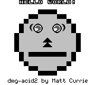
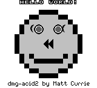
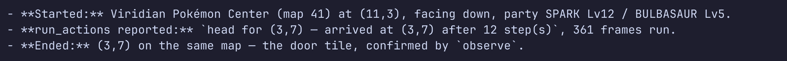
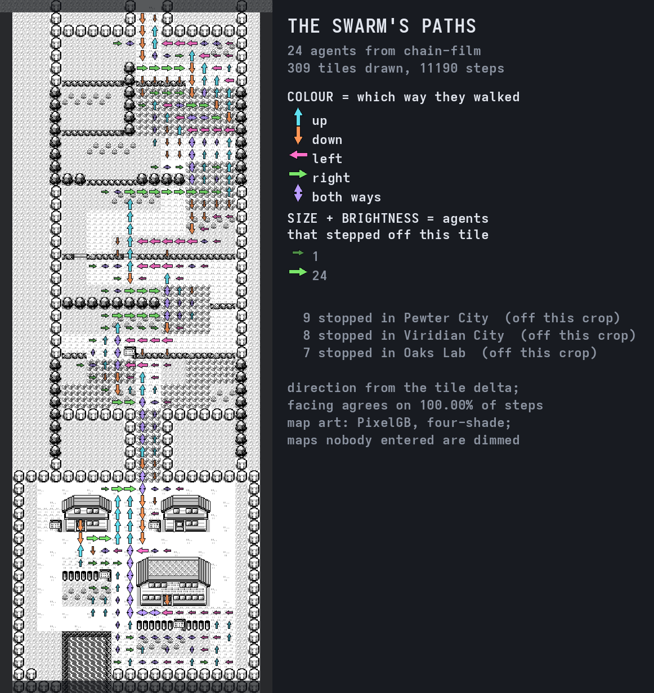

<p align="center">
  <a href="docs/brand/README.md"></a>
</p>

<p align="center">
  <a href="https://github.com/Alchemy86/TerminalGB/actions/workflows/ci.yml"></a>
  <a href="docs/conformance-action.md"></a>
  <a href="LICENSE"></a>
  <a href="rust-toolchain"></a>
</p>

**A cycle-accurate Game Boy and Game Boy Color emulator in Rust, with real pixels in your
terminal.** It plays games. It also takes Mooneye's `acceptance` suite <!--score:mooneye_acceptance_accurate-->75 / 75<!--/score-->
and scores **243 / 264** on the GB Emulator Shootout's own board, compiles down to one
third-party crate, runs on a PlayStation
Portable and on 32-bit RISC-V, and hands the running machine to plugins, to an MCP client, or to
your own program.

### → **[Install it](#install-it)** · **[what it scores](docs/accuracy.md)** · **[the two picture engines](#exactness-or-speed-decided-by-one-keypress)** · **[where it stands](docs/status.md)** · **[every page](docs/README.md)**

<p align="center">
  
</p>

<p align="center"><em>A real image in a real terminal — not text art. This is
<a href="https://github.com/mattcurrie/dmg-acid2">dmg-acid2</a>, the ROM the install command below
runs, and 0 of its 23,040 pixels differ from the author's reference.</em></p>

---

## Install it

```bash
git clone https://github.com/Alchemy86/TerminalGB && cd TerminalGB
cargo run --release --example terminal -- third_party/dmg-acid2/dmg-acid2.gb
```

**Rust 1.83+ and nothing else.** No system libraries, no `apt install`, no submodule, and no
cartridge to start with — the MIT-licensed dmg-acid2 test ROM ships with the repository and that
is what the command runs.

Prefer a binary?

```bash
cargo install terminalgb                    # then: terminalgb path/to/game.gb
cargo install terminalgb --features audio   # …with sound (Linux: needs libasound2-dev first)
```

Or nothing installed at all: [](https://codespaces.new/Alchemy86/TerminalGB?quickstart=1) builds the repository's own
[devcontainer](.devcontainer/devcontainer.json) in the browser and hands you a terminal — with the
[MCP server](docs/mcp.md) ready, so an AI client can drive it with no cartridge and no API key.
**[The whole quick start →](docs/quickstart.md)**

> **Sound is off by default and the emulator says so.** The `audio` feature pulls in `cpal`,
> which on Linux needs ALSA headers to build — so a fresh clone stays dependency-free and the
> Status panel reports `Audio off` rather than leaving you to suspect your sound card. The sound
> chip is fully emulated either way. [Prebuilt release
> binaries](https://github.com/Alchemy86/TerminalGB/releases) are built with audio on.

**Your ROMs stay yours.** TerminalGB ships no game content — no ROMs, no BIOS, no extracted
assets. Point it at your own dumps in `~/roms`, or pass a path. Saves are written beside the ROM
in the same `.sav` format every other emulator and cartridge dumper uses. Nothing is uploaded:
there is no telemetry unless you point the opt-in [local file](docs/telemetry.md) somewhere, and
the only network features — the [link cable over TCP](docs/bgb-link.md) and the [trade
portal](docs/portal.md) — stay off until you configure them.

---

## Why this one

**The accuracy is gated, not claimed.** Every score below comes out of a baseline file checked
into this repository, and every one of those baselines fails CI **in either direction** — a row
that starts *passing* is a change too, and has to be re-blessed deliberately. Nothing is judged
against a hash of our own output; every verdict belongs to the ROM's author.

**There are two complete picture engines and you switch between them with one key.** Very few
emulators have a per-dot renderer at all. Here it is a run-time mode, and the panel tells you what
the exact one costs.

**One core, and it goes nearly everywhere.** Terminal, desktop, browser, a PlayStation Portable,
32-bit RISC-V — the same emulation code, producing byte-identical frames on each.

**It is a platform, not just a player.** The running machine is reachable from a plugin, from any
MCP client, from C, and from your own Rust program at one third-party dependency.

---

## Exactness, or speed, decided by one keypress

`src/gpu/` holds two complete picture engines. Which one runs is a mode you pick — live with the
**`P`** key, or in the config, or from the environment. They are not a quality or appearance
choice: palette, upscaler and every other visual enhancement live above the PPU and are
byte-identical either way. The only axis is **exactness against speed**.

| | **`identical`** (default) | **`standard`** |
|---|---|---|
| **What it draws** | the real pipeline, dot by dot: BG fetcher, 8-pixel FIFO, sprite fetches, window restart, `SCX & 7` discard, and a mode 3 length that falls out of the machine | a whole scanline in one go at the mode 3 → 0 transition, with mode 3 fixed at 172 dots |
| **A mid-scanline register write** | lands exactly where hardware puts it | invisible — only the final value of `BGP`/`SCX`/`LCDC`/`WX` is read |
| **Cost** | **0.371 ms/frame · 45× real time** | **0.040 ms/frame · 422× real time** |
| **Mooneye `acceptance`** | **<!--score:mooneye_acceptance_accurate-->75 / 75<!--/score-->** | <!--score:mooneye_acceptance-->67 / 75<!--/score--> |
| **Mealybug Tearoom** | **<!--score:mealybug_accurate-->29 / 79<!--/score-->** | <!--score:mealybug-->3 / 79<!--/score--> |
| **Gambatte** (5,225 rows) | **<!--score:csp_gambatte_accurate-->3622 / 5225<!--/score-->** | <!--score:csp_gambatte-->3176 / 5225<!--/score--> |
| **dmg-acid2** | 0 / 23,040 pixels differ | 0 / 23,040 pixels differ |
| **Well-behaved games** | identical output, proved frame-for-frame | identical output |

Both costs are dmg-acid2 with the picture on, measured by `cargo test --release --test
ppuengines`, which times both engines on every run and **fails the build if the figure the emulator
prints to users stops matching what they actually cost**. So the exact engine is about nine times
the cheap one — and the PPU is a small part of a frame, so what a player pays is **0.37 ms of a
16.743 ms budget: 2.2 %**, still 45× real time.

```bash
GB_PPU=identical cargo run --release --example terminal -- game.gb   # per-dot, the default
GB_PPU=standard  cargo run --release --example terminal -- game.gb   # the cheap engine
```

…or press **`P`** in the game, or set `ppu = standard` in `config.toml`, or call
`Gpu::set_render_mode` if you are embedding.

`identical` became the default on 20 August 2026, when the last row it lost to the cheap engine
closed. That flip alone took the GB Emulator Shootout's own manifest from 223 to 238 — fifteen
gains, zero losses. Reach past it for `standard` on small hardware (the PSP frontend pins it), on a
headless collector where nobody is looking at the pixels the exact engine is being paid for, or
when you want speed mode, which `identical` refuses.

**The honest part.** `identical` is structurally right and part-way calibrated, and it is **not
strictly dominant**. Across every gated baseline it wins 1,059 rows and loses 459 — net **+600** —
and the losses are real rows in the same groups as the wins, four small Gambatte groups among them.
It does not lose a row anywhere the shootout looks, which is why it is the default, but "always
better" would be the wrong claim.

📖 **[The whole story → docs/picture-modes.md](docs/picture-modes.md)** · and a third mode, for
driving rather than judging: **[docs/modes.md](docs/modes.md)**

---

## Accuracy, and how you can check it

| Suite | `identical` | `standard` |
|---|---:|---:|
| **In-repo harness** — Blargg + dmg-acid2, both consoles | <!--score:harness-->46 / 47<!--/score--> | <!--score:harness-->46 / 47<!--/score--> |
| **Mooneye GB** `acceptance` | **<!--score:mooneye_acceptance_accurate-->75 / 75<!--/score-->** | <!--score:mooneye_acceptance-->67 / 75<!--/score--> |
| **Mooneye GB** `emulator-only` · `misc` (CGB) | <!--score:mooneye_emulator_only_accurate-->28 / 28<!--/score--> · <!--score:mooneye_cgb-->8 / 8<!--/score--> | <!--score:mooneye_emulator_only-->28 / 28<!--/score--> · <!--score:mooneye_cgb-->8 / 8<!--/score--> |
| **SameSuite** | <!--score:samesuite-->73 / 76<!--/score--> | <!--score:samesuite-->73 / 76<!--/score--> |
| **CasualPokePlayer** | <!--score:cpp-->4 / 4<!--/score--> | <!--score:cpp-->4 / 4<!--/score--> |
| **Gambatte** | **<!--score:csp_gambatte_accurate-->3622 / 5225<!--/score-->** | <!--score:csp_gambatte-->3176 / 5225<!--/score--> |
| **Mealybug Tearoom** | **<!--score:mealybug_accurate-->29 / 79<!--/score-->** | <!--score:mealybug-->3 / 79<!--/score--> |
| **GB Emulator Shootout**, its own manifest | **243 / 264** — 5th of 19 | 223 / 264 |

Thirteen more suites are gated beside these. The one red in the in-repo harness is `oam_bug` on a
Game Boy Color, and **it has to stay red**: that silicon has no OAM-corruption defect, so a real
Color console fails the ROM too.

<p align="center">
  
  
  
  
</p>

<p align="center"><em>Left: correct, 0 of 23,040 pixels wrong. The other three are the same ROM
with one PPU behaviour deliberately broken — Y-flip, X-flip, tile-data select — which is how a
test ROM turns a timing bug into something you can see. Distances of 868, 119 and 1,044 pixels.
<a href="docs/emulation/test-roms.md">The whole gallery</a>.</em></p>

📖 **[Every score, the consoles modelled, the known limitations, and how to score *your* emulator
→ docs/accuracy.md](docs/accuracy.md)**

---

## Speed

Pokémon Blue, a real in-game save state, one worker pinned to a P-core, thread CPU clock. The
DMG's own frame is 16.7427 ms, so 1× is 59.7275 frames a second.

| configuration | ms/frame | × real time | load |
|---|---:|---:|---:|
| **collector** — pixels off, APU installed, samples off | **0.0454** | **369×** | 1.3 |
| the same, with no APU at all | 0.0405 | 414× | 1.3 |
| **player** — picture on, APU silent | 0.1582 | 106× | 16 |
| the same on `identical` | 0.4962 | 34× | 16 |

Fanned out on a quiet box: 4 workers **1,066×**, 20 workers **3,735×**. **Four cores are already
past 1000×**, and the per-instance figure rises only 28 % from one worker to twenty — which is
what silicon-limited rather than contention-limited looks like.

Against the field, every side optimised and measured in one session on the same box:

| | ms/frame | × real time | cycle-accurate? |
|---|---:|---:|---|
| SameBoy (`-O3 -ffast-math` + LTO), rendering off | 0.3854 | 43× | yes |
| **TerminalGB**, pixels off | **0.0413** | **405×** | **yes** |
| PyBoy 2.7.0 (Cython), rendering and sound off | 0.0193 | 869× | no |

**9.5× faster than SameBoy and 2.1× behind PyBoy** — and the second half of that is the
interesting one: PyBoy gives up cycle accuracy always, and scores 0 on Mealybug's 24 published
rows where this emulator scores 26.

📖 **[The baseline, the method, and which 1000× is which →
docs/measured/throughput-baseline.md](docs/measured/throughput-baseline.md)** · [the engineering
record, including the negative results](docs/throughput.md)

---

## One core, everywhere

The same emulation code, producing byte-identical frames.

| target | state | evidence |
|---|---|---|
| **Terminal** (kitty / Sixel / iTerm2 / half-blocks) | ✅ | runs in *any* terminal — it degrades rather than refusing |
| **Desktop** (OpenGL) | ✅ | `cargo run --example desktop` |
| **Browser** (WebAssembly) | ✅ | video, input **and sound** through Web Audio — no `SharedArrayBuffer`, no COOP/COEP, so a plain static host works |
| **aarch64 · armv7 · i686** | ✅ | `make test-cross` builds **and runs** a cartridge on each, requiring a byte-identical frame and save-state length |
| **PlayStation Portable** | ✅ | `tools/psp-build.sh` — Pokémon Blue at the DMG's own 59.7275 fps with 40 % of the frame budget spare, same frame hash as the desktop build |
| **32-bit RISC-V** | ✅ | the `--no-default-features` core builds clean for `riscv32imafc-esp-espidf` with no changes, and under QEMU produces the same frame hash as x86-64 on **both** picture engines |
| **C / Go static library** | 🟡 | `make ffi-build` → `libterminalgb.a` + `terminalgb.h` |
| **macOS** | 🟡 | type-checks; nothing has been run on it |

<p align="center">
  
  
</p>

<p align="center"><em>The PSP port, running the same core. It pins <code>standard</code> — a
constrained console declares its own picture engine.</em></p>

Nothing has ever been run on a big-endian machine, and the save-state codec is explicitly
little-endian. That is a prediction, not a measurement, and it is the honest gap in this table.

📖 **[The measured cross-target report, and what is a fact versus a type check →
docs/portability.md](docs/portability.md)**

---

## Take the emulator, leave the frontends

```toml
[dependencies]
terminalgb = { git = "https://github.com/Alchemy86/TerminalGB", default-features = false }
```

That is the **whole** dependency tree at that feature set:

```console
$ cargo tree --no-default-features --edges normal
terminalgb v0.2.0
├── blip_buf v0.1.5
└── terminalgb-plugin-api v0.1.0 (crates/terminalgb-plugin-api)
```

One third-party crate — `blip_buf`, the APU's band-limited resampler — against 170 for the default
build. `terminalgb-plugin-api` is first-party, lives in this repository, has no dependencies of its
own, and exists so plugin crates depend on a contract instead of on the emulator. CI enforces the
whole paragraph.

The API is small enough to fit here:

```rust
use terminalgb::gameboy::Gameboy;
use terminalgb::{mode::Model, KeypadKey};

// You read the ROM. `None` for the path keeps cartridge RAM in memory and the
// emulator never touches the filesystem; `Some(p)` opts into `<rom>.sav`.
let mut gb = Gameboy::new_with_model(std::fs::read("game.gb")?, None, Model::Dmg);

loop {
    gb.frame();                     // one 59.7275 Hz frame
    let rgba: &[u8] = gb.image();   // 160 × 144 × 4, top-left first
    gb.keydown(KeypadKey::A);
    gb.keyup(KeypadKey::A);
}
```

Also there without any feature: `save_state()` / `load_state()`, `flush_battery()`,
`rom_title()`, the debug reads (`peek`, `peek_range`, `debug_pc`, `step_instruction`), the
[plugin API](docs/plugins.md), the [pixel-art upscaler](docs/upscaling.md), and
`enable_audio(Box<dyn AudioPlayer>)` — implement that one trait and the APU's samples are yours,
with no `cpal` anywhere in the build.

**Prove it rather than believing it.** `make embed` runs the example below with `HOME`, `DISPLAY`
and `WAYLAND_DISPLAY` unset:

```console
$ cargo run --release --no-default-features --example headless -- third_party/dmg-acid2/dmg-acid2.gb 240
rom            DMG-ACID2
checksum       0xa934
frames         240
frame hash     0x01acf78fe505f31c
state bytes    142102          # moves with savestate::FORMAT_VERSION
state re-run   identical after 60 more frames

                ########
            ####........####
          ##................##
        ##..-+++++....+++++-..##
        ##..--++++....++++--..##
      ##........................##
      ##..........-##-..........##
      ##..........-##-..........##
      ##........................##
        ##..##............##..##
        ##....############....##
          ##................##
            ####........####
                ########
```

That frame hash is the same one `make test-cross` requires on aarch64, armv7 and i686 — and the
same one the core produces on 32-bit RISC-V.

**Honestly:** the core needs `std`, reads exactly one environment variable (`GB_MODEL`, and only
when the console is `Model::Auto` — `new_with_model` bypasses it), and reads a wall clock in one
place: writing or reading an **MBC3 clock cartridge's** battery file, to cover the time the
console was switched off. With no save path nothing here reads a host clock at all.

📖 **[The embedding surface, the portability audit and the licensing position for redistributors →
docs/portability.md](docs/portability.md)**

---

## Write a plugin

A plugin is an **in-process Rust crate** that gets a controlled view of the running machine. Seven
ship in [`plugins/`](plugins/), and the emulator builds and runs with **all of them
deleted** — checked by `make no-plugins`, which greps the dependency graph rather than trusting
anyone's intentions.

| directory | you type | what it does | capabilities |
|---|---|---|---|
| **[`example-tracer/`](plugins/example-tracer/README.md)** | `example-tracer` | watches one address and reports what changed it — **the one to copy** | observe + read |
| [`trainer/`](plugins/trainer/README.md) | `trainer` | live Pokémon R/B party, badges, sprites, shiny-if-traded verdicts | observe + read |
| [`gen1-link/`](plugins/gen1-link/README.md) | `gen1-link` | a virtual link-cable partner: real trades and Colosseum battles | observe + read + link |
| [`battle-control/`](plugins/battle-control/README.md) | `gen1-battle` | start any Gen 1 battle from a preset | observe + read + write + input |
| [`agent/`](plugins/agent/README.md) | `agent` | an AI that plays the game, under a budget | observe + read + input |
| [`gen1-shinyhunt/`](plugins/gen1-shinyhunt/README.md) | `gen1-shinyhunt` | hunt a Gen 1 DV spread across many headless emulators | observe + read |
| [`gen1-lobby/`](plugins/gen1-lobby/) | `gen1-lobby` | a shared Cable Club room several emulators walk around in together | observe + read + write |

There is no plugin directory to drop a `.so` into and no script runtime — deliberately, because
neither works on `wasm32`, where there are no sockets and no `dlopen`. A plugin is a cargo
dependency, so installing a third party's is exactly what installing one of ours is:

```bash
cargo build --release --features plugin-example-tracer
GB_PLUGINS=example-tracer cargo run --release --example terminal -- game.gb
```

**The contract is enforced, not advised.** A plugin declares `OBSERVE`, `READ_MEMORY`,
`WRITE_MEMORY`, `CONTROL_INPUT` or `SERIAL_LINK`, and the **host** refuses the rest:
`Machine::peek` returns `None` and `Machine::poke` returns `false` for anything undeclared. The
trainer view's read-only guarantee is that refusal, not a borrow-checker accident. At most one
plugin may hold `SERIAL_LINK`; a cable has two ends.

**Nothing loads implicitly.** A plugin attaches only when you name it, and anything attached gets
its own row in the Status panel — `!` if it may write memory, `!!` if it has.

Plugin crates depend on [`crates/terminalgb-plugin-api`](crates/terminalgb-plugin-api/README.md),
which has **no dependencies and does not depend on the emulator**. That direction is what lets the
emulator depend on plugin crates — its frontend draws their panels — without a cycle, and it is why
a plugin does not have to live in this repository.

📖 **[Zero to a working plugin, for someone who has never seen this codebase →
docs/writing-a-plugin.md](docs/writing-a-plugin.md)** · [the full contract and trust
model](docs/plugins.md) · [the directory itself](plugins/README.md)

---

## Drive it from an MCP client

**Any [Model Context Protocol](https://modelcontextprotocol.io) client can play the game** — Claude
Desktop, Claude Code, or anything else that speaks MCP.

```bash
cargo build --release --no-default-features --features mcp
claude mcp add terminalgb -- "$PWD/target/release/terminalgb-mcp" --rom ~/roms/blue.gb
```

<p align="center">
  
</p>

Eleven tools, each answering a different question — `observe` (structured game state: mode,
on-screen text, map, coordinates, party, battle), `screenshot`, `read_memory`, `press_buttons`
(frame-accurate), `run_actions` (`walk` / `goto` / `advance_text` — one call covering hundreds of
frames), `step`, `load_rom`, `reset`, `save_state`, `load_state`, and `render_audio`.

* **A thin wrapper over the [agent plugin](plugins/agent/), not a new subsystem.** `observe` *is*
  the agent's `Gen1Observer`; `run_actions` *is* its `Executor`.
* **It cannot write memory** unless you pass `--allow-write-memory` — and then the tool is not
  merely refused, it is not *listed*, so a client is never shown a tool that will say no.
* **Adds no third-party crate**, so embedding the core does not drag in an MCP stack.

### …which makes it an environment to evaluate agents in

```bash
env -i ./target/release/terminalgb-mcp --rom /abs/path/game.gb   # 880 KiB, one dependency
```

* **Deterministic across architectures.** The same cartridge produces a byte-identical framebuffer
  and save state on x86-64, aarch64, armv7 and i686, enforced by `make test-cross`, which fails on
  one pixel. Reproducibility is the whole ballgame for evaluation, and one that survives a change
  of CPU is rare.
* **Save states are the reset primitive.** Exact, gated at every frame boundary. Start an episode
  anywhere you can reach.
* **The screen decodes to text — with a `trust` field that says when it cannot be believed**,
  rather than handing a model letter salad in the same field as good data.
* **Budgets, a circuit breaker and repetition detection** for a run nobody is watching.

**The one lesson worth learning first:** the emulator is not the bottleneck, the model is. The
lever is *frames per model call* — a whole intention (`advance_text`, `goto`) buys ~300 frames
where a button press buys 30.

Nobody has trained a model on this. The training project is
**[AgentGB](https://github.com/Alchemy86/AgentGB)**, which drives this emulator as its
environment.

📖 **[Install steps for both clients, every flag and the honest limitations →
docs/mcp.md](docs/mcp.md)** · [every hook, field and payload](docs/agent-reference.md) · [as an AI
environment](docs/agent-environment.md)

---

## Be the Game Boy on the other end of the cable

Walk into any Cable Club in Pokémon Red or Blue and trade with a partner that does not exist.

<p align="center">
  
</p>

**It is not a memory poke** — the plugin does not hold the capability to write RAM. The Pokémon
arrives because the game asked for it on the wire, ran its real link protocol, and inserted it
itself.

**The proof is a number we never sent.** The partner puts a level 5 Mew on the wire with **125
experience** — the exact total for level 5 on Mew's growth curve. Read the Pokémon out of the party
afterwards and it has **135**. Generation 1 gives a *traded* Pokémon boosted experience, and the
game applied it on the receiving side, of its own accord, because it believed it had traded with a
person. A memory poke would have left 125 sitting there.

Ask for what you want in a small `key = value` file, then arm it:

```bash
GB_PLUGINS=gen1-link GB_GEN1_TRADE=~/mewtwo.trade \
  cargo run --release --example terminal -- ~/roms/blue.gb
```

**Or plug in a second console.** Start another copy of the emulator and the cable is already
connected — no flag, no arming. Two instances on one machine find each other and link, the way
plugging a real cable in does, which is what lets the Cable Club attendant *see* a partner at all.
That cable knows nothing about Pokémon; it relays bytes, so **both ends are the genuine article** —
a Gen 1 trade between two real games (measured: 1,552 transfers, zero lost, both saves valid
afterwards), a link battle, or the Gen 1 ↔ Gen 2 **[Time
Capsule](docs/gen2/time-capsule.md)** — for which the relaying cable needed nothing added at all.

`link_net` puts the link port on a **TCP socket** instead, speaking [BGB's
protocol](docs/bgb-link.md) — so the far end can be BGB, another copy of TerminalGB anywhere on
the internet, or a bridge with a **real Game Boy** behind it.

📖 **[Two consoles, one wire → docs/link-cable.md](docs/link-cable.md)** · [the full trade
journey, with screenshots →](docs/link-trade.md) · [the Colosseum, and the crash that used to eat
save files →](docs/link-battle.md)

---

## Stage a battle, hunt a spread, watch a swarm

**Pokémon Red and Blue decide to start a battle by reading one byte.** Write it and the engine does
the rest — the transition, the sprite, the music, the AI, the animations, the experience. Nothing
here simulates a battle; it asks for one. So a battle becomes something you can *stage*: a named
preset, one keypress, with the teams you chose on both sides, and a script that plays it out.

```bash
cargo run --release --example gen1_battle -- --preset charizard-flamethrower --video - \
  | ffmpeg -f rawvideo -pix_fmt rgba -s 160x144 -framerate 59.7275 -i - out.mp4
```

**A cinematic rendered by the actual game**, and reproducible: the same script from the same
starting state produces byte-identical frames, proved by running it three times and comparing a
hash of *every* frame. Your save is not at risk — the plugin writes only WRAM and HRAM, never
cartridge RAM, and puts back every byte it changed.

**Shiny-hunt in parallel, without ever looking at a sprite.** The instant the game rolls an
encounter the DVs are read straight out of `wEnemyMonDVs`. Gen 1 has no shiny Pokémon; what this
hunts is the spread that *becomes* shiny once traded to Gen 2 — eight spreads in 65,536, 1 in
8,192. Measured on a 20-core box: **8–18 encounters per second on 12 instances, 176–367× real
time.**

The interesting part is what that found. Instances that all did the same thing would be one
instance wearing four hats, so they are decorrelated by varying input *timing*. **Divergence turned
out not to be enough**: `Random_` builds both DV bytes from a single `rDIV` sample, so the pair is
not two free bytes, and reloading the same save state before every roll lands every result on one
thin band — **968 of the 65,536 spreads**. A 97,212-encounter hunt found nothing while reporting a
healthy rate and a 1.7-minute ETA the whole time. An attempt is a *run* of encounters now, and
`--probe` measures coverage instead of assuming it.

**And the swarm view** — twenty-four emulators from one save state, each a dot at its own place in
the world, the camera pulling back. **864,000 emulated frames in 23.8 s — 608× real time — for a
50-second video.** The picture immediately said something a table would have buried: Route 1's
ledges are a one-way valve. After ten emulated minutes more than half the swarm has drained south
into Pallet Town, the northern half of Route 1 is empty in every frame, and not one agent ever
reaches Viridian City. These are a decorrelated random walk, not learning agents — that is the null
model the picture exists to make visible.

<p align="center">
  
</p>

<p align="center"><em>Every tile the swarm walked, one arrow each — hue by direction, brightness
by how many agents went that way. <a href="docs/agent/path-arrows.md">How it is drawn.</a></em></p>

📖 **[Starting battles on demand](docs/gen1/battle-control.md)** · [the shiny
hunt](docs/shiny-hunt.md) · [the swarm view](docs/swarm-view.md) · [the Gen 1
index](docs/gen1/README.md)

---

## The rest of the surface

<table>
<tr><td width="50%" valign="top">

**🔴 [Live trainer view](docs/trainer.md)** — press **`T`** in Pokémon Red or Blue for your party,
badges and the opponent's hidden stats, with the sprite decompressed out of your own cartridge.
Strictly read-only, enforced by the host. A banner tells you whether a wild Pokémon **would be
shiny if traded to Gen 2** before you spend a Ball.

**💿 [Music mode](docs/music-mode.md)** — `terminal music`. Every cartridge in `rom_dir` becomes an
album, with cover art taken from the game's own title screen and its music playing while you
browse. `w` saves what you are hearing as a WAV. It says which track it got, because a cartridge
has no "play track 5" interface and booting it gets you the title theme.

**🎼 [Chiptune renderer](docs/chiptune.md)** — sound-chip instructions in, real Game Boy audio out.
Not a synthesiser imitating a Game Boy: it is this repository's emulated APU, scoring <!--score:samesuite_apu-->66 / 69<!--/score-->
on SameSuite's APU group and 12/12 on Blargg's `dmg_sound`. Takes register writes, a small score,
or a `.vgm`.

</td><td width="50%" valign="top">

**🎥 [Video out & virtual webcam](docs/video-out.md)** — one line of config, press `v`, and pick
the Game Boy as your camera in Chrome, Meet, Discord or OBS. The emulator negotiates the V4L2
device itself; no `ffmpeg`, no FIFO. A paused feed sends a drawn idle card rather than freezing on
the last frame, because a dead feed that looks live is the thing worth fixing.

**🤖 [Claude plays Pokémon](docs/claude-plays.md)** — an agent watches the emulator, plays it, and
says what it is thinking, built to be streamed. It returns a goal, a line of commentary and up to
twelve actions; cheap local code carries them out over hundreds of frames. **The emulator never
waits** — a driver is polled, never awaited, and with a driver that never answers at all emulation
costs 0.24 ms/frame against a 16.74 ms budget.

**🖼️ [The picture path](docs/picture.md)** — four published terminal graphics protocols, chosen by
asking the terminal rather than guessing from `$TERM`. **81 bytes per frame** over kitty shared
memory; an unchanged picture costs nothing at all.

</td></tr>
</table>

---

## Playing it

### Terminal

```bash
terminalgb path/to/game.gb        # the installed binary
cargo run --release --example terminal -- path/to/game.gb    # from a clone
```

Launch with no ROM and it opens a picker. Press **`?`** in game for the full, always-current key
list — the highlights are save-state slots (**`1`**–**`3`**, **`F5`** / **`F8`**), a speed ladder
(**`+`** / **`-`**), a stats overlay (**`t`**), palette (**`[`**) and upscaler (**`]`** / **`}`**)
cycling, the [picture mode](#exactness-or-speed-decided-by-one-keypress) (**`P`**), screenshots
(**`c`** what you see, **`C`** the raw frame), video (**`v`**) and recording (**`V`**), and volume
(**`,`** **`.`** **`m`**).

<p align="center">
  
</p>

<p align="center"><em>The overlay is drawn in its own rectangle, never over the picture — a
terminal image owns whole cells, so text there <em>replaces</em> the image rather than covering it.
It and the <code>Controls</code> panel are short versions of <a href="docs/controls.md">the written
controls page</a>, and a test fails the build if the three disagree.</em></p>

**It runs in any terminal and gets better in a capable one.** Both the picture and the keyboard
degrade rather than refuse, and the Status panel says which you got. The ladder is **kitty → Sixel
→ iTerm2 → half-blocks**, and the terminal is *asked* (`a=q` for kitty, `DA1` for Sixel), never
inferred from `$TERM`.

| terminal | picture | keyboard |
|---|---|---|
| **kitty** · **Ghostty** · **foot** | kitty graphics, shared memory — ~81 bytes/frame | press **and** release |
| **WezTerm** | kitty graphics, shared memory | press and release, with `enable_kitty_keyboard = true` |
| **iTerm2** | inline images, palette-indexed PNG (~1.4 KB/frame) | presses only |
| **xterm** (`-ti vt340`), **mlterm**, **Contour** | Sixel — real pixels, whole picture every frame | presses only |
| **GNOME Terminal / Ptyxis (VTE)**, **Konsole** | half-blocks — text, two pixels per cell | presses only |

In basic keyboard mode the emulation is identical; the difference is that a plain terminal only
ever says a key was *pressed*, so holding a direction depends on your OS auto-repeat. The frontend
refuses to start in exactly one case: neither stdout nor stdin is a terminal, so there is nothing
to draw on *and* no keys to read.

### Desktop

```bash
cargo run --release --example desktop -- path/to/game.gb
```

**Z** Select · **X** Start · **A** A · **B** B · **arrows** D-pad · **U**/**I** cycle the
upscaler. The window is resizable and scales crisply — nearest-neighbour, integer-letterboxed 10:9.
`--model`, `--scale`, `--speed` and `--run-unfocused` are there for when the window has to be a
known thing rather than a comfortable one.

<details>
<summary>Two Linux startup messages that are <strong>not</strong> emulator bugs</summary>

Neither has a fix on our side, and neither affects emulation, audio or input.

| Message | Where it comes from |
|---|---|
| `xkbcommon: ERROR: … dead_hamza …` and similar keysym errors | The **system X11 compose/keymap files** (`/usr/share/X11/locale/…`), parsed by `libxkbcommon` when the window is created. A complaint about the distribution's compose table. |
| `queue … destroyed while proxies still attached` (Wayland) | **`winit`/`glutin`** tearing down their Wayland event queue at exit — upstream cleanup ordering, inside the windowing crates. |

Both are emitted before or after anything we control.
</details>

### Browser

```bash
cd web && npm install && npm run serve
```

Video, input **and sound** — the APU is emulated on `wasm32` like every other target and plays
through the Web Audio API, with no `SharedArrayBuffer` and no cross-origin-isolation headers, so a
plain static host works. Measured in Chrome over five minutes: **0 underruns, 0 dropped samples,
59.6 emulated fps, 85–96 ms end-to-end latency**, and the pitch the ROM asked for to a tenth of a
hertz.

### Configuration

<details>
<summary><strong>The terminal config file</strong> — <code>~/.config/terminalgb/config.toml</code></summary>

A small `key = value` file. A missing one means defaults; an unknown key or an unusable value is
reported at startup and shown in the picker footer and the `?` overlay rather than ignored. Values
may be bare, `"double-quoted"` or `'single-quoted'`.

| Key | Values | Meaning |
|---|---|---|
| `rom_dir` | a path (`~` expands) | Directory the ROM picker browses. Default `~/roms`. |
| `protocol` | `auto` / `kitty` / `sixel` / `iterm2` / `halfblocks` | Force a graphics protocol. `auto` (default) asks the terminal. Pinning a value *disables* detection. |
| `palette` | `grayscale` / `green` / `amber` | Recolour DMG games. Default `grayscale`. |
| `upscale` · `upscale_factor` | `nearest` / `scale2x` / `mmpx` / `lcd` · an integer | [Pixel-art upscaler](docs/upscaling.md) run each frame. |
| `cell_scale` | `auto` / a number ≥ 1.0 | HiDPI device-pixel-per-cell correction. Default `1.0`. |
| `ppu` | `standard` / `identical` | Which [picture mode](docs/picture-modes.md). Default `identical`. `$GB_PPU` overrides for one run. |
| `volume` | `0`–`100`, or `off` | Playback volume. Default `50`. Applied to the samples handed to the sound card, never to the Game Boy's own `NR50`. |
| `shiny_alert` | `on` / `quiet` / `off` | How loudly a wild Pokémon's shiny-if-traded verdict is announced. |
| `key_a` / `key_b` / `key_start` / `key_select` | a single character | Rebind the buttons (movement is always the arrows). |
| `screenshot_dir` · `video_dir` · `music_dir` | paths (`~` expands) | Where `c`, `V` and music mode's `w` write. |
| `video_out` | `-` / a file / a FIFO / `/dev/videoN` / a directory / `off` | Where `v` sends the stream. Default `off`. Nothing is opened until you press `v`. |
| `video_autostart` | `true` / `false` | Go live at launch. Default `false` — naming a destination is not the same decision as sending frames to it. |
| `video_format` · `video_size` · `video_source` · `video_pace` | see [video-out.md](docs/video-out.md) | Wire format, letterbox size, native-or-displayed picture, and pacing. |
| `plugins` | comma-separated names | Attach [plugins](docs/plugins.md). **Empty by default — nothing loads implicitly.** |
| `gen1_trade` · `battles` | paths | Trade file for `gen1-link`; battle presets for `gen1-battle`. |
| `link` | `auto` (default) / `off` / a second ROM path | The [link cable](docs/link-cable.md). `auto` is live by default. |
| `link_net` | `[listen:\|connect:]host:port` | Put the link port on a TCP socket, speaking [BGB's protocol](docs/bgb-link.md). |
| `portal` | a URL, or `off` | The [trade portal](docs/portal.md): asynchronous friend trades over HTTPS. |
| `agent_command` · `agent_objective` · `agent_max_calls` · `agent_max_usd` | see [claude-plays.md](docs/claude-plays.md) | The agent driver, its objective, and its hard caps. |
| `telemetry` | a path | Opt-in local [NDJSON run data](docs/telemetry.md). Off unless set. |

**Upgrading from before the rename.** The project used to be called `gameboy`. Nothing was moved
and nothing needs moving: the old `~/.config/gameboy/` and `~/.local/state/gameboy/` are still read
and written where they are, because the emulator prefers the new name and falls back to the old one
whenever the old one is what exists on disk.
</details>

---

## Build modes

Everything is a cargo feature, and the honest summary is that **the default build is the one you
want to play on** — every other mode exists to take something away.

| I want… | Command |
|---|---|
| **to play a game** | `cargo build --release` |
| **sound** | `cargo build --release --features audio` |
| **the terminal only** | `cargo build --release --no-default-features --features tui` |
| **the emulator with no plugins** | `cargo build --release --no-default-features --features tui,desktop` |
| **the core, for embedding** | `cargo build --release --no-default-features` |
| **any MCP client to drive it** | `cargo build --release --no-default-features --features mcp` |
| **the browser build** | `cargo build --release --target wasm32-unknown-unknown` |
| **a C / Go static library** | `make ffi-build` |

Two run-time switches are worth knowing. Neither is a compile flag; both are read once at start-up,
and a typo warns on stderr and is **ignored** rather than silently changing machine.

```bash
GB_PPU=identical   # the per-dot picture mode (or `standard`)
GB_MODEL=dmg       # force a console: auto|dmg|dmg0|mgb|cgb|cgb0|agb|sgb|sgb2
```

<details>
<summary>Every feature, what it pulls in, and what it needs at run time</summary>

| feature | in `default` | pulls in | needs at run time |
|---|:---:|---|---|
| *(none)* | | `blip_buf` | nothing |
| `desktop` | ✅ | `glutin`, `gl`, `libc`, `image` | a display server (X11 / Wayland / Windows / macOS) |
| `tui` | ✅ | `ratatui`, `ratatui-image`, `icy_sixel`, `image`, `libc` | a terminal — any terminal; it degrades rather than refusing |
| `audio` | | `cpal` | a sound device (ALSA **dev headers** to *build* on Linux) |
| `mcp` | | `plugin-agent`, `chiptune` — **no third-party crate** | an [MCP](https://modelcontextprotocol.io) client. Builds `terminalgb-mcp`. |
| `chiptune` | ✅ | `terminalgb-chiptune` — first-party, **no dependencies at all** | nothing. Builds `terminalgb-chiptune`. |
| `standard-plugins` | ✅ | the plugin crates below | nothing; each still has to be named to attach |
| `plugin-trainer` | ✅ | `terminalgb-plugin-trainer` | a Pokémon R/B cartridge, or it declines |
| `plugin-gen1-link` | ✅ | + `terminalgb-plugin-gen1-link` | as above |
| `plugin-battle-control` | ✅ | + `terminalgb-plugin-battle-control` | as above |
| `plugin-agent` | ✅ | + `terminalgb-plugin-agent` | an `agent_command` driver, or it declines |
| `plugin-gen1-shinyhunt` | ✅ | + `terminalgb-plugin-gen1-shinyhunt` | a Pokémon R/B cartridge, or it declines |
| `plugin-gen1-lobby` | ✅ | + `terminalgb-plugin-gen1-lobby` | a Pokémon R/B cartridge, or it declines |
| `plugin-example-tracer` | | `terminalgb-plugin-example-tracer` | nothing — **the one to copy** |
| `testing` | | — | `terminalgb::testing::TestMachine`, for plugin authors' tests |
| `ffi` | | — | drops the Rust frontends; exposes the C ABI |

`plugin-*` features are additive and imply the plugins they build on
(`plugin-battle-control` needs `plugin-gen1-link`, which needs `plugin-trainer`).
[`Cargo.toml`](Cargo.toml) is the authority.
</details>

---

## What's inside

The core is a library that any frontend drives through a tiny surface: `Gameboy::new(rom) →
frame() → image()`, plus `keydown`/`keyup`. Each piece of the console is a component with its own
deep-dive page — the hardware, its history across DMG/MGB/SGB/CGB, how our implementation works
with honest notes on where it is not cycle-perfect, and a numbered list of expected behaviours
phrased as future tests.

| Component | Source | Deep dive |
|---|---|---|
| **CPU** — Sharp LR35902 (SM83). *It is not a Z80.* | [`src/cpu/`](src/cpu) | [docs](docs/components/cpu.md) |
| **PPU** — two picture modes, switchable live | [`src/gpu/`](src/gpu) | [docs](docs/components/ppu.md) · [picture modes](docs/picture-modes.md) |
| **MMU** — the 64 KB bus, OAM DMA, CGB HDMA/GDMA, interrupt wiring | [`src/mmu/`](src/mmu) | [docs](docs/components/mmu.md) |
| **Cartridges** — MBC0/1/2/3/5, the MBC3 clock, battery saves | [`src/mbc/`](src/mbc) | [docs](docs/components/mbc.md) |
| **APU** — 2 square + wave + noise, the 512 Hz frame sequencer | [`src/sound.rs`](src/sound.rs) | [registers](docs/components/apu.md) · [pipeline](docs/audio.md) |
| **Timer** — `DIV`/`TIMA`/`TMA`/`TAC` | [`src/mmu/timer.rs`](src/mmu/timer.rs) | [docs](docs/components/timer.md) |
| **Serial** — the link cable, and how Blargg reports results | [`src/mmu/serial.rs`](src/mmu/serial.rs) | [docs](docs/components/serial.md) |
| **Super Game Boy** — the ICD2 packet receiver and `MLT_REQ` | [`src/sgb.rs`](src/sgb.rs) | [docs](docs/components/sgb.md) |
| **Joypad** — the 2×4 matrix at `0xFF00` | [`src/input.rs`](src/input.rs) | [docs](docs/components/input.md) |
| **Frontends** — desktop, terminal, web, FFI | [`src/screen/`](src/screen) | [docs](docs/components/frontends.md) |

Every one of those pages follows the same shape, and [`docs/components/`](docs/components/README.md)
is the index.

```
frontend ──▶ Gameboy ──▶ CPU ──▶ MMU ──┬─▶ PPU   ─▶ framebuffer ─▶ frontend
   │                       │           ├─▶ MBC   (cartridge)
 keys                   interrupts     ├─▶ APU
                        (IF / IE)      ├─▶ Timer / Serial
                                       └─▶ Joypad
```

The **MMU is the hub**: the CPU only reads and writes addresses, and the MMU routes each to a
component. Components raise interrupts by setting a bit the MMU folds into `IF`; the CPU dispatches
them, VBlank → STAT → Timer → Serial → Joypad.

<p align="center">
  
</p>

<p align="center"><em>The address space to scale. The five regions the CPU talks to most — OAM,
I/O, HRAM and <code>IE</code> — are the sliver at the far right; the second bar magnifies it.</em></p>

---

## Documentation

**[The complete index is `docs/README.md`](docs/README.md)** — 139 pages, grouped, one line each.
The four worth knowing about before you have decided to read anything:

| | |
|---|---|
| **[what an emulator actually is](docs/emulation/README.md)** | the concepts, for a reader who is not a hardware engineer: the machine chip by chip, where imitating it has to stop being convenient and start being exact, and how a test ROM proves it |
| **[accuracy — what it scores](docs/accuracy.md)** | every suite with the gate behind it, the nine consoles, the known limitations, and how to score your own emulator |
| **[the measured Game Boy](docs/measured/README.md)** | "Pan Docs says X — here is what we measured, the test that catches it, and what a wrong emulator does" |
| **[pitfalls & gotchas](docs/pitfalls/README.md)** | for the person at 1am staring at a symptom: the traps, each with the *wrong conclusion it invites*, the fix, and what else moves when you change it |

New to the codebase? The **[code map](docs/codemap.md)** traces a frame through the system, follows
a memory access CPU → MMU → device, and shows where the frontends attach, with every reference a
clickable link into the source.

### Sibling projects

| | |
|---|---|
| **[AtlasGB](https://github.com/Alchemy86/AtlasGB)** | memory maps that carry the evidence for every claim. This emulator produces that evidence — proving an address needs a machine that runs the cartridge and watches what it does |
| **[AgentGB](https://github.com/Alchemy86/AgentGB)** | teaching a small network to play Pokémon Blue from the screen alone. It drives this emulator as its environment |
| **[GBSelfTest](https://github.com/Alchemy86/GBSelfTest)** | a cartridge that tests the machine it runs on and prints a code you can look up. [Our score, both engines →](docs/gbselftest.md) |

[What lives where, and why](docs/where-things-live.md).

---

## Contributing

```bash
cargo build --release          # native; no ALSA needed
cargo test  --release --lib    # 911 library unit tests
make lint                      # rustfmt --check + clippy -D warnings
make docs-check                # every doc link and every score in prose
```

Everything in [the gates table](docs/accuracy.md#the-gates) runs in CI on every push. The suite
baselines are red on any change **in either direction** — a row that starts passing is a change
too, and has to be re-blessed deliberately. That is the difference between a gate and a scoreboard.

**Third-party licence hygiene**, in one line: formats and hardware facts are learned from any
source and reimplemented; incompatible code and game assets never enter this tree. See
[CONTRIBUTING.md](CONTRIBUTING.md).

---

## Credits & lineage

This repository is a fork of **[raphamorim/gameboy](https://github.com/raphamorim/gameboy)** by
Raphael Amorim, itself closely modelled on **[mvdnes/rboy](https://github.com/mvdnes/rboy)**. It is
[MPL-2.0](LICENSE), the same licence as upstream, under which the original authorship stays
credited.

> **[mvdnes/rboy](https://github.com/mvdnes/rboy)** (core emulation model)
> → **[raphamorim/gameboy](https://github.com/raphamorim/gameboy)** (Rust, WebAssembly, FFI and
> terminal frontends)
> → **this fork** (accuracy work across the timer, interrupt dispatch, OAM DMA, the APU and the
> OAM-corruption bug; a second per-dot PPU engine; save states; battery saves; the upscaler; the
> audio pipeline; telemetry; the terminal render path and frame transport; video out; the plugin
> system; the test-ROM harness and the external-suite gates — see the [CHANGELOG](CHANGELOG.md)).

The upstream author's credit is a standing requirement, not decoration: Raphael Amorim stays in
[`Cargo.toml`](Cargo.toml)'s `authors` and here.

**References.** Hardware behaviour is grounded in [Pan Docs](https://gbdev.io/pandocs/) — public
domain under CC0, and **cited rather than reproduced**; where our measurements go beyond it they
live in [the measured Game Boy](docs/measured/README.md). The accuracy suites are Blargg's,
Gekkio's [Mooneye GB](https://github.com/Gekkio/mooneye-gb), LIJI32's
[SameSuite](https://github.com/LIJI32/SameSuite), and Matt Currie's
[dmg-acid2](https://github.com/mattcurrie/dmg-acid2) and [Mealybug Tearoom
Tests](https://github.com/mattcurrie/mealybug-tearoom-tests) — **none of them vendored here**
except the MIT-licensed dmg-acid2 ROM, the rest fetched at run time from their authors' own
upstreams at pinned commits. Gen 1 game internals come from the
[`pret/pokered`](https://github.com/pret/pokered) disassembly, cited by symbol name at every
address.

## Licence

MPL-2.0. See [`LICENSE`](LICENSE). Not affiliated with or endorsed by Nintendo.
