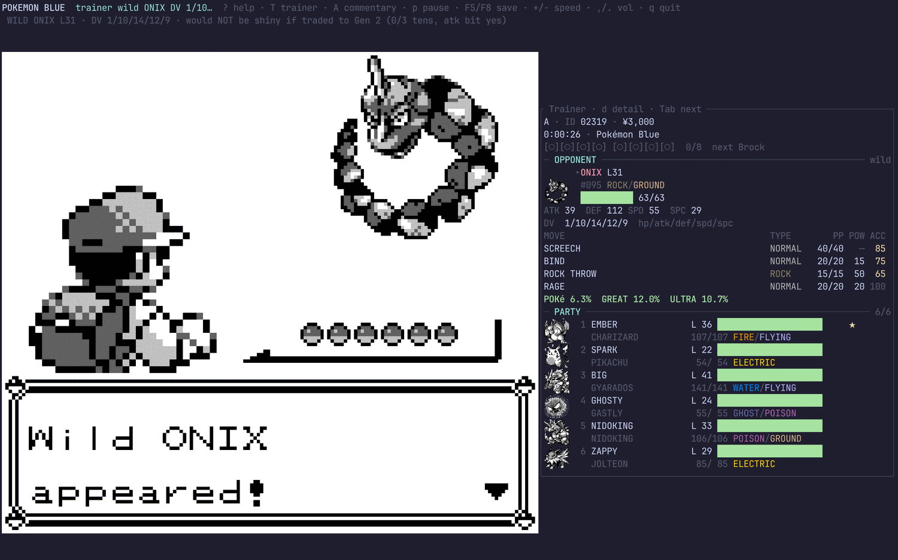
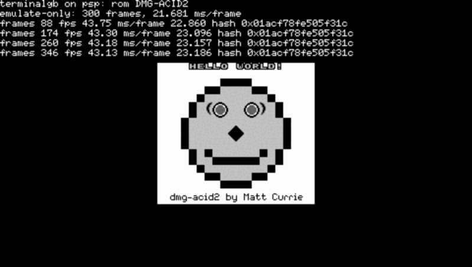
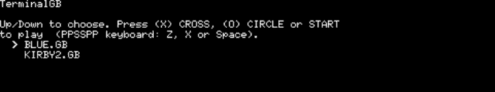

<p align="center">
  <a href="docs/brand/README.md"></a>
</p>

<p align="center">
  <a href="https://github.com/Alchemy86/TerminalGB/actions/workflows/ci.yml"></a>
  <a href="docs/conformance-action.md"></a>
  <a href="LICENSE"></a>
  <a href="rust-toolchain"></a>
</p>

**A cycle-accurate Game Boy and Game Boy Color emulator in Rust that draws real pixels in your
terminal.** It plays games. It also takes Mooneye's `acceptance` suite <!--score:mooneye_acceptance_accurate-->75 / 75<!--/score-->, scores **243 / 264** on the
[GB Emulator Shootout](docs/shootout.md)'s own board, compiles down to **one third-party crate**,
and hands the running machine to [plugins](docs/plugins.md), any [MCP client](docs/mcp.md), or
[your own program](docs/portability.md#7a-embedding-the-core).

<p align="center">
  
</p>

<p align="center"><em>A Pokémon battle in a terminal, with the read-only
<a href="docs/trainer.md">live trainer view</a> beside it reading the running cartridge: the
opponent's hidden DVs and catch odds, and a star on the party member that would be shiny if
traded to Gen 2.</em></p>

### → **[Run it](#run-it)** · **[picture mode](#picture-mode-and-pacing--set-these-on-purpose)** ·
**[features](#features)** · **[what it scores](docs/accuracy.md)** ·
**[where it stands](docs/status.md)** · **[every page](docs/README.md)**

---

## Run it

```bash
git clone https://github.com/Alchemy86/TerminalGB && cd TerminalGB
cargo run --release --example terminal -- third_party/dmg-acid2/dmg-acid2.gb
```

**Rust 1.83+ and nothing else** — no system libraries, no submodule, and no cartridge to start
with: the MIT-licensed dmg-acid2 test ROM ships with the repository.

```bash
cargo install terminalgb                    # then: terminalgb path/to/game.gb
cargo install terminalgb --features audio   # …with sound (Linux: needs libasound2-dev first)
cargo install terminalgb --features gen1    # …with everything Pokémon (the panel pictured above)
```

**A plain build is a Game Boy emulator and nothing else.** The Generation 1 work — the trainer
panel in that screenshot, the virtual trade partner, the battle simulator, the agent runners — is
a large, entirely optional layer on top, and it is one flag: `--features gen1`. See
[Generation 1](#generation-1--one-flag-away) below.

Or install nothing at all: [](https://codespaces.new/Alchemy86/TerminalGB?quickstart=1)
builds the [devcontainer](.devcontainer/devcontainer.json) in your browser, with the
[MCP server](docs/mcp.md) ready so an AI client can drive it with no cartridge and no API key.

**Your ROMs stay yours** — no game content ships here, nothing is uploaded, and saves are written
beside the ROM in the ordinary `.sav` format. Sound is off by default so a fresh clone needs no
ALSA headers, and the Status panel says so rather than leaving you suspecting your sound card.

📖 **[The whole quick start](docs/quickstart.md)** · [every key](docs/controls.md) ·
[the config file](docs/configuration.md) · [build modes and cargo features](docs/build-modes.md)

---

## Picture mode and pacing — set these on purpose

Two things about *this run* are chosen at start-up, not baked into the build, and worth
choosing deliberately: get either wrong and you can time, score, or simply watch a different
machine than you think you are.

**Picture mode: `identical` (the default) or `standard`.** `src/gpu/` carries two complete
renderers, not a quality setting. `identical` draws the real hardware pixel pipeline dot by
dot, so a register written mid-scanline lands exactly where a Game Boy puts it — every
accuracy score on this page is measured under it. `standard` draws one shot per scanline at
the mode-3→0 transition and misses anything written mid-line, for a fraction of the cost:

| | `identical` (**default**) | `standard` |
|---|---|---|
| a register written mid-scanline | lands exactly where hardware puts it | invisible — only the final value is read |
| cost, one P-core, Pokémon Blue, playing | 0.373 ms/frame — 45× real time | 0.094 ms/frame — 178× real time |
| cost, headless, no picture wanted | 0.382 ms/frame — 44× | 0.057 ms/frame — 295×, 6.7× cheaper |

```bash
GB_PPU=identical cargo run --release --example terminal -- game.gb   # the default; hardware-exact
GB_PPU=standard  cargo run --release --example terminal -- game.gb   # cheaper; mid-line writes lost
```

Same choice as `ppu = standard` in `config.toml`, `Gpu::set_render_mode` when embedding, or
press **`P`** to flip it live in the terminal frontend — the Status panel's `PPU` row says
which one is actually running. A misspelling of either warns on stderr and falls back to the
default rather than failing silently. Full comparison, and when `standard` is worth reaching
for: **[docs/picture-modes.md](docs/picture-modes.md)**.

**Pacing.** Playing in the terminal or desktop frontend, both default to the real Game Boy's
59.7275 Hz: the terminal's **`+`/`-`** step a ladder (`0.5x` → `1x` → `2x` → `4x` → `MAX`); the
desktop frontend takes **`--speed <N>`** (default `1` = real time, e.g. `--speed 15`).
**Driving it from a program** through the [MCP server](docs/mcp.md) defaults the *other* way:
`--speed uncapped` (as fast as the host manages) unless you ask for `--speed realtime`
(59.7275 Hz, for a human watching over `--video-out`) or a fixed `--speed 2x`.

**Which binary you get.** `cargo build --release` builds the terminal frontend (the
`terminalgb` binary) with default features on. The desktop window and the MCP server are
separate targets: `cargo run --release --example desktop -- game.gb`, and `cargo build
--release --features mcp` for `terminalgb-mcp`. Every feature, what it pulls in, and what it
needs at run time: **[docs/build-modes.md](docs/build-modes.md)**.

---

## Features

- **[Terminal, desktop and browser](docs/quickstart.md)** frontends, over one core.
- **[A real picture in any terminal](docs/picture.md)** — kitty, sixel, iTerm2 or half-blocks,
  picked by asking the terminal what it can do rather than guessing from `$TERM`. It degrades
  instead of refusing.
- **[Four upscalers](docs/upscaling.md)**, three palettes, a speed ladder and a stats overlay, all
  live on a [keypress](docs/controls.md).
- **[Three save-state slots](docs/savestates.md)**, plus battery saves written beside the ROM in
  the ordinary `.sav` format.
- **[Two complete picture engines](docs/picture-modes.md)** — a per-dot renderer that draws the
  real pipeline, and a fast whole-scanline one. A run-time mode on the `P` key, not a build.
- **[Cycle-accurate, scored against everybody else's suites](docs/accuracy.md)** — it takes
  Mooneye's `acceptance` suite <!--score:mooneye_acceptance_accurate-->75 / 75<!--/score-->, scores Mealybug <!--score:mealybug_accurate-->29 / 79<!--/score-->,
  and reaches **243 / 264** on the [GB Emulator Shootout](docs/shootout.md)'s own board.
- **[Runs almost anywhere](docs/portability.md)** — WebAssembly, aarch64, armv7, i686, 32-bit
  RISC-V, and a PlayStation Portable at the DMG's own 59.7275 fps.
- **[An embeddable core](docs/portability.md#7a-embedding-the-core)** — `default-features = false`
  gives you the running machine against **one third-party crate**, where the default build has
  170. CI enforces the count.
- **[MCP support](docs/mcp.md)** — any [Model Context Protocol](https://modelcontextprotocol.io)
  client can play the game: eleven tools covering structured game state, screenshots, memory
  reads, frame-accurate button presses, whole intentions like `goto` and `advance_text`, save and
  load. It adds no third-party crate, and it cannot write memory unless you say so — and then the
  tool is not merely refused, it is not *listed*.
  [As an agent environment](docs/agent-environment.md) · [every field](docs/agent-reference.md)
- **[Full data output](docs/telemetry.md)** — opt-in NDJSON: displayed *and* emulated fps, the
  per-stage millisecond breakdown, bytes on the wire, dropped frames, audio queue depth. Every
  number the overlay shows a human is also a machine-readable line.
- **[Plugins](docs/plugins.md)** — [seven ship in the tree](plugins/README.md), every one of them
  optional, and the emulator builds and runs with all of them deleted — which CI checks on every
  push rather than taking on trust. Each declares what it may touch and the host refuses
  the rest; nothing loads implicitly. [Zero to a working plugin](docs/writing-a-plugin.md)
- **[Be the console on the other end of the cable](docs/link-cable.md)** — start a second emulator
  and the cable is already connected, no flag and no arming.
- **[The link port over TCP](docs/bgb-link.md)** — `link_net` speaks BGB's protocol, so the far end
  can be another emulator anywhere, or a bridge with real hardware behind it.
- **[Music mode](docs/music-mode.md)** — every cartridge in your ROM directory becomes an album,
  cover art lifted from its own title screen.
- **[A virtual webcam](docs/video-out.md)** — press `v` and pick the Game Boy as your camera in
  Chrome, Meet, Discord or OBS.
- **[A chiptune renderer](docs/chiptune.md)** — a score or a `.vgm` in, real Game Boy audio out,
  because it is this repository's emulated APU rather than a synthesiser imitating one
  (<!--score:samesuite_apu-->66 / 69<!--/score--> on SameSuite's APU group).

### Generation 1 — one flag away

Everything below is **off unless you ask for it**. `cargo build --features gen1` (or
`cargo install terminalgb --features gen1`) turns on the lot; each piece is also selectable on its
own — `--features plugin-trainer` is a perfectly good build. None of it adds a third-party crate,
and none of it ships game data: every byte comes out of the cartridge on your own disk at run time.

- **[A live trainer view](docs/trainer.md)** — press `T` in Pokémon Red or Blue for your party,
  badges and the opponent's hidden stats, sprites decompressed out of your own cartridge, and a
  verdict on whether a wild Pokémon **would be shiny if traded to Gen 2** before you spend a Ball.
- **[Trade with a partner that does not exist](docs/link-trade.md)** — not a memory poke: the game
  runs its real link protocol and inserts the Pokémon itself. [The Colosseum](docs/link-battle.md)
  puts a link *battle* on the other end of the same cable.
- **[Stage and script a battle](docs/gen1/battle-control.md)** — Red and Blue start one by reading
  a single byte, so you can [hunt a DV spread](docs/shiny-hunt.md) across a dozen headless
  emulators, or [watch two dozen agents](docs/swarm-view.md) walk the world at once.
- **[A battle simulator](docs/gen1/battle-engine.md)** held to the retail cartridge by a
  differential harness, with agents that play it and an evaluation protocol that refuses to
  report a win rate it cannot stand behind.
- **[Agents that play unattended](docs/claude-plays.md)**, with [scenarios](docs/scenarios.md)
  whose rules the host *enforces* rather than asks for.
- **[The whole Generation 1 area](docs/gen1/README.md)** — the memory map, the mechanics, and what
  is measured rather than assumed.

---

## Accuracy, two picture engines, and how you check both

`src/gpu/` holds **two complete renderers**, and which one runs is a run-time mode — the **`P`**
key, `ppu = …` in the config, `GB_PPU=…`, or `Gpu::set_render_mode` when embedding. It is not a
quality choice: palette and upscaler live above the PPU and are byte-identical either way. The
only axis is exactness against speed. `identical` draws the real pipeline dot by dot — BG fetcher,
8-pixel FIFO, sprite fetches, window restart, `SCX & 7` discard, and a mode 3 length that falls
out of the machine — so a mid-scanline register write lands exactly where hardware puts it.
`standard` draws a whole scanline at the mode 3 → 0 transition and never sees one.

<p align="center">
  
</p>

<p align="center"><em>The same <a href="https://github.com/mattcurrie/dmg-acid2">dmg-acid2</a> the
<a href="#run-it">Run it</a> command starts — a real image in a real terminal, not text art, and
0 of its 23,040 pixels differ from its author's reference.</em></p>

| Suite | **`identical`** (default) | **`standard`** |
|---|---:|---:|
| **In-repo harness** — Blargg + dmg-acid2, both consoles | <!--score:harness-->46 / 47<!--/score--> | <!--score:harness-->46 / 47<!--/score--> |
| **Mooneye GB** `acceptance` · `emulator-only` · `misc` | **<!--score:mooneye_acceptance_accurate-->75 / 75<!--/score-->** · <!--score:mooneye_emulator_only_accurate-->28 / 28<!--/score--> · <!--score:mooneye_cgb-->8 / 8<!--/score--> | <!--score:mooneye_acceptance-->67 / 75<!--/score--> · <!--score:mooneye_emulator_only-->28 / 28<!--/score--> · <!--score:mooneye_cgb-->8 / 8<!--/score--> |
| **SameSuite** · **CasualPokePlayer** | <!--score:samesuite-->73 / 76<!--/score--> · <!--score:cpp-->4 / 4<!--/score--> | <!--score:samesuite-->73 / 76<!--/score--> · <!--score:cpp-->4 / 4<!--/score--> |
| **Gambatte** | **<!--score:csp_gambatte_accurate-->3622 / 5225<!--/score-->** | <!--score:csp_gambatte-->3176 / 5225<!--/score--> |
| **Mealybug Tearoom** | **<!--score:mealybug_accurate-->29 / 79<!--/score-->** | <!--score:mealybug-->3 / 79<!--/score--> |
| **GB Emulator Shootout**, its own manifest | **243 / 264** — 5th of 19 | 223 / 264 |
| **Cost** (dmg-acid2, picture on) | 0.37 ms/frame · 45× | 0.040 ms/frame · 420× |

Every score here comes out of a baseline file that fails CI in **either** direction — a row that
starts *passing* is a change too — and nothing is judged against a hash of our own output.

Very few emulators have a per-dot renderer at all; here it is the default, and it costs a player
**2.2 % of a 16.743 ms frame** — a figure `cargo test --release --test ppuengines` re-measures on
every run and fails the build over if what we print to users stops matching what they pay. It is
not strictly dominant: counted row by row across every paired baseline it wins **1,059** and loses
**459**, so "always better" would be the wrong claim. Thirteen more suites are gated beside these,
and every verdict belongs to the ROM's author. The one red in the in-repo harness is `oam_bug` on
a Game Boy Color, and it **has to stay red** — that silicon has no OAM-corruption defect, so a
real Color console fails the ROM too.

📖 **[Every score, the nine consoles, the known limitations, and how to score *your* emulator →
docs/accuracy.md](docs/accuracy.md)** · [the two engines in
full](docs/picture-modes.md) · [a third mode, for driving rather than judging](docs/modes.md) ·
[what a wrong PPU looks like](docs/emulation/test-roms.md)

---

## Speed, and where it runs

Pokémon Blue on one pinned core, thread CPU clock, against a 16.7427 ms frame: a headless
**collector** runs at **369×** real time and a **player** with the picture on at **106×**; four
workers on a quiet box pass **1,000×** and twenty reach **3,735×**. Measured against the field in
one session on one machine, every side optimised: **9.5× faster than SameBoy**, and 2.1× behind
PyBoy — which gives up cycle accuracy always, and scores 0 on Mealybug's 24 published rows where
this scores 26.

The same code runs on **terminal, desktop and browser** (WebAssembly, sound through Web Audio, no
cross-origin-isolation headers needed), on **aarch64, armv7 and i686** — where `make test-cross`
builds *and runs* a cartridge and demands a byte-identical frame — on a **PlayStation Portable** at
the DMG's own 59.7275 fps with 40 % of the budget spare, and on **32-bit RISC-V**. A C or Go static
library is `make ffi-build`. Nothing has ever been run on a big-endian machine and the save-state
codec is explicitly little-endian: that is a prediction, not a measurement, and it is the gap.

<p align="center">
  
  
</p>

📖 **[The throughput baseline](docs/measured/throughput-baseline.md)** · [against the
field](docs/measured/against-the-field.md) · [the cross-target report](docs/portability.md) ·
[the engineering record, negative results included](docs/throughput.md)

---

## Documentation

**[The complete index is `docs/README.md`](docs/README.md)** — every page, grouped, one line each.
The four worth knowing before you have decided to read anything:

| | |
|---|---|
| **[what an emulator actually is](docs/emulation/README.md)** | the concepts, for a reader who is not a hardware engineer |
| **[accuracy — what it scores](docs/accuracy.md)** | every suite with the gate behind it, and how to score your own emulator |
| **[the measured Game Boy](docs/measured/README.md)** | "Pan Docs says X — here is what we measured, the test that catches it, and what a wrong emulator does" |
| **[pitfalls & gotchas](docs/pitfalls/README.md)** | for the person at 1am staring at a symptom: each trap with the *wrong conclusion it invites* |

New to the codebase? The **[code map](docs/codemap.md)** traces a frame through the system; the **[component reference](docs/components/README.md)** is one deep-dive page per chip.

**Sibling projects.** [AtlasGB](https://github.com/Alchemy86/AtlasGB) — memory maps carrying the
evidence for every claim, which this emulator produces. [AgentGB](https://github.com/Alchemy86/AgentGB) —
teaching a small network to play Pokémon Blue from the screen alone, driving this as its
environment. [GBSelfTest](https://github.com/Alchemy86/GBSelfTest) — a cartridge that tests the
machine it runs on ([our score](docs/gbselftest.md)). [What lives where, and why](docs/where-things-live.md).

---

## Contributing

```bash
cargo build --release          # native; no ALSA needed
cargo test  --release --lib    # 911 library unit tests
make lint                      # rustfmt --check + clippy -D warnings
make docs-check                # every doc link and every score in prose
```

Everything in [the gates table](docs/accuracy.md#the-gates) runs in CI on every push. **Licence
hygiene**, in one line: formats and hardware facts are learned from any source and reimplemented;
incompatible code and game assets never enter this tree. See
[CONTRIBUTING.md](CONTRIBUTING.md).

---

## Credits & lineage

This repository is a fork of **[raphamorim/gameboy](https://github.com/raphamorim/gameboy)** by
Raphael Amorim, itself closely modelled on **[mvdnes/rboy](https://github.com/mvdnes/rboy)**. It is
[MPL-2.0](LICENSE), the same licence as upstream, under which the original authorship stays
credited: Raphael Amorim stays in [`Cargo.toml`](Cargo.toml)'s `authors` and here, as a standing
requirement rather than decoration.

> **[mvdnes/rboy](https://github.com/mvdnes/rboy)** (core emulation model)
> → **[raphamorim/gameboy](https://github.com/raphamorim/gameboy)** (Rust, WebAssembly, FFI and
> terminal frontends)
> → **this fork** (accuracy work across the timer, interrupt dispatch, OAM DMA, the APU and the
> OAM-corruption bug; a second per-dot PPU engine; save states; battery saves; the upscaler; the
> audio pipeline; telemetry; the terminal render path and frame transport; video out; the plugin
> system; the test-ROM harness and the external-suite gates — see the [CHANGELOG](CHANGELOG.md)).

**References.** Hardware behaviour is grounded in [Pan Docs](https://gbdev.io/pandocs/) — public
domain under CC0, and **cited rather than reproduced**; our own measurements live in [the measured
Game Boy](docs/measured/README.md). The accuracy suites are Blargg's, Gekkio's
[Mooneye GB](https://github.com/Gekkio/mooneye-gb), LIJI32's
[SameSuite](https://github.com/LIJI32/SameSuite), and Matt Currie's
[dmg-acid2](https://github.com/mattcurrie/dmg-acid2) and [Mealybug Tearoom
Tests](https://github.com/mattcurrie/mealybug-tearoom-tests) — **none vendored here** except the
MIT-licensed dmg-acid2 ROM, the rest fetched at run time from their authors' own upstreams at
pinned commits. Gen 1 internals come from the [`pret/pokered`](https://github.com/pret/pokered)
disassembly, cited by symbol name at every address.

## Licence

MPL-2.0. See [`LICENSE`](LICENSE). Not affiliated with or endorsed by Nintendo.
