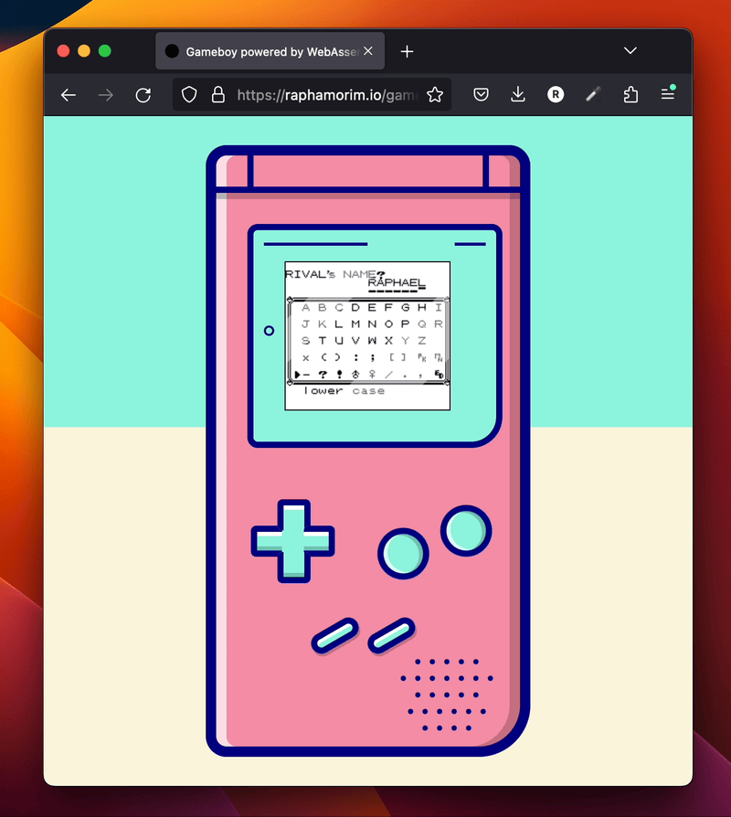
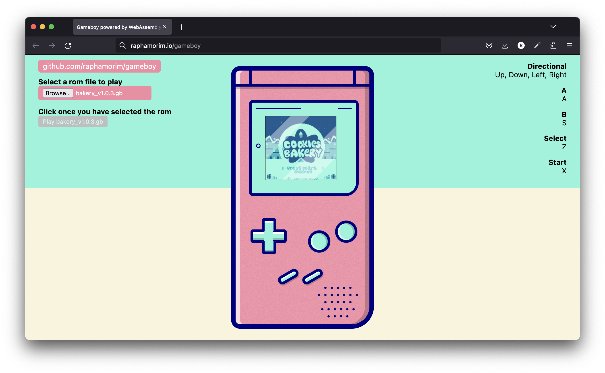
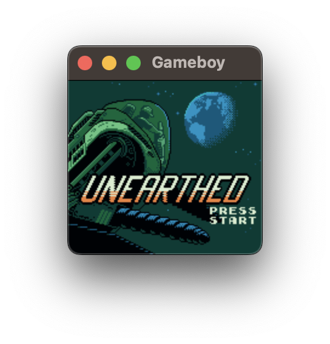
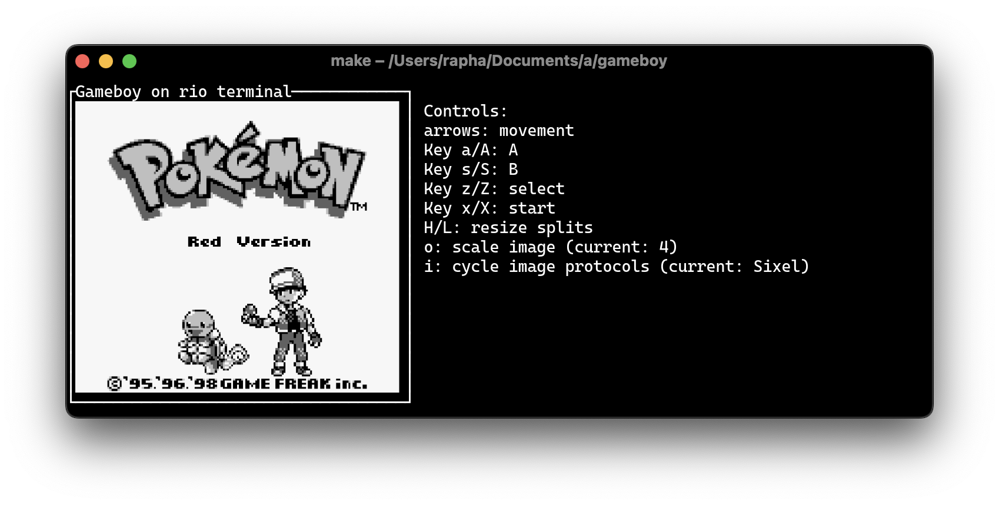
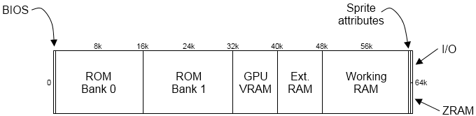
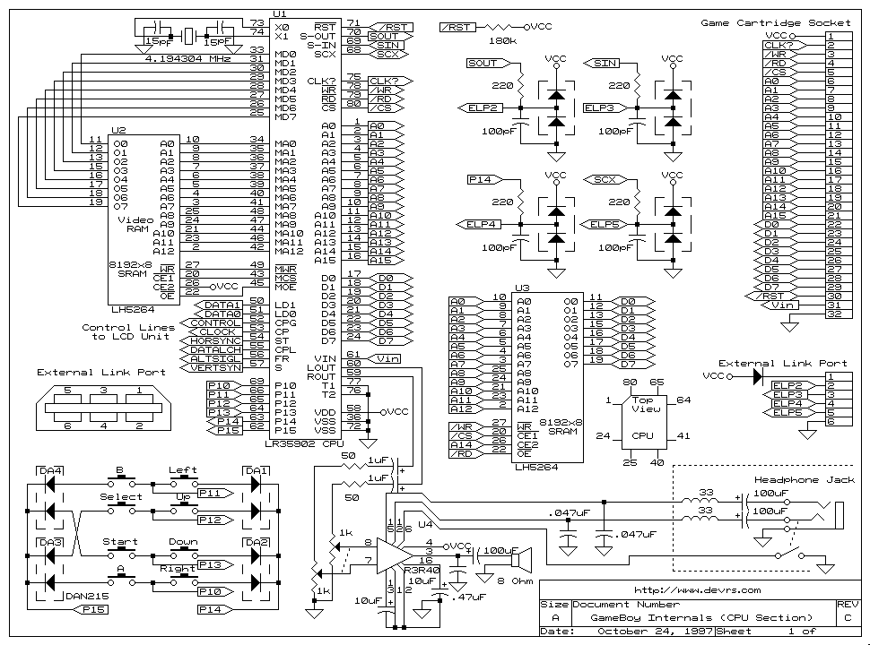

# gameboy

[](https://github.com/Alchemy86/gameboy/actions/workflows/ci.yml)
[](docs/conformance-action.md)
[](LICENSE)
[](rust-toolchain)

**A Game Boy / Game Boy Color emulator written in Rust — runs on the desktop, in your terminal, and in the browser via WebAssembly.**


> This project is a fork of **[raphamorim/gameboy](https://github.com/raphamorim/gameboy)** by
> Raphael Amorim, itself closely modelled on **[mvdnes/rboy](https://github.com/mvdnes/rboy)**.
> It stands on their work — see **[Credits & lineage](#credits--lineage)**.

<p align="center">
  
</p>

| Web (WASM) | Desktop | Terminal |
|:---:|:---:|:---:|
|  |  |  |

> ⚠️ **Status: playable, work in progress.** Many commercial games boot and play. The CPU
> passes Blargg's `cpu_instrs`, `instr_timing`, `mem_timing` and `halt_bug`; a few
> edge-cases (parts of CGB sound, variable mode-3 timing) remain known-inaccurate as
> documented non-goals — see
> **[Status](#status)**, the [test scoreboard](testharness/README.md), and the honest
> per-component notes. This project is a study of emulation, not a piracy tool: it ships no
> ROMs and no BIOS.

---

## Quick start

Requires **Rust 1.83+** (pinned via [`rust-toolchain`](rust-toolchain)). Bring your own
`.gb`/`.gbc` ROM.

> **Audio is opt-in.** By default the emulator builds and runs **without** any system
> audio library — a fresh `cargo build`/`cargo test`/`cargo run` needs no extra packages.
> The APU is still fully emulated; only speaker playback is off.
>
> **To hear sound, enable the `audio` feature** (this pulls in `cpal`, which on **Linux**
> requires the ALSA development headers):
> ```bash
> sudo apt install libasound2-dev      # Debian/Ubuntu
> sudo dnf install alsa-lib-devel      # Fedora
> cargo run --features audio --example desktop -- path/to/game.gb
> ```
> Audio ships **off by default** so that a fresh clone builds with zero system
> dependencies; turn it on explicitly once ALSA (or your platform's audio backend) is
> available.

### 🖥️ Desktop (OpenGL window)

```bash
cargo run --release --example desktop -- path/to/game.gb
```

Controls: **Z** = Select · **X** = Start · **A** = A · **B** = B · **Arrow keys** = D-pad ·
**U**/**I** cycle the pixel-art upscaler (algorithm / factor). The window is resizable and
scales crisply (nearest-neighbour, integer-letterboxed 10:9).

> The ROM path is the first argument; run with no argument and it prints a usage line and
> exits cleanly. Add `--features audio` for sound (see the ALSA note above).

### ⌨️ Terminal

```bash
cargo run --release --example terminal -- path/to/game.gb          # no sound
cargo run --release --features audio --example terminal -- path/to/game.gb   # with sound
```

> The ROM path is the first argument; run with no argument and it prints a usage line and
> exits cleanly. Needs a terminal that supports the **kitty keyboard protocol** for input
> and, ideally, the **kitty graphics protocol** for a crisp picture (kitty, WezTerm,
> Ghostty, foot). If the kitty keyboard protocol is unavailable it exits with a clear error
> — often it's just disabled in your terminal config (e.g. WezTerm needs
> `enable_kitty_keyboard = true`) rather than truly missing
> ([`src/screen/tui.rs`](src/screen/tui.rs)). It opens sized to the terminal, auto-selects the
> sharpest graphics protocol the terminal advertises, and **auto-fits the picture to the pane**
> (it re-fits on resize — there is no manual zoom key). Launch with no ROM path and it opens an
> in-app **ROM picker**. Press **`?`** in-game for the full, always-current key list; the
> highlights are save-state slots (**`1`**–**`3`**, **`F5`** save / **`F8`** load), a speed
> ladder (**`+`**/**`-`**), a stats overlay (**`t`**), palette cycling (**`[`**), pixel-art
> upscaler cycling (**`]`** algorithm / **`}`** factor), **screenshots** (**`c`** what you see,
> **`C`** the raw 160×144 frame), the **video stream / webcam** on/off (**`v`**) and a
> timestamped **recording** (**`V`**). Audio works here too
> with `--features audio` (see the ALSA note above).
>
> **Volume:** **`,`** and **`.`** move it a rung, **`m`** mutes (and unmutes back to the level
> you were at, not to full). The level is on the Status panel, mute is called out on the top
> bar, and both are remembered across sessions — `volume = 50` in `config.toml` sets where a
> fresh install starts. **The attenuation is applied to the samples handed to the sound card,
> not to the Game Boy's own master volume (NR50)**: NR50 is emulated behaviour that the
> accuracy suites measure, so turning it down to quieten the room would change what the
> emulator models. The machine is bit-identical at every setting.
>
> *(The terminal frontend is under active development — the render crew is adding faster
> rendering and a machine-readable telemetry stream — so treat the exact keys as the `?`
> overlay reports them.)*
>
> **HiDPI displays:** on a *scaled* Wayland session some terminals (e.g. WezTerm) report their
> cell size in logical pixels but draw inline images in physical pixels, so the picture comes
> out shrunk by the scale factor. If the game renders far smaller than the window, add
> `cell_scale = auto` (or an explicit number like `cell_scale = 2.0`) to
> `~/.config/gameboy/config.toml`. The default is `1.0` (no correction).
>
> **Frame rate is independent of window size, and the picture barely touches the wire.**
> The frame is transmitted at the resolution the emulator computed (160×144, or the pixel-art
> filter's own output) and the terminal scales it to the cell rectangle, so a fullscreen
> window costs the same as a small one. On top of that the *transport* is chosen by asking
> the terminal what it supports: **81 bytes per frame** over Kitty shared memory, ~1.4 KB as
> a palette-indexed PNG, against 118 KB for the raw path this replaced — and an unchanged
> picture (a menu, a pause screen) costs nothing at all. Emulation is paced separately from
> drawing: if the terminal cannot repaint fast enough the *display* drops frames while the
> game itself stays at exactly 59.7275 fps. Press **t** for live stats — the `Proto` line
> names the transport in use — and read
> [**how a frame gets into a terminal**](docs/rendering.md), which explains the whole ladder
> with measured numbers and a terminal-compatibility table. If your terminal's own scaling
> looks too soft, `transmit_scale = 2` sends more pixels; `render_path = legacy` restores the
> old path.
>
> Config problems are reported rather than ignored: an unknown key, or a value that cannot be
> applied, prints a warning at startup and shows in the picker footer and the `?` overlay.
> Values may be bare, `"double-quoted"` or `'single-quoted'`.

#### 🔴 Live trainer view (Pokémon Red/Blue)

Press **`T`** while playing Pokémon Red or Blue and a panel appears beside the game showing
your **party live** — nickname, species, level, HP bar, status, types — your **badges**, and,
while you are in a battle, the **opponent's level, HP, stats and moves**. **`d`** opens a
detail view for one Pokémon with its moves and PP, its DVs, the stat experience the game keeps
hidden, its Hidden Power, and whether it **would be shiny if traded to Gen 2**; **`Tab`**
cycles the party. The focused Pokémon's sprite is decompressed straight out of your own
cartridge, so it works in the overworld and not just in battle.

**And the moment a wild Pokémon appears, a banner across the top of the terminal tells you
whether it *would be shiny if traded to Gen 2* — before you spend a Ball.** It shows the DVs
alongside, so a near miss is legible, and it stays up for the whole encounter. You do not need
the panel open: an encounter is exactly when nobody is looking at a stats panel. Only
*catchable* encounters get a verdict — a trainer's Pokémon has fixed DVs and cannot be caught,
so a verdict there would be noise. **Gen 1 has no shiny Pokémon at all**; the claim is strictly
about what Gold/Silver would do with the same DVs, and every string says so. `shiny_alert` in
the config turns the bell, or the whole row, off. (Terminal frontend only — the desktop and
web builds do not attach the plugin.)

It is **strictly read-only** — it declares only the "observe" and "read memory" capabilities,
and the host refuses a write from a plugin that did not ask for one — and it reads memory ten
times a second rather than every frame, so it costs the
render path nothing. Every address is derived from the
[`pret/pokered`](https://github.com/pret/pokered) disassembly and cited by symbol name; any
cartridge that is not verified English Red or Blue is **refused with an explanation** instead
of shown wrong numbers. Full design, address table and verification:
[docs/trainer.md](docs/trainer.md).

#### 🔗 Virtual link partner

Press into a Cable Club in Pokémon Red or Blue and trade with a partner that does not exist.
It has a section of its own below: **[Trade a Pokémon in over the link cable](#-trade-a-pokémon-in-over-the-link-cable)**.

#### Terminal config file

The terminal frontend reads `${XDG_CONFIG_HOME:-~/.config}/gameboy/config.toml` (a small
`key = value` file — a strict subset of TOML). A missing file just means defaults; unknown or
malformed keys are ignored, never an error. Values may be **bare or double-quoted** — both
`palette = green` and `palette = "green"` work (the parser strips optional surrounding quotes).
The recognised keys:

| Key | Values | Meaning |
|---|---|---|
| `rom_dir` | a path (`~` expands) | Directory the ROM picker browses. Default `~/roms`. |
| `protocol` | `auto` / `kitty` / `sixel` / `iterm2` … | Force a graphics protocol; `auto` (default) picks the best advertised. |
| `palette` | `grayscale` / `green` / `amber` | Recolour classic (DMG) games. Default `grayscale`. |
| `upscale` | `nearest` / `scale2x` / `mmpx` / `lcd` | Pixel-art upscaler run each frame. Default `nearest` (a no-op at factor 1). |
| `upscale_factor` | an integer | Scale factor, clamped to what the algorithm supports. |
| `cell_scale` | `auto` / a number ≥ 1.0 | HiDPI device-pixel-per-cell correction (see above). Default `1.0`. |
| `volume` | `0`–`100` (a `%` is allowed), or `off` | **Playback volume**, the level a session starts at. Default **`50`** (−12 dB) — deliberately quieter than full scale. `,` / `.` change it in game and `m` mutes; whatever you last set is remembered across sessions, and editing this key overrides that. Attenuation is applied to the audio the *host device* is handed, never to the emulated machine — see below. |
| `shiny_alert` | `on` / `quiet` / `off` | How loudly a wild Pokémon's shiny-if-traded verdict is announced. `on` (default) = banner + toast + terminal bell; `quiet` drops the bell; `off` drops the row. |
| `key_a` / `key_b` / `key_start` / `key_select` | a single character | Rebind the Game Boy buttons (movement is always the arrow keys). |
| `screenshot_dir` | a path (`~` expands) | Where **`c`** writes PNGs. Default `$XDG_PICTURES_DIR/gameboy`, else `~/Pictures/gameboy`. |
| `video_out` | `-` / a file / a **FIFO** / a **`/dev/videoN` camera** / a directory / `off` | **Where `v` sends the stream** (see [video-out.md](docs/video-out.md)). Default `off`. Setting it does *not* start streaming — the emulator always comes up with the feed off. **Safe to set to anything**: nothing is opened, created or claimed until you press `v`. The TUI refuses `-` — it owns stdout. |
| `video_autostart` | `true` / `false` | Go live at launch instead of waiting for `v`. Default `false`. The separate, explicit way to ask for it, because naming a destination is not the same decision as sending frames to it. |
| `video_format` | `rgba` / `rgb24` / `yuyv` | Wire pixel format. Default `rgba`. Ignored for a `/dev/videoN` camera, which negotiates YUYV itself. |
| `video_size` | `WxH` | Letterbox the stream into this size, e.g. `640x480`. Default: the source size, or 640×480 for a camera. |
| `video_source` | `native` / `display` | Stream the raw 160×144 framebuffer, or what you see (palette + upscaler). Default `native`. |
| `video_pace` | `realtime` / `emulated` | One frame per 1/59.7275 s of wall clock (fast-forward drops frames), or one per emulated frame. Default `realtime`. |
| `video_dir` | a path (`~` expands) | Where **`V`** records. Default `$XDG_VIDEOS_DIR/gameboy`, else `~/Videos/gameboy`. |
| `video_device` | `/dev/videoN` | A `v4l2loopback` node to *verify*: the emulator warns if its camera label names a different game. |
| `plugins` | comma-separated names, e.g. `gen1-link` | Attach [plugins](docs/plugins.md). **Empty by default — nothing loads implicitly**, and anything attached is shown in the Status panel. |
| `gen1_trade` | a path | Trade file for the `gen1-link` virtual link partner. Unset offers the built-in level 5 event Mew. |
| `battles` | a path | Battle-preset file for the `gen1-battle` plugin. Unset uses the built-in presets. See [docs/gen1/battle-control.md](docs/gen1/battle-control.md). |
| `agent_command` | a program + arguments | What the `agent` plugin runs to decide what to do. Unset means no driver, and the plugin declines to attach rather than sitting there inert. See [Claude plays Pokémon](docs/claude-plays.md). |
| `agent_objective` | one sentence | What the agent is trying to achieve this session. |
| `agent_max_calls` | a whole number (default `200`) | Hard ceiling on the agent's decisions. It runs unattended and each call costs money. |
| `agent_max_usd` | a number (default `5.0`) | Hard ceiling on the agent's reported spend. |

### 🌐 Web (WebAssembly)

```bash
cd web
npm install
npm run serve     # dev server; open the printed localhost URL and choose a ROM
```

To produce an optimized bundle: `make build-wasm` (requires
[`wasm-opt`](https://github.com/WebAssembly/binaryen)). The web build has **no audio yet**
and currently mis-detects non-MBC3 cartridges — see [Status](#status).

### 📦 As a library

```toml
[dependencies]
gameboy = { git = "https://github.com/Alchemy86/gameboy" }
```

```rust
use gameboy::gameboy::{load_rom, Gameboy, RenderMode};

fn main() {
    let (rom, path) = load_rom("./game.gb").expect("load ROM");
    let gb = Gameboy::new(rom, Some(path));
    gb.render(RenderMode::Desktop); // or RenderMode::Terminal
}
```

---

## 🔗 Trade a Pokémon in over the link cable

**The emulator can be the Game Boy on the other end of the link cable.** Walk into any Cable
Club in Pokémon Red or Blue, use the console, and trade with a partner that does not exist —
and get back a Pokémon you described in a text file.

<p align="center">
  
</p>

**It is not a memory poke.** Nothing writes to the game's RAM — the plugin does not even hold
the capability to. The Pokémon arrives because the game asked for it on the wire, ran its real
link protocol, and inserted it *itself*.

### The proof is a number we never sent

The partner puts a level 5 Mew on the wire with **125 experience** — the exact total for level 5
on Mew's growth curve. Read the Pokémon out of the party afterwards and it has **135**.

Nothing in the plugin knows that number. Generation 1 gives a **traded** Pokémon boosted
experience, and the game applied it on the receiving side, of its own accord, because it
believed it had just traded with a person. A memory poke would have left 125 sitting there.

The game says so in its own words, too — `MEW is transferred.` and `Trade completed!` are
printed by its link code and will not appear unless the whole exchange ran:

<p align="center">
  
</p>

### Ask for what you want

A small `key = value` file — say `~/mewtwo.trade`:

```text
trainer  = ORACLE            # the trainer name the game says you traded with

species  = Mewtwo            # a name, "#150" for a dex number, or a raw index
level    = 70
nickname = MEWTWO
ot_name  = GF                # a traded Pokémon keeps its original trainer
ot_id    = 22796
moves    = Psychic, Recover, Amnesia, Swift
dvs      = 15, 15, 15, 15    # attack, defense, speed, special
```

Then arm it — nothing loads implicitly, so you have to name it:

```bash
GB_PLUGINS=gen1-link GB_GEN1_TRADE=~/mewtwo.trade \
  cargo run --release --example terminal -- ~/roms/blue.gb
```

The Status panel gains a **`Plugin`** row (`gen1-link: offering MEWTWO (Lv70) — waiting for
link`), so an armed partner is never invisible. In game: get the Pokédex, talk to any Cable Club
receptionist, choose **TRADE CENTER**, then use the **left-hand console facing right** — the
game only starts an exchange for that seat, and that player is the one it makes clock master.

Only `species` is required; a second `species` line adds another Pokémon, up to six. Every value
is validated against your own cartridge's tables, and a misspelled key refuses to attach rather
than quietly handing over something else.

📖 **[The full story, the step-by-step journey, and what to do if it hangs →
docs/link-trade.md](docs/link-trade.md)** · the [plugin contract](docs/plugins.md) it is built on
· the Cable Club's **other** room, the Colosseum, and the crash that used to eat save files →
**[docs/link-battle.md](docs/link-battle.md)**.

---

## 🎬 Start any Gen 1 battle — and film it

**Pokémon Red and Blue decide to start a battle by reading one byte.** Write it and the engine
does the rest: the transition, the sprite, the music, the AI, the animations, the cries, the
experience. Nothing here simulates a battle — it asks for one.

So a battle becomes something you can *stage*: a named preset, one keypress, with the teams you
chose on both sides.

```text
[charizard-flamethrower]
player   = Charizard
level    = 50
moves    = Flamethrower, Slash, Fly, Earthquake

wild     = Pidgey
level    = 3

do = await-battle              # …and a script that plays it out
do = press-until b FIGHT
do = press-until a FLAMETHROWER
do = press-until a "used FLAMETHROWER"
do = press-until b fainted
do = await-overworld
```

```bash
GB_PLUGINS=gen1-battle cargo run --release --example terminal -- ~/roms/blue.gb
#   B  start the selected battle      N  choose the next preset
```

**A cinematic rendered by the actual game**, not a video file — and reproducible: the same
script from the same starting state produces byte-identical frames, proved by running it three
times and comparing a hash of *every* frame. It records through the existing video path with no
special handling:

```bash
cargo run --release --example gen1_battle -- --preset charizard-flamethrower --video - \
  | ffmpeg -f rawvideo -pix_fmt rgba -s 160x144 -framerate 59.7275 -i - out.mp4
```

**Your save is not at risk.** The plugin writes only WRAM and HRAM — never cartridge RAM, which
is what a `.sav` is made of — puts back every byte it changed when the battle ends, refuses a
cartridge it does not recognise, and does nothing at all until you name it and arm it.

📖 **[How it works, what "reproducible" precisely means, and the traps →
docs/gen1/battle-control.md](docs/gen1/battle-control.md)**

---

## 🎮 Game mechanics & hacking — Pokémon Gen 1

A documented area for how these games keep their state and how to drive them from outside:
the [memory map](docs/gen1/memory-map.md) with a `pret/pokered` symbol name and a derivation for
every address, [starting battles on demand](docs/gen1/battle-control.md),
[reading dialogue back as text](docs/gen1/reading-the-screen.md) (Gen 1 tile ids *are*
characters), [driving the link cable](docs/gen1/link-from-outside.md), and the
[sharp edges](docs/gen1/sharp-edges.md) that cost us hours.

It is written to teach the mechanism rather than the recipe, because each of these techniques
came from understanding a piece of the engine and asking what else touches it.

📖 **[The index → docs/gen1/](docs/gen1/README.md)**

---

## What's inside — the components

The core is a library (`src/`) that any frontend drives through a tiny surface:
`Gameboy::new(rom) → frame() → image()`, plus `keydown`/`keyup`. Under that surface each
piece of the console is a distinct component with **its own deep-dive page** under
[`docs/components/`](docs/components/README.md) — covering what it is, the real hardware,
its history across DMG/MGB/SGB/CGB, how our implementation works (with honest notes on where
it isn't cycle-perfect), the known hardware quirks, and **a numbered list of expected
behaviours phrased as future tests.**

| Component | Source | What it does | Deep dive |
|---|---|---|---|
| **CPU** | [`src/cpu/`](src/cpu) | Sharp **LR35902 (SM83)** core — registers, flags, full opcode + `CB` tables, interrupts. *It is not a Z80.* | **[docs](docs/components/cpu.md)** |
| **PPU (GPU)** | [`src/gpu/mod.rs`](src/gpu/mod.rs) | Scanline pixel engine — the mode cycle, background/window/sprites, DMG + CGB palettes, STAT/LYC timing. | **[docs](docs/components/ppu.md)** |
| **MMU** | [`src/mmu/mod.rs`](src/mmu/mod.rs) | The 64 KB memory bus — address routing, OAM DMA, CGB HDMA/GDMA, and the `IF`/`IE` interrupt wiring. | **[docs](docs/components/mmu.md)** |
| **Cartridges (MBC)** | [`src/mbc/`](src/mbc) | Bank switching for MBC0/1/2/3/5, MBC3's real-time clock, battery-backed saves. | **[docs](docs/components/mbc.md)** |
| **APU (Sound)** | [`src/sound.rs`](src/sound.rs) | Four channels (2 square + wave + noise), the 512 Hz frame sequencer, `blip_buf` → `cpal`. *Native only.* | **[registers](docs/components/apu.md)** · **[audio pipeline & quality](docs/audio.md)** |
| **Timer & Divider** | [`src/mmu/timer.rs`](src/mmu/timer.rs) | `DIV`/`TIMA`/`TMA`/`TAC` — the programmable interrupt heartbeat. | **[docs](docs/components/timer.md)** |
| **Serial** | [`src/mmu/serial.rs`](src/mmu/serial.rs) | The link cable — and the channel Blargg test ROMs report results through. | **[docs](docs/components/serial.md)** |
| **Joypad (Input)** | [`src/input.rs`](src/input.rs) | The 2×4 button matrix at `0xFF00` and the joypad interrupt. | **[docs](docs/components/input.md)** |
| **Frontends** | [`src/screen/`](src/screen) | Desktop (OpenGL), terminal (ratatui), web (canvas), and the C/Go FFI. | **[docs](docs/components/frontends.md)** |

```
frontend ──▶ Gameboy ──▶ CPU ──▶ MMU ──┬─▶ PPU   ─▶ framebuffer ─▶ frontend
   │                       │             ├─▶ MBC   (cartridge)
 keys                   interrupts       ├─▶ APU   (native)
                        (IF / IE)        ├─▶ Timer / Serial
                                         └─▶ Joypad
```

The **MMU is the hub**: the CPU only reads and writes addresses, and the MMU routes each to
a component. Components raise interrupts by setting a bit the MMU folds into `IF`; the CPU
dispatches them (priority VBlank → STAT → Timer → Serial → Joypad).

🗺️ **New here? Read the [code map](docs/codemap.md)** — one orientation page that traces a
frame through the system, follows a memory access from CPU → MMU → device, and shows where the
frontends attach, with every reference a clickable link into the source.

👉 **Start at the [component reference index](docs/components/README.md)**, read the
[accuracy-testing yardstick](docs/testing.md) that every component's test list is built on,
see [how a frame gets into a terminal](docs/rendering.md) — the transport ladder from
shared memory (81 bytes/frame) through indexed PNG, how the transport is negotiated, and
which terminals support what — and the
[terminal render-performance notes](docs/terminal-render.md) — why a large terminal
window used to cost frames and what caps the cost now — the
[telemetry schema](docs/telemetry.md) — machine-readable NDJSON run data (fps, per-stage
breakdown, emulated speed) for automated checks — the
[video-out guide](docs/video-out.md) — the picture as a raw frame stream for `ffmpeg`/OBS and as
a virtual webcam, with the exact commands — the
[plugin contract](docs/plugins.md) — what a plugin may do, how you can tell one is attached,
and the virtual link-cable partner that completes a real Generation 1 Pokémon trade — or the
[display-scaling design](docs/display.md) — how each frontend enlarges the 160×144
screen today and how to make it crisp (nearest/integer), smooth, or "vector-like",
or see the [debug-tooling design](docs/debugging.md) — how to inspect, step, and capture the
running machine (the deterministic frame-hashing that ties into the tests, plus a public
extension surface external tools can emit from, control, and plug into).

---

## 🔊 Audio

The Game Boy is authentically **4-bit, chiptune lo-fi** — two square waves, a
32-step wavetable, and an LFSR noise channel, band-limited through `blip_buf` and
played out via `cpal`. That grit is genuine DMG character and is meant to stay.

Sound is **opt-in** (`--features audio`) so a fresh clone needs no system audio
library. What the emulator produces is pitch-accurate: `blip_buf` resamples the
4.194304 MHz APU to whatever rate the device negotiates, so **a programmed 440 Hz
tone comes out at 440 Hz** (asserted by `cargo test --lib sound`).

A "rough and slightly fast" report (Pokémon Blue) traced to **three** issues, now
fixed:

| Symptom | Cause | Fix |
|---|---|---|
| Only one channel / odd rates | Device negotiation broke on the *first* `F32` config — often mono, or forced 96–384 kHz | Prefer the device's **stereo default** config; else scan for span-44100 + most channels |
| "Aged", laggy, skippy | Hand-off queue allowed up to **1 s** of latency before dumping it | A measured queue policy (prime / hold-and-fade / high-watermark wait); end-to-end latency later cut to **~53 ms** (a tighter device buffer + smaller blocks) — see [`docs/audio.md`](docs/audio.md) |
| **Slightly fast + rough** | Desktop paced at **16 ms = 62.5 fps** vs the real **59.73 fps** (**+4.64 %**) — the APU overproduced and the queue overflowed | Pace at the true **16.743 ms** frame period |

> The **fast** was the *emulator*, not the audio — audio was a symptom. Both
> frontends now pace on a **deadline accumulator** at the true 16.743 ms frame
> period (the terminal's old too-fast ~5 ms tick is fixed too), so the long-run
> rate is exactly 59.7275 Hz.

📖 **Full breakdown — the signal path, the negotiation logic, the pacing maths,
what's genuine DMG character, and how to measure it yourself — in
[`docs/audio.md`](docs/audio.md).** Probe your own machine's negotiated rate with
`cargo run --features audio --example audio_probe`.

### "Is the sound on?" — the emulator now tells you

Silence used to be ambiguous: an audio build with no working device looked exactly like a
quiet game. Every audio-device failure is now **published rather than discarded** —

- the terminal Status panel has an **`Audio`** row beside `Video`: `off`, `● LIVE 48000Hz ×2`,
  or `failed: no default output device`;
- a failure raises a **toast** when you enter a game;
- `GB_TELEMETRY` emits an **`audio_host`** object (`state`, `errors`, `error`) on every frame,
  so it can be checked without anyone watching the screen — see
  [`docs/telemetry.md`](docs/telemetry.md);
- errors cpal raises on an already-open stream are counted too (`● LIVE 48000Hz ×2 (3 err)`),
  which is otherwise entirely invisible.

The frontends deliberately do **not** `eprintln!` any of this: the TUI lives in the alternate
screen and a stray line corrupts it.

### Harmless startup noise on Linux (not ours, don't chase it)

The desktop frontend prints two things on some Linux desktops that are **not** emulator bugs
and have no fix on our side:

| Message | Where it comes from |
|---|---|
| `xkbcommon: ERROR: … dead_hamza …` (and similar keysym errors) | The **system X11 compose/keymap files** (`/usr/share/X11/locale/…`), parsed by `libxkbcommon` when the window is created. Purely a complaint about the distro's compose table. |
| `queue … destroyed while proxies still attached` (Wayland) | **`winit`/`glutin`** tearing down their Wayland event queue at exit. Upstream cleanup ordering, inside the windowing crates. |

Both are emitted before/after anything we control, and neither affects emulation, audio or
input.

<details>
<summary><strong>Memory map</strong> (click to expand)</summary>

```
0x0000–0x3FFF  ROM bank 0        0xE000–0xFDFF  Echo RAM
0x4000–0x7FFF  ROM bank N        0xFE00–0xFE9F  OAM (sprites)
0x8000–0x97FF  Tile RAM          0xFEA0–0xFEFF  Unused
0x9800–0x9FFF  BG map            0xFF00–0xFF7F  I/O registers
0xA000–0xBFFF  Cartridge RAM     0xFF80–0xFFFE  High RAM
0xC000–0xDFFF  Work RAM          0xFFFF         Interrupt Enable
```


*(Image from [Imran Nazar — GameBoy Emulation in JavaScript](http://imrannazar.com/GameBoy-Emulation-in-JavaScript:-Memory).)*
</details>

---

## 🤖 Claude plays Pokémon

**An AI agent can watch this emulator and play it, and say what it is thinking while it does** —
built to be streamed on Twitch, with a commentary panel a viewer can follow.

```bash
GB_PLUGINS=agent \
GB_AGENT_CMD=tools/claude_plays/claude_api_adapter.py \
GB_AGENT_OBJECTIVE="Get out of the house and choose a starter Pokemon" \
  cargo run --release --example terminal -- ~/roms/blue.gb
```

`A` shows the commentary panel, `G` hands the controller back to a human.

**The architecture is the interesting part.** A model takes seconds to answer; the Game Boy runs
at 59.73 frames a second. So the agent does not press buttons — it returns a *goal, one line of
commentary and up to twelve actions*, and cheap local code carries them out over hundreds of
frames, coming back only when the plan finishes, fails, or the world does something unexpected.
One action (`advance_text`) holds a whole conversation down. Measured on Pokémon Blue's opening:
**about one model call per 1,100 emulated frames.**

* **The emulator never waits.** A driver is polled, never awaited. With a driver that never
  answers at all, emulation costs **0.24 ms/frame** against a 16.74 ms budget — asserted in CI.
* **Hard caps live in the host, not the prompt**: calls, tokens, spend *and* wall clock, plus a
  circuit breaker and escalating stuck-detection. A runaway loop is not possible.
* **The agent is swappable.** The contract is *"here is the state, give me actions and
  commentary"*. Claude through either shipped adapter, a scripted policy, a random walker, or
  you. A deterministic scripted driver goes through the identical code path, which is how all of
  this is tested for free.
* **It presses buttons; it cannot write memory.** The plugin does not hold the capability, and
  the status bar marks it `>>` the moment it presses anything.
* **Everything the panel shows is treated as public and permanent** — a driver error reaches a
  viewer as *"The agent hit a problem — trying again"* and never as a path, a key or a stack
  trace.

Full design, the OBS/Twitch recipe (canvas, bitrate, font size, what to capture) and the honest
gaps: **[`docs/claude-plays.md`](docs/claude-plays.md)**.

---

## 🎥 Video out & virtual webcam

**The Game Boy as a webcam, with no bridge.** Put one line in `config.toml`, run the game,
press `v`, and pick the camera in Chrome, Meet, Discord or OBS:

```toml
video_out = "/dev/video10"
```

**`v` toggles the picture, never the camera.** Once opened, the device is held for the session:
pressing `v` again stops sending the game and starts sending an idle card, so a viewer in the
middle of a Meet call or a Twitch stream sees the picture change and never loses the device.
A stopped feed that froze on the last game frame — looking live while being dead — was the thing
worth fixing; so was a camera that could not be turned back on once released.

The emulator negotiates the V4L2 device itself (`VIDIOC_QUERYCAP` + `VIDIOC_S_FMT`) and writes
the frames — no `ffmpeg`, no FIFO, no rule about what to start first. Size and pixel format are
**detected, not configured**: YUYV at 640×480, with the 160×144 picture scaled by integer
nearest-neighbour and letterboxed, never stretched. Linux only, and it needs the `v4l2loopback`
kernel module once (root); the emulator prints the exact install commands if it is missing.

The picture can also leave as a **raw frame stream** any standard tool consumes. **Off by
default**, and free when off.

```bash
# record a headless run straight into an MP4
cargo run --release --example video_out -- --rom game.gb --frames 600 \
  | ffmpeg -f rawvideo -pix_fmt rgba -s 160x144 -framerate 59.7275 -i - -pix_fmt yuv420p gb.mp4

# stream a game you are PLAYING in the terminal, through a FIFO — press `v` to go live
mkfifo /tmp/gb.raw
ffmpeg -f rawvideo -pix_fmt rgba -s 160x144 -framerate 59.7275 -i /tmp/gb.raw gb.mp4 &
cargo run --release --example terminal -- game.gb --video-out /tmp/gb.raw
```

**No video destination can stop the emulator from starting.** A FIFO with nothing reading it, a
camera that is missing or busy — the *stream* waits and attaches by itself the moment the far
end appears, and a consumer that quits mid-stream drops it back to waiting rather than killing
or stalling anything. A slow consumer costs dropped frames, never frame time.

The emulator prints the exact consuming command for whatever settings are in force, so it is
never guesswork. Native 160×144 or the upscaled/palette-mapped picture, `rgba`/`rgb24`/`yuyv`,
letterboxed into any size, paced to wall clock so fast-forward drops frames instead of producing
a 4× speed video. **`v`** streams and **`V`** records a timestamped file — two different jobs,
two different keys — and the Status panel says which and where (`◌ wait`, `● LIVE`, `● REC`).

macOS and Windows have no v4l2; there, `tools/virtual-camera.sh` and OBS's own virtual camera
consume the same stream. Full guide, measured costs, platform limits and the captured proof:
**[`docs/video-out.md`](docs/video-out.md)**.

---

## Status

**Platforms**

| Frontend | State |
|---|---|
| Desktop (glutin/GL) | ✅ Working; audio with `--features audio` |
| Terminal (ratatui) | ✅ Working (kitty-protocol terminals); audio with `--features audio` |
| Web (WASM) | 🟡 Video + input work; **no audio yet**; non-MBC3 cartridges mis-detected |
| FFI (C/Go) | 🟡 Static lib + header build; the Go example takes a ROM path |

**Console model — DMG or Game Boy Color**

The emulator picks the console from the cartridge header: a cartridge whose CGB flag
(`0x0143` bit 7) is set boots a **Game Boy Color**, anything else boots an original
**DMG** — what a person with both consoles on the shelf would do. Override it with the
`GB_MODEL` environment variable, which every frontend honours:

```bash
GB_MODEL=dmg cargo run --release --example desktop -- game.gbc   # force an original Game Boy
GB_MODEL=cgb cargo run --release --example desktop -- game.gb    # force the Color's DMG-compat mode
```

This matters more than it sounds. Before this existed *everything* booted a Color, so a
DMG-only game always ran in the Color's compatibility mode — a different machine, with
different boot registers (`A=0x11 HL=0x007C` rather than `A=0x01 HL=0x014D`) and the
undocumented CGB registers still responding. Nine Mooneye acceptance tests print those
registers and can tell.

**Multi-game compilation cartridges (MBC1M)**

Carts like *Bomberman Collection* or *Mortal Kombat I & II* hold several games behind one
menu and wire their MBC1 differently — and they cannot be told apart from an ordinary
cartridge by the header, so every emulator guesses. We treat a cartridge as a multicart
when it is exactly 1 MiB and carries a second Nintendo header in bank `$10`, which is the
identification Pan Docs documents. If a cart guesses wrong in either direction,
`GB_MBC1_MULTICART=1` forces multicart wiring and `GB_MBC1_MULTICART=0` forces the
ordinary wiring.

**Accuracy — hardware test ROMs**

A **headless Blargg/acid2 harness is wired in** ([`testharness/`](testharness/), run
with `cargo test --release --test testroms`) and gated in CI against a checked-in
baseline. Every ROM runs on **both consoles** — a DMG and a Game Boy Color — and every
verdict is the ROM's own (its serial string, the text it writes to `$A000`, or its
author's reference image); nothing is judged against a hash of our own previous output.
Full per-ROM breakdown: **[testharness/README.md](testharness/README.md)** ·
rationale: **[docs/testing.md](docs/testing.md)**.

| Suite | Result |
|---|---|
| Blargg `cpu_instrs` (11) | ✅ 11/11 pass, DMG and CGB |
| Blargg `instr_timing` | ✅ Pass, DMG and CGB |
| Blargg `mem_timing` / `mem_timing-2` | ✅ Pass, DMG and CGB (timer stepped per memory access) |
| Blargg `halt_bug` | ✅ Pass, DMG and CGB (HALT bug modelled) |
| `dmg-acid2` (PPU) | ✅ 0 of 23,040 pixels differ from the reference image, DMG and CGB |
| Blargg `dmg_sound` (12) | ✅ 12/12 pass (measured by the audio harness) |
| Blargg `oam_bug` | ✅ 8/8 sub-tests pass on DMG (the OAM-corruption bug is modelled). Expected to fail on CGB — that silicon has no such defect |
| Blargg `interrupt_time` | 🚫 Fails — 16- vs 20-T-cycle interrupt dispatch, a documented non-goal |

**32 of 35 ROM/console rows pass.** APU accuracy is measured by a separate offline audio
harness (`cargo test --release --test audiocapture`) — see [`docs/audio.md`](docs/audio.md).

These numbers cover **18 ROMs**. The wider community suites are a much larger denominator and
we do far worse on them; the honest scoreboard, measured with the
[GB Emulator Shootout](https://gbdev.io/GBEmulatorShootout/)'s own ROMs and reference images,
is Mooneye acceptance 13/66, Mealybug 0/71, SameSuite APU 2/61. Do not read "we pass Blargg" as
"we are accurate".

**Known limitations** (each is documented honestly on the relevant component page)
- No boot ROM / logo scroll; the post-boot register state is written directly.
- The DMG OAM-corruption bug **is** modelled, as is the HALT bug. The PPU is stepped once
  per instruction, so which OAM row a mid-instruction bus cycle hits is predicted
  arithmetically rather than observed; one calibrated constant absorbs the phase the
  batched PPU picks up when the LCD is switched on mid-instruction.
- OAM DMA is instantaneous and does not restrict the bus; PPU mode 3 is fixed-length. Making
  these cycle-exact needs a cycle-stepped PPU/CPU — the structural step the Mealybug PPU suite
  (0/71) and SameSuite's DMA tests (0/4) are waiting on.
- **The timer uses separate DIV/TIMA counters with no falling-edge quirks.** Mooneye's
  `acceptance/timer/*` tests exactly this and we fail 10 of 13.
- Web build has no sound and always treats cartridges as MBC3.
- Battery saves work only on the native (filepath) path — the web and FFI builds have no
  filesystem, so in-game saves are not persisted there. **Save states are implemented** in the
  core (versioned, ROM-checked `GBSS` format; byte-identical round-trip proof) and exposed in
  the terminal frontend as quick-save/-load slots — see [`docs/savestates.md`](docs/savestates.md).

**Battery saves** are written to `<rom>.sav` — **raw cartridge RAM with no header**, the
format every other emulator uses and the one real-cartridge dumpers produce, so saves can be
carried in either direction. For MBC3 cartridges that have a real-time clock, the clock is
appended to the same file as the standard 48-byte footer. That clock runs on **emulated**
time — one second per second of Game Boy time, so it speeds up when you fast-forward and
stops when you pause, exactly as the console's own clock would — and gains the real elapsed
time while the emulator is closed, as the cartridge's coin cell does. It passes all three of
ax6's [`rtc3test`](https://github.com/aaaaaa123456789/rtc3test) suites. `.srm` files are read too, as are
saves from older builds of this emulator (`<rom>.gbsave`), which are migrated automatically
with the old file left in place untouched as a backup. Saves are written **while the
emulator runs** — about a second after the game finishes writing cartridge RAM — and
atomically, so closing the window, a crash or a `kill` cannot lose or truncate them.

---

## Development

```bash
cargo build --release          # native; no ALSA needed (audio is off by default)
cargo test  --release --lib    # library unit tests (76 today)
cargo test  --release --test testroms      # headless accuracy harness (see testharness/)
make lint                      # rustfmt --check + clippy -D warnings
cargo build --release --target wasm32-unknown-unknown
cargo build --release --features audio     # host audio (needs ALSA dev headers on Linux)
```

A fresh clone builds and tests with **no system audio library** — `cpal` is an optional
dependency behind the `audio` feature. CI (GitHub Actions) still installs `libasound2-dev` so
it can exercise the `audio` path, then runs fmt, clippy, the test build and tests, the
test-ROM harness, and a desktop build on every push/PR.

---

## 🧪 Conformance for *your* emulator

**A reusable GitHub Action that runs Game Boy test ROMs against *someone else's* emulator and
gives it a score, a badge, and an explanation of every failure.** Add one job:

```yaml
jobs:
  conformance:
    uses: Alchemy86/gameboy/.github/workflows/conformance.yml@main
    with:
      build: cargo build --release          # optional: build your emulator first
      adapter: ./ci/gbconform-adapter.sh    # the only thing you have to write
```

Anyone can run a test ROM. The point of this one is the **why**: a failure comes back as
*"`POP AF` must mask the low nibble of F — bits 0-3 of the flag register do not exist on the
chip"*, with the hardware citation attached, drawn from the same per-fix conformance notes
this project has been keeping all along.

**Your emulator only has to do two things**, and not even both — write the bytes a ROM sends
to the link port, and/or write one frame. No API, no protocol, nothing parsed from stdout.
The adapter is usually a four-line shell script over a headless mode you already have:

```sh
#!/bin/sh
[ -n "${GBCONFORM_FRAME_OUT:-}" ] || exit 0     # decline the capability you lack
exec my-emulator --headless --frames "$GBCONFORM_FRAMES" \
     --screenshot "$GBCONFORM_FRAME_OUT" "$GBCONFORM_ROM"
```

| | |
|---|---|
| **Runs today** | Blargg `cpu_instrs` 01–11, `instr_timing`, `mem_timing` (serial) + `dmg-acid2` (screen) — 14 checks |
| **Badge** | shields.io endpoint JSON **and** a self-contained SVG; `conformance 24/26`, not pass/fail |
| **Report** | `results.json`, a Markdown summary in the job page, captured serial text, actual + diff frames |
| **Cost** | Python standard library only — no `pip install`, no toolchain, seconds to run |
| **ROMs** | dmg-acid2 is MIT and vendored here; **Blargg's are fetched from their own upstream** at a pinned commit, never redistributed by us; commercial ROMs never |
| **Proven on** | ourselves (14/14, enforced in CI) and on **[binjgb](https://github.com/binji/binjgb)** — an unrelated emulator, which passes dmg-acid2 through it unmodified |

Screen checks compare **shade rank, not colour**, so your palette can be green, grey or
anything else. Checks needing a capability your adapter does not have are reported *skipped*
and excluded from the score, rather than failed.

📖 **Full contract, adapter examples, badge recipes, the licensing position and an honest
account of what is *not* covered: [`docs/conformance-action.md`](docs/conformance-action.md).**

---

## Roadmap & goals

Near-term, in priority order:

- **A cycle-stepped PPU/CPU** — the largest single accuracy gap. Mealybug Tearoom (0/71),
  SameSuite DMA (0/4) and Mooneye's PPU and OAM-DMA tests all need it. The APU already reached
  `dmg_sound` 12/12 with per-access stepping; the same structure is what the rest is waiting on.
  See [`docs/components/apu.md`](docs/components/apu.md).
- **Wire Mooneye GB** into the harness — the fine-grained timing suite that will turn our current
  approximations into visible, trackable reds. See [`docs/testing.md`](docs/testing.md).
- **Web audio** and correct **web/FFI MBC detection** (both currently forced to MBC3).

Bigger picture:

- 🧭 **A standalone Game Boy emulator conformance tool.** Once we pass the standard suites, turn
  this project's test harness into a tool anyone can point at *their own* emulator — to see what
  fails, and **why** — and eventually extract it into its own crate/repo. The design thinking
  (what it reports, how it attaches to a foreign emulator, what we already have, the extraction
  and licensing path, and why our own honest scores are the proof) is written up in
  **[`docs/conformance.md`](docs/conformance.md)**. **Its first shippable form now exists** —
  see [Conformance for *your* emulator](#-conformance-for-your-emulator) above.

---

## Credits & lineage

This repository ([**Alchemy86/gameboy**](https://github.com/Alchemy86/gameboy)) is a fork of
**[raphamorim/gameboy](https://github.com/raphamorim/gameboy)** by Raphael Amorim, which is
itself closely modelled on **[mvdnes/rboy](https://github.com/mvdnes/rboy)**. It is licensed
**[MPL-2.0](LICENSE)**, the same licence as upstream — under which the original authorship
stays credited. The lineage:

> **[mvdnes/rboy](https://github.com/mvdnes/rboy)** (core emulation model)
> → **[raphamorim/gameboy](https://github.com/raphamorim/gameboy)** (Raphael Amorim — Rust +
> WebAssembly + FFI + terminal frontends)
> → **this fork** (accuracy work, save states, upscaler, audio pipeline, telemetry, terminal
> render path, test-ROM harness, and the per-component docs — see the
> [`CHANGELOG`](CHANGELOG.md)).

**References.** Hardware behaviour is grounded in [Pan Docs](https://gbdev.io/pandocs/),
[gbdev/awesome-gbdev](https://github.com/gbdev/awesome-gbdev), and
[rylev/DMG-01](https://rylev.github.io/DMG-01/); [alexcrichton/jba](https://github.com/alexcrichton/jba/tree/rust)
was a further emulation reference. The accuracy suites are Blargg, Gekkio's
[Mooneye GB](https://github.com/Gekkio/mooneye-gb), and Matt Currie's
[dmg-acid2/cgb-acid2](https://github.com/mattcurrie/dmg-acid2). Web CSS from
[Daniel Snow's Game Boy CSS](https://codepen.io/daniel-snows).

Want to help? See **[CONTRIBUTING.md](CONTRIBUTING.md)**.

<details>
<summary><strong>A bit of Game Boy history</strong> (the long version)</summary>

The Game Boy's CPU is a Sharp **LR35902** (core: **SM83**) — a custom hybrid that sits
between the Intel 8080 and the Zilog Z80, and is *not* itself a Z80 (see the
[CPU page](docs/components/cpu.md) for why the difference matters). It runs at 4.194304 MHz,
drives a 160×144 4-shade screen, and has four sound channels. Emulating it is mostly about
moving a lot of individual bytes: reading joypad state from I/O registers, pushing pixels
into VRAM, and banking through ROM/RAM.



*(c) Jeff Frohwein — [devrs.com](http://www.devrs.com/gb/hardware.php#hardgb). More
long-form history and the DMG board schematics live in [`resources/`](resources/).*
</details>

## License

MPL-2.0. See [`LICENSE`](LICENSE). Not affiliated with or endorsed by Nintendo.
