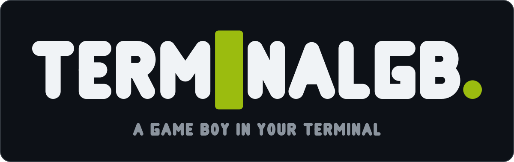
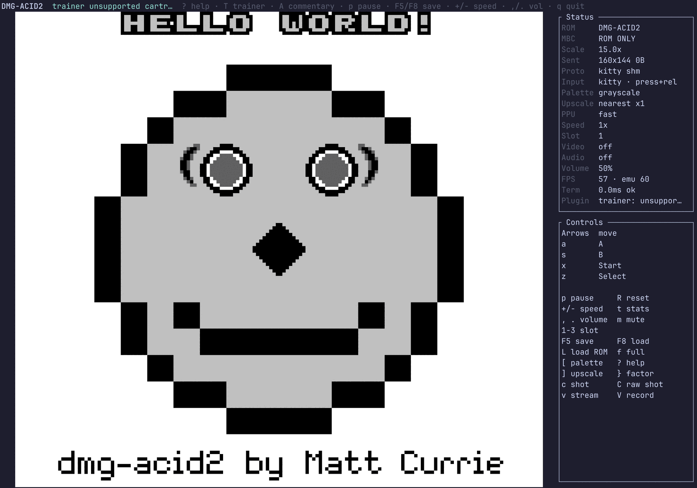
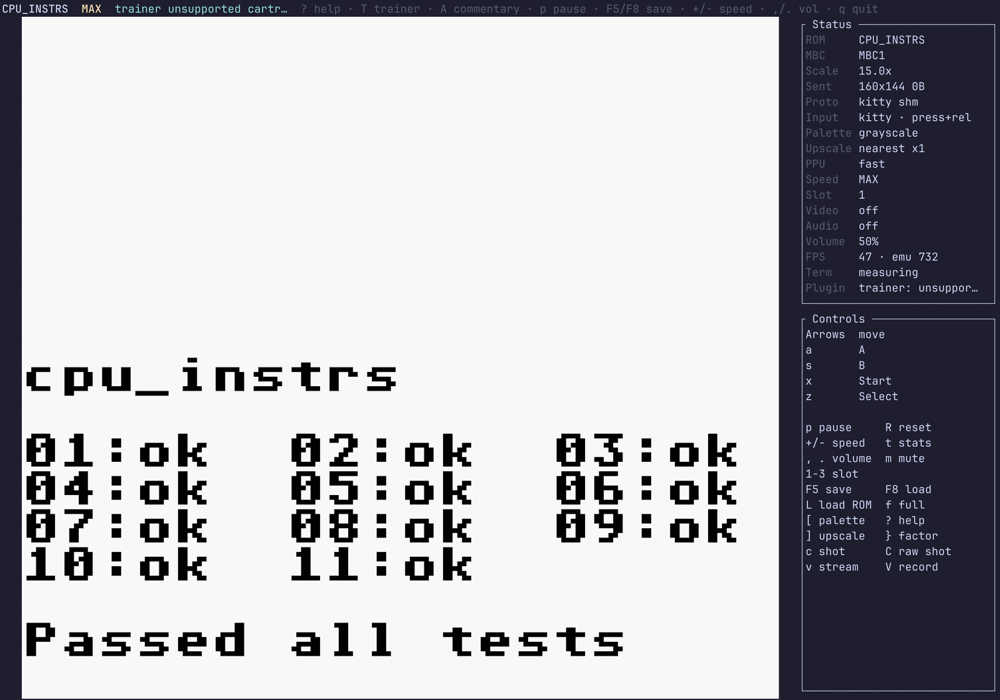
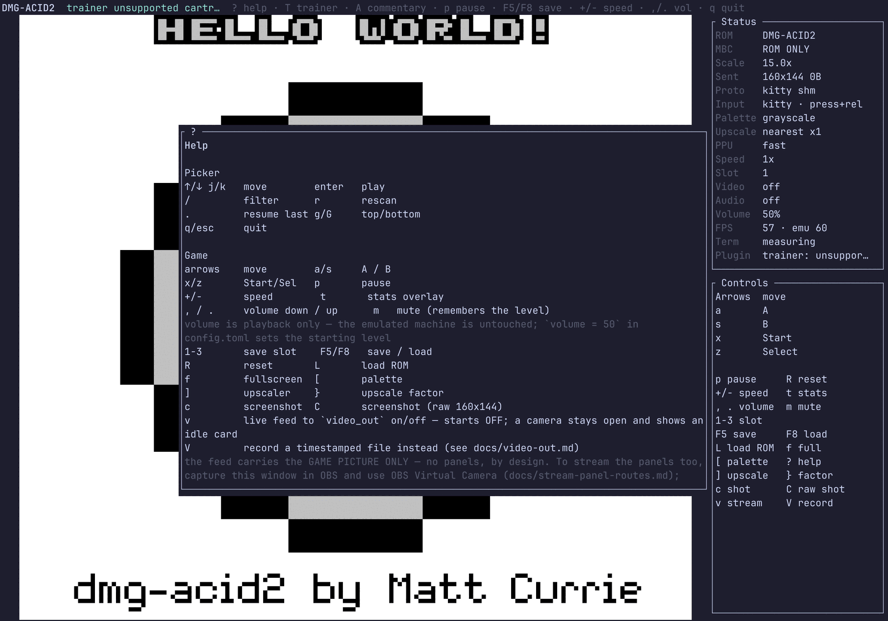
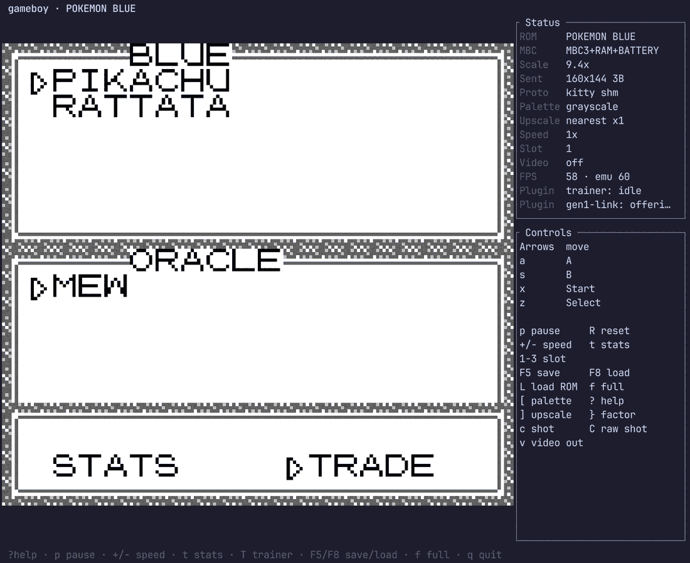
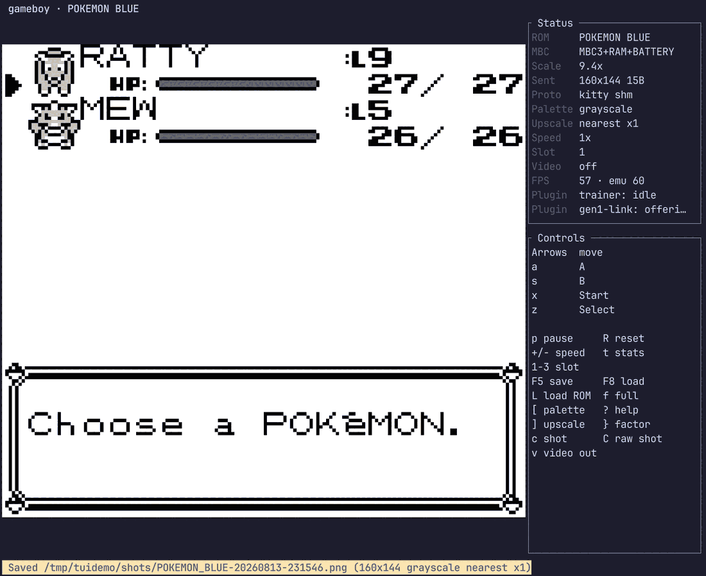
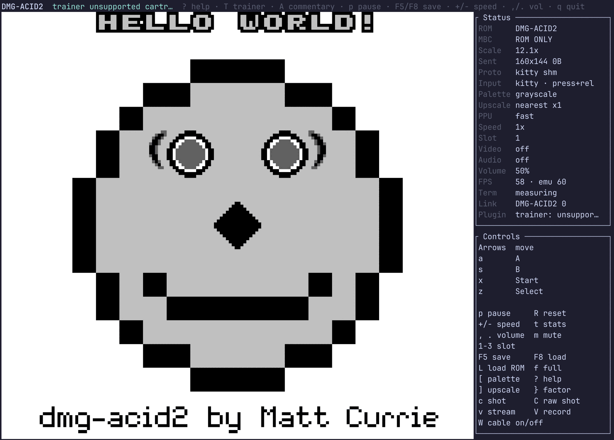
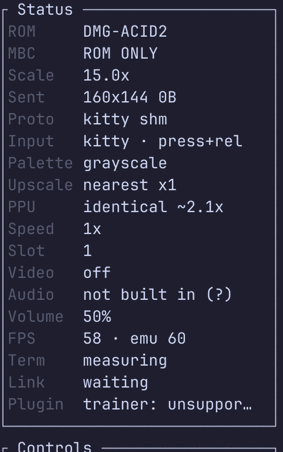
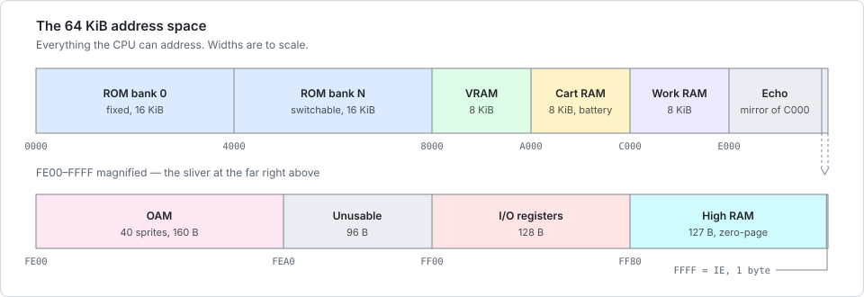
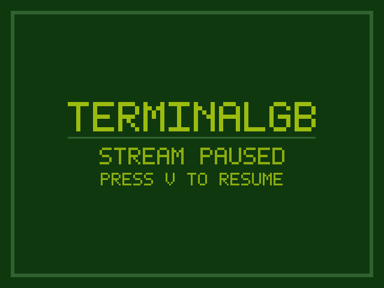

# TerminalGB

<p align="center">
  <a href="docs/brand/README.md"></a>
</p>

> ### 📊 [Where TerminalGB stands →](docs/status.md)
> Every public accuracy suite scored from the checked-in baselines, everything the emulator can
> do, the honest gaps — including the test that must stay failing — and what is coming next.

[](https://github.com/Alchemy86/TerminalGB/actions/workflows/ci.yml)
[](docs/conformance-action.md)
[](LICENSE)
[](rust-toolchain)

**A Game Boy / Game Boy Color emulator written in Rust — runs on the desktop, in your terminal, and in the browser via WebAssembly.**


<p align="center"><em>The whole thing in a terminal: the game on the left, the read-only
<a href="docs/trainer.md">live trainer view</a> on the right, reading the running cartridge.</em></p>

<p align="center">
  
</p>

<p align="center"><em>The terminal frontend running
<a href="https://github.com/mattcurrie/dmg-acid2">dmg-acid2</a> — 0 of 23,040 pixels differ from
the author's reference image. Every screenshot in this README was taken from this emulator, with
its own <code>c</code> key or a capture of its own window; apart from the trainer-view picture
above, they use only test ROMs the repository is free to show.</em></p>

> This project is a fork of **[raphamorim/gameboy](https://github.com/raphamorim/gameboy)** by
> Raphael Amorim, itself closely modelled on **[mvdnes/rboy](https://github.com/mvdnes/rboy)**.
> It stands on their work — see **[Credits & lineage](#credits--lineage)**.

| Blargg `cpu_instrs`, in the terminal, at `MAX` speed | The desktop window | What the `c` key writes |
|:---:|:---:|:---:|
|  |  |  |
| `Passed all tests`, 11/11, **732 emulated fps** | `cargo run --example desktop` | a PNG, straight from the running emulator |

> ⚠️ **Status: playable, work in progress.** Many commercial games boot and play. The whole
> Blargg suite passes on both consoles (46 of 47 ROM/console rows), dmg-acid2 is pixel-exact,
> and the community timing suites are scored in CI on every push — honestly, including the
> reds. Today: **Mooneye 95/103, SameSuite 72/76, `cpp` 4/4, Mealybug 3/79.** See
> **[Status & accuracy](#status--accuracy)** for the measured table, the
> [test scoreboard](testharness/README.md), and the honest per-component notes. This project
> is a study of emulation, not a piracy tool: it ships no ROMs and no BIOS.

---

## Your ROMs stay yours — and stay local

**TerminalGB ships no game content, ever** — no ROMs, no BIOS, no extracted assets. You point
it at your own cartridge dumps: put `.gb`/`.gbc` files in `~/roms` (or set `rom_dir` in the
[config file](#terminal-config-file)), or pass a path on the command line. Start it with no
ROMs at all and the picker tells you exactly this instead of failing.

Everything you load stays on your machine. ROMs are read from your disk; in-game saves are
written **beside the ROM** (`<rom>.sav`, the same format other emulators and cartridge dumpers
use, so your saves are portable); save states and config live under your own
`~/.config`/`~/.local/state`. Nothing is uploaded anywhere: there is no telemetry unless you
point the opt-in local [telemetry file](docs/telemetry.md) somewhere, and the only network
features — the [link cable over TCP](docs/bgb-link.md) and the [trade portal](docs/portal.md)
— are off until you configure them yourself.

## Quick start

Requires **Rust 1.83+**. Bring your own `.gb`/`.gbc` ROM.

**Install the terminal emulator** (the flagship frontend — real pixels in a kitty/WezTerm/
Ghostty terminal, graceful fallback elsewhere):

```bash
cargo install terminalgb          # then: terminalgb path/to/game.gb, or just terminalgb
```

> **The default install is silent on purpose.** It needs no system libraries — but the
> `audio` feature is off by default, so speaker output is not built in (the sound chip is
> still fully emulated, and the emulator says so in its status panel rather than leaving you
> to suspect your sound card). For sound:
> ```bash
> cargo install terminalgb --features audio   # Linux: needs libasound2-dev / alsa-lib-devel first
> ```
> or grab a [prebuilt release binary](https://github.com/Alchemy86/TerminalGB/releases),
> which is built with audio.

**Or run from a clone** (this also gets you the desktop window and every example):

```bash
git clone https://github.com/Alchemy86/TerminalGB
cd TerminalGB
cargo run --release --example terminal -- third_party/dmg-acid2/dmg-acid2.gb
```

That is the whole set-up, and it works from a clean clone: **no system libraries, no
`apt install`, no submodule.** The ROM in that command is the MIT-licensed
[dmg-acid2](third_party/dmg-acid2/) PPU test that ships with the repository — the one thing
here you can run without bringing your own cartridge, and what the pictures above are. Swap it
for your own `.gb`/`.gbc` when you have one.

The `tests/` submodule carries **Blargg's test ROMs** and is needed only by the accuracy
harness: `git clone --recurse-submodules`, or `git submodule update --init` afterwards.

> **Audio is opt-in.** By default the emulator builds and runs **without** any system
> audio library — a fresh `cargo build`/`cargo test`/`cargo run` needs no extra packages.
> The APU is still fully emulated; only speaker playback is off.
>
> **To hear sound, enable the `audio` feature** (this pulls in `cpal`, which on **Linux**
> requires the ALSA development headers):
> ```bash
> sudo apt install libasound2-dev      # Debian/Ubuntu
> sudo dnf install alsa-lib-devel      # Fedora
> cargo run --features audio --example desktop -- path/to/game.gb
> ```
> Audio ships **off by default** so that a fresh clone builds with zero system
> dependencies; turn it on explicitly once ALSA (or your platform's audio backend) is
> available.

### 🖥️ Desktop (OpenGL window)

```bash
cargo run --release --example desktop -- path/to/game.gb
```

Controls: **Z** = Select · **X** = Start · **A** = A · **B** = B · **Arrow keys** = D-pad ·
**U**/**I** cycle the pixel-art upscaler (algorithm / factor). The window is resizable and
scales crisply (nearest-neighbour, integer-letterboxed 10:9).

> The ROM path is the first argument; run with no argument and it prints a usage line and
> exits cleanly. Add `--features audio` for sound (see the ALSA note above).

Flags, for when the window has to be a known thing rather than a comfortable one — recording a
clip, scripting a run, or being driven by a conformance runner
([`docs/shootout.md`](docs/shootout.md)):

| flag | what it does |
|---|---|
| `--model <auto\|dmg\|cgb\|sgb\|sgb2>` | which console to boot; beats both the cartridge header and `$GB_MODEL` |
| `--scale <N>` | client area of exactly `N×160 × N×144` **device** pixels, non-resizable |
| `--upscale <algo>` / `--upscale-factor <N>` | override `config.toml`; `--upscale none` draws the untouched frame |
| `--speed <N>` | emulation speed, `1` = real time. Above 1 the extra frames are emulated inside one draw, not drawn |
| `--run-unfocused` | keep emulating when the window loses focus (default: pause) |

### ⌨️ Terminal

```bash
terminalgb path/to/game.gb        # the installed binary (see Quick start)
# or, from a clone (the `terminal` example is the same source as the binary):
cargo run --release --example terminal -- path/to/game.gb          # no sound
cargo run --release --features audio --example terminal -- path/to/game.gb   # with sound
```

> The ROM path is the first argument; run with no argument and it prints a usage line and
> exits cleanly. **It runs in any terminal**, and gets better in a capable one. Both the
> picture and the keyboard degrade rather than refuse: with the **kitty graphics protocol**
> you get a crisp scaled image, without it Sixel, and without that half-blocks; with the
> **kitty keyboard protocol** you get exact key press *and* release, and without it a
> shorter auto-repeat-driven hold (the `Input` row in the status panel says which you got,
> and one line at startup says what is degraded and how to fix it). Terminals with both:
> kitty, WezTerm (needs `enable_kitty_keyboard = true` in its config), Ghostty, foot — the
> full table is in
> [**Which terminals give you what**](#which-terminals-give-you-what), and the keyboard half in
> [Input modes](#input-modes) below. It opens sized to the terminal, auto-selects the
> sharpest graphics protocol the terminal advertises, and **auto-fits the picture to the pane**
> (it re-fits on resize — there is no manual zoom key). Launch with no ROM path and it opens an
> in-app **ROM picker**. Press **`?`** in-game for the full, always-current key list; the
> highlights are save-state slots (**`1`**–**`3`**, **`F5`** save / **`F8`** load), a speed
> ladder (**`+`**/**`-`**), a stats overlay (**`t`**), palette cycling (**`[`**), pixel-art
> upscaler cycling (**`]`** algorithm / **`}`** factor), the
> [**picture mode**](#two-picture-modes--standard-and-identical) (**`P`**: `standard`, or
> hardware-exact `identical`), **screenshots** (**`c`** what you see,
> **`C`** the raw 160×144 frame), the **video stream / webcam** on/off (**`v`**) and a
> timestamped **recording** (**`V`**). Audio works here too
> with `--features audio` (see the ALSA note above).
>
> **Volume:** **`,`** and **`.`** move it a rung, **`m`** mutes (and unmutes back to the level
> you were at, not to full). The level is on the Status panel, mute is called out on the top
> bar, and both are remembered across sessions — `volume = 50` in `config.toml` sets where a
> fresh install starts. **The attenuation is applied to the samples handed to the sound card,
> not to the Game Boy's own master volume (NR50)**: NR50 is emulated behaviour that the
> accuracy suites measure, so turning it down to quieten the room would change what the
> emulator models. The machine is bit-identical at every setting.
>
> *(The terminal frontend moves faster than this README. The `?` overlay is generated from the
> live key handling, so treat it as the authority for the exact keys.)*
>
> **HiDPI displays:** on a *scaled* Wayland session some terminals (e.g. WezTerm) report their
> cell size in logical pixels but draw inline images in physical pixels, so the picture comes
> out shrunk by the scale factor. If the game renders far smaller than the window, add
> `cell_scale = auto` (or an explicit number like `cell_scale = 2.0`) to
> `~/.config/terminalgb/config.toml`. The default is `1.0` (no correction).
>
> **Frame rate is independent of window size, and the picture barely touches the wire.**
> The frame is transmitted at the resolution the emulator computed (160×144, or the pixel-art
> filter's own output) and the terminal scales it to the cell rectangle, so a fullscreen
> window costs the same as a small one. On top of that the *transport* is chosen by asking
> the terminal what it supports: **81 bytes per frame** over Kitty shared memory, ~1.4 KB as
> a palette-indexed PNG, against 118 KB for the raw path this replaced — and an unchanged
> picture (a menu, a pause screen) costs nothing at all. Emulation is paced separately from
> drawing: if the terminal cannot repaint fast enough the *display* drops frames while the
> game itself stays at exactly 59.7275 fps. Press **t** for live stats — the `Proto` line
> names the transport in use — and read
> [**how a frame gets into a terminal**](docs/rendering.md), which explains the whole ladder
> with measured numbers and a terminal-compatibility table. If your terminal's own scaling
> looks too soft, `transmit_scale = 2` sends more pixels; `render_path = legacy` restores the
> old path.
>
> Config problems are reported rather than ignored: an unknown key, or a value that cannot be
> applied, prints a warning at startup and shows in the picker footer and the `?` overlay.
> Values may be bare, `"double-quoted"` or `'single-quoted'`.

<p align="center">
  
</p>

<p align="center"><em>Press <code>?</code>. The overlay is generated from the live key
handling, so it cannot go stale the way a README table can — and it is drawn in its own
rectangle, never on top of the picture, because a terminal image owns whole cells and text
there replaces the image rather than covering it.</em></p>

#### Input modes

The kitty keyboard protocol reports a key going **down** and a key coming **up**. A plain
terminal only ever tells you a key was pressed; if you hold it, all you get is the operating
system's auto-repeat. So there are two modes, both playable, and the status panel's **`Input`**
row says which one you are in:

| | `kitty · press+rel` | `basic · autorepeat` |
|---|---|---|
| Hold a direction | exact — down until you let go | one step, a pause of the auto-repeat *delay* (~0.5 s), then continuous |
| Tap a direction | exactly one step | exactly one step |
| Let go | immediate | ~0.15 s later (adapts to your repeat rate, 0.09–0.35 s) |
| Two buttons at once | yes, including diagonals | only briefly — a terminal auto-repeats the *last* key held |
| Hold a control key (`[`, `]`, `v`, `f`) | cycles | fires once, not thirty times a second |

Nothing else differs, and the emulation is identical. The startup line naming the degradation
is printed once, to the scrollback — never every frame. To get the better mode: **kitty**,
**Ghostty** and **foot** enable the protocol by default; **WezTerm** needs
`enable_kitty_keyboard = true` in `~/.config/wezterm/wezterm.lua`. GNOME Terminal / Ptyxis
(VTE), Konsole and xterm do not implement it, and run in basic mode.

The frontend refuses to start in exactly one case: neither stdout nor stdin is a terminal, so
there is nothing to draw on *and* no keys to read.

#### 🔴 Live trainer view (Pokémon Red/Blue)

Press **`T`** while playing Pokémon Red or Blue and a panel appears beside the game showing
your **party live** — nickname, species, level, HP bar, status, types — your **badges**, and,
while you are in a battle, the **opponent's level, HP, stats and moves**. **`d`** opens a
detail view for one Pokémon with its moves and PP, its DVs, the stat experience the game keeps
hidden, its Hidden Power, and whether it **would be shiny if traded to Gen 2**; **`Tab`**
cycles the party. The focused Pokémon's sprite is decompressed straight out of your own
cartridge, so it works in the overworld and not just in battle.

**And the moment a wild Pokémon appears, a banner across the top of the terminal tells you
whether it *would be shiny if traded to Gen 2* — before you spend a Ball.** It shows the DVs
alongside, so a near miss is legible, and it stays up for the whole encounter. You do not need
the panel open: an encounter is exactly when nobody is looking at a stats panel. Only
*catchable* encounters get a verdict — a trainer's Pokémon has fixed DVs and cannot be caught,
so a verdict there would be noise. **Gen 1 has no shiny Pokémon at all**; the claim is strictly
about what Gold/Silver would do with the same DVs, and every string says so. `shiny_alert` in
the config turns the bell, or the whole row, off. (Terminal frontend only — the desktop and
web builds do not attach the plugin.)

It is **strictly read-only** — it declares only the "observe" and "read memory" capabilities,
and the host refuses a write from a plugin that did not ask for one — and it reads memory ten
times a second rather than every frame, so it costs the
render path nothing. Every address is derived from the
[`pret/pokered`](https://github.com/pret/pokered) disassembly and cited by symbol name; any
cartridge that is not verified English Red or Blue is **refused with an explanation** instead
of shown wrong numbers. Full design, address table and verification:
[docs/trainer.md](docs/trainer.md).

#### 🔗 Virtual link partner

Press into a Cable Club in Pokémon Red or Blue and trade with a partner that does not exist.
It has a section of its own below: **[Trade a Pokémon in over the link cable](#-trade-a-pokémon-in-over-the-link-cable)**.

#### Terminal config file

The terminal frontend reads `${XDG_CONFIG_HOME:-~/.config}/terminalgb/config.toml` (a small
`key = value` file — a strict subset of TOML). A missing file just means defaults; unknown or
malformed keys are ignored, never an error. Values may be **bare or double-quoted** — both
`palette = green` and `palette = "green"` work (the parser strips optional surrounding quotes).

> **Upgrading from before the rename.** The project used to be called `gameboy` and kept its
> files in `~/.config/gameboy/`, `~/.local/state/gameboy/` (recents, remembered volume, save
> states) and `~/Pictures/gameboy` / `~/Videos/gameboy`. **Nothing was moved and nothing needs
> moving**: each of those is still read and written exactly where it is, because the emulator
> prefers the new `terminalgb` name and falls back to the old one whenever the old one is what
> exists on disk. Rename the directories yourself if you want to; do not rename half of them.

The recognised keys:

| Key | Values | Meaning |
|---|---|---|
| `rom_dir` | a path (`~` expands) | Directory the ROM picker browses. Default `~/roms`. |
| `protocol` | `auto` / `kitty` / `sixel` / `iterm2` / `halfblocks` | Force a graphics protocol. `auto` (default) asks the terminal and takes the best it advertises — **kitty → sixel → iTerm2 → half-blocks**, half-blocks only when nothing better exists. Pinning a value *disables* detection, so a terminal can end up on a worse protocol than it can actually do; the status row's `Proto` line always names what is live. An unrecognised value is reported, not silently ignored. |
| `palette` | `grayscale` / `green` / `amber` | Recolour classic (DMG) games. Default `grayscale`. |
| `upscale` | `nearest` / `scale2x` / `mmpx` / `lcd` | Pixel-art upscaler run each frame. Default `nearest` (a no-op at factor 1). |
| `upscale_factor` | an integer | Scale factor, clamped to what the algorithm supports. |
| `cell_scale` | `auto` / a number ≥ 1.0 | HiDPI device-pixel-per-cell correction (see above). Default `1.0`. |
| `ppu` | `standard` / `identical` (aliases: `fast` / `accurate`) | Which **[picture mode](docs/picture-modes.md)** the emulated hardware runs. `standard` (default) draws a whole scanline at a time; `identical` runs the real per-dot pixel pipeline, so a mid-scanline register write lands exactly where a Game Boy puts it — for about **2.1x** the CPU. Nothing to do with `palette`/`upscale`, which sit above the PPU and are identical either way. **`P` toggles it live**; the Status panel's `PPU` row says which is on and what it costs. `$GB_PPU` overrides this for one run. |
| `volume` | `0`–`100` (a `%` is allowed), or `off` | **Playback volume**, the level a session starts at. Default **`50`** (−12 dB) — deliberately quieter than full scale. `,` / `.` change it in game and `m` mutes; whatever you last set is remembered across sessions, and editing this key overrides that. Attenuation is applied to the audio the *host device* is handed, never to the emulated machine — see below. |
| `shiny_alert` | `on` / `quiet` / `off` | How loudly a wild Pokémon's shiny-if-traded verdict is announced. `on` (default) = banner + toast + terminal bell; `quiet` drops the bell; `off` drops the row. |
| `key_a` / `key_b` / `key_start` / `key_select` | a single character | Rebind the Game Boy buttons (movement is always the arrow keys). |
| `screenshot_dir` | a path (`~` expands) | Where **`c`** writes PNGs. Default `$XDG_PICTURES_DIR/terminalgb`, else `~/Pictures/terminalgb`. |
| `video_out` | `-` / a file / a **FIFO** / a **`/dev/videoN` camera** / a directory / `off` | **Where `v` sends the stream** (see [video-out.md](docs/video-out.md)). Default `off`. Setting it does *not* start streaming — the emulator always comes up with the feed off. **Safe to set to anything**: nothing is opened, created or claimed until you press `v`. The TUI refuses `-` — it owns stdout. |
| `video_autostart` | `true` / `false` | Go live at launch instead of waiting for `v`. Default `false`. The separate, explicit way to ask for it, because naming a destination is not the same decision as sending frames to it. |
| `video_format` | `rgba` / `rgb24` / `yuyv` | Wire pixel format. Default `rgba`. Ignored for a `/dev/videoN` camera, which negotiates YUYV itself. |
| `video_size` | `WxH` | Letterbox the stream into this size, e.g. `1280x720`. Default: the source size, or 1280×720 for a camera ([why 16:9](docs/video-out.md#4a-the-camera-is-169--because-the-consumer-crops-and-we-cannot-see-it-happen)). A camera size that is not 16:9 is honoured, with a warning. |
| `video_source` | `native` / `display` | Stream the raw 160×144 framebuffer, or what you see (palette + upscaler). Default `native`. |
| `video_pace` | `realtime` / `emulated` | One frame per 1/59.7275 s of wall clock (fast-forward drops frames), or one per emulated frame. Default `realtime`. |
| `video_dir` | a path (`~` expands) | Where **`V`** records. Default `$XDG_VIDEOS_DIR/terminalgb`, else `~/Videos/terminalgb`. |
| `video_device` | `/dev/videoN` | A `v4l2loopback` node to *verify*: the emulator warns if its camera label names a different game. |
| `music_dir` | a path (`~` expands) | Where **music mode's `w`** writes WAVs. Default `$XDG_MUSIC_DIR/terminalgb`, else `~/Music/terminalgb`. Never beside the ROM. |
| `music_export_seconds` | `5`–`600` (default `60`) | How long one exported track is. |
| `plugins` | comma-separated names, e.g. `gen1-link` | Attach [plugins](docs/plugins.md). **Empty by default — nothing loads implicitly**, and anything attached is shown in the Status panel. [Write your own](docs/writing-a-plugin.md); the ones we ship live in [`plugins/`](plugins/) and can all be built out. |
| `gen1_trade` | a path | Trade file for the `gen1-link` virtual link partner. Unset offers the built-in level 5 event Mew. |
| `portal` | a URL, or `off` | The [trade portal](docs/portal.md): asynchronous friend trades over HTTPS. Sign in once with `@` in the TUI (opens your browser; the code is printed too) or `terminal login`; an accepted trade then arms the `gen1-link` partner at ROM load, and the trade happens at the Cable Club as usual. Only a ~250-byte description of one Pokémon ever crosses the wire — never a save or a ROM. `$GB_PORTAL` overrides. |
| `battles` | a path | Battle-preset file for the `gen1-battle` plugin. Unset uses the built-in presets. See [docs/gen1/battle-control.md](docs/gen1/battle-control.md). |
| `link` | `auto` (default), `off`, or a path to a second ROM | The [link cable](docs/link-cable.md). **`auto` is live by default**: start a second copy of the emulator on this machine and the two find each other and link automatically, the way plugging a cable in does — which is what lets Gen 1's Cable Club attendant see a partner at all. `W` unplugs and plugs back in; `off` keeps this instance out of it. A ROM path instead boots a second console *inside this process*, where `W` swaps which one you play. |
| `link_net` | `[listen:\|connect:]host:port` | Put the link port on a **TCP socket** instead, speaking [BGB's link protocol](docs/bgb-link.md). The far end can be BGB, another copy of TerminalGB **anywhere on the internet**, or a bridge tool with a **real Game Boy** on the other side of it. Without a prefix the default is `connect:`. A Game Boy has one link port, so this takes it: `link` is left alone. |
| `agent_command` | a program + arguments | What the `agent` plugin runs to decide what to do. Unset means no driver, and the plugin declines to attach rather than sitting there inert. See [Claude plays Pokémon](docs/claude-plays.md). |
| `agent_objective` | one sentence | What the agent is trying to achieve this session. |
| `agent_max_calls` | a whole number (default `200`) | Hard ceiling on the agent's decisions. It runs unattended and each call costs money. |
| `agent_max_usd` | a number (default `5.0`) | Hard ceiling on the agent's reported spend. |

### 🌐 Web (WebAssembly)

```bash
cd web
npm install
npm run serve     # dev server; open the printed localhost URL and choose a ROM
```

To produce an optimized bundle: `make build-wasm` (requires
[`wasm-opt`](https://github.com/WebAssembly/binaryen)).

**The web build has sound.** The APU is emulated on `wasm32` like every other target and its
output is played through the Web Audio API — no plugin, no `SharedArrayBuffer`, no
cross-origin-isolation headers, so it works from a plain static host such as GitHub Pages.
Measured in Chrome on a five-minute run of a tone cartridge: **0 underruns, 0 dropped samples,
59.6 emulated fps, 85–96 ms of end-to-end latency**, and the pitch the ROM asked for
(439.8 Hz) to a tenth of a hertz. A status line above the picture reports fps, the
`AudioContext` rate and state, the current latency and the underrun count — a browser will
quietly refuse to start audio until you press a key ([autoplay
policy](https://developer.chrome.com/blog/autoplay/#webaudio)), and a silent emulator with no
explanation is worse than a loud one. Details and the design:
[`docs/web-audio.md`](docs/web-audio.md).

The same change fixed a second thing worth knowing about: the emulator used to step one frame
per `requestAnimationFrame`, i.e. at *the display's* refresh rate — so a game ran 0.46 % fast
on a 60 Hz screen and at **double speed on a 120 Hz one**. It is paced on a real clock now.

---

## 🧱 Build modes — what you can compile, and why you would

Everything is a cargo feature, and the honest summary is: **the default build is the one you
want to play on, and every other mode exists to take something away.** Each command below is
copy-pasteable and was run to produce this table.

| I want… | Command | What you get |
|---|---|---|
| **to play a game** | `cargo build --release` | Both frontends + the four standard plugins. Needs no system libraries. |
| **sound** | `cargo build --release --features audio` | Adds `cpal`. On Linux this is the one mode that needs a package: `libasound2-dev` / `alsa-lib-devel`. |
| **the terminal only** | `cargo build --release --no-default-features --features tui` | Drops GL, `glutin` and the window system. Right for a server or an SSH session. |
| **the desktop only** | `cargo build --release --no-default-features --features desktop` | Drops `ratatui`, the terminal image protocols and the plugins' panels. |
| **the emulator with no plugins** | `cargo build --release --no-default-features --features tui,desktop` | Both frontends, zero plugin crates in the graph — [proved](#-plugins-other-people-can-write), not asserted, by `make no-plugins`. |
| **one plugin** | `cargo build --release --features plugin-trainer` | Pick and choose; the names are in the table below. |
| **the core, for embedding or an agent** | `cargo build --release --no-default-features` | **One** third-party crate (`blip_buf`). No window, no terminal, no audio device, no image codecs, no `$HOME`. See [Embedding the core](#-embedding-the-core). |
| **a headless run right now** | `cargo run --release --no-default-features --example headless -- third_party/dmg-acid2/dmg-acid2.gb 240` | Runs a cartridge, round-trips a save state and prints the frame as ASCII. |
| **any Claude client to drive it** | `cargo build --release --no-default-features --features mcp` | The `terminalgb-mcp` [MCP server](#-mcp-server--drive-it-from-claude-desktop-or-claude-code). Adds **no third-party crate**. |
| **the browser build** | `cargo build --release --target wasm32-unknown-unknown` | Video, input and [sound](docs/web-audio.md) — the APU is emulated here too and plays through Web Audio, with no `audio` feature and no `cpal`. `make build-wasm` also runs `wasm-opt`. |
| **a C / Go static library** | `make ffi-build` | `--no-default-features --features ffi` + `cbindgen` → `libterminalgb.a` and `terminalgb.h`. |

### The features

| feature | in `default` | pulls in | needs at run time |
|---|:---:|---|---|
| *(none)* | | `blip_buf` | nothing |
| `desktop` | ✅ | `glutin`, `gl`, `libc`, `image` | a display server (X11 / Wayland / Windows / macOS) |
| `tui` | ✅ | `ratatui`, `ratatui-image`, `icy_sixel`, `image`, `libc` | a terminal — [any terminal](#which-terminals-give-you-what); it degrades rather than refusing |
| `audio` | | `cpal` | a sound device (ALSA **dev headers** to *build* on Linux) |
| `mcp` | | `plugin-agent`, `chiptune` — **no third-party crate** | an [MCP](https://modelcontextprotocol.io) client (Claude Desktop, Claude Code, …). Builds the `terminalgb-mcp` binary. |
| `chiptune` | ✅ | `terminalgb-chiptune` — first-party, **no dependencies at all** | nothing. Builds the `terminalgb-chiptune` binary — [instructions in, real Game Boy audio out](#-chiptune-renderer--hear-what-the-hardware-would-do). |
| `standard-plugins` | ✅ | the five plugin crates below | nothing; each still has to be named to attach |
| `plugin-trainer` | ✅ | `terminalgb-plugin-trainer` | a Pokémon R/B cartridge, or it declines |
| `plugin-gen1-link` | ✅ | + `terminalgb-plugin-gen1-link` | as above |
| `plugin-battle-control` | ✅ | + `terminalgb-plugin-battle-control` | as above |
| `plugin-agent` | ✅ | + `terminalgb-plugin-agent` | an `agent_command` driver, or it declines |
| `plugin-gen1-shinyhunt` | ✅ | + `terminalgb-plugin-gen1-shinyhunt` | a Pokémon R/B cartridge, or it declines |
| `plugin-example-tracer` | | `terminalgb-plugin-example-tracer` | nothing — **[the one to copy](#-plugins-other-people-can-write)** |
| `testing` | | — | — (`terminalgb::testing::TestMachine`, for plugin authors' tests) |
| `ffi` | | — | — (drops the Rust frontends; exposes the C ABI) |

`plugin-*` features are additive and imply the plugins they build on
(`plugin-battle-control` needs `plugin-gen1-link`, which needs `plugin-trainer`) —
[`Cargo.toml`](Cargo.toml) is the authority.

### The two run-time switches worth knowing

Neither is a compile flag; both are read once at start-up, and a typo warns on stderr and is
**ignored** rather than silently changing machine.

```bash
GB_PPU=identical  cargo run --release --example terminal -- game.gb   # the per-dot picture mode
GB_MODEL=dmg      cargo run --release --example terminal -- game.gbc  # force an original Game Boy
```

`GB_PPU` picks the [picture mode](#two-picture-modes--standard-and-identical) (`P` switches it
without leaving the game); `GB_MODEL` picks the
[console](#console-model--dmg-game-boy-color-or-super-game-boy). Both also have a config key (`ppu`,
and `GB_MODEL` only overrides `Model::Auto`). There is a third, `GB_BOOT_ROM=<path>`, which
points at [a boot ROM you dumped yourself](#bring-your-own-boot-rom-optional) — optional, never
bundled, and silently ignored when it is absent.

### What audio actually costs — measured, not remembered

Audio *used* to be the single biggest performance lever in this project, because the cpal
player **waited** inside `Cpu::do_cycle` to make the sound card the master clock. That cost
17.9 ms of a 16.74 ms frame — about 5 displayed frames a second — and it is fixed
([`docs/audio.md`](docs/audio.md) §4c). Measured today on this machine, with a real device
attached:

| build | emulated frame cost | budget |
|---|---:|---:|
| `--no-default-features`, `standard` picture mode | **0.221 ms** | 16.743 ms |
| `--features audio`, real device | **0.267 ms** | 16.743 ms |
| `--no-default-features`, `GB_PPU=identical` | **0.461 ms** | 16.743 ms |

So **audio is nearly free and the picture mode is the real lever** (~2.1×, and still 36× real
time). Reproduce these with `cargo test --release --test ppuengines` and
`cargo run --release --features audio,libc --example audio_frame_cost -- <rom>`; CI holds the
audio number under 4 ms/frame on every push (`make test-audio-perf`).


---

## 📦 Embedding the core

**Take the emulator, leave the frontends.** If you are building your own UI, a hardware
handheld, a bot, a CI check or a research harness, you want the machine and nothing else —
no window system, no terminal, no audio device, no image codecs.

```toml
[dependencies]
terminalgb = { git = "https://github.com/Alchemy86/TerminalGB", default-features = false }
```

That is the **whole** dependency tree at that feature set:

```text
$ cargo tree --no-default-features --edges normal
terminalgb v0.2.0
├── blip_buf v0.1.5
└── terminalgb-plugin-api v0.1.0 (crates/terminalgb-plugin-api)
```

One crate — `blip_buf`, the APU's band-limited resampler. For comparison, the default
build (both frontends, four plugins) resolves **193** crates. Everything else is opt-in —
the full feature list is in [Build modes](#-build-modes--what-you-can-compile-and-why-you-would).

`terminalgb-plugin-api` resolves beside `blip_buf` and is not a loosening of that claim: it is
first-party, in this repository, has no dependencies of its own, and is the contract plugin
crates depend on **instead of** depending on the emulator. An embedder gains no third-party
code from it. CI enforces the whole paragraph.

### The API

The whole embedding surface is [`Gameboy`](src/gameboy.rs):

```rust
use terminalgb::gameboy::Gameboy;
use terminalgb::{mode::Model, KeypadKey};

// You read the ROM. `None` for the path keeps cartridge RAM in memory and the
// emulator never touches the filesystem; `Some(p)` opts into `<rom>.sav`.
let rom = std::fs::read("game.gb")?;

// `new` resolves the console from the cartridge header (and honours $GB_MODEL).
// `new_with_model` is the reproducible form — it ignores the environment.
// `try_new_with_model` returns Err instead of panicking on a cartridge that
// cannot be mapped, which is what you want for bytes a user handed you.
let mut gb = Gameboy::new_with_model(rom, None, Model::Dmg);

loop {
    gb.frame();                     // one ~59.7275 Hz frame
    let rgba: &[u8] = gb.image();   // 160 × 144 × 4, top-left first
    gb.keydown(KeypadKey::A);
    gb.keyup(KeypadKey::A);
}
```

Also available without any feature: `save_state()` / `load_state()` (versioned `GBSS`
snapshots, [`docs/savestates.md`](docs/savestates.md)), `flush_battery()`, `rom_title()`,
`global_checksum()`, the debug reads (`peek`, `peek_range`, `debug_pc`,
`step_instruction`), the [plugin API](docs/plugins.md), the
[pixel-art upscaler](docs/upscaling.md) (`terminalgb::upscale`, pure CPU, no deps), and
`enable_audio(Box<dyn AudioPlayer>)` — implement that one trait and the APU's samples are
yours, with no `cpal` anywhere in the build.

### Prove it, don't take our word

[`examples/headless.rs`](examples/headless.rs) is the whole claim, executable:

```bash
cargo run --release --no-default-features --example headless -- third_party/dmg-acid2/dmg-acid2.gb 240
```

```text
rom            DMG-ACID2
checksum       0xa934
frames         240
frame hash     0x01acf78fe505f31c
state bytes    141965          # moves with savestate::FORMAT_VERSION
state re-run   identical after 60 more frames

        +++++-+-++  +++++++-++--
                ########
            ####........####
          ##................##
        ##..-+++++....+++++-..##
        ##..--++++....++++--..##
      ##........................##
      ##..........-##-..........##
      ##..........-##-..........##
      ##........................##
        ##..##............##..##
        ##....############....##
          ##................##
            ####........####
                ########
```

It runs a cartridge, takes input, round-trips a save state and prints the picture as ASCII
— with **`HOME`, `DISPLAY` and `WAYLAND_DISPLAY` unset**, which is how the output above was
produced.

### What is and is not portable — honestly

**The core does not:** read a config file, look up `$HOME` or any `$XDG_*` path, open a
device node, require a temp directory, require a terminal, or require a display. It builds
for `wasm32-unknown-unknown` with no changes.

**The core does:**

- **Require `std`.** It is not `no_std`: `Vec`, `String`, `Box<dyn>`, `std::sync::Mutex`
  (FFI only) and `std::path::PathBuf` (battery saves) are all used. A bare-metal port would
  mean an `alloc`-only rework of the MBC/battery layer — real work, not a flag. On embedded
  Linux (a Pi, a handheld) none of this matters.
- **Read one environment variable**, `GB_MODEL`, and only when the console is
  [`Model::Auto`](src/mode.rs). `Gameboy::new_with_model` bypasses it entirely; use that
  if your process environment is not yours to trust.
- **Read the wall clock** — `SystemTime::now()` — in exactly one place: writing or reading
  an **MBC3 clock cartridge's battery file**, to cover the time the console was switched
  off, which is what the coin cell does. The running clock itself is driven by *emulated*
  time ([`src/mbc/rtc.rs`](src/mbc/rtc.rs)), so with no save path nothing here reads a
  host clock at all.
- **Write `<rom>.sav`** if, and only if, you passed `Some(path)` to the constructor. The
  format is the ecosystem's raw-cartridge-RAM `.sav`, not ours
  ([`src/mbc/battery.rs`](src/mbc/battery.rs)).
- **Abort on a cartridge it cannot map** if you use `new`/`new_with_model` — release builds
  set `panic = 'abort'`, so there is no unwinding to catch. Use `try_new_with_model` for
  bytes you did not produce.

**Cross-target status.** `cargo check --no-default-features` is clean for
`x86_64-pc-windows-gnu`, `aarch64-unknown-linux-gnu`, `x86_64-apple-darwin` and
`wasm32-unknown-unknown`. Those are type-check passes, not linked-and-run: **the only
platform anything here has actually been executed on is x86-64 Linux.** The frontends are
another matter — `desktop` needs GL and a windowing system, `tui` needs a kitty-protocol
terminal, and the shared-memory frame transport
([`docs/rendering.md`](docs/rendering.md)) is POSIX-only and stubs itself out elsewhere.

**Licensing for redistributors.** The crate is [MPL-2.0](LICENSE) and every resolved
dependency is MIT / Apache-2.0 / BSD / Zlib / ISC / 0BSD / Unlicense — **nothing GPL, in
any feature combination** (`icy_sixel` ships MIT text without a `license` field in its
manifest). No game ROM or commercial asset is in this repository. The one vendored ROM is
[`third_party/dmg-acid2`](third_party/dmg-acid2/) (Matt Currie, **MIT**, redistribution
permitted, licence included). **Blargg's test ROMs are *not* vendored** — they carry no
explicit licence, so they are a git submodule pointing at `retrio/gb-test-roms` and are
fetched, never redistributed here. **Mooneye GB is not vendored either**; clone
[Gekkio/mooneye-test-suite](https://github.com/Gekkio/mooneye-test-suite) yourself. See
[`CONTRIBUTING.md`](CONTRIBUTING.md) for the standing rule: formats and hardware facts are
learned from any source and reimplemented; incompatible code and game assets never enter
this tree.

### If you want a frontend after all

```rust
use terminalgb::gameboy::{load_rom, Gameboy, RenderMode};

let (rom, path) = load_rom("./game.gb").expect("load ROM");
let gb = Gameboy::new(rom, Some(path));
gb.render(RenderMode::Desktop); // needs `desktop`; or ::Terminal with `tui`
```

`RenderMode::Headless` is the default and always available: it hands the loop back to you.

---

## 🔗 Trade a Pokémon in over the link cable

**The emulator can be the Game Boy on the other end of the link cable.** Walk into any Cable
Club in Pokémon Red or Blue, use the console, and trade with a partner that does not exist —
and get back a Pokémon you described in a text file.

<p align="center">
  
</p>

**It is not a memory poke.** Nothing writes to the game's RAM — the plugin does not even hold
the capability to. The Pokémon arrives because the game asked for it on the wire, ran its real
link protocol, and inserted it *itself*.

### The proof is a number we never sent

The partner puts a level 5 Mew on the wire with **125 experience** — the exact total for level 5
on Mew's growth curve. Read the Pokémon out of the party afterwards and it has **135**.

Nothing in the plugin knows that number. Generation 1 gives a **traded** Pokémon boosted
experience, and the game applied it on the receiving side, of its own accord, because it
believed it had just traded with a person. A memory poke would have left 125 sitting there.

The game says so in its own words, too — `MEW is transferred.` and `Trade completed!` are
printed by its link code and will not appear unless the whole exchange ran:

<p align="center">
  
</p>

### Ask for what you want

A small `key = value` file — say `~/mewtwo.trade`:

```text
trainer  = ORACLE            # the trainer name the game says you traded with

species  = Mewtwo            # a name, "#150" for a dex number, or a raw index
level    = 70
nickname = MEWTWO
ot_name  = GF                # a traded Pokémon keeps its original trainer
ot_id    = 22796
moves    = Psychic, Recover, Amnesia, Swift
dvs      = 15, 15, 15, 15    # attack, defense, speed, special
```

Then arm it — nothing loads implicitly, so you have to name it:

```bash
GB_PLUGINS=gen1-link GB_GEN1_TRADE=~/mewtwo.trade \
  cargo run --release --example terminal -- ~/roms/blue.gb
```

The Status panel gains a **`Plugin`** row (`gen1-link: offering MEWTWO (Lv70) — waiting for
link`), so an armed partner is never invisible. In game: get the Pokédex, talk to any Cable Club
receptionist, choose **TRADE CENTER**, then use the **left-hand console facing right** — the
game only starts an exchange for that seat, and that player is the one it makes clock master.

Only `species` is required; a second `species` line adds another Pokémon, up to six. Every value
is validated against your own cartridge's tables, and a misspelled key refuses to attach rather
than quietly handing over something else.

### Or plug in a second *console*

**Start another copy of the emulator and the cable is already connected.** No flag, no arming,
no configuration: two instances running on the same machine find each other and link, the way
plugging a real cable in does — which is what lets the Cable Club attendant *see* a partner,
since she checks the link before she lets you through.

<p align="center">
  
</p>

The `Link` row names the console on the other end and the trainer panel says whether anyone is
connected and whether a trade is actually happening. `W` unplugs and plugs back in;
`link = off` keeps an instance out of it.

This cable knows nothing about Pokémon — it relays bytes, so **both ends are the genuine
article**. That is what makes it work for things nobody wrote a partner for: a Gen 1 trade
between two real games (measured: 1,552 transfers, zero lost, both saves valid afterwards), a
link battle, or the Gen 1 ↔ Gen 2 **Time Capsule**.

📖 **[Two consoles, one wire → docs/link-cable.md](docs/link-cable.md)** — the hardware, why
running both in one process removes the drift that would corrupt a trade, the Time Capsule's
in-game prerequisites, and an honest design note on playing over the internet.

📖 **[The full story, the step-by-step journey, and what to do if it hangs →
docs/link-trade.md](docs/link-trade.md)** · the [plugin contract](docs/plugins.md) it is built on
· the Cable Club's **other** room, the Colosseum, and the crash that used to eat save files →
**[docs/link-battle.md](docs/link-battle.md)**.

---

## 🎬 Start any Gen 1 battle — and film it

**Pokémon Red and Blue decide to start a battle by reading one byte.** Write it and the engine
does the rest: the transition, the sprite, the music, the AI, the animations, the cries, the
experience. Nothing here simulates a battle — it asks for one.

So a battle becomes something you can *stage*: a named preset, one keypress, with the teams you
chose on both sides.

```text
[charizard-flamethrower]
player   = Charizard
level    = 50
moves    = Flamethrower, Slash, Fly, Earthquake

wild     = Pidgey
level    = 3

do = await-battle              # …and a script that plays it out
do = press-until b FIGHT
do = press-until a FLAMETHROWER
do = press-until a "used FLAMETHROWER"
do = press-until b fainted
do = await-overworld
```

```bash
GB_PLUGINS=gen1-battle cargo run --release --example terminal -- ~/roms/blue.gb
#   B  start the selected battle      N  choose the next preset
```

**A cinematic rendered by the actual game**, not a video file — and reproducible: the same
script from the same starting state produces byte-identical frames, proved by running it three
times and comparing a hash of *every* frame. It records through the existing video path with no
special handling:

```bash
cargo run --release --example gen1_battle -- --preset charizard-flamethrower --video - \
  | ffmpeg -f rawvideo -pix_fmt rgba -s 160x144 -framerate 59.7275 -i - out.mp4
```

**Your save is not at risk.** The plugin writes only WRAM and HRAM — never cartridge RAM, which
is what a `.sav` is made of — puts back every byte it changed when the battle ends, refuses a
cartridge it does not recognise, and does nothing at all until you name it and arm it.

📖 **[How it works, what "reproducible" precisely means, and the traps →
docs/gen1/battle-control.md](docs/gen1/battle-control.md)**

---

## ✨ Shiny-hunt Gen 1, in parallel

A hunter we watched runs **four Nintendo DS consoles wired to one controller through a hardware
input splitter**, so identical presses hit all four at once — and had to drop back to two,
because the four-way rig kept desyncing. This is the software equivalent, and it wins for a
reason that has nothing to do with parallelism: **it never looks at a sprite.** The instant the
game rolls the encounter, the DVs are read straight out of `wEnemyMonDVs`.

**Gen 1 has no shiny Pokémon.** Shininess arrives in Gen 2 and is derived from DVs a Gen 1
Pokémon already carries, so what this hunts is the spread that *becomes* shiny once the Pokémon
is traded forward — defence, speed and special all exactly 10, attack with bit 1 set. Eight
spreads in 65,536: **1 in 8,192**. It is the same rule the trainer panel's `★` uses, called from
there rather than copied.

```bash
# from a bare cartridge: a fresh game walked to the grass on Route 1
cargo run --release --example shiny_hunt -- --rom blue.gb --make-state route1.gbss

# N headless emulators, one encounter loop each, stop the moment one matches
cargo run --release --example shiny_hunt -- --rom blue.gb --state route1.gbss --out ~/hit
```

**Measured on a 20-core box: 8–18 encounters per second on 12 instances, 176–367x realtime**
(the spread is other work on the same machine; both figures are real). The
progress line reports encounters/s, attempts, elapsed and an ETA computed from the *measured*
rate and the target's exact odds — the number that answers "should I leave it running
overnight?".

**Instances that all did the same thing would be one instance wearing four hats**, since
emulation is deterministic. They are decorrelated by varying input *timing* — Gen 1's `Random_`
folds the free-running `rDIV` in on every call — and `--probe` proves it in both directions: with
decorrelation on, every instance must produce a different sequence; with `--no-decorrelate`, they
must be identical.

**And divergence turned out not to be enough — which is the most interesting thing this found.**
`Random_` builds both DV bytes from a single `rDIV` sample, so `lo − hi` *is* that sample and the
pair is not two free bytes. Reload the same save state before every roll and every result lands
on one thin band: **968 of the 65,536 spreads**, measured — which is why a 97,212-encounter hunt
found nothing while reporting a healthy rate and a 1.7-minute ETA the whole time. An attempt is
now a *run* of encounters with a flee between them, so the RNG drifts the way a real hunter's
console does, and `--probe` **measures and reports coverage** instead of assuming it.

A hit stops every instance and preserves the save state at the encounter, a report, and the frame
— plus the one command that re-rolls that exact Pokémon in a fresh machine, which the driver runs
itself before it will call anything a hit.

📖 **[What is actually being hunted, the measured rates, and the cartridge sharp edges →
docs/shiny-hunt.md](docs/shiny-hunt.md)**

---

## 🎮 Game mechanics & hacking — Pokémon Gen 1

A documented area for how these games keep their state and how to drive them from outside:
the [memory map](docs/gen1/memory-map.md) with a `pret/pokered` symbol name and a derivation for
every address, [starting battles on demand](docs/gen1/battle-control.md),
[reading dialogue back as text](docs/gen1/reading-the-screen.md) (Gen 1 tile ids *are*
characters), [driving the link cable](docs/gen1/link-from-outside.md), and the
[sharp edges](docs/gen1/sharp-edges.md) that cost us hours.

It is written to teach the mechanism rather than the recipe, because each of these techniques
came from understanding a piece of the engine and asking what else touches it.

**Generation 2 has its own area**, deliberately narrower: everything on the path to the
[Time Capsule](docs/gen2/time-capsule.md) — the [graded memory map](docs/gen2/memory-map.md),
the [three-run save layout](docs/gen2/the-save-file.md), and the
[sharp edges](docs/gen2/sharp-edges.md) — is established and cited, and everything off it is
named as a gap rather than guessed at.

📖 **[The Gen 1 index → docs/gen1/](docs/gen1/README.md)** · **[the Gen 2 index →
docs/gen2/](docs/gen2/README.md)**

---

## Two picture modes — `standard` and `identical`

There are **two complete picture engines** in `src/gpu/`, and which one runs is a mode you pick —
**live, with the `P` key**, or in the config, or from the environment. They are not a quality or
appearance choice: palette, upscaler and every other visual enhancement live above the PPU in
`src/screen/` and are byte-identical either way. The only axis is **exactness against speed.**

Very few emulators offer a per-dot renderer at all. Here it is one keypress.

| | **`standard`** (default) | **`identical`** |
|---|---|---|
| **What it is** | draws a whole scanline in one go at the mode 3 → 0 transition; mode 3 has a fixed 172-dot length | the real pixel pipeline, dot by dot: BG fetcher, 8-pixel FIFO, sprite fetches, window restart, `SCX & 7` discard, and a mode 3 length that falls out of the machine |
| **A mid-scanline register write** | invisible — only the final value of `BGP`/`SCX`/`LCDC`/`WX` is ever read | takes effect exactly where hardware puts it |
| **Cost** | **0.221 ms/frame** (76× real time) | **0.461 ms/frame** (36× real time) — about **2.1×** |
| **dmg-acid2 vs the author's reference** | 0 / 23,040 pixels differ | **0 / 23,040** |
| **Mooneye `acceptance`** | 67 / 75 | **69 / 75** |
| **Mealybug Tearoom rows** | 3 / 79 | **12 / 79** |
| **Mealybug pixel distance** | 1,212,282 | **646,838** |
| **Well-behaved games** | identical output, proved frame-for-frame | identical output |

<p align="center">
  
</p>

<p align="center"><em>The <code>PPU</code> row says which mode is live, and what the expensive one
costs. A run-time choice nobody can see is one nobody can debug.</em></p>

```bash
GB_PPU=identical cargo run --release --example terminal -- game.gb   # per-dot, hardware-exact
GB_PPU=standard  cargo run --release --example terminal -- game.gb   # the default
```

…or press **`P`** in the game, or `ppu = identical` in `config.toml` (the environment variable
wins for one run), or `Gpu::set_render_mode` if you are embedding. **The old spellings `fast` and
`accurate` still parse everywhere**, so nothing written against them breaks.

**`standard` is the default deliberately.** For every game that does not write PPU registers
mid-scanline — which is almost all of them — the two produce byte-identical frames, and `standard`
does it at half the cost. Reach for `identical` when a game has a mid-scanline effect (a split
status bar, a wobble, a parallax band) that looks wrong, or when you are working on the PPU.

**And the honest part:** `identical` is *structurally* right and *part-way* calibrated. It is
pixel-exact on twelve Mealybug rows against hardware references and within a few hundred pixels on
several more (`m3_scx_high_5_bits` is **12**), and it **no longer loses a single row to
`standard` on any gate** — the two it used to lose, `ppu/intr_1_2_timing-GS` and Blargg `oam_bug`
sub-test 7, are both closed. What keeps it opt-in is the 2.1× cost, nothing else. For calibration,
quote the **pixel distance**, not the row count: it is a *rank* distance, so a frame with one extra
distinct shade reports ~23,040 whatever else is right, and a four-pixel error can move the total by
60,000. Both modes have **their own baselines** and both are scored in CI on every push, so
neither can drift unnoticed — and the 2.1× figure itself is re-measured by
`cargo test --release --test ppuengines`, which fails the build if the number printed to users
stops matching what the engines actually cost.

📖 **[The whole story → docs/picture-modes.md](docs/picture-modes.md)**

### Bring your own boot ROM (optional)

Ten of those Mealybug ROMs draw with a tile that only a real boot ROM leaves in video RAM. That
tile is a glyph — artwork out of somebody else's ROM — so **we do not ship it, at any size**,
and we do not fetch it. Instead, if you have dumped the boot ROM of hardware you own, drop it
in and TerminalGB will run it:

```sh
${XDG_CONFIG_HOME:-~/.config}/terminalgb/dmg_boot.bin    # 256 bytes
${XDG_CONFIG_HOME:-~/.config}/terminalgb/cgb_boot.bin    # 2304 bytes
#   or GB_BOOT_ROM=/path/to/dmg_boot.bin
```

With no file there — which is the default, and what every score in this repository and every CI
job is measured on — nothing changes: the boot state is reconstructed by hand from Mooneye's
hardware-verified tables, and a missing, unreadable, wrong-sized or wrong-console image is
silently that same machine. With one, you get the real scrolling logo and the real handoff, and
Mealybug's whole-suite pixel distance falls **693,023 → 483,005** (three rows from ~22,750 to
108/256/324). Both numbers, and how they were measured, are in
[`docs/mealybug.md`](docs/mealybug.md) §8.6.

📖 **[The measurement, in full → `docs/mealybug.md` §8](docs/mealybug.md)** · the engine's own
notes in [`docs/components/ppu.md`](docs/components/ppu.md) · the two held against each other
in [`testharness/ppuengines.rs`](testharness/ppuengines.rs)
(`cargo test --release --test ppuengines`) · the boot ROM's own contract in
[`src/boot.rs`](src/boot.rs) and [`testharness/bootrom.rs`](testharness/bootrom.rs).

---

## 💿 Music mode — your ROMs as a record shelf

```bash
cargo run --release --example terminal -- music     # …or press M in the ROM picker
```

Every cartridge in `rom_dir` becomes an album: **cover art taken from the game's own title
screen**, its header title, and its own music playing while you browse. `w` saves what you are
hearing as a WAV.

| key | does |
|---|---|
| `←` `→` | browse — the music keeps playing |
| `⏎` | play the selected album |
| `w` | save it as a WAV (to `music_dir`) |
| `c` | next cover candidate — titles animate in, so several are kept |
| `g` | leave the shelf and play the game properly |

**It says which mode it got, and that matters.** A Game Boy cartridge has no "play track 5"
interface — no standard sound-driver entry point, no track table. What always works is
*booting it and listening*, which gets you the **title theme**, and the panel says exactly
that. Driving a game's own sound test, or its sound driver, would get whole soundtracks and
needs per-game knowledge — that is what a [plugin](docs/plugins.md) is for, and music mode
does not pretend to have it.

The cover is found by looking for the part of the boot that **stays** — a title screen is
where a game waits for you — rather than for the frame that looks busiest, which picks a fade
for one game and the sea behind another's intro. Playback and export both start at the moment
the cover was taken, so the picture and the sound agree even for a game with a minute of intro.

**Music mode never opens a save file**: every machine it builds is constructed with no
cartridge path, so browsing a shelf cannot touch your `.sav`. Nothing derived from a
commercial cartridge is ever written into this repository.

Measured on the three cartridges here: **3/3 usable covers, 3/3 audible title themes.**
Full write-up, including how the cover picker works and what it got wrong first:
**[`docs/music-mode.md`](docs/music-mode.md)**.

---

## 🔌 Plugins other people can write

A plugin is an **in-process Rust crate** that gets a controlled view of the running machine.
Five ship in this repository, in [`plugins/`](plugins/), and the emulator builds and runs with
**all of them deleted** — that is checked by `make no-plugins`, which greps the dependency
graph, not by anyone's good intentions.

Each has **its own README** — what it does, its history, how it is tested, and the traps it
cost someone to find.

| directory | you type | what it does | capabilities |
|---|---|---|---|
| **[`example-tracer/`](plugins/example-tracer/README.md)** | `example-tracer` | watches one address and reports what changes it — **[the one to copy](docs/writing-a-plugin.md)** | observe + read |
| [`trainer/`](plugins/trainer/README.md) | `trainer` | live Pokémon R/B party, badges, sprites, shiny-if-traded verdicts | observe + read |
| [`gen1-link/`](plugins/gen1-link/README.md) | `gen1-link` | a virtual link-cable partner: [real trades](#-trade-a-pokémon-in-over-the-link-cable) and Colosseum battles | observe + read + link |
| [`battle-control/`](plugins/battle-control/README.md) | `gen1-battle` | [start any Gen 1 battle](#-start-any-gen-1-battle--and-film-it) from a preset | observe + read + write + input |
| [`agent/`](plugins/agent/README.md) | `agent` | [an AI that plays the game](#-claude-plays-pokémon), under a budget | observe + read + input |
| [`gen1-shinyhunt/`](plugins/gen1-shinyhunt/README.md) | `gen1-shinyhunt` | [hunt a Gen 1 DV spread](#-shiny-hunt-gen-1-in-parallel) across many headless emulators | observe + read |

### Installing one is two lines

There is no plugin directory to drop a `.so` into, and no script runtime — deliberately, because
neither works on `wasm32`, where there are no sockets and no `dlopen`. A plugin is a **cargo
dependency**, so installing a third party's is exactly what installing one of ours is:

```toml
# Cargo.toml
[dependencies]
some-cool-plugin = { git = "https://github.com/someone/some-cool-plugin" }
```

```bash
cargo build --release --features plugin-example-tracer
GB_PLUGINS=example-tracer cargo run --release --example terminal -- game.gb
```

**Nothing loads implicitly.** A plugin attaches only when you name it in `GB_PLUGINS` or the
`plugins` config key, and anything attached gets its own row in the Status panel — `!` if it
may write memory, `!!` if it has. `example-tracer` is deliberately left out of the default
bundle: it is the crate a stranger copies, so it is also the end-to-end proof that the
documented install path works for a plugin nothing in the emulator special-cases.

### The contract is enforced, not advised

A plugin declares its capabilities — `OBSERVE`, `READ_MEMORY`, `WRITE_MEMORY`,
`CONTROL_INPUT`, `SERIAL_LINK` — and the **host** refuses the rest: `Machine::peek` returns `None` and
`Machine::poke` returns `false` for anything undeclared. The trainer view's read-only
guarantee is that refusal, not a borrow checker accident. At most one plugin may hold
`SERIAL_LINK`; a cable has two ends.

Plugin crates depend on [`crates/terminalgb-plugin-api`](crates/terminalgb-plugin-api/) — which has
**no dependencies and does not depend on the emulator**. That direction is what lets the
emulator depend on plugin crates (its frontend draws their panels) without a cycle, and it is
why a plugin does not have to be in this repository.

📖 **[Zero to a working plugin, for someone who has never seen this codebase →
`docs/writing-a-plugin.md`](docs/writing-a-plugin.md)** · the full contract, the trust model
and the version boundary in [`docs/plugins.md`](docs/plugins.md) · the directory's own
[`plugins/README.md`](plugins/README.md).

---

## What's inside — the components

The core is a library (`src/`) that any frontend drives through a tiny surface:
`Gameboy::new(rom) → frame() → image()`, plus `keydown`/`keyup`. Under that surface each
piece of the console is a distinct component with **its own deep-dive page** under
[`docs/components/`](docs/components/README.md) — covering what it is, the real hardware,
its history across DMG/MGB/SGB/CGB, how our implementation works (with honest notes on where
it isn't cycle-perfect), the known hardware quirks, and **a numbered list of expected
behaviours phrased as future tests.**

| Component | Source | What it does | Deep dive |
|---|---|---|---|
| **CPU** | [`src/cpu/`](src/cpu) | Sharp **LR35902 (SM83)** core — registers, flags, full opcode + `CB` tables, interrupts. *It is not a Z80.* | **[docs](docs/components/cpu.md)** |
| **PPU (GPU)** | [`src/gpu/mod.rs`](src/gpu/mod.rs) · [`fifo.rs`](src/gpu/fifo.rs) | **Two picture modes**, switchable live — a whole-scanline renderer (`standard`) and a per-dot pixel FIFO (`identical`). The mode cycle, background/window/sprites, DMG + CGB palettes, STAT/LYC timing, and the DMG OAM-corruption bug. | **[docs](docs/components/ppu.md)** · **[picture modes](docs/picture-modes.md)** |
| **MMU** | [`src/mmu/mod.rs`](src/mmu/mod.rs) | The 64 KB memory bus — address routing, OAM DMA, CGB HDMA/GDMA, and the `IF`/`IE` interrupt wiring. | **[docs](docs/components/mmu.md)** |
| **Cartridges (MBC)** | [`src/mbc/`](src/mbc) | Bank switching for MBC0/1/2/3/5, MBC3's real-time clock, battery-backed saves. | **[docs](docs/components/mbc.md)** |
| **APU (Sound)** | [`src/sound.rs`](src/sound.rs) | Four channels (2 square + wave + noise), the 512 Hz frame sequencer, `blip_buf` → `cpal` natively and → Web Audio in the browser. Emulated on **every** target. | **[registers](docs/components/apu.md)** · **[audio pipeline & quality](docs/audio.md)** · **[web audio](docs/web-audio.md)** |
| **Timer & Divider** | [`src/mmu/timer.rs`](src/mmu/timer.rs) | `DIV`/`TIMA`/`TMA`/`TAC` — the programmable interrupt heartbeat. | **[docs](docs/components/timer.md)** |
| **Serial** | [`src/mmu/serial.rs`](src/mmu/serial.rs) | The link cable — and the channel Blargg test ROMs report results through. | **[docs](docs/components/serial.md)** |
| **Super Game Boy** | [`src/sgb.rs`](src/sgb.rs) | The ICD2 command-packet receiver on `$FF00` and the `MLT_REQ` multiplayer joypad index — everything of an SGB a cartridge can observe. | **[docs](docs/components/sgb.md)** |
| **Joypad (Input)** | [`src/input.rs`](src/input.rs) | The 2×4 button matrix at `0xFF00` and the joypad interrupt. | **[docs](docs/components/input.md)** |
| **Frontends** | [`src/screen/`](src/screen) | Desktop (OpenGL), terminal (ratatui), web (canvas), and the C/Go FFI. | **[docs](docs/components/frontends.md)** |

```
frontend ──▶ Gameboy ──▶ CPU ──▶ MMU ──┬─▶ PPU   ─▶ framebuffer ─▶ frontend
   │                       │             ├─▶ MBC   (cartridge)
 keys                   interrupts       ├─▶ APU   (native)
                        (IF / IE)        ├─▶ Timer / Serial
                                         └─▶ Joypad
```

The **MMU is the hub**: the CPU only reads and writes addresses, and the MMU routes each to
a component. Components raise interrupts by setting a bit the MMU folds into `IF`; the CPU
dispatches them (priority VBlank → STAT → Timer → Serial → Joypad).

🗺️ **New here? Read the [code map](docs/codemap.md)** — one orientation page that traces a
frame through the system, follows a memory access from CPU → MMU → device, and shows where the
frontends attach, with every reference a clickable link into the source.

### Every page, and what it is for

Nothing below is repeated here — this README is the index, those are the sources.

**Start here**

| page | what it answers |
|---|---|
| **[the measured Game Boy](docs/measured/README.md)** | **"Pan Docs says X — here is what we measured, the test that catches it, and what it looks like when an emulator gets it wrong."** Every suite scored with a reason for each red row, the calibrated timing constants and the sweeps behind them, and a symptom → cause index |
| [code map](docs/codemap.md) | traces a frame through the system, follows a memory access CPU → MMU → device, shows where the frontends attach |
| [component reference index](docs/components/README.md) | one deep-dive page per component: hardware, history, our implementation, honest approximations, and expected behaviours phrased as future tests |
| [accuracy-testing yardstick](docs/testing.md) | which suites exist, how each is judged, and how our harness detects a verdict |

**Subsystems**

| page | what it answers |
|---|---|
| [audio pipeline & quality](docs/audio.md) | APU → `blip_buf` → `cpal` → speaker, the pacing maths, the latency budget, and what is genuine DMG character |
| [web audio](docs/web-audio.md) | the browser's half: why the `wasm32` build had no sound *chip*, the Web Audio scheduler, and the three constants a real Chrome run decided |
| [how a frame gets into a terminal](docs/rendering.md) | the transport ladder from shared memory (81 bytes/frame) through indexed PNG, how it is negotiated, which terminals support what |
| [the link cable](docs/link-cable.md) | **two consoles, one wire**: start a second copy of the emulator and they find each other and link automatically. The hardware, the lockstep argument, the Gen 1 ↔ Gen 2 Time Capsule rules, and an honest design note on playing over the internet |
| [terminal render performance](docs/terminal-render.md) | why a large terminal window used to cost frames, and what caps the cost now |
| [picture modes](docs/picture-modes.md) | `standard` vs `identical`: what each draws, what each scores, what the exact one costs, and how to switch |
| [Mealybug Tearoom, measured](docs/mealybug.md) | what the PPU actually scores, how hard calibration is, and §7 on the pixel-FIFO engine |
| [display scaling](docs/display.md) | how each frontend enlarges 160×144, and how to make it crisp, smooth or vector-like |
| [pixel-art upscaler](docs/upscaling.md) | the four algorithms, their measured costs, and the licensing constraint that shaped them |
| [save states](docs/savestates.md) | the `GBSS` format, the block layout, and why not BESS |
| [video out & virtual webcam](docs/video-out.md) | the picture as a raw frame stream and as a V4L2 camera, with the exact commands |
| [telemetry schema](docs/telemetry.md) | machine-readable NDJSON run data (fps, per-stage breakdown, emulated speed) for automated checks |
| [debug-tooling design](docs/debugging.md) | how to inspect, step and capture the running machine, and the extension surface external tools emit from |

**Extending it**

| page | what it answers |
|---|---|
| [chiptune renderer](docs/chiptune.md) | sound-chip instructions in, real Game Boy audio out — the score/`.vgm`/register formats, and the accuracy evidence |
| [the MCP server](docs/mcp.md) | driving the emulator from Claude Desktop / Claude Code: install steps, every flag, the measured numbers, the honest limitations |
| [writing a plugin](docs/writing-a-plugin.md) | zero to a working plugin for someone who has never seen this codebase |
| [the plugin contract](docs/plugins.md) | what a plugin may do, how you can tell one is attached, the trust model, the version boundary |
| [`crates/terminalgb-plugin-api`](crates/terminalgb-plugin-api/README.md) | the dependency-free contract crate, and why it is separate |
| [`plugins/`](plugins/README.md) | the five that ship, each with its own README |
| [`testharness/`](testharness/README.md) | the per-ROM scoreboard and how each verdict is obtained |

**Pokémon Generation 1**

| page | what it answers |
|---|---|
| [the index](docs/gen1/README.md) | memory map, reading the screen as text, driving the link cable, and the sharp edges |
| [the link trade](docs/link-trade.md) · [the link battle](docs/link-battle.md) | the whole journey, with screenshots, and what to do if it hangs |
| [starting battles on demand](docs/gen1/battle-control.md) | the one byte the engine reads, and how to script what follows |
| [the trainer view](docs/trainer.md) | the address table, the derivation, and the verification |
| [Claude plays Pokémon](docs/claude-plays.md) | the agent architecture, the OBS/Twitch recipe, and the honest gaps |

**Pokémon Generation 2**

| page | what it answers |
|---|---|
| [the index](docs/gen2/README.md) | what is established about Pokémon Gold, how each address was graded, and a blunt list of what is not |
| [the Time Capsule](docs/gen2/time-capsule.md) | the only door between the generations: what Gold refuses, what it requires, and why a relaying cable needs nothing added |
| [the save file](docs/gen2/the-save-file.md) | three WRAM runs into three SRAM runs, the checksum, and why editing the map does not move the player |
| [building the disassembly](docs/gen2/building-the-disassembly.md) | making a `pokegold` build byte-identical to the cartridge, so its symbol table is exact |

**Conformance**

| page | what it answers |
|---|---|
| [the GB Emulator Shootout submission](docs/shootout.md) | what we would score on the public board (223/264), what their runner requires, and the prepared entry |
| [the GitHub Action](docs/conformance-action.md) | scoring *someone else's* emulator: the contract, badges, licensing, honest gaps |
| [the standalone-tool design](docs/conformance.md) | where this is going and why |
| [per-fix conformance notes](docs/conformance-notes.md) | every accuracy bug we fixed, with symptom, catching test and hardware citation |

---

## 🔊 Audio

The Game Boy is authentically **4-bit, chiptune lo-fi** — two square waves, a
32-step wavetable, and an LFSR noise channel, band-limited through `blip_buf` and
played out via `cpal`. That grit is genuine DMG character and is meant to stay.

Sound is **opt-in** (`--features audio`) so a fresh clone needs no system audio
library. What the emulator produces is pitch-accurate: `blip_buf` resamples the
4.194304 MHz APU to whatever rate the device negotiates, so **a programmed 440 Hz
tone comes out at 440 Hz** (asserted by `cargo test --lib sound`).

Four reports, each of which turned out to be something other than the audio, and all
now fixed:

| Symptom | Cause | Fix |
|---|---|---|
| Only one channel / odd rates | Device negotiation broke on the *first* `F32` config — often mono, or forced 96–384 kHz | Prefer the device's **stereo default** config; else scan for span-44100 + most channels |
| "Aged", laggy, skippy | Hand-off queue allowed up to **1 s** of latency before dumping it | A measured queue policy (prime / hold-and-fade / bounded latency); a tighter device buffer and smaller blocks |
| **Slightly fast + rough** | Desktop paced at **16 ms = 62.5 fps** vs the real **59.73 fps** (**+4.64 %**) — the APU overproduced and the queue overflowed | Pace at the true **16.743 ms** frame period |
| **~5 fps with sound on** | The cpal player **waited** inside `Cpu::do_cycle` to make the sound card the master clock — **17.93 ms/frame, 97.6 % of it blocked rather than executing** | Never block in the player: push, then bound latency by *discarding*. **0.34 ms/frame** after; end-to-end latency also fell 44.8 → **36.3 ms** |

> **The fast, and the slow, were both the *emulator*** — audio was the symptom each time. Both
> frontends now pace on a **deadline accumulator** at the true 16.743 ms frame period, so the
> long-run rate is exactly 59.7275 Hz; and **nothing is allowed to put a second clock inside
> the emulator's inner loop.** That last one was misdiagnosed four times as the cost of the
> T-cycle-stepped APU, which in fact costs ~0.16 ms/frame. It is now gated in CI by
> `make test-audio-perf`, which needs the `audio` feature but **no sound card** — it attaches
> the real producer with no consumer so the queue saturates, and fails above 4 ms/frame.
> Teeth proven: the old policy measures 29.6 ms and 0.57× real time against it.

📖 **Full breakdown — the signal path, the negotiation logic, the pacing maths,
what's genuine DMG character, and how to measure it yourself — in
[`docs/audio.md`](docs/audio.md).** Probe your own machine's negotiated rate with
`cargo run --features audio --example audio_probe`.

### Volume — `,` `.` and `m`, remembered

**`,`** and **`.`** move the level a rung, **`m`** mutes and unmutes **back to the level you
were at**, not to full. The level is on the Status panel, mute is called out on the top bar,
and whatever you last set is remembered across sessions; `volume = 50` in `config.toml` sets
where a fresh install starts (50 % ≈ −12 dB, deliberately quieter than full scale). `0`–`100`,
a `%` is allowed, and `off` is accepted.

**The attenuation is applied to the samples handed to the sound card — never to the Game Boy's
own master volume (`NR50`).** That distinction is the whole design. `NR50` is emulated
behaviour that the accuracy suites measure, so turning it down to quieten the room would change
what the emulator models. **The machine is bit-identical at every volume setting**, mute
included.

If you have bound `m` to a Game Boy button (`key_b = m`), your binding wins — your
configuration outranks ours, and that is pinned by a unit test.

### "Is the sound on?" — the emulator now tells you

Silence used to be ambiguous: an audio build with no working device looked exactly like a
quiet game. Every audio-device failure is now **published rather than discarded** —

- the terminal Status panel has an **`Audio`** row beside `Video`: `off`, `● LIVE 48000Hz ×2`,
  or `failed: no default output device`;
- a failure raises a **toast** when you enter a game;
- `GB_TELEMETRY` emits an **`audio_host`** object (`state`, `errors`, `error`) on every frame,
  so it can be checked without anyone watching the screen — see
  [`docs/telemetry.md`](docs/telemetry.md);
- errors cpal raises on an already-open stream are counted too (`● LIVE 48000Hz ×2 (3 err)`),
  which is otherwise entirely invisible.

The frontends deliberately do **not** `eprintln!` any of this: the TUI lives in the alternate
screen and a stray line corrupts it.

### Harmless startup noise on Linux (not ours, don't chase it)

The desktop frontend prints two things on some Linux desktops that are **not** emulator bugs
and have no fix on our side:

| Message | Where it comes from |
|---|---|
| `xkbcommon: ERROR: … dead_hamza …` (and similar keysym errors) | The **system X11 compose/keymap files** (`/usr/share/X11/locale/…`), parsed by `libxkbcommon` when the window is created. Purely a complaint about the distro's compose table. |
| `queue … destroyed while proxies still attached` (Wayland) | **`winit`/`glutin`** tearing down their Wayland event queue at exit. Upstream cleanup ordering, inside the windowing crates. |

Both are emitted before/after anything we control, and neither affects emulation, audio or
input.

<details>
<summary><strong>Memory map</strong> (click to expand)</summary>

```
0x0000–0x3FFF  ROM bank 0        0xE000–0xFDFF  Echo RAM
0x4000–0x7FFF  ROM bank N        0xFE00–0xFE9F  OAM (sprites)
0x8000–0x97FF  Tile RAM          0xFEA0–0xFEFF  Unused
0x9800–0x9FFF  BG map            0xFF00–0xFF7F  I/O registers
0xA000–0xBFFF  Cartridge RAM     0xFF80–0xFFFE  High RAM
0xC000–0xDFFF  Work RAM          0xFFFF         Interrupt Enable
```
<p align="center">
  
</p>

<p align="center"><em>The same table drawn to scale. The top bar is the whole address space, so
the five regions the CPU talks to most — OAM, I/O, HRAM and <code>IE</code> — are the sliver at
the far right; the second bar magnifies it. Our own diagram
(<a href="docs/diagrams/memory-map.svg"><code>docs/diagrams/memory-map.svg</code></a>, MPL-2.0).</em></p>

For the prose version, [Imran Nazar's *GameBoy Emulation in
JavaScript*](http://imrannazar.com/GameBoy-Emulation-in-JavaScript:-Memory) is the classic
introduction, and [Pan Docs](https://gbdev.io/pandocs/Memory_Map.html) is the reference.
</details>

---

## 🤖 Claude plays Pokémon

**An AI agent can watch this emulator and play it, and say what it is thinking while it does** —
built to be streamed on Twitch, with a commentary panel a viewer can follow.

```bash
GB_PLUGINS=agent \
GB_AGENT_CMD=tools/claude_plays/claude_api_adapter.py \
GB_AGENT_OBJECTIVE="Get out of the house and choose a starter Pokemon" \
  cargo run --release --example terminal -- ~/roms/blue.gb
```

`A` shows the commentary panel, `G` hands the controller back to a human.

**The architecture is the interesting part.** A model takes seconds to answer; the Game Boy runs
at 59.73 frames a second. So the agent does not press buttons — it returns a *goal, one line of
commentary and up to twelve actions*, and cheap local code carries them out over hundreds of
frames, coming back only when the plan finishes, fails, or the world does something unexpected.
One action (`advance_text`) holds a whole conversation down. Measured on Pokémon Blue's opening:
**about one model call per 1,100 emulated frames.**

* **The emulator never waits.** A driver is polled, never awaited. With a driver that never
  answers at all, emulation costs **0.24 ms/frame** against a 16.74 ms budget — asserted in CI.
* **Hard caps live in the host, not the prompt**: calls, tokens, spend *and* wall clock, plus a
  circuit breaker and escalating stuck-detection. A runaway loop is not possible.
* **The agent is swappable.** The contract is *"here is the state, give me actions and
  commentary"*. Claude through either shipped adapter, a scripted policy, a random walker, or
  you. A deterministic scripted driver goes through the identical code path, which is how all of
  this is tested for free.
* **It presses buttons; it cannot write memory.** The plugin does not hold the capability, and
  the status bar marks it `>>` the moment it presses anything.
* **Everything the panel shows is treated as public and permanent** — a driver error reaches a
  viewer as *"The agent hit a problem — trying again"* and never as a path, a key or a stack
  trace.

Full design, the OBS/Twitch recipe (canvas, bitrate, font size, what to capture) and the honest
gaps: **[`docs/claude-plays.md`](docs/claude-plays.md)**.

---

## 🔌 MCP server — drive it from Claude Desktop or Claude Code

**Any [Model Context Protocol](https://modelcontextprotocol.io) client can play the game.** Not
only our own agent loop: Claude Desktop, Claude Code, or anything else that speaks MCP.

```bash
cargo build --release --no-default-features --features mcp
claude mcp add terminalgb -- "$PWD/target/release/terminalgb-mcp" --rom ~/roms/blue.gb
```

Eleven tools, each answering a different question — `observe` (the structured game state: mode,
on-screen text, map, coordinates, party, battle), `screenshot`, `read_memory`, `press_buttons`
(frame-accurate), `run_actions` (`walk` / `goto` / `advance_text` — one call covering hundreds
of frames), `step`, `load_rom`, `reset`, `save_state`, `load_state`, and `render_audio` (compose
a phrase and render it through the emulated sound chip — the one tool that needs no cartridge).

* **It is a thin wrapper over the [agent plugin](plugins/agent/), not a new subsystem.** `observe` *is*
  the agent's `Gen1Observer`; `run_actions` *is* its `Executor`. Nothing was re-implemented.
* **Everything optional is off, so it runs lean.** Measured headless with no audio, no video and
  no plugins: **0.238 ms/frame — 70x real time**. `--speed realtime`, `--audio` and
  `--video-out` are there for when a human is watching.
* **It cannot write memory** unless you pass `--allow-write-memory` — and then the tool is not
  merely refused, it is not *listed*, so a client is never shown a tool that will say no.
* **Optional at build time.** Behind the `mcp` cargo feature and it adds **no third-party
  crate**, so embedding the core does not drag in an MCP stack.

Install steps for both clients, the config blocks, every flag, the measured numbers and the
honest limitations: **[`docs/mcp.md`](docs/mcp.md)**.

---

## 🎼 Chiptune renderer — hear what the hardware would do

**Feed sound-chip instructions in, get real Game Boy audio out.** For a composer who wants
the authoritative answer to "what will this actually sound like?" without owning hardware.

```bash
cargo run --release --bin terminalgb-chiptune -- docs/chiptune-examples/demo.gbscore -o demo.wav
paplay demo.wav
```

The renderer is **not a synthesiser imitating a Game Boy** — it is this repository's emulated
APU, the one scored at **64/69 on SameSuite's APU group** and **12/12 on Blargg's `dmg_sound`
and `cgb_sound`**, by those ROMs' own verdicts. Everything a real chip does, it does:

* **Three input layers, one ground truth.** Register writes with timing (`NR10`-`NR52` and wave
  RAM, at exact cycles — the layer that *cannot* be wrong); a small score on top of it (notes,
  durations, duty, envelope, sweep, wavetable, noise); and a **`.vgm` importer**, because a VGM
  already *is* a timed register log and there are archives of Game Boy ones. `--dump-registers`
  shows you exactly what the chip is told, in a form the tool reads back.
* **Deterministic.** Same input, same bytes — integer time throughout, no clock read.
* **Things only real hardware behaviour gets right**, all measured in CI: a C major scale lands
  on the frequencies the 11-bit period register can actually express (C5 is **524.288 Hz** on a
  Game Boy, not 523.25); the envelope steps every **46.9 ms** against 3/64 s from hardware; an
  upward sweep that overflows past 2047 **switches the channel off**; the 7-bit noise LFSR
  repeats every **127 bits at 3.878 ms** (autocorrelation 0.995) where the 15-bit one does not
  repeat at all; 50% duty has odd harmonics only. DMG and CGB really differ, and you choose.
* **Not in the core.** It is its own dependency-free crate reaching the chip through a trait, so
  `--no-default-features` inherits no music renderer at all.

Format reference, the accuracy evidence and how to re-measure it:
**[`docs/chiptune.md`](docs/chiptune.md)**.

---

## 🎥 Video out & virtual webcam

**The Game Boy as a webcam, with no bridge.** Put one line in `config.toml`, run the game,
press `v`, and pick the camera in Chrome, Meet, Discord or OBS:

```toml
video_out = "/dev/video10"
```

**`v` toggles the picture, never the camera.** Once opened, the device is held for the session:
pressing `v` again stops sending the game and starts sending an idle card, so a viewer in the
middle of a Meet call or a Twitch stream sees the picture change and never loses the device.
A stopped feed that froze on the last game frame — looking live while being dead — was the thing
worth fixing; so was a camera that could not be turned back on once released.

<p align="center">
  
</p>

<p align="center"><em>What the camera sends when the feed is paused. It is drawn by the
emulator, in its own palette, at whatever size the device negotiated — so "paused" is a state a
viewer can read, not a frozen frame they have to guess at.</em></p>

The emulator negotiates the V4L2 device itself (`VIDIOC_QUERYCAP` + `VIDIOC_S_FMT`) and writes
the frames — no `ffmpeg`, no FIFO, no rule about what to start first. Size and pixel format are
**detected, not configured**: YUYV at 1280×720, with the 160×144 picture scaled by integer
nearest-neighbour (an exact ×5, filling the height) and letterboxed, never stretched. Linux only,
and it needs the `v4l2loopback` kernel module once (root); the emulator prints the exact install
commands if it is missing.

**16:9 is not a stylistic choice.** A video-call client shows a camera in a 16:9 tile and fills
it, so a 4:3 feed is centre-cropped on the way to the screen — 12.5 % off the top and 12.5 % off
the bottom, which slices a Game Boy dialogue box mid-line. It happens entirely inside the
consumer (Chrome hands the page the whole frame, `resizeMode: "none"`), so no amount of correct
letterboxing at this end can prevent it; the only fix a camera has is to be the shape of the
tile. An explicit `video_size` is still honoured, with a warning if it is not 16:9.
[Details and how to reproduce it.](docs/video-out.md#4a-the-camera-is-169--because-the-consumer-crops-and-we-cannot-see-it-happen)

**The feed is the game picture only** — no status panel, no trainer view. Those are text the
*terminal* draws, and the terminal is not in this pipeline. To stream them too, capture the
window (it is titled `TerminalGB`) in OBS and use OBS Virtual Camera: scene recipe and the
routes that were rejected are in
[`docs/stream-panel-routes.md`](docs/stream-panel-routes.md).

The picture can also leave as a **raw frame stream** any standard tool consumes. **Off by
default**, and free when off.

```bash
# record a headless run straight into an MP4
cargo run --release --example video_out -- --rom game.gb --frames 600 \
  | ffmpeg -f rawvideo -pix_fmt rgba -s 160x144 -framerate 59.7275 -i - -pix_fmt yuv420p gb.mp4

# stream a game you are PLAYING in the terminal, through a FIFO — press `v` to go live
mkfifo /tmp/gb.raw
ffmpeg -f rawvideo -pix_fmt rgba -s 160x144 -framerate 59.7275 -i /tmp/gb.raw gb.mp4 &
cargo run --release --example terminal -- game.gb --video-out /tmp/gb.raw
```

**No video destination can stop the emulator from starting.** A FIFO with nothing reading it, a
camera that is missing or busy — the *stream* waits and attaches by itself the moment the far
end appears, and a consumer that quits mid-stream drops it back to waiting rather than killing
or stalling anything. A slow consumer costs dropped frames, never frame time.

The emulator prints the exact consuming command for whatever settings are in force, so it is
never guesswork. Native 160×144 or the upscaled/palette-mapped picture, `rgba`/`rgb24`/`yuyv`,
letterboxed into any size, paced to wall clock so fast-forward drops frames instead of producing
a 4× speed video. **`v`** streams and **`V`** records a timestamped file — two different jobs,
two different keys — and the Status panel says which and where (`◌ wait`, `● LIVE`, `● REC`).

macOS and Windows have no v4l2; there, `tools/virtual-camera.sh` and OBS's own virtual camera
consume the same stream. Full guide, measured costs, platform limits and the captured proof:
**[`docs/video-out.md`](docs/video-out.md)**.

---

## Status & accuracy

### Platforms

| Frontend | State |
|---|---|
| Desktop (glutin/GL) | ✅ Working; audio with `--features audio` |
| Terminal (ratatui) | ✅ Working in **any** terminal — it degrades rather than refusing ([which terminals give you what](#which-terminals-give-you-what)); audio with `--features audio` |
| Web (WASM) | ✅ Video, input **and sound** ([Web Audio](docs/web-audio.md)); the mapper comes from the cartridge header. No battery saves — a browser has no filesystem |
| FFI (C/Go) | 🟡 Static lib + header build; the Go example takes a ROM path |
| [MCP server](#-mcp-server--drive-it-from-claude-desktop-or-claude-code) | ✅ Working; `--features mcp`, driven end to end from a real MCP client |

| Console | State |
|---|---|
| DMG (original Game Boy) | ✅ Modelled, and the default for a non-CGB cartridge |
| Game Boy Color | ✅ Modelled, including the CGB-in-DMG compatibility mode and CPU revisions |
| Super Game Boy / SGB2 | 🟡 `GB_MODEL=sgb`: the **ICD2 command receiver and `MLT_REQ`** — everything a cartridge can read back, and [all three published SGB test rows](#what-the-super-game-boy-support-actually-scores). Border, palettes and SGB sound are a documented non-goal |
| MGB / DMG0 / CGB0 / AGB | ✅ `GB_MODEL=mgb\|dmg0\|cgb0\|agb`. A boot ROM is part of the silicon, so these are separate machines: all eleven of their Mooneye `boot_*` rows pass |

### Which terminals give you what

The terminal frontend **runs everywhere and refuses in exactly one case**: neither stdout nor
stdin is a terminal, so there is nothing to draw on *and* no keys to read. Everything else
degrades, says so once at start-up, and reports what you got in the Status panel's `Proto` and
`Input` rows. Two capabilities are negotiated separately — how the picture gets there, and how
keys arrive:

| terminal | picture | keyboard |
|---|---|---|
| **kitty** | kitty graphics + **shared memory** — ~81 bytes/frame | press **and** release |
| **WezTerm** | kitty graphics + shared memory (direct placement — it does *not* implement Unicode placeholders, so we do not use them) | press and release, with `enable_kitty_keyboard = true` in `wezterm.lua` |
| **Ghostty** | kitty graphics | press and release |
| **foot** | kitty graphics or Sixel | press and release |
| **iTerm2** | iTerm2 inline images, palette-indexed PNG (~1.4 KB/frame) | presses only |
| **xterm** (`-ti vt340`), **mlterm**, **Contour** | Sixel — real pixels, but the whole picture every frame | presses only |
| **GNOME Terminal / Ptyxis (VTE)**, **Konsole** | **half-blocks** — text, two pixels per cell | presses only |

**The honest Fedora note:** GNOME Terminal and Ptyxis fall back to half-blocks there not
because the frontend gave up but because **Fedora builds VTE without Sixel**. Measured on VTE
0.84.1 (Fedora 44): `DA1` answers `?61;1;21;22;28` — no `4`, which is the Sixel bit — and
`vte_get_features()` reports `+BIDI +GNUTLS +ICU +SYSTEMD` with no Sixel. There is nothing to
negotiate; on a distribution that enables Sixel in VTE, the same binary picks it up.

The ladder is **kitty → Sixel → iTerm2 → half-blocks**, and half-blocks is only ever what you
get when nothing better exists — never a default for "not kitty". The terminal is *asked*
(`a=q` handshake for kitty, `DA1` for Sixel), never inferred from `$TERM`, and pinning
`protocol = …` in `config.toml` **disables** detection, so it can leave you on a worse
protocol than your terminal can actually do.

**In basic keyboard mode the emulation is identical** — the difference is that a plain terminal
only ever says a key was pressed, so holding a direction depends on your OS auto-repeat. The
full comparison is in [Input modes](#input-modes) above.

### Console model — DMG, Game Boy Color, or Super Game Boy

The emulator picks the console from the cartridge header: a cartridge whose CGB flag
(`0x0143` bit 7) is set boots a **Game Boy Color**, anything else boots an original
**DMG** — what a person with both consoles on the shelf would do. Override it with the
`GB_MODEL` environment variable, which every frontend honours:

```bash
GB_MODEL=dmg  cargo run --release --example desktop -- game.gbc  # force an original Game Boy
GB_MODEL=cgb  cargo run --release --example desktop -- game.gb   # force the Color's DMG-compat mode
GB_MODEL=sgb  cargo run --release --example desktop -- game.gb   # a Super Game Boy (sgb2 also works)
GB_MODEL=agb  cargo run --release --example desktop -- game.gbc  # a Game Boy Advance running a GB cartridge
```

The full list is `auto`, `dmg`, `dmg0`, `mgb`, `cgb`, `cgb0`, `agb`, `sgb`, `sgb2` — **nine
consoles, because a boot ROM is part of the silicon.** A DMG 0 (the earliest revision), a
Game Boy Pocket, a CGB 0 and a Game Boy Advance present the same hardware to a cartridge from
`PC=$0100` onwards, and hand it a different machine to start from: `A = $FF` is how a game
detects a Pocket, and `B` bit 0 is how it detects an AGB and offers the brighter palette that
screen needs. Mooneye ships a `boot_regs` / `boot_div` / `boot_hwio` ROM per machine, no two
of which can pass at once, and all of them are green. A typo is warned about and ignored
rather than silently booting the wrong console, and **`auto` never picks a revision** —
inferring one would change every game's boot registers for no benefit.

A **Super Game Boy** is never chosen automatically. A cartridge's SGB flag (`0x0146 == 0x03`)
says the game *offers* a border and a palette, not that you own the peripheral — and this
emulator shows the 160×144 Game Boy screen, so booting one on that hint would change the
game's boot registers and give it none of the display it asked for. What `GB_MODEL=sgb` does
give you is the real machine underneath: the SGB boot registers and the **ICD2 command
channel on `$FF00`**, so `MLT_REQ` multiplayer works and a game can read back which player it
is talking to. **The border, the SGB palettes and SGB sound are a documented non-goal** —
they live on the SNES side, a Game Boy program cannot observe them, and no test ROM asserts
them. Full reasoning, the packet protocol and the three published conformance rows it passes:
[`docs/components/sgb.md`](docs/components/sgb.md).

This matters more than it sounds. Before this existed *everything* booted a Color, so a
DMG-only game always ran in the Color's compatibility mode — a different machine, with
different boot registers (`A=0x11 HL=0x007C` rather than `A=0x01 HL=0x014D`) and the
undocumented CGB registers still responding. Nine Mooneye acceptance tests print those
registers and can tell.

### What the Super Game Boy support actually scores

**All three of the shootout's published SGB rows pass, 0 of 23,040 pixels different** from
their authors' references: `cpp/sgb-ext-test`, `samesuite/sgb/command_mlt_req` and
`samesuite/sgb/command_mlt_req_1_incrementing`. Of the eighteen emulators in the shootout's
own published table, only GSE passes all three — SameBoy passes one, bgb one, mGBA two, and
six decline the SGB model entirely.

**Read that precisely, because it is a narrower claim than it sounds.** It does not mean this
is a good Super Game Boy. All three of those ROMs are plain 160×144 DMG-grey screens — no
border, no palette, no SNES side is involved in any of them — because each measures the same
thing: the ICD2 command-packet receiver and the `MLT_REQ` joypad index, which is the *only*
part of an SGB a Game Boy program can read back. Everything else an SGB does is one-way
traffic to a screen the cartridge cannot see, so no test ROM can assert it and this emulator
has nowhere to put it. The score is real and so is the limit; neither should be quoted without
the other.

It brings **+2 Mooneye `acceptance` rows** (`boot_regs-sgb`, `boot_regs-sgb2`) and **+2
SameSuite rows** (both `sgb/`), and moves nothing else.

### CGB CPU revision (conformance knob — leave it alone for games)

The Color shipped in several CPU steppings and its APU changed between them: on CPU CGB 0
and B, writing `NRx4` with the length counter previously disabled clocks that counter even
when the write leaves it disabled. That is a silicon bug — it breaks *Prehistorik Man* —
and Nintendo fixed it in CPU CGB C. The emulator models **CPU CGB C and later**, which is
what every later console and every DMG does.

```bash
GB_CGB_REVISION=cgb0 …   # or cgbB — reintroduce the pre-C length-clocking bug
```

It exists because SameSuite ships five test ROMs that name a revision in their *filename*,
and `-cgb0` and `-cgbB` contradict each other, so no single machine can pass both; the
conformance runner reads the revision off the name the way it reads `@dmg`/`@cgb` off a
cartridge header. A DMG ignores the setting entirely. An unrecognised value warns on
stderr and is ignored rather than silently switching you onto buggy silicon.

### Multi-game compilation cartridges (MBC1M)

Carts like *Bomberman Collection* or *Mortal Kombat I & II* hold several games behind one
menu and wire their MBC1 differently — and they cannot be told apart from an ordinary
cartridge by the header, so every emulator guesses. We treat a cartridge as a multicart
when it is exactly 1 MiB and carries a second Nintendo header in bank `$10`, which is the
identification Pan Docs documents. If a cart guesses wrong in either direction,
`GB_MBC1_MULTICART=1` forces multicart wiring and `GB_MBC1_MULTICART=0` forces the
ordinary wiring.

### Accuracy — hardware test ROMs

A **headless Blargg/acid2 harness is wired in** ([`testharness/`](testharness/), run
with `cargo test --release --test testroms`) and gated in CI against a checked-in
baseline. Every ROM runs on **both consoles** — a DMG and a Game Boy Color — and every
verdict is the ROM's own (its serial string, the text it writes to `$A000`, or its
author's reference image); nothing is judged against a hash of our own previous output.
Full per-ROM breakdown: **[testharness/README.md](testharness/README.md)** ·
rationale: **[docs/testing.md](docs/testing.md)**.

| Suite | Result |
|---|---|
| Blargg `cpu_instrs` (11) | ✅ 11/11, DMG and CGB — 22/22 rows |
| Blargg `instr_timing` | ✅ Pass, DMG and CGB |
| Blargg `mem_timing` / `mem_timing-2` | ✅ Pass, DMG and CGB (timer stepped per memory access) |
| Blargg `halt_bug` | ✅ Pass, DMG and CGB (HALT bug modelled) |
| Blargg `interrupt_time` | ✅ Pass, DMG and CGB (dispatch measures the correct 13 cycles) |
| `dmg-acid2` (PPU) | ✅ 0 of 23,040 pixels differ from the reference image, DMG and CGB — on **both** engines |
| Blargg `dmg_sound` (12) | ✅ 12/12 (measured by the audio harness) |
| Blargg `cgb_sound` (12) | ✅ 12/12 |
| Blargg `oam_bug` | ✅ 8/8 sub-tests on DMG (the OAM-corruption bug is modelled). Expected to fail on CGB — that silicon has no such defect, and that row is the one red |

**46 of 47 ROM/console rows pass**, and the one red is expected. APU accuracy is also measured
by a separate offline audio harness (`cargo test --release --test audiocapture`) — see
[`docs/audio.md`](docs/audio.md).

### The community suites — the honest scoreboard

Blargg is a small denominator. The suites that actually stress timing are larger, and we do
worse on them. **All three are now scored in CI on every push**, against a checked-in baseline
that is red on any change *in either direction* — a test that starts passing is a baseline
change too. The ROMs are never vendored; they are fetched at run time from the commits pinned
in [`tools/fetch-test-suites.sh`](tools/fetch-test-suites.sh).

| Suite | Score | What it measures |
|---|---:|---|
| **Mooneye GB** `acceptance` | **67 / 75** | instruction and interrupt timing, the timer circuit, OAM DMA, PPU mode timing, boot state |
| **Mooneye GB** `emulator-only` | **28 / 28** | MBC1/2/5 banking behaviour |
| **Mooneye GB** `misc` (CGB) | **8 / 8** | Color-specific boot and timing |
| **SameSuite** | **72 / 76** | APU 65/69 · DMA 4/4 · PPU 1/1 · **SGB 2/2** |
| **CasualPokePlayer** (`cpp`) | **4 / 4** | MBC3 RTC edge cases, and [`sgb-ext-test`](#what-the-super-game-boy-support-actually-scores) |
| **Mealybug Tearoom** | **3 / 79** | mid-scanline PPU effects, photographed off real hardware |

```bash
make fetch-test-suites && make test-external            # the default (fast) engine
make test-external-accurate                             # the same suites, `identical` mode
```

That Mealybug 3/79 is the real remaining gap and it is **not hidden by a pass/fail column**:
the baseline records *how many of the 23,040 pixels differ* on every row, so progress shows up
even when no row flips.

### What we would score on the GB Emulator Shootout

The [GB Emulator Shootout](https://gbdev.io/GBEmulatorShootout/) is the community's public
board: 264 ROMs, 18 emulators, every verdict a screenshot comparison. Scored against **its**
ROMs, **its** reference images and **its** pass criterion:

> **223 / 264 — 84.5 %**, which is 5th of 19 by pass count: behind docboy (258), Emulicious
> (254), SameBoy (253) and Beaten Dying Moon (247), ahead of GSE (218), bgb (205),
> GambatteSpeedrun (169), mGBA (150) and everything below.

All 41 failures are documented open areas, and 36 of them are the PPU. Re-derive the number in
under a minute — no Windows, no display:

```bash
git clone https://github.com/gbdev/GBEmulatorShootout
python3 tools/shootout/manifest.py GBEmulatorShootout > manifest.tsv
cargo run --release --features image --example shootout_scout -- manifest.tsv
```

We are **not listed on the board yet**; [`docs/shootout.md`](docs/shootout.md) is the prepared
submission, the per-suite breakdown and what remains.

**The shootout standing, for scale.** From the
[GB Emulator Shootout](https://gbdev.io/GBEmulatorShootout/)'s own published per-test data on
the 24 DMG Mealybug rows:

| emulator | Mealybug (DMG rows) |
|---|---:|
| SameBoy | 15 / 24 |
| **us, `identical` mode** | **4 / 24** |
| bgb | 2 / 24 |
| **us, `standard` mode (default)** | **1 / 24** |
| PyBoy | 0 / 24 |

This is not a suite where a competent cycle-stepped PPU scores 24/24 — it is the suite that
separates the two or three most accurate emulators in the world from everyone else, and the
top scorer on the board still fails nine rows. **We are a long way from the top; the default
mode is one row behind bgb and the opt-in one is twice ahead of it**, which is the accurate way
to say it. (The shootout screenshots whatever the emulator boots with, so 1/24 is the figure
that belongs on their board today.) See
[Two picture modes](#two-picture-modes--standard-and-identical) and
[`docs/mealybug.md`](docs/mealybug.md) for the full calibration argument.

Two figures that used to appear here are **out of date and should not be requoted**: "Mooneye
acceptance 13/66" and "SameSuite APU 2/61" predate the timer rewrite, the 5-M-cycle interrupt
dispatch and the timed OAM DMA. Do not read "we pass Blargg" as "we are accurate" — but do
read the table above, which is measured, not remembered.

**Known limitations** (each is documented honestly on the relevant component page)
- No boot ROM / logo scroll; the post-boot state is written directly, per console *revision*
  — Mooneye ships a `boot_div` / `boot_hwio` / `boot_regs` ROM for each machine and all
  eleven now pass. What is still not reproduced is the logo animation itself, the
  header-checksum lock-up, and the boot ROM's beep (its envelope volume is not readable from
  any register, so how far it has decayed cannot be derived).
- The DMG OAM-corruption bug **is** modelled, as is the HALT bug. In the `standard` picture mode the PPU
  is stepped once per instruction, so which OAM row a mid-instruction bus cycle hits is
  predicted arithmetically rather than observed; one calibrated constant absorbs the phase the
  batched PPU picks up when the LCD is switched on mid-instruction.
- **Mode 3 is fixed-length in the default picture mode.** The `identical` mode derives it instead
  (`GB_PPU=identical`) and is structurally right but not yet calibrated — the sprite penalty,
  the window's WX penalty and the exact dot a CPU write becomes visible are the open work.
  This is what Mealybug is waiting on.
- Battery saves work only on the native (filepath) path — the web and FFI builds have no
  filesystem, so in-game saves are not persisted there. This is the *only* thing the save
  path decides: the mapper comes from cartridge header byte `$0147` on every path. **Save states are implemented** in the
  core (versioned, ROM-checked `GBSS` format; byte-identical round-trip proof) and exposed in
  the terminal frontend as quick-save/-load slots — see [`docs/savestates.md`](docs/savestates.md).

**Battery saves** are written to `<rom>.sav` — **raw cartridge RAM with no header**, the
format every other emulator uses and the one real-cartridge dumpers produce, so saves can be
carried in either direction. For MBC3 cartridges that have a real-time clock, the clock is
appended to the same file as the standard 48-byte footer. That clock runs on **emulated**
time — one second per second of Game Boy time, so it speeds up when you fast-forward and
stops when you pause, exactly as the console's own clock would — and gains the real elapsed
time while the emulator is closed, as the cartridge's coin cell does. It passes all three of
ax6's [`rtc3test`](https://github.com/aaaaaa123456789/rtc3test) suites. `.srm` files are read too, as are
saves from older builds of this emulator (`<rom>.gbsave`), which are migrated automatically
with the old file left in place untouched as a backup. Saves are written **while the
emulator runs** — about a second after the game finishes writing cartridge RAM — and
atomically, so closing the window, a crash or a `kill` cannot lose or truncate them.

---

## Development

```bash
cargo build --release          # native; no ALSA needed (audio is off by default)
cargo test  --release --lib    # library unit tests (466 today)
make lint                      # rustfmt --check + clippy -D warnings
make lint-audio                # the same, with the `audio` feature compiled in
```

The test harnesses, each of which is its own binary with its own baseline:

| command | what it proves |
|---|---|
| `cargo test --release --test testroms` | Blargg + dmg-acid2, **every ROM on both consoles**, judged by the ROM's own verdict — never by a hash of our output |
| `cargo test --release --test ppuengines` | the two [picture modes](#two-picture-modes--standard-and-identical) against each other, against dmg-acid2's reference, and against the clock |
| `cargo test --release --test savestate` | byte-identical save-state round trip, every frame, plus the negative cases |
| `cargo test --release --test battery` | an in-game save reaches disk **while the emulator runs** — no destructor involved |
| `cargo test --release --test audiocapture` | the APU's sample stream with no audio device: rate, pitch, level, continuity, and Blargg `dmg_sound`'s own verdict |
| `cargo test --release --test basicterm` | the frontend runs, draws, takes input and quits in a terminal with **no** kitty keyboard protocol |
| `cargo test --release --test agent` | the agent plugin's budget cap, circuit breaker and stuck detection, against a hand-assembled cartridge |
| `make test-audio-perf` | emulation stays inside the frame budget with a host audio player attached (needs `audio`, **not** a sound card) |
| `make test-external` / `make test-external-accurate` | Mooneye + SameSuite + Mealybug, both picture modes, against pinned baselines |
| `make embed` | the core alone: one third-party dependency, and a ROM runs with `HOME` and `DISPLAY` unset |
| `make no-plugins` | no plugin crate is reachable from the emulator or either frontend |
| `make docs-check` | every generated `path:line` doc link still points at a real line |

Everything in that table runs in CI on every push and pull request, across four jobs — lint &
test, the embeddable core, the test-ROM harness, and the external suites. **The suite baselines
are red on any change in either direction**: a row that starts *passing* is a baseline change
too, and has to be re-blessed deliberately
(`UPDATE_EXTERNAL_BASELINE=1 make test-external`). That is the difference between a gate and a
scoreboard, and it is why the numbers in this README can be trusted to be today's.

A fresh clone builds and tests with **no system audio library** — `cpal` is an optional
dependency behind the `audio` feature. CI still installs `libasound2-dev` so it can lint,
build and time the `audio` path, which is how four unused-variable warnings — each swallowing
a real audio-device error — once lived in the tree unnoticed.

---

## 🧪 Conformance for *your* emulator

**A reusable GitHub Action that runs Game Boy test ROMs against *someone else's* emulator and
gives it a score, a badge, and an explanation of every failure.** Add one job:

```yaml
jobs:
  conformance:
    uses: Alchemy86/TerminalGB/.github/workflows/conformance.yml@main
    with:
      build: cargo build --release          # optional: build your emulator first
      adapter: ./ci/gbconform-adapter.sh    # the only thing you have to write
```

Anyone can run a test ROM. The point of this one is the **why**: a failure comes back as
*"`POP AF` must mask the low nibble of F — bits 0-3 of the flag register do not exist on the
chip"*, with the hardware citation attached, drawn from the same per-fix conformance notes
this project has been keeping all along.

**Your emulator only has to do two things**, and not even both — write the bytes a ROM sends
to the link port, and/or write one frame. No API, no protocol, nothing parsed from stdout.
The adapter is usually a four-line shell script over a headless mode you already have:

```sh
#!/bin/sh
[ -n "${GBCONFORM_FRAME_OUT:-}" ] || exit 0     # decline the capability you lack
exec my-emulator --headless --frames "$GBCONFORM_FRAMES" \
     --screenshot "$GBCONFORM_FRAME_OUT" "$GBCONFORM_ROM"
```

| | |
|---|---|
| **Runs today** | Blargg `cpu_instrs` 01–11, `instr_timing`, `mem_timing` (serial) + `dmg-acid2` (screen) — 14 checks |
| **Badge** | shields.io endpoint JSON **and** a self-contained SVG; `conformance 24/26`, not pass/fail |
| **Report** | `results.json`, a Markdown summary in the job page, captured serial text, actual + diff frames |
| **Cost** | Python standard library only — no `pip install`, no toolchain, seconds to run |
| **ROMs** | dmg-acid2 is MIT and vendored here; **Blargg's are fetched from their own upstream** at a pinned commit, never redistributed by us; commercial ROMs never |
| **Proven on** | ourselves (14/14, enforced in CI) and on **[binjgb](https://github.com/binji/binjgb)** — an unrelated emulator, which passes dmg-acid2 through it unmodified |

Screen checks compare **shade rank, not colour**, so your palette can be green, grey or
anything else. Checks needing a capability your adapter does not have are reported *skipped*
and excluded from the score, rather than failed.

📖 **Full contract, adapter examples, badge recipes, the licensing position and an honest
account of what is *not* covered: [`docs/conformance-action.md`](docs/conformance-action.md).**

---

## Roadmap & goals

Near-term, in priority order:

- **Calibrate the `identical` picture mode.** The pixel FIFO exists, is structurally right and is
  already the better scorer on every gate ([`GB_PPU=identical`](#two-picture-modes--standard-and-identical));
  what is left is the sprite penalty, the window's WX penalty, and the exact dot on which a CPU
  write becomes visible to the fetcher. There is no single constant left to find — there are many,
  and they constrain each other. Mealybug 12/79 is the number that moves when this lands, and
  closing the gap is also what would let `identical` become the default.
  See [`docs/mealybug.md`](docs/mealybug.md) §7.
- **Every remaining Mooneye red is a mid-scanline PPU row** and belongs with the pixel FIFO
  above. The named-machine rows that used to sit here — SGB, MGB, DMG0, CGB0, AGB boot state —
  are all green: see [Platforms](#platforms).
- ~~**Web audio** and correct **web/FFI MBC detection**~~ — **both done.** The mapper has
  come from cartridge header byte `$0147` on every path since persistence and mapper choice
  were separated (`mbc::get_mbc` takes the save path *only* to decide whether to write a
  `.sav`); the web build now emulates the APU and plays it through Web Audio. See
  [Web (WebAssembly)](#-web-webassembly).

Done since this list was last written, and now gated in CI rather than promised: the timer as
the real hardware circuit, 5-M-cycle interrupt dispatch, timed OAM DMA, the DMG OAM-corruption
bug, the MBC3 clock on emulated time, and all three community suites
([Status & accuracy](#status--accuracy)).

Bigger picture:

- 🧭 **A standalone Game Boy emulator conformance tool.** Once we pass the standard suites, turn
  this project's test harness into a tool anyone can point at *their own* emulator — to see what
  fails, and **why** — and eventually extract it into its own crate/repo. The design thinking
  (what it reports, how it attaches to a foreign emulator, what we already have, the extraction
  and licensing path, and why our own honest scores are the proof) is written up in
  **[`docs/conformance.md`](docs/conformance.md)**. **Its first shippable form now exists** —
  see [Conformance for *your* emulator](#-conformance-for-your-emulator) above.

---

## Credits & lineage

The project is called **TerminalGB** and lives at
[**Alchemy86/TerminalGB**](https://github.com/Alchemy86/TerminalGB) (formerly
`Alchemy86/gameboy` — GitHub redirects the old slug, so existing clones, remotes and
permalinks keep working). This repository is a fork of
**[raphamorim/gameboy](https://github.com/raphamorim/gameboy)** by Raphael Amorim, which is
itself closely modelled on **[mvdnes/rboy](https://github.com/mvdnes/rboy)**. It is licensed
**[MPL-2.0](LICENSE)**, the same licence as upstream — under which the original authorship
stays credited. The lineage:

> **[mvdnes/rboy](https://github.com/mvdnes/rboy)** (core emulation model)
> → **[raphamorim/gameboy](https://github.com/raphamorim/gameboy)** (Raphael Amorim — Rust +
> WebAssembly + FFI + terminal frontends)
> → **this fork** (accuracy work across the timer, interrupt dispatch, OAM DMA, the APU and
> the OAM-corruption bug; a second per-dot PPU engine; save states; battery saves; the
> upscaler; the audio pipeline; telemetry; the terminal render path and frame transport;
> video out; the plugin system; the test-ROM harness and the external-suite gates; and the
> per-component docs — see the [`CHANGELOG`](CHANGELOG.md)).

The upstream author's credit is a **standing requirement, not decoration**: Raphael Amorim
stays in [`Cargo.toml`](Cargo.toml)'s `authors`, in the note at the top of this README, and
here. The MPL-2.0 `LICENSE` text and every upstream copyright notice stay as they are.

**References.** Hardware behaviour is grounded in [Pan Docs](https://gbdev.io/pandocs/) —
public domain under CC0, and **cited rather than reproduced**; where our own measurements go
beyond it, they live in [the measured Game Boy](docs/measured/README.md), which links back to
the relevant Pan Docs section on every page. Also
[gbdev/awesome-gbdev](https://github.com/gbdev/awesome-gbdev) and
[rylev/DMG-01](https://rylev.github.io/DMG-01/); [alexcrichton/jba](https://github.com/alexcrichton/jba/tree/rust)
was a further emulation reference. The accuracy suites are Blargg's, Gekkio's
[Mooneye GB](https://github.com/Gekkio/mooneye-gb), LIJI32's
[SameSuite](https://github.com/LIJI32/SameSuite), and Matt Currie's
[dmg-acid2](https://github.com/mattcurrie/dmg-acid2) and
[Mealybug Tearoom Tests](https://github.com/mattcurrie/mealybug-tearoom-tests) — **none of them
vendored here** except the MIT-licensed dmg-acid2 ROM, and the rest fetched at run time from
their authors' own upstreams at pinned commits. Gen 1 game internals come from the
[`pret/pokered`](https://github.com/pret/pokered) disassembly, cited by symbol name at every
address. Web CSS from [Daniel Snow's Game Boy CSS](https://codepen.io/daniel-snows).

Want to help? See **[CONTRIBUTING.md](CONTRIBUTING.md)**.

<details>
<summary><strong>A bit of Game Boy history</strong> (the long version)</summary>

The Game Boy's CPU is a Sharp **LR35902** (core: **SM83**) — a custom hybrid that sits
between the Intel 8080 and the Zilog Z80, and is *not* itself a Z80 (see the
[CPU page](docs/components/cpu.md) for why the difference matters). It runs at 4.194304 MHz,
drives a 160×144 4-shade screen, and has four sound channels. Emulating it is mostly about
moving a lot of individual bytes: reading joypad state from I/O registers, pushing pixels
into VRAM, and banking through ROM/RAM.

If you want to see that at the gate level, the DMG board schematics — the LR35902 beside its
video RAM, the cartridge socket, the link port and the four-channel mixer — are Jeff Frohwein's,
on [devrs.com](http://www.devrs.com/gb/hardware.php#hardgb) and mirrored on the [gbdev
wiki](https://gbdev.gg8.se/wiki/articles/DMG_Schematics). They are **(c) Jeff Frohwein** and
carry no licence, so we link them rather than reproduce them here.
</details>

## License

MPL-2.0. See [`LICENSE`](LICENSE). Not affiliated with or endorsed by Nintendo.
