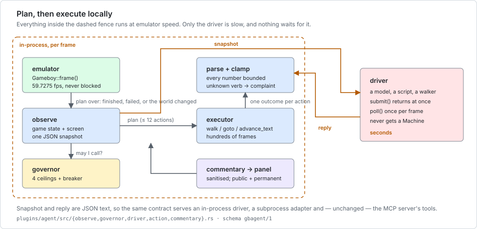

# TerminalGB as an agent environment

*Running and evaluating agents against a real Game Boy, headless, at speed.*

Most of this repository is about accuracy — whether the emulated hardware behaves like the
silicon. This page is about a consequence of that work that nobody here had written down: a
cycle-accurate emulator that is **deterministic across architectures, fast headless, resettable
to any point, and observable as text** is an unusually good place to run an agent.

**The honest framing, up front.** These are *properties*, verified below. Nobody has trained a
model on this emulator. What has actually been run is: a scripted-driver harness in CI, a
subprocess adapter playing a real cartridge, a real model (Claude) playing the opening of
Pokémon Blue through the same contract, and the measurements on this page. What has **not**
been run is any training loop, any benchmark suite, any comparison against another environment,
and anything at all on Windows or macOS. Section [§10](#10-what-has-been-run-and-what-has-not)
says exactly which is which, and it is the section to read before quoting this one.

* [1. The one lesson: frames per model call](#1-the-one-lesson-frames-per-model-call)
* [2. The text-only, terminal-free, at-speed path](#2-the-text-only-terminal-free-at-speed-path)
* [3. Determinism](#3-determinism)
* [4. Speed, in useful units](#4-speed-in-useful-units)
* [5. Save states are the reset primitive](#5-save-states-are-the-reset-primitive)
* [6. The observation space](#6-the-observation-space)
* [7. The action space](#7-the-action-space)
* [8. Recording a dataset](#8-recording-a-dataset)
* [9. Containers, fan-out and safety rails](#9-containers-fan-out-and-safety-rails)
* [10. What has been run, and what has not](#10-what-has-been-run-and-what-has-not)
* [11. Scoring that cannot be gamed](#11-scoring-that-cannot-be-gamed)
* [12. Prior art, and what is different here](#12-prior-art-and-what-is-different-here)

---

## 1. The one lesson: frames per model call

**The emulator is not the bottleneck. The model is.** Measured here, one headless instance runs
**3,000–4,300 frames a second**; a model round trip takes seconds. In the time one call
completes, the machine could have played *an hour of game*.

So the only design lever that matters is **how many emulated frames one model call buys.**
Everything else — cheaper prompts, a faster model, more parallelism — is second order.

Real numbers, all from runs on this page:

| what one call bought | frames | seconds of game |
|---|---:|---:|
| `press A` once (`press_buttons`) | 32 | 0.5 |
| `walk down 1` | 31 | 0.5 |
| `press A` × 6, 40-frame gaps | 288 | 4.8 |
| `advance_text` through 3 boxes | 230 | 3.9 |
| `advance_text` through 4 boxes | 291 | 4.9 |
| `goto (3,7)`, 11 steps round furniture | 331 | 5.5 |
| **a real model playing Blue's opening** (previously measured, `docs/claude-plays.md`) | **~1,100** | **~18** |
| the deliberately naive adapter below (median gap) | 39 | 0.7 |

That last row is the lesson in one line. `tools/agent-docs/canned_adapter.py` mostly emits
single-press plans, so a 23,587-frame run cost **235 model calls — 100 frames per call overall, and a
median gap of 39 frames between consecutive decisions**.
At 40 frames per call, a model that answers in two seconds runs the game at **1/3 of real time**
on hardware that can do 70×. The identical emulator, driven with whole intentions instead of
button taps, does 1,100 frames per call and outruns the console by an order of magnitude.

Concretely, prefer:

```json
{"plan": [{"do": "advance_text"}, {"do": "goto", "x": 4, "y": 7}, {"do": "walk", "dir": "down", "steps": 1}]}
```

over eleven separate `press` calls that achieve the same thing. This is why the action
vocabulary is *intentions* and not buttons, and why every action reports honestly what it
achieved — a batched intention is only affordable if you can tell afterwards whether it worked.

**Corollary for evaluation:** report **frames (or game-seconds) per model call** alongside any
score. Two agents that reach the same place having spent 40 calls and 4,000 calls are not
comparable, and the second one is not an agent, it is a button masher with a language model
attached.



*Why the arrangement is this way round. Everything inside the dashed fence runs at emulator
speed; only the driver is slow, and nothing waits for it. `submit` returns immediately, `poll`
is called once per frame, and the plan the driver returned is carried out locally over hundreds
of frames. The full contract is [`docs/agent-reference.md`](agent-reference.md).*

---

## 2. The text-only, terminal-free, at-speed path

No display server. No terminal. No sound device. No `$HOME`. No image codec. Uncapped speed.

```sh
# build: the emulator and nothing else
cargo build --release --no-default-features --features mcp

# run: 880 KiB of binary, one third-party crate, empty environment
env -i ./target/release/terminalgb-mcp --rom /abs/path/game.gb
```

That really is the whole thing — verified with `env -i`, so not even `PATH` is set. The server
reads JSON-RPC on stdin and writes it on stdout; the only host resources it touches are those
two pipes and the cartridge file.

**Uncapped is the default.** `--speed realtime` exists for when a human is watching; leave it
off and the machine runs as fast as the CPU allows. A one-line throughput check:

```sh
printf '%s\n' \
  '{"jsonrpc":"2.0","id":1,"method":"initialize","params":{}}' \
  '{"jsonrpc":"2.0","id":2,"method":"tools/call","params":{"name":"step","arguments":{"frames":60000}}}' \
  | ./target/release/terminalgb-mcp --rom game.gb --no-battery > /dev/null
```

60,000 frames is 16.7 minutes of console time; here it takes **16–18 seconds**.

For the in-process agent plugin the equivalent is `examples/claude_plays` with **no** `--pace`
flag — the flag is what slows it to real time:

```sh
cargo run --release --features image,plugin-agent --example claude_plays -- \
  --rom target/blue.gb --frames 200000 --log run.ndjson --report \
  --driver command --command ./my_adapter.py          # --command must be LAST
```

Measured on a real cartridge with a subprocess adapter answering every call:
**4,038 emulated fps, 67.6× real time**, with the adapter in the loop.

And from Python, without writing any Rust — [`tools/agent-docs/gb_env.py`](../tools/agent-docs/gb_env.py)
is a stdlib-only client over that same stdio transport:

```
$ python3 tools/agent-docs/gb_env.py --rom target/blue.gb
rom          POKEMON BLUE
mode         title  screen.kind no-text trust ok
throughput   3065 frames/s (51x real time)
reset        WRAM $C000 restored exactly: True
press        one A -> cutscene
```

**There is no `--tui` and there never will be.** The MCP transport *is* stdin/stdout; a
terminal frontend owns both, and running them together would interleave escape sequences with
JSON-RPC frames. A human who wants to watch a headless run gets `--video-out`
([`docs/video-out.md`](video-out.md)) at +0.007 ms/frame, or `--speed realtime` and the terminal
frontend with the plugin instead.

---

## 3. Determinism

**Same start state plus same inputs gives the same frames — on every architecture that has been
tried.** For evaluation and for anything resembling reinforcement learning, reproducibility is
the whole ballgame, and a guarantee that survives a change of CPU is not common.

Verified by running `./tools/run-cross.sh` (`make test-external`'s sibling, `make test-cross`)
while writing this page:

```
== host x86_64: building the reference
   frame hash 0x01acf78fe505f31c
   state bytes 142093

== aarch64-unknown-linux-musl     PASS: identical to the host
== armv7-unknown-linux-musleabihf PASS: identical to the host
== i686-unknown-linux-musl        PASS: identical to the host

run-cross: 3 target(s) ran a cartridge and agreed with the host, pixel for pixel
```

Four architectures — 64- and 32-bit, little-endian ARM and x86 — produce a **byte-identical
framebuffer** and a **byte-identical save-state length** from the same cartridge. The harness
fails on a one-pixel disagreement. `docs/portability.md` records the same frame hash from a
**PSP** (MIPS), which this crew did not re-measure.

The runner needs `qemu-<arch>-static`; a **missing one is a loud SKIP, never a silent pass**.
Without root, fetch it in a minute:

```sh
mkdir /tmp/q && cd /tmp/q
dnf download qemu-user-static-aarch64 qemu-user-static-arm
for r in *.rpm; do rpm2cpio "$r" | cpio -idmu; done
GB_QEMU_DIR=/tmp/q/usr/bin make test-cross
```

**What determinism here does and does not mean.** It means: from a given machine state, a given
sequence of inputs produces a given sequence of frames, anywhere. It does **not** mean the
*game* is predictable — Gen 1's `Random_` mixes the `DIV` register in on every call, so a wild
Pokémon's species and DVs depend on exactly when the roll happens, and any change to emulation
timing moves them (`docs/trainer.md` records exactly that happening). The determinism is of the
machine, which is what a replay or an A/B needs; it is not a seed you can pin.

There is one deliberate host read: `$GB_MODEL`, and only when the model is `auto`. Pass
`--model dmg` or `--model cgb` and even that is gone. MBC3 clock cartridges read the wall clock
to advance their RTC across a save; nothing else in the core touches the host.

---

## 4. Speed, in useful units

Measured on this machine (20 cores, release build, contended — other work was running), through
the JSON-RPC protocol itself, stepping 60,000 frames per instance from a real save state:

| instances | total frames/s | vs real time | ms/frame/instance |
|---:|---:|---:|---:|
| 1 | 3,764 | 63× | 0.266 |
| 4 | 12,877 | 216× | 0.078 |
| 8 | 21,091 | 353× | 0.047 |
| 16 | 31,485 | **527×** | 0.032 |

In units that matter for planning a run:

* **one instance ≈ 1 game-hour per wall-minute** (63× ≈ 3,780 game-seconds per wall-minute).
* **16 instances ≈ 22 game-days per wall-hour.**
* A 20-minute Pokémon episode is **~19 seconds** of wall clock on one instance, or ~2.3 seconds
  of amortised time in a 16-wide fan-out.
* Peak memory is small: the binary is 880 KiB dynamic (**974 KiB fully static**, see §9) and a
  save state is 142 KB, so instances are bounded by cores, not by RAM.

Scaling is sub-linear past ~8 on this box, which is what you would expect on 20 contended cores.
**Re-measure on your own hardware** — the reproduction command is in §2 and takes 15 seconds.

**These figures are the emulator alone.** Add a model and §1 applies: at 40 frames per call you
will not see any of this, and at 1,100 you will.

---

## 5. Save states are the reset primitive

`save_state` / `load_state` snapshot and restore the **complete machine** — CPU, RAM, VRAM,
the PPU's counters, the timer, the APU's frame sequencer, the MBC's banking and its clock. That
is the reset an episode loop needs, and it makes arbitrary start conditions free: you can begin
an episode at the title screen, outside a gym, three tiles from a wild encounter, or mid-battle,
by playing there once and snapshotting.

| | |
|---|---|
| size | **142,093 bytes** for a cartridge with no RAM; 174,879 for Pokémon Blue's 32 KiB of battery-backed RAM. It moves when the format does — the Mealybug PPU campaign added two bytes while these pages were being written, and the gate below caught it |
| format | `GBSS`, versioned (**v22** today), hand-rolled, no dependency |
| refuses | a different cartridge (title + global checksum), a bad magic, a version mismatch, a truncated file |
| does **not** carry | the ROM (states are small and never redistribute a game), plugin state, the server's `frame` counter |
| where | a numbered slot under `--state-dir`, or an exact `path` you choose |

The round trip is gated, not assumed. `cargo test --release --test savestate` runs a cartridge,
snapshots, restores into a *fresh machine* and asserts **byte-identical framebuffers and
byte-identical full-state snapshots on every frame afterwards** — plus, on two Blargg ROMs,
`save/load at all 300 frame boundaries stayed identical`, and the negative cases
(magic / version / truncation / wrong game) are all rejected.

```python
env.reset(state="episode-start.gbss")     # exact, every time
... run the episode ...
env.snapshot("checkpoint-42.gbss")        # a new reset point, for curriculum work
```

**One trap, and it is the reason `gb_env.py`'s self-test checks work RAM instead:** `observe`'s
`frame` field is a **session** counter — how many frames this server has run — and `load_state`
deliberately does not rewind it. Compare a memory read, or the structured state, to prove a
reset landed. Never the frame number.

---

## 6. The observation space

Three channels, in descending order of how much you should want them.

**1. Structured state — a few hundred bytes.** Map id and name, tile coordinates, facing, the
map's exits, party with levels and HP, badges, money, the battle opponent. Read straight out of
the game's own RAM at documented addresses, so it costs the model nothing to interpret and
cannot be misread the way pixels can. Pokémon Red/Blue (English) only. Full field table:
[`docs/agent-reference.md` §4](agent-reference.md#4-observe-field-by-field).

**2. The screen, as text.** Gen 1 loads its font so a tile id *is* a character code, so the
tilemap decodes to what a player would read — and this is where the design differs most from a
pixel environment. A language model reasons far better over

```
▶POKéDEX
 POKéMON
 ITEM
```

than over 160×144 RGB. The block carries `kind` (`no-text` · `text` · `dialogue` · `menu` ·
`yes-no` · `naming-keyboard`, i.e. *what does A do here*), `selected` (exactly what the cursor
points at) and `trust`.

**`trust` is the part worth copying into your own environment.** When the decode cannot be
believed, the text is **withheld** and the reason is stated: `graphics-not-text` (artwork whose
tiles happen to fall in the font range — the Game Freak intro genuinely decodes as
`ABCDEFGHIJKLMNOP`), `still-redrawing`, `screen-off`. An observation that says *"I cannot read
this, and here is why"* is worth far more than one that guesses; letter salad delivered in the
same field as good data poisons the good data. Consume it as:

```python
s = obs["screen"]
if s["trust"] != "ok":
    env.step_frames(30)          # a fact, not a failure: look again
elif s["kind"] == "no-text":
    ...                          # genuinely no text on screen — also a fact
else:
    read(s["text"], s.get("selected"))
```

Fourteen real screens with their raw 20×18 grids and verdicts are in
[`docs/agent/examples/screen-tour.txt`](agent/examples/screen-tour.txt).

**3. Pixels and raw memory, as fallbacks.** `screenshot` returns a PNG (and `--screenshot-scale`
upscales it); `read_memory` returns bytes exactly as the CPU sees them **without perturbing
timing**, which is what makes an agent fast instead of squinting. Both are escape hatches — and
`read_memory` is the one to think hardest about before granting to an *evaluated* agent (§11).

**What no channel gives you: sprites.** People, Poké Balls and objects are OAM sprites drawn
over the tilemap and appear in **no** text channel at any trust level. `kind: no-text` means
there is no text, not that the room is empty. That gap is documented rather than papered over.

---

## 7. The action space

Two levels, both bounded, both reporting honestly.

**Buttons** — `press_buttons`, any cartridge: the eight keys, with explicit `hold_frames` and
`gap_frames`, run to completion before the call returns so state read straight afterwards
reflects them.

**Intentions** — `run_actions` / a driver's `plan`, Pokémon Red/Blue: `press`, `wait`, `walk`,
`goto`, `advance_text`. Up to 12 per call, every count clamped by the host, every one reporting
what it achieved:

```
head for (3,7) — arrived at (3,7) after 11 step(s)
walk down 1 — blocked after 0 step(s) at (3,7) — a wall that way
read through the text — read through 4 text box(es)
read through the text — stopped after 0 press(es): the naming keyboard is up, and A here
                        TYPES A LETTER instead of advancing. Press START to finish the name.
```

Two properties an environment designer should note. **Every action is bounded** — there is no
"repeat until it works", so no action can consume an episode. And **two screens are refused on
purpose**: `advance_text` will not press A on the naming keyboard (where A types a letter for
ever) or on a YES/NO box (where A *answers a question* with whatever was already selected).
Both refusals exist because a real run walked into them; both report the refusal rather than
silently doing nothing.

Full vocabulary, clamps, aliases and outcome strings:
[`docs/agent-reference.md` §6](agent-reference.md#6-the-action-vocabulary).

---

## 8. Recording a dataset

**The decision log already is the dataset.** Run the agent plugin with `--log` (or
`GB_AGENT_LOG`) and every decision is one NDJSON record carrying the snapshot **verbatim**, the
driver's reply verbatim, the wall-clock latency and the reported usage:

```json
{"ev":"decision","decision":2,"frame":403,"ms":913,
 "request":"{…the whole gbagent/1 snapshot…}",
 "reply":"{\"goal\":…,\"plan\":[…]}",
 "usage":{"input_tokens":1533,"output_tokens":88,"usd":0.0046}}
```

[`tools/agent-docs/log_to_dataset.py`](../tools/agent-docs/log_to_dataset.py) flattens that into
one row per decision and, crucially, **joins each decision to the outcomes the next snapshot
reports for it** — so the label is what the executor observed, not what the driver hoped:

```
$ python3 tools/agent-docs/log_to_dataset.py run.ndjson --stats > dataset.jsonl
decisions            235
frames per decision  min 22  median 39  max 381  mean 40
emulated frames      9294  (155.6 s of game)
driver latency ms    mean 14  max 16
actions executed     918, of which 918 changed the world
reported usage       2011600 tokens, $0.9400
```

Each row is `{decision, frame, latency_ms, observation, action, outcomes, interrupted,
notes_next, usage, frames_to_next}`. `outcomes` is the honest label; `frames_to_next` is the
efficiency number from §1.

Two things it deliberately does *not* do: it does not invent a reward (§11), and it does not
drop the final decision of an episode — a row with no successor is emitted with nulls, because
silently losing the last row of every episode is how an evaluation ends up measuring something
other than what it meant to.

For frames as well as facts, `--frame-capture <dir>` writes a PNG per decision and puts its path
in the snapshot as `frame_png`. It is off by default because it is the expensive channel.

---

## 9. Containers, fan-out and safety rails

### It containerises to almost nothing

```sh
rustup target add x86_64-unknown-linux-musl
cargo build --release --target x86_64-unknown-linux-musl \
  --no-default-features --features mcp --bin terminalgb-mcp
```

produces a **974 KiB fully static binary** (`file` says `static`, `ldd` says `statically
linked`) that runs under `env -i`. So:

```dockerfile
FROM scratch
COPY terminalgb-mcp /terminalgb-mcp
COPY game.gb /game.gb
ENTRYPOINT ["/terminalgb-mcp", "--rom", "/game.gb"]
```

`FROM scratch` is not a flourish — there is nothing else to put in the image. The dependency
tree for that build is exactly one third-party crate, `blip_buf` (the audio resampler); every
other node is in this repository. Check it yourself with
`cargo tree --no-default-features --features mcp -e normal`.

**The cartridge is yours to supply.** No ROM is distributed here, and none ever will be. The
only cartridge in the repository is the MIT-licensed `third_party/dmg-acid2/dmg-acid2.gb`, which
draws a picture and nothing else — useful for a smoke test, useless as a game.

### Fanning out

Instances share nothing: separate processes, separate cartridge copies, separate `--state-dir`.
The one rule, and it is the one that has already destroyed a save in this project's history:
**never point two instances at one ROM path**, because the MBC writes a `.sav` beside it. Copy
the cartridge per instance, or pass `--no-battery` (which loads no save either — see
`docs/mcp.md` §5). Note the naming trap while you are staging: the extension is **replaced**,
so `game.gb` saves to `game.sav`, not `game.gb.sav`
([`docs/pitfalls/environment.md`](pitfalls/environment.md)).

```sh
for i in $(seq 16); do
  mkdir -p /tmp/gb/$i && cp game.gb /tmp/gb/$i/
  ./terminalgb-mcp --rom /tmp/gb/$i/game.gb --state-dir /tmp/gb/$i/states < plan.jsonl &
done; wait
```

### Safety rails, for a run nobody is watching

The agent plugin's [governor](agent-reference.md#7-the-governor) is four independent ceilings —
calls, tokens, spend and **wall clock** — plus a circuit breaker and repetition detection, all
in the host where no driver can reach them. Tokens and spend are self-reported by the driver, so
treat them as a floor; the wall clock is the one that cannot be evaded.

It fires. In a run for this page the token ceiling stopped a 235-call session at 2,011,600
reported tokens and printed `halted by: token-cap`; the emulator carried on at full speed with
nobody at the controller, which is exactly the intended behaviour.

Two failure properties worth having in an unattended run, both gated in CI: **the emulator never
waits on the model** (0.25 ms/frame against a driver that never answers, gate 4 ms), and **a
driver's error text never escapes to anything public** — the commentary panel is given a
category, never a message, and a test asserts no history line contains a path or a filename.

---

## 10. What has been run, and what has not

**Run, and reproducible from this repository:**

| | |
|---|---|
| the agent stack end to end against a hand-assembled Gen-1-shaped cartridge, in CI | `cargo test --release --features plugin-agent --test agent` — 16/16 |
| a subprocess adapter playing a real cartridge, 235 decisions, no failures, budget halt | `examples/claude_plays` + `tools/agent-docs/canned_adapter.py` |
| a real model (Claude) playing Pokémon Blue's opening | `docs/claude-plays.md` §10–12 |
| a real MCP client (Claude Code) driving the server | [`docs/agent-reference.md` §9c](agent-reference.md#9c-a-real-mcp-client) |
| byte-identical frames on 4 architectures | `make test-cross` |
| save/load exact at every frame boundary | `cargo test --release --test savestate` |
| the throughput and fan-out figures in §4 | the commands in §2 and §4 |
| a static `FROM scratch`-able binary running under `env -i` | §9 |

**Not run, and not claimed:**

* **No model has been trained here.** Not fine-tuned, not RL-ed, not distilled. The properties
  above are what would make it feasible; feasible is not done.
* **No benchmark or leaderboard.** There is no task suite, no reward function and no baseline
  score, deliberately (§11).
* **No comparison against another environment.** The figures in §4 are absolute, on one machine,
  and have not been measured against PyBoy, ALE or anything else.
* **No Gymnasium API and no Python package.** [`gb_env.py`](../tools/agent-docs/gb_env.py) is a
  ~200-line client, not a library; it has no `spaces`, no `reward` and no `terminated`.
* **Structured state is Pokémon Red/Blue (English) only.** Every other cartridge works through
  `screenshot`, `read_memory`, `press_buttons` and `step` — which is a pixel-and-bytes
  environment, not a text one.
* **Linux only, measured on one machine.** The core cross-compiles and is type-checked for
  Windows and macOS; nothing here has been *run* on either.
* **Multi-instance beyond 16 has not been measured**, and scaling is already sub-linear at 8.

---

## 11. Scoring that cannot be gamed

This project's standing rule is that a number must be earned — the test harness refuses to pin
any expectation to its own output, and the suites all judge by the ROM's own verdict. The same
discipline applies to scoring an agent, and the failure mode is the same: **an easy number is
worse than no number**, because it gets quoted.

Concrete ways an agent will score well without playing well, and what to do:

| the cheat | why it works | the counter |
|---|---|---|
| **save-scumming** | `save_state`/`load_state` make retrying free, so a search beats a policy | do not expose them to the agent. Keep reset in the *harness*, and count resets |
| **memory reads as an oracle** | `read_memory` at a known address answers questions the game never showed on screen | withhold `read_memory` from an evaluated agent, or count and report its use as part of the score |
| **RNG manipulation** | `Random_` mixes `DIV` in, so re-attempting the same moment resamples until a roll goes your way | forbid resets *within* an episode; make an episode one continuous run |
| **memorising a route** | the environment is deterministic, so a fixed button sequence reproduces exactly | randomise the start state across a *set* of snapshots, and hold some out |
| **plan-free button mashing** | a big enough call budget brute-forces menus | report frames per model call (§1) beside any score; publish the call count |
| **scoring on a proxy** | badges, money and party size are all reachable by odd routes | prefer game-defined events, and say which addresses the score reads |

Two things this environment gives you for that, free: the log records **every** decision with
its cost, so a score is always auditable against how it was reached; and the outcome strings are
the executor's observation rather than the agent's claim, so "I walked to the door" is
distinguishable from "I tried to walk to the door".

**No reward function is shipped, and that is a decision, not an omission.** A default reward
becomes everybody's benchmark by accident, and this repository has watched a hand-typed constant
outlive its own correction by months. `gb_env.py`'s `reward_from()` raises `NotImplementedError`
with a pointer to this section.

**What *is* shipped is a floor.** [The swarm view](swarm-view.md) runs twenty-four decorrelated
random walkers from one save state and publishes where they end up, so any score on that
corridor can be read against what undirected play achieves — which on Route 1 turns out to be
"drains south through the ledges and never reaches Viridian City". A null model is the cheapest
defence on the list above: most of the cheats produce a number that looks impressive until it is
put next to one.

---

## 12. Prior art, and what is different here

Being accurate about this matters more than being flattering.

* **The Arcade Learning Environment** (Bellemare, Naddaf, Veness & Bowling, 2013) established
  the shape of the whole field: an accurate console emulator wrapped as an RL environment, with
  the game's own score as the reward. It is Atari 2600, pixel-and-RAM observations, and it ships
  a reward per game — which is exactly the design decision this page declines to make.
* **Gymnasium** (the Farama Foundation's fork of OpenAI Gym) is the de-facto API — `reset()`,
  `step(action) -> (obs, reward, terminated, truncated, info)`, and typed `spaces`. **TerminalGB
  does not implement it.** [`gb_env.py`](../tools/agent-docs/gb_env.py) is deliberately
  Gym-*shaped* and Gym-*free*; writing a real `Env` on top is a small job and would belong in
  the user's project, not here, precisely because the reward and the episode boundary are theirs.
* **PyBoy** is the established Python Game Boy emulator used for this kind of work and is the
  obvious comparison. It optimises for a different point
  — being a Python library first — where this optimises for accuracy and for a
  dependency-free, embeddable, cross-architecture-identical core. No head-to-head has been run
  here, and the accuracy scores this repository publishes are against test-ROM suites, not
  against anybody's throughput.
* **The public "AI plays Pokémon" efforts**, including Anthropic's own Claude-plays-Pokémon
  stream, are agent scaffolding around an emulator: a screen, a button API, and a lot of prompt
  engineering. What is unusual here is that the *scaffolding is in the emulator* and is
  documented and tested — the bounded action executor, the trust signal on the screen decode,
  the budget governor and the honest outcome reporting are components with tests, not prompt
  text.

**What is genuinely unusual about this one**, stated without inflation: byte-identical frames
across four architectures with a harness that enforces it; a text observation channel with an
explicit *withheld-and-why* signal; a bounded action layer that reports what it actually
achieved; a one-third-party-dependency static binary that runs under `env -i`; and a budget
governor built for unattended runs. Every one of those is verified above.

---

## Where else to look

| | |
|---|---|
| [`docs/agent-reference.md`](agent-reference.md) | every hook, field and payload, with generated examples |
| [`docs/mcp.md`](mcp.md) | installing and configuring the server |
| [`docs/claude-plays.md`](claude-plays.md) | the design, the recorded runs, the streaming setup |
| [`docs/portability.md`](portability.md) | the cross-architecture and PSP measurements |
| [`docs/savestates.md`](savestates.md) | the state format, block by block |
| [`docs/telemetry.md`](telemetry.md) | per-frame run data as NDJSON |
| [`docs/testing.md`](testing.md) | how this project decides a number is earned |
| [`docs/pitfalls/`](pitfalls/README.md) | when the tooling is lying to you — including the [`.sav` naming trap](pitfalls/environment.md) that bites anyone fanning out instances |
