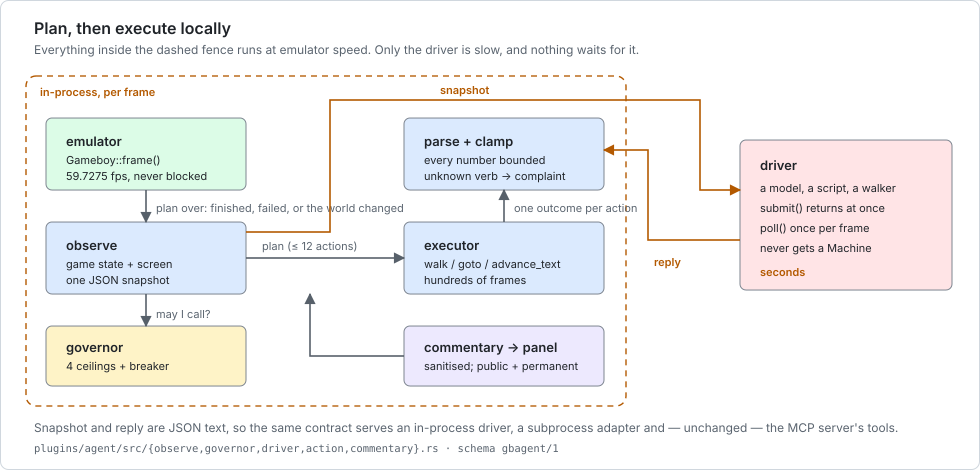
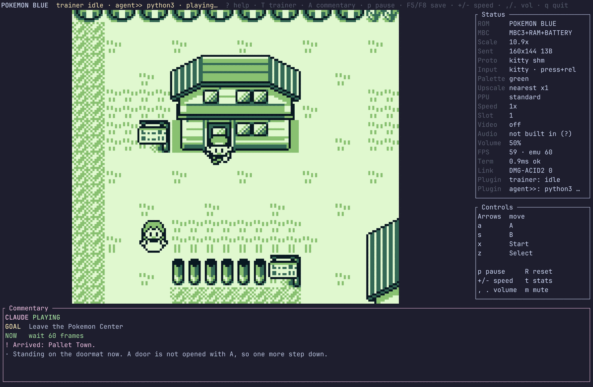
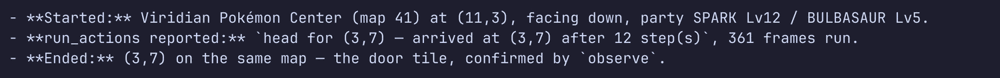

# Agent reference — every hook, every field, every example

This is the integrator's page: **what you receive, what you send, and what each field
promises.** [`docs/mcp.md`](mcp.md) is the install guide, [`docs/claude-plays.md`](claude-plays.md)
is the design essay, [`plugins/agent/README.md`](../plugins/agent/README.md) is the one-page
overview. This one is the surface.

Every payload below was **generated by running the thing** and is committed under
[`docs/agent/examples/`](agent/examples/). Regenerate the lot with

```sh
cargo build --release --no-default-features --features mcp
cargo build --release --features image,plugin-agent --example claude_plays
cargo build --release --features plugin-agent --example screen_text
python3 tools/agent-docs/capture.py --rom ~/roms/blue.gb --save ~/roms/blue.sav
```

If a payload on this page and one in that directory disagree, **this page is wrong**.
Nothing here is hand-written JSON.

| file | what it is |
|---|---|
| [`mcp-transcript.md`](agent/examples/mcp-transcript.md) | every MCP tool, request and reply, in order |
| [`mcp-transcript.jsonl`](agent/examples/mcp-transcript.jsonl) | the same replies as raw JSON-RPC lines |
| [`tools-list.json`](agent/examples/tools-list.json) | the complete `tools/list` reply, every `inputSchema` in full |
| [`agent-snapshots.md`](agent/examples/agent-snapshots.md) | three real `gbagent/1` snapshots and the driver replies to them |
| [`agent-run.txt`](agent/examples/agent-run.txt) | the run those snapshots came from, with its summary |
| [`screen-tour.txt`](agent/examples/screen-tour.txt) | fourteen real screens: the raw 20×18 grid, the decode, the verdict |

---

## 1. Two ways in, and how to choose

There are exactly two supported entry points, and they wrap the *same* perception and the
*same* executor.

| | **MCP server** (`terminalgb-mcp`) | **agent plugin** (`plugins/agent`) |
|---|---|---|
| you are | an MCP client — Claude Desktop, Claude Code, your own | a program that owns the emulator |
| who drives the clock | **you**, one tool call at a time | the emulator, at 59.7 fps, continuously |
| the model is called | whenever you decide | when a plan ends, fails, or the world changes |
| transport | JSON-RPC 2.0 over stdio | a snapshot on a subprocess's stdin |
| budget enforcement | your client's | the [governor](#7-the-governor), in the host |
| commentary panel | no | yes |
| build | `--no-default-features --features mcp` | `--features plugin-agent` |
| reference | [§3](#3-the-mcp-tool-surface) | [§5](#5-the-agent-plugin-hooks-and-extension-points) |

Both refuse to be combined: an MCP client already *is* the agent, so
`terminalgb-mcp --plugins agent` returns that explanation rather than attaching two
controllers to one game.

---

## 2. The loop



The load-bearing property is the dashed fence. `Driver::submit` returns immediately and
`Driver::poll` is called once per emulated frame; nothing ever waits. Gated in CI against a
driver that is permanently thinking *and* one that has died — the gate is **under 4 ms/frame**
against a 16.743 ms budget, and both measured **0.25 ms/frame** on the machine these docs were
written on (`testharness/agent.rs`, `case_the_emulator_never_waits_for_the_agent` and
`case_a_dead_agent_does_not_stop_the_game`).

Measured on Pokémon Blue's opening, that shape costs **about one model call per 1,100
emulated frames** — which is what makes an unattended run affordable.



*The terminal frontend with the agent attached. Note the `agent>>` marker in the top bar and
in the Status panel: `>` means "may press buttons", `>>` means "has pressed". A plugin that is
playing your game is never invisible. Produced by
[`tools/agent-docs/canned_adapter.py`](../tools/agent-docs/canned_adapter.py), which is a
complete working driver in 70 lines.*

---

## 3. The MCP tool surface

Eleven tools, plus `write_memory` when the operator asks for it. The complete schemas are
[`tools-list.json`](agent/examples/tools-list.json); this is the shape of each reply.

Every tool returns MCP's standard `{"content":[{"type":"text","text":…}],"isError":false}`.
`screenshot` adds a second content block of `{"type":"image","data":<base64>,"mimeType":"image/png"}`.

| tool | arguments | reply text | `isError` when |
|---|---|---|---|
| `load_rom` | `path` (required), `model` (`auto`\|`dmg`\|`cgb`) | title + whether structured state is available | the file cannot be read or is not a cartridge |
| `reset` | — | `Cartridge rebooted from cold.` | no cartridge loaded |
| `observe` | — | [the JSON object in §4](#4-observe-field-by-field) | no cartridge loaded |
| `screenshot` | `scale` 1–6 | `Frame N — WxH PNG.` + an image block | no cartridge loaded |
| `read_memory` | `address` 0–65535 (required), `length` 1–256 | `$D35E..$D362` / `hex: …` / `dec: …` | address out of range |
| `press_buttons` | `buttons[]` (required), `times` 1–64, `hold_frames` 1–120, `gap_frames` 0–240 | `Pressed a x6 (8f hold, 40f gap) over 288 frames. Now at frame 3020.` | unknown button, or an empty list |
| `run_actions` | `actions[]` (required) | one line per action, then a frame count — [§6](#6-the-action-vocabulary) | **no** action parsed |
| `step` | `frames` (required) | `Ran N frames. Now at frame M.` | no cartridge loaded |
| `save_state` / `load_state` | `slot` 0–99 **or** `path` | the file written or restored, with its size | wrong cartridge, missing file |
| `render_audio` | `score` \| `path`, `out`, `rate`, `model`, `seconds`, `registers` | length, peak, RMS, channels, optionally the register script | the score does not compile |
| `write_memory` | `address`, `bytes[]` | how many bytes landed | **absent from `tools/list`** without `--allow-write-memory` |

### Defaults that are not obvious

* `press_buttons` holds for `DEFAULT_HOLD` = **8 frames** and then waits `MENU_GAP` = **24
  frames**. The gap is not caution: Gen 1's `HandleMenuInput` delays several frames after
  accepting a press, so two presses eight frames apart look exactly like dropped input.
* `step` is capped by `--max-frames`, default **60000**, and the cap is **reported**:

  ```
  Ran 60000 frames (asked for 999999; the server's --max-frames is 60000). Now at frame 63782.
  ```
* `run_actions` inherits every clamp in [§6](#6-the-action-vocabulary). Numbers are silently
  bounded; *verbs* are not — an unknown one is an error you can learn from.

### The three error shapes, and which is which

**1. A tool that is not there** is a JSON-RPC error, because the fault is in the request:

```json
{"jsonrpc": "2.0", "id": 20, "error": {"code": -32602,
 "message": "unknown tool 'write_memory' — this server was not started with --allow-write-memory"}}
```

**2. A tool that ran and could not do the job** is a *successful* call carrying `isError`,
because that is what MCP asks for — a transport-level error is a fault most clients never show
the model, so it cannot adapt:

```json
{"jsonrpc": "2.0", "id": 21, "result": {"content": [{"type": "text",
 "text": "no usable actions: action 1: unknown action \"teleport\""}], "isError": true}}
```

**3. A notification gets no reply at all.** `notifications/initialized` has no `id`;
answering it is a protocol error some clients treat as fatal.

---

## 4. `observe`, field by field

One `observe` is a few hundred bytes and is the only way to tell whether an action worked. A
real reply, from the overworld:

```json
{"rom":"POKEMON BLUE","frame":3420,"mode":"overworld","in_game":true,"player":"BLUE",
 "position":{"map":41,"map_name":"Viridian Pokémon Center","x":11,"y":3,"facing":"down",
             "map_width":14,"map_height":8},
 "exits":[{"x":3,"y":7,"to_map":255},{"x":4,"y":7,"to_map":255}],
 "badges":0,"money":3000,
 "party":[{"name":"SPARK","level":12,"hp":34,"max_hp":34},
          {"name":"BULBASAUR","level":5,"hp":20,"max_hp":20}],
 "screen":{"trust":"ok","kind":"no-text","text":"","waiting_for_input":false,
           "menu_cursor_row":null}}
```

| field | type | range / units | absent when |
|---|---|---|---|
| `rom` | string | the cartridge header title, up to 16 bytes | never |
| `frame` | number | frames **this server session** has run; 59.7275 = one second. `reset` and `load_rom` zero it; **`load_state` deliberately does not**, so it is a monotonic clock for the session, not machine state | never |
| `mode` | string | `title` · `overworld` · `dialogue` · `menu` · `battle` · `transition` · `cutscene` | never |
| `in_game` | bool | a save is loaded and the player exists | never |
| `player` | string | the player's name from the save | `in_game` is false |
| `position.map` | number | 0–255, Gen 1's map id | not in game |
| `position.map_name` | string | our table's name for that id | the id is not in the table |
| `position.x` / `.y` | number | **tiles**, not blocks — see the warning below | not in game |
| `position.facing` | string \| null | `up` · `down` · `left` · `right`; `null` means the byte was sampled mid-update | never, when in game |
| `position.map_width` / `_height` | number | the map in **blocks**; one block is two tiles each way | no map header is loaded |
| `position.map_loaded` | bool | present **only** as `false`, replacing width/height | a header *is* loaded |
| `exits[]` | array | every warp on this map: `x`, `y` in tiles, `to_map`, and `to` when named | not in game (may legitimately be empty — the Cable Club has none) |
| `badges` | number | 0–8, the *count* of set bits, not the bitmask | not in game |
| `money` | number | 0–999999 | not in game |
| `party[]` | array | `name` (nickname), `level`, `hp`, `max_hp`, and `status` when afflicted | not in game (empty before the first Pokémon) |
| `battle` | object | `{"kind":"wild"\|"trainer","opponent":{…}}` | not in a battle |
| `screen` | object | [§4a](#4a-the-screen-block) | never |
| `note` | string | why there is no structured state | the cartridge *is* Pokémon Red/Blue |
| `fault` | string | the machine faulted and **the save file is no longer being written** | no fault |

**`position.map_loaded: false` is the field that explains why walking does nothing.** During
a cutscene, a warp or the opening, `wCurMap` already holds a plausible id and the coordinates
look plausible with it — but no map header is loaded, so the player is not in control. Nothing
you press will move them. `mode` reads `cutscene` at the same time; the two agree.

**A map's width and height are in 32×32 blocks; every coordinate is in 16×16 tiles.** They are
reported in the units the game stores, so Pallet Town is 10 wide while `x` legitimately runs
0..19. Double the dimensions before comparing.

**`fault` is not cosmetic.** It means a detector decided the cartridge crashed and the
emulator has **withdrawn its own right to write the `.sav`** for the rest of the session
(`docs/link-battle.md`). The game keeps running; the file stops changing.

### 4a. The `screen` block

Gen 1 loads its font so a tile id **is** a character code, which is the only reason a screen
reads back as text at all.

| field | promises |
|---|---|
| `kind` | what shape of screen this is, and so *what A does*: `no-text` · `text` · `dialogue` · `menu` · `yes-no` · `naming-keyboard` |
| `trust` | `ok`, or why the text was **withheld**: `graphics-not-text` · `still-redrawing` · `screen-off` |
| `text` | the visible text, blank lines dropped, indentation kept down to the common margin so a two-column menu still reads as two columns. **Empty string whenever `trust` is not `ok`.** |
| `selected` | exactly what the `▶` cursor points at. On the naming keyboard, the single letter A would type. Absent when no cursor is on screen |
| `note` | present only when text was withheld, saying so in words |
| `waiting_for_input` | the `▼` "press A for more" arrow is showing |
| `menu_cursor_row` | 0–17, or `null` |
| `menu_cursor_col` | 0–19; present only when a cursor is on screen. On a *grid* the row alone cannot say which letter is under the cursor |

`kind` is sent whatever the trust verdict, because it comes from the cursor and arrow glyphs
rather than from words.

#### Worked example: the same layer, four different screens

All four are real, from [`screen-tour.txt`](agent/examples/screen-tour.txt), which prints the
raw 20×18 grid beside the decode for fourteen screens.

**A menu.** The cursor position is a fact, not an inference over rows:

```
mode=menu kind=menu trust=ok waiting=false cursor=Some(2),Some(11) selected=Some("POKéDEX")
|           ▶POKéDEX |          →   text: "▶POKéDEX\n POKéMON\n ITEM\n BLUE\n SAVE\n OPTION\n EXIT"
|            POKéMON |              selected: "POKéDEX"
|            ITEM    |
```

**A dialogue box.** `waiting=true` is the game saying *your turn*:

```
mode=dialogue kind=dialogue trust=ok waiting=true
| Hello there!       |          →   text: "Hello there!\nWelcome to the   ▼"
| Welcome to the   ▼ |
```

**Artwork whose tiles fall in the font range.** This is what `graphics-not-text` exists for —
the Game Freak intro really does decode as sequential letters:

```
mode=cutscene kind=text trust=graphics-not-text
|  ABCDEFGHIJKLMNOP  |          →   text: ""      (withheld)
                                    note: "screen.text was withheld: the tilemap is not
                                           showing readable text right now."
```

**The naming keyboard.** `selected` narrows to a single letter, and it is the screen where A
does *not* mean "continue":

```
mode=menu kind=naming-keyboard trust=ok cursor=Some(5),Some(1) selected=Some("A")
| ▶A B C D E F G H I |
|  J K L M N O P Q R |
```

#### Two things `screen` does not promise

**Sprites are not in `screen.text`, at any trust level.** People, Poké Balls and every other
object are OAM sprites drawn *over* the tilemap. `kind: no-text` on the overworld means there
is no text on that screen — it does not mean the room is empty.

**`still-redrawing` is a plugin verdict, not a server one.** The MCP server answers one call
at a time and does not drive the clock between reads, so its `trust` is the single-read
verdict; deciding "the tilemap is still moving" needs several consecutive frames, which only
the in-process plugin has. A client that cares should `step` a few frames and observe again.

---

## 5. The agent plugin: hooks and extension points

There are exactly four seams. Everything else is internal.

| seam | you implement | you get | you cannot |
|---|---|---|---|
| **`Driver`** (`driver.rs`) | `name`, `submit`, `poll`, optionally `cancel` / `take_stderr` / `costs_money` | the snapshot as a `&str`; you return reply *text* | touch the machine. A driver never receives a `Machine` |
| **a subprocess adapter** (`subprocess.rs`) | a program | the snapshot on stdin | anything else — the contract is four lines, below |
| **`Plugin`** (`terminalgb-plugin-api`) | `name`, `capabilities`, `status`, `on_event`, `as_any`(`_mut`) | `Event::Frame { number }` and `Event::SerialTransfer { sent, received }`, each with a `&mut Machine` | exceed the capabilities you declared |
| **`Config`** (`lib.rs`) | nothing — you set fields | budget, limits, objective, settle, frame capture, log path, history depth | raise a cap from inside a driver |

### 5a. The subprocess adapter contract

```text
stdin   one line of JSON: the state snapshot
stdout  one JSON object:  {"goal":…, "say":…, "plan":[…], "usage":{…}}
stderr  copied to the host's log; never shown to a viewer
exit 0  success; anything else is a failed call
```

That is the whole of it. One process per decision — no stream protocol, no resynchronisation,
no state leaking between decisions, and a hung call is killed by killing a process. It costs a
few milliseconds of spawn against a multi-second model call.

The smallest adapter that works is
[`tools/agent-docs/hello_adapter.sh`](../tools/agent-docs/hello_adapter.sh):

```sh
#!/bin/sh
cat > /dev/null
printf '%s\n' '{"goal":"Press A until something happens",
                "say":"Pressing A. It is a strategy.",
                "plan":[{"do":"press","button":"a","times":8}]}'
```

```sh
GB_PLUGINS=agent GB_AGENT_CMD=tools/agent-docs/hello_adapter.sh \
  cargo run --release --example terminal -- <rom>
```

A useful skeleton — one that actually reads the snapshot and branches on `screen.kind` — is
[`tools/agent-docs/canned_adapter.py`](../tools/agent-docs/canned_adapter.py), 70 lines of
stdlib Python. Replace its `decide()` with a model call and nothing else changes. Verified end
to end through the real subprocess driver: **62 calls, 0 failures**, playing a new game from
the title screen into the bedroom in 12,000 emulated frames at 64x real time.

The shipped adapters for Claude are [`tools/claude_plays/`](../tools/claude_plays/):
`claude_api_adapter.py` (sends ~1.5 KB, the one to use for a real run) and
`claude_cli_adapter.py` (convenient, ~$0.078 for the first call and ~$0.0086 after, because
the CLI loads a whole coding-agent system prompt every time).

### 5b. The snapshot: schema `gbagent/1`

This is what a driver is handed. Every field below is from a real run —
[`agent-snapshots.md`](agent/examples/agent-snapshots.md) has all three decisions in full.

```json
{
  "schema": "gbagent/1",
  "frame": 402,
  "decision": 2,
  "mode": "overworld",
  "game": {
    "in_game": true,
    "player": "BLUE",
    "map": {"id": 41, "name": "Viridian Pokémon Center",
            "x": 3, "y": 7, "facing": "down", "width": 14, "height": 8},
    "exits": [{"x": 3, "y": 7, "to_map": 255}, {"x": 4, "y": 7, "to_map": 255}],
    "badges": 0,
    "money": 3000,
    "party": [{"name": "SPARK", "level": 12, "hp": 34, "max_hp": 34},
              {"name": "BULBASAUR", "level": 5, "hp": 20, "max_hp": 20}]
  },
  "screen": {"trust": "ok", "kind": "no-text", "text": "",
             "waiting_for_input": false, "menu_cursor_row": null},
  "last_actions": [
    {"action": "head for (3,7)", "result": "arrived at (3,7) after 12 step(s)", "changed": true}
  ],
  "notes": [
    "You are standing ON an exit. A door is not opened with A — walk one more step in the direction it faces (for a door at the bottom of a room, that is down) to go through it."
  ],
  "budget": {"calls_used": 1, "calls_max": 400, "fraction_used": 0.003}
}
```

| field | what it is | absent when |
|---|---|---|
| `schema` | `gbagent/1`. Bumped when a field is renamed, retyped or removed; additions are free | never |
| `frame` | frames the plugin has seen, i.e. since it was attached | never |
| `decision` | 1-based; this is the *n*th time you have been asked | never |
| `objective` | the operator's one-sentence standing goal — **not** your plan | no objective was configured |
| `mode` | as in `observe` | never |
| `game.*` | the same facts `observe` reports, nested differently: `game.map` carries `id`/`name`/`x`/`y`/`facing`/`width`/`height`, or `loaded: false` | `in_game` is false |
| `screen.*` | as in [§4a](#4a-the-screen-block), plus `still-redrawing` which only this path can produce | never |
| `last_actions[]` | **what your last plan actually achieved**, `{action, result, changed}`, most recent last. Depth is `Config::history`, default 4 | the first decision |
| `interrupted` | why the last plan stopped early — `"the map changed"`, `"a battle started"` | it ran to completion |
| `notes[]` | situational instructions from the host: see below | nothing applies |
| `budget` | `calls_used`, `calls_max`, `fraction_used` (0.0–1.0 of the *tightest* ceiling) | never |
| `frame_png` | path to a PNG of the current frame | `Config::frame_capture` is unset (the default — it is the expensive channel) |
| `actions_help` / `screen_help` | the action vocabulary and the screen contract, **once per session on the first snapshot only** | every decision after the first |

**`last_actions` is what makes a blind agent viable.** It cannot see the map; it is told
precisely what its last intention did, and whether anything observably changed.

**`notes` is the host promoting a documented fact to an enforced one.** Each entry appears only
when its situation is live, and each exists because a real run walked into it:

| note fires when | because |
|---|---|
| you are standing on an exit tile | Gen 1 fires a warp when you step *through* a door; a run pressed A at one six times |
| your last plan moved nothing at all | "every direction is a wall" almost always means the game is not accepting movement — a cutscene, a text box, a menu |
| the naming keyboard is up | A types another letter for ever; START finishes the name. A run typed a name of A's |
| `trust` is `graphics-not-text` or `still-redrawing` | so an empty `text` is not read as an empty screen |
| a YES/NO box is up | A here *answers a question*, and the default was chosen before you saw it |
| the stuck detector escalated | [§7c](#7c-stuck-detection-nudge--insist--intervene) |

### 5c. The reply

```json
{"goal": "Leave the Pokemon Center",
 "say": "I am standing on the doormat. A door is not opened with A, so I will take one more step down.",
 "plan": [{"do": "walk", "dir": "down", "steps": 1}, {"do": "wait", "frames": 60}],
 "usage": {"input_tokens": 1533, "output_tokens": 88, "usd": 0.0046}}
```

| field | required | notes |
|---|---|---|
| `plan` | effectively yes | up to `Limits::plan_actions` = **12** actions. `actions` is accepted as an alias. An empty or missing plan is **not** a driver failure — you are asked again after a settle and told `"your last reply contained no usable actions"` next time |
| `goal` | no | the standing `GOAL` line a viewer reads. Changes rarely, by design |
| `say` | no | one or two sentences of commentary. `commentary` is accepted as an alias. **Read by strangers**: no JSON, no paths, no jargon — and it is sanitised before it reaches the panel either way |
| `usage` | no | `input_tokens`, `output_tokens`, `usd`. **Self-reported, so only ever a floor** on the true cost. The wall-clock ceiling is what makes trusting it safe |

The reply is parsed with `json::parse_embedded`, so a model that wraps its JSON in prose is
still understood. Every number is then clamped by the host — a driver cannot make the emulator
do anything a player could not.

### 5d. Configuration

| `Config` field | default | env / config key |
|---|---|---|
| `budget` | [§7](#7-the-governor) | `agent_max_calls`, `agent_max_usd`, `GB_AGENT_WALL` (seconds) |
| `limits` | [§6](#6-the-action-vocabulary) | — |
| `objective` | empty | `GB_AGENT_OBJECTIVE`, `agent_objective` |
| `settle_frames` | 20 | — |
| `frame_capture` | `None` | — |
| `log` | `None` | `GB_AGENT_LOG` |
| `history` | 4 | — |
| the driver command | none — **and there is no default** | `GB_AGENT_CMD`, `agent_command` |

With no `agent_command` the frontend refuses to attach and says so, rather than putting an
inert plugin in the status bar. The frontend also raises `call_timeout` to **150 s**, because
the shipped CLI adapter legitimately retries up to 2 × 60 s; at the library default of 60 s a
slow call is killed mid-retry and the game appears to sit on a menu doing nothing.

### 5e. What it declares, and what that buys you

```rust
Capability::OBSERVE | Capability::READ_MEMORY | Capability::CONTROL_INPUT
```

**Not `WRITE_MEMORY`** — and this is enforced by the host per call, not promised in a comment:
`Machine::poke` returns `false`. An agent that can poke RAM is editing the game rather than
playing it. The status bar marks the plugin `>` for "may press" and `>>` the moment it presses
anything.

---

## 6. The action vocabulary

Five verbs. The same list serves `run_actions` over MCP and `plan` in a driver reply, because
it is the same executor (`plugins/agent/src/action.rs`).

| action | fields | clamped to | reports |
|---|---|---|---|
| `press` | `button` (required), `times`, `hold` | `times` 1–`max_repeat` (**20**), `hold` 1–120 frames | `done` |
| `wait` | `frames` | ≤ `max_wait` (**300**) | `done` |
| `walk` | `dir` (required), `steps` | `steps` 1–`max_steps` (**24**) | how far it got, and why it stopped |
| `goto` | `x`, `y` (both required), `max_steps` | 0–255; `max_steps` 1–24 | arrival, or where it gave up |
| `advance_text` | `max_presses` | 1–`max_text_presses` (**40**) | how many boxes it read, or why it refused |

Aliases are accepted for the verb (`tap`/`button` → `press`, `move` → `walk`,
`go_to`/`walk_to` → `goto`, `advance`/`talk`/`text` → `advance_text`) and for fields
(`action` for `do`, `key` for `button`, `direction` for `dir`, `count` for `times`).

**An unknown verb is an error, never a silent no-op** — a driver whose actions vanish cannot
learn anything. It comes back as `action 3: unknown action "teleport"` in `notes` next time, or
as `isError` from `run_actions` when *nothing* parsed.

### The outcome strings, which are the API

`walk`:

```
walk down 1 — walked 1 step(s) to (11,4)
walk down 1 — blocked after 0 step(s) at (3,7) — a wall that way
walk up 6 — only managed 2 step(s), now at (3,5)
```

`goto` — greedy, goes *round* what blocks it, and gives up rather than wandering:

```
head for (3,7) — arrived at (3,7) after 11 step(s)
head for (3,7) — stuck at (11,3) trying to reach (3,7) — walls in the way. Walk several
                 steps sideways and try again from there
head for (3,7) — ran out of steps at (7,4), wanted (3,7)
```

`advance_text` — one call instead of thirty, and it **refuses two screens on purpose**:

```
read through the text — read through 4 text box(es)
read through the text — still more text after 40 presses — it did not end
read through the text — nothing to read — the game was not showing text, and the screen
                        did not change
read through the text — stopped after 0 press(es): the naming keyboard is up, and A here
                        TYPES A LETTER instead of advancing. Press START to finish the name.
read through the text — stopped after 2 press(es): a YES/NO box is up (cursor on YES).
                        A here ANSWERS the question — read the text, pick YES or NO
                        deliberately.
```

Both refusals are enforced in the executor, *before any press*, because a real run typed a name
of A's from inside this very loop — the model never got a say.

### The constants, and why they are not round numbers

| constant | value | measured against |
|---|---|---|
| `WALK_HOLD` | 16 frames | a Gen 1 step animation is 16 frames; holding for the whole of it is what makes one press one *tile* rather than a turn in place |
| `WALK_GAP` | 14 frames | at 6 the coordinate is still being written when it is read, and every step reports "blocked" |
| `WALK_MISSES` | 3 | **not one.** A press that finds the player facing another way only turns them; declaring a wall on the first unchanged reading is wrong about half the time |
| `GOTO_BARREN` | 8 | `goto` is *supposed* to bump into things — that is how it discovers the obstacle |
| `GOTO_DETOUR` | 4 steps | a building's width in Pallet Town |
| `MENU_GAP` | 24 frames | Gen 1's `HandleMenuInput` delays several frames after accepting a press |
| `plan_frames` | 1500 | ~25 seconds of game before a plan is abandoned and the driver asked again |
| `text_settle` | 24 frames | measured: a dialogue box waiting on the blinking `▼` changes 6 times in 240 frames, longest identical run **39 frames** |

---

## 7. The governor

Four independent ceilings and a circuit breaker, in the **host** — not in the driver and not
in a prompt. `Governor::gate` is asked before any call starts and is the only place a call can
begin. A driver cannot raise them, ignore them, or fail to implement them.

### 7a. The four ceilings

| ceiling | `Budget` field | default | catches |
|---|---|---|---|
| calls | `max_calls` | 400 | a fast loop |
| tokens | `max_tokens` | 2,000,000 | a slow loop with big prompts |
| spend | `max_usd` | $5.00 | the same, in money |
| **wall clock** | `max_wall` | 2 hours | **everything else.** Tokens and spend are self-reported, so the first three can be evaded and this one cannot |

Plus `call_timeout` (60 s in the library, **150 s** from the terminal frontend),
`max_consecutive_failures` (4), `breaker_cooldown` (60 s) and `min_call_interval` (0).

Reaching any ceiling is **permanent for the session** — no amount of waiting reopens a spent
budget. `Gate` is `Go`, `Wait` (rate limit or breaker cooldown) or `Stop(Halt)`.

| `Halt` | status label | the sentence a viewer sees |
|---|---|---|
| `Calls` | `call-cap` | *the agent has used up its decision budget* |
| `Tokens` | `token-cap` | *the agent has used up its token budget* |
| `Spend` | `spend-cap` | *the agent has reached its spending limit* |
| `Wall` | `time-cap` | *the agent has reached its time limit* |
| `Broken` | `breaker` | *the agent kept failing, so it has been switched off* |

The Status panel's plugin row is `driver · activity · governor`, e.g.
`python3 · playing · 37/400 calls · 9% of budget`, and becomes `stopped: call-cap` or
`recovering (6 failures)`.

Proved in CI, not described: `case_the_budget_cap_fires` runs 60,000 frames against a looping
driver with `max_calls: 4` and asserts exactly 4 calls, `Halt::Calls`, and that the panel says
*decision budget*.

### 7b. The circuit breaker

Consecutive failures open it; it stays open for `breaker_cooldown`, then lets **exactly one
probe call** through. Three trips and the agent is switched off for good (`Halt::Broken`).

**A failure reported with no call in flight is ignored.** A driver that reports one spuriously
would otherwise be counted on every frame, tripping the breaker in milliseconds and reading as
"the agent is broken" when the truth is "the driver answered a question nobody asked". Found by
a test driver that did exactly that.

`case_the_circuit_breaker_fires` attaches a driver that fails every call with
`"/home/somebody/secret.py exploded"` and asserts three things at once: the breaker halted it
in under 60 calls (**12** as measured here), the panel showed only the **category** (*The agent
hit a problem — trying again.*), and **no history line anywhere contains `/home/` or `.py`**.

### 7c. Stuck detection: nudge → insist → intervene

An agent walking into a wall fails *silently* — each individual decision looks reasonable. The
detector fingerprints the observable world (map, coordinates, badges, party size, screen hash;
deliberately **not** the frame number, which always changes) and counts identical decisions in
a row.

| repeats | escalation | what happens |
|---|---|---|
| 0–1 | `None` | — |
| 2–3 | `Nudge` | a note: *"Nothing has changed for a few decisions — what you are trying is not working. Try something different."* |
| 4–6 | `Insist` | a note: *"You are stuck in a loop. Do NOT repeat your last plan. Back out of any menu with B, and move somewhere you have not been."* |
| 7+ | `Intervene` | the **host** takes over for one plan: B, B, wait, then two steps away from whatever is being walked into. The panel says *"Going in circles — backing out and trying a different way."* The ladder then restarts |

`case_stuck_detection_escalates` scripts a driver that walks left into a wall for ever and
asserts the intervention happened.

---

## 8. Failure modes, and what the emulator does

The point of every row here is the right-hand column.

| what goes wrong | what the agent does | **what the emulator does** |
|---|---|---|
| the driver takes ten seconds | nothing; `poll` returns `Pending` | runs at full speed. One `poll` per frame |
| the driver never answers at all | `call_timeout` fires, `cancel()` kills the child, the failure is counted | **0.25 ms/frame** against a 16.743 ms budget — gated in CI at under 4 |
| the driver crashes / exits non-zero | counted; four in a row open the breaker | keeps playing with nobody at the controller |
| the reply is not JSON | `DriverError::Unreadable`; panel says *The agent's answer didn't make sense — trying again.* | unaffected |
| the reply has no usable actions | **not** a failure. Asked again after a settle, told so next time | unaffected |
| some actions parse and some do not | the good ones run; the bad ones come back in `notes` | unaffected |
| a budget ceiling is reached | stops for good, panel says which | **keeps running.** A halted agent is a game with nobody playing it, which is still a stream |
| the plan runs 1500 frames without finishing | abandoned, driver asked again | unaffected |
| the map changes or a battle starts mid-plan | the plan is interrupted; `interrupted` says why | unaffected |
| the cartridge is not Pokémon Red/Blue | refuses to play; status reads `unsupported cartridge` | unaffected |
| **the plugin panics** | quarantined: marked `x`, reported once, never called again | keeps running — *but see below* |

**The panic quarantine is real in dev and test and not in a release build.** `[profile.release]
panic = 'abort'` means no `catch_unwind` catches anything. That is a deliberate trade for the
save-file guarantee elsewhere in this emulator, and it is stated here rather than implied away.

The other honest caveat: `case_a_dead_agent_does_not_stop_the_game` and
`case_the_emulator_never_waits_for_the_agent` prove the frame cost against a **driver** that is
dead. A driver that answers *quickly and wrongly* costs frames in the executor, which is what
`plan_frames` bounds.

---

## 9. End to end

### 9a. Hello, press A

```sh
cargo build --release --features plugin-agent --example terminal
GB_PLUGINS=agent GB_AGENT_CMD=tools/agent-docs/hello_adapter.sh \
  ./target/release/examples/terminal ~/roms/blue.gb
```

The panel opens by itself when an agent is attached. `A` closes it, `G` hands the controller
back to a human.

### 9b. A scripted plan, headless and deterministic

Three canned decisions — leave the room, step through the door, walk on — driven through the
identical code path a real model takes:

```sh
cargo run --release --features image,plugin-agent --example claude_plays -- \
  --rom target/agentdocs/cart.gb --state <a save state> \
  --driver scripted --script script.ndjson --log agent.ndjson --report
```

Real output, from [`agent-run.txt`](agent/examples/agent-run.txt):

```
[     21] GOAL  Leave the Pokemon Center
[     21] think I am in a Pokemon Center. The way out is the pair of doors at the bottom of the room, so I will head for one of them.
[    382]   do  head for (3,7) — arrived at (3,7) after 12 step(s)
[    403] think I am standing on the doormat. A door is not opened with A, so I will take one more step down to walk through it.
[    406]   !   Arrived: Pallet Town.
[    427] GOAL  Explore Viridian City

--- run summary ---
emulated frames   : 526
wall clock        : 0.1 s  (3639 emulated fps, 60.9x real time)
decisions         : 3
calls             : 3
failed calls      : 0
tokens (reported) : 4821
spend  (reported) : $0.0137
```

`--log` writes one NDJSON record per decision — `{ev, decision, frame, ms, request, reply,
usage}` — and `request` is the snapshot **verbatim**. That is where
[`agent-snapshots.md`](agent/examples/agent-snapshots.md) comes from, and it is the tool to
reach for when an adapter misbehaves.

### 9c. A real MCP client

Everything in [`mcp-transcript.md`](agent/examples/mcp-transcript.md) was produced by feeding
JSON-RPC to the real binary. Independently, a real client — Claude Code — was pointed at it:

```sh
claude -p --mcp-config mcp.json \
  --allowed-tools 'mcp__terminalgb__observe,mcp__terminalgb__load_state,mcp__terminalgb__run_actions' \
  'Load slot 9, observe, walk to the door at (3,7), and report what happened.'
```



Three independent facts agree there: `observe` before, `run_actions`' own report, and `observe`
after. That is the loop an integrator should build — **never take an action's word for it when
`observe` costs a few hundred bytes.**

---

## 10. Honest limits

* **Structured state is Pokémon Red/Blue (English) only.** The cartridge is identified by title
  *and* header checksum, so a hack, translation or randomiser with a shifted layout is refused
  with an explanation rather than reported wrongly. Every other cartridge still works through
  `screenshot`, `read_memory`, `press_buttons` and `step`.
* **`screen.text` cannot see sprites**, and no amount of decoding will change that.
* **`usage` is self-reported.** Treat the token and spend ceilings as a floor and the wall clock
  as the real bound.
* **Timing sensitivity is the game's, not ours.** After a screen *transition*, let it settle
  with `step` before pressing again.
* **A driver cannot be written in Python and loaded in-process** — the `Driver` trait is Rust.
  A driver written in anything at all can be a subprocess adapter, which is the supported route
  and the one both shipped Claude adapters take.
* **The panic quarantine does not apply to release builds** (§8).
* **`still-redrawing` is unavailable over MCP** (§4a).
* **Nothing on this page is measured on Windows or macOS.** The numbers are Linux, release
  build, on one machine.

---

## Where else to look

| | |
|---|---|
| [`docs/mcp.md`](mcp.md) | installing and configuring the server |
| [`plugins/agent/README.md`](../plugins/agent/README.md) | the plugin in one page |
| [`docs/claude-plays.md`](claude-plays.md) | the design, the OBS/Twitch recipe, the honest gaps |
| [`docs/gen1/agent-play.md`](gen1/agent-play.md) | the Gen 1 facts behind each primitive |
| [`docs/plugins.md`](plugins.md) · [`docs/writing-a-plugin.md`](writing-a-plugin.md) | the plugin system generally |
| [`docs/chiptune.md`](chiptune.md) | what `render_audio` compiles |
