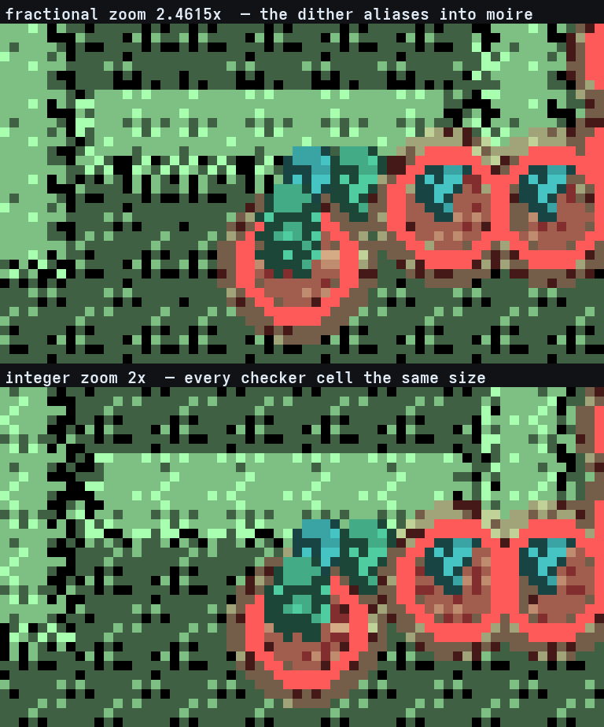
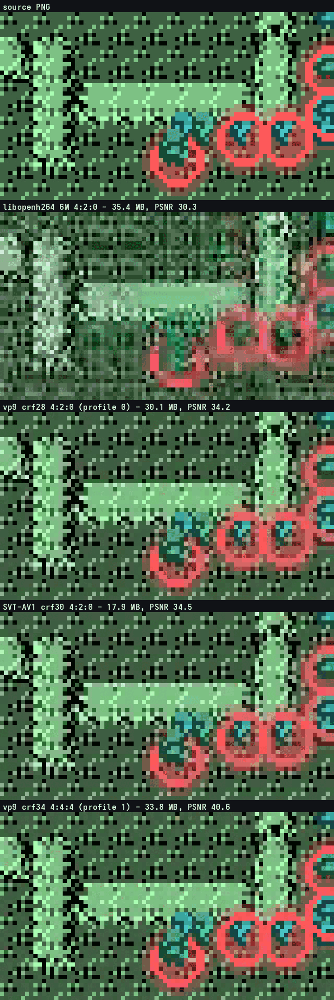

# Encoding a swarm film — why the files were huge, and why they were soft

<!-- codemap:asof -->

The films are pixel art on a fixed tile grid: four Game Boy shades per sprite
over [PixelGB](https://github.com/Alchemy86/PixelGB)'s photographed atlas, flat
colour, hard edges, a small palette, and long stretches where nothing on screen
moves. Every published film here was **rendered at whatever fractional zoom the
swarm's spread asked for and encoded with `libopenh264 -b:v 6M`**, which is the
opposite of all four of those. Reported as: the videos are large and often a tab
blurry, and *"we have hi scale vector images and exports creating these
maps and characters... it genuinely feels like these can be WAYYYY smaller file
wise while maintaining high length and quality."*

That is right, and there were **two** independent causes. This page is the
measurement of both, the recipe that came out of it, and one compatibility trap
that cost a shipped film.

Tool: [`tools/pewter-chain/encode_film.py`](../../tools/pewter-chain/encode_film.py).

```
encode_film.py                                   # what it is, and the recipes
encode_film.py encode FRAMES --out FILM.mp4 --fps 60 --mobile FILM-mobile.mp4
encode_film.py bakeoff FRAMES --frames 240 --keep /tmp/bake
encode_film.py measure FRAMES FILM.mp4 [FILM.mp4 ...]
```

## 1. The render: not one frame of a film sat at an integer scale

The camera crops a region of the atlas and resizes it to the viewport. The crop
width was snapped to a **geometric** ladder (rule 3, and rule 7's box smoothing)
so the resample ratio would hold still — but nothing ever asked what that ratio
*was*. Measured over the Mt Moon cut, 7,100 frames, 22 distinct widths:

| scale | frames | integer? |
|---|---:|---|
| 0.3326x | 1,991 | no |
| 0.4025x | 2,720 | no |
| 2.4615x | 1,626 | no |
| the other 19 | 763 | none of them |

**Zero frames of 7,100.** Gen 1 draws grass, cave floor and water as a
**one-pixel dither checkerboard**, so a fractional nearest resample turns that
checkerboard into moiré: an irregular, frame-to-frame-unstable high-frequency
pattern over the whole picture. It looks soft and it shimmers — which is what
"often a tab blurry" is — and it is also the single most expensive thing anybody
can hand a video codec, because every transform block is full of noise that
never repeats.

**Rule 8** ([`chainrender/camera.py`](../../tools/pewter-chain/chainrender/camera.py))
makes every rung an integer pixel scale: `view_w / s` for an integer upscale, or
`view_w * k` for an integer downscale, rounded **up** so the view only ever gets
wider than asked for and no agent is lost to it. The render then magnifies each
source pixel into an aligned `s x s` block, or samples one pixel in `k` on a
regular grid. `--no-integer-zoom` restores the old behaviour exactly.

The same Mt Moon cut, same tracks, same camera rules otherwise:

| | fractional zoom | integer zoom |
|---|---:|---:|
| distinct scales | 22, none integer | 4, **all integer** |
| resample ratio changed on | 23 frames | **5 frames** |
| PNG frames on disk | 1,022 MB | **918 MB** |
| encoded, `libopenh264 -b:v 6M` | 56.45 MB | **35.38 MB** |
| encoded, quality-targeted 4:4:4 | 125.70 MB | **43.07 MB** |
| camera coverage | 99.5 % | **99.8 %** |

**The moiré was two thirds of the bitrate of a quality-targeted encode** and a
third of the bitrate of the shipped one, at the same encoder and the same
picture. Even the source PNGs are 10 % smaller.



*Top: the checker cells vary in width and the halo rings have ragged edges.
Bottom: every cell is 2x2 and the rings are clean.*

## 2. The encoder: `-b:v 6M` is a bitrate target, not a quality target

`libopenh264` spends 6 Mbps on a frame where nothing moved and still cannot
afford the hard edges on a frame where the whole camera panned. Constant-quality
rate control is what flat, hugely compressible content wants: it asks for a
*quality* and lets a still frame cost almost nothing.

Whole Mt Moon film, integer frames, 7,100 frames at 1280x720 / 60 fps (118.3 s).
`exact` is the share of pixels that come back byte-identical to the source and
`new colours` is how many colours the decode contains that the source frame did
not — the categorical measure this repository already uses for
[half-blocks](../display.md) and the terminal captures, because a Game Boy frame
contains a bounded set of colours and one that is not in it is blur, counted.

| recipe | chroma | MB | kbps | exact | new colours | PSNR |
|---|---|---:|---:|---:|---:|---:|
| `libopenh264 -b:v 6M` (published) | 4:2:0 | 35.38 | 2392 | 1.33 % | 467,838 | 30.32 |
| `vp9 crf28` | 4:2:0 | 30.08 | 2033 | 1.39 % | 243,804 | 34.16 |
| `SVT-AV1 crf30` | 4:2:0 | 17.90 | 1210 | 1.34 % | 134,837 | 34.49 |
| `vp9 crf34` | 4:4:4 | 33.78 | 2284 | 17.20 % | 227,609 | 40.64 |
| `vp9 crf28` | 4:4:4 | 43.07 | 2911 | 18.42 % | 160,128 | 43.33 |
| `libaom-av1 crf30` | 4:4:4 | 15.65 | 1058 | — | — | — |
| `vp9 lossless, RGB planes` | none | 146.90 | 9932 | **100 %** | **0** | inf |

The lossless row is the calibration: 100 % exact and zero invented colours says
the metric works and that **the render is exact up to the encoder** — every
softness in a film is put there by the encode.



## 3. THE TRAP THAT COST A SHIPPED FILM: 4:4:4 is not playable

The table above sent this tool to VP9 at `yuv444p`, and that film was shipped.
It is corrupt on an ordinary player: layout and text perfect, and the atlas's
greys rendered **green, pink and orange**.

**`yuv444p` VP9 is VP9 Profile 1, which most players and essentially all
hardware decoders do not implement.** A decoder that does not implement it does
not refuse the file — it reads the planes as 4:2:0 anyway and produces exactly
that. AV1 at 4:4:4 is its Professional profile and carries the same trap.

Two dead ends were measured on the way, and both are worth not repeating:

* **It is not the missing colour tags.** The file carried
  `color_space=unknown`, which is a real defect and is fixed (see §4) — but
  BT.709 tags were added, the film re-encoded, and it was **still corrupt**. A
  matrix mismatch cannot do this anyway: grey is `U = V = 128` in every matrix,
  so a wrong matrix leaves greys grey. Greys turning colour means the chroma
  planes are being read wrongly, which is a profile fault.
* **Checking it with ffmpeg proved nothing, and neither did Chrome.** ffmpeg
  decodes Profile 1 correctly, so an encode-then-decode round trip through the
  same library reports a perfect picture; Chrome decodes it correctly too —
  measured, pixel for pixel against the source. **A compatibility fault is only
  visible in a decoder that lacks the feature.**

So the two rules the recipe is now built on:

* **Compatibility beats chroma fidelity.** A film the captain can open on a
  phone and on a GNOME desktop is the product; a sharper file he cannot watch
  is worth nothing.
* **Sharpness comes from integer-scale rendering, not from exotic chroma.**
  Rule 8 removes the softness and two thirds of the bitrate at *any* chroma —
  and measured on the same frames, 4:2:0 with modern rate control is visually
  indistinguishable from 4:4:4 at 9x zoom, while 4:2:0 with the old
  `libopenh264 -b:v 6M` is mush. **The defect was never the chroma. It was the
  rate control.**

`encode_film.py` therefore marks every 4:4:4 and lossless recipe **MASTER
ONLY** and refuses to produce one without `--master`.

## 4. Colour is declared, never left to the player to guess

The frames are RGB PNGs and every YUV codec has to convert them, which needs a
matrix — and swscale picks one silently while the encoder tags the stream with
nothing at all. Every film here, old and new, carried `color_space=unknown`.

The conversion and the tag are now stated together and say the same thing:
convert from full-range RGB to limited-range BT.709, and mark the stream BT.709
limited. A player that reads the tags and a player that assumes BT.709 (which is
what most of them do at 720p) then agree.

Honest limitation, measured on `libvpx-vp9`, `libsvtav1` and `libopenh264`
alike, with and without `-movflags write_colr`: **no encoder in this ffmpeg
build writes `color_primaries` or `color_transfer` into an mp4.** They are asked
for on every encode and reported after it; the gate requires the two that
actually corrupt a picture when guessed — the **matrix** and the **range**.

## 5. The recipe

```
-c:v libopenh264 -profile high -coder 1 -b:v 6M
-pix_fmt yuv420p
-vf scale=in_range=full:in_color_matrix=bt709:out_range=tv:out_color_matrix=bt709
-colorspace bt709 -color_primaries bt709 -color_trc bt709 -color_range tv
-movflags +faststart+write_colr
```

* **H.264 High profile with CABAC**, which every player and every hardware
  decoder handles. High + CABAC is 5.6 % smaller than the Baseline the old
  recipe produced, at marginally better quality (56.22 MB / PSNR 31.34 against
  59.57 MB / 31.19 on the same 8,290 frames).
* **`-vf scale` here is a colour conversion and nothing else** — input and
  output dimensions are identical, so it resamples no pixel. **Nothing in this
  recipe may ever change the picture's size**; the frames are written at the
  output resolution by `swarm_film.py` with `Image.NEAREST`, and a second
  resample is the first thing that would soften the picture again.
* **A mobile copy raises the quality target; it never scales the picture.**
  Scaling pixel art is the whole finding above.
* `libopenh264` is a weak encoder and its rate control is the quality ceiling
  here — on the hardest 240 frames of the cut it reaches PSNR 24.7 where VP9 at
  constant quality reaches 32.5. If a stronger H.264 encoder (x264, or a working
  VAAPI path) ever appears on this box the recipe improves without the format
  changing. **This box has neither** — `libopenh264` is the only H.264 encoder
  installed, and `h264_vaapi` reports *"No usable encoding profile found"*.

## 6. Verify by looking, in a decoder that did not encode it

`encode` runs two checks after every film and **fails the encode** rather than
handing over a broken one:

1. the stream carries a colour **matrix** and **range**;
2. a player that ignores the tags and assumes BT.709 still gets the right
   colours, checked by decoding under a forced BT.709 interpretation and
   comparing against the source frames.

Neither is sufficient on its own and neither catches a profile fault, so the
last step is a human one and it is not optional: **open the finished file in a
different program and look at it.** For §3 that was Chrome via
`chrome-devtools-axi`, serving the file over `python3 -m http.server` and
reading pixels back off a canvas — and the lesson is that even that was not
enough, because Chrome implements Profile 1. The decoder that finds a
compatibility fault is the one that lacks the feature.

## 7. What was NOT done, and why

* **No resolution change.** 1280x720 at 60 fps stays; halving the frame rate
  would halve the file and would also change the cut.
* **AV1 as the deliverable.** `SVT-AV1 crf30` is the smallest thing measured
  that still plays widely — 17.9 MB against H.264's 56 MB on comparable
  frames — and it is a live option for a future film. It is not the default
  because AV1 playback is newer than H.264's and the whole of §3 is about not
  betting a deliverable on a decoder feature.
* **`libaom-av1` at 4:4:4 produced an undecodable stream once** on a 7,100-frame
  encode (`libdav1d: Unknown OBU type 0`), and decoded cleanly on a 2,836-frame
  one. Unexplained, and it is a MASTER recipe either way.

## 8. Driving it: the three films this was measured on

**What the agent achieved in these films is AgentGB's record**
([`../where-things-live.md`](../where-things-live.md)); what follows is the
*tooling* half — the commands, and the three tool-level decisions that are
properties of the renderer rather than of any agent.

```bash
# 1. the tracks. `film` plays the slice once per agent, carrying each agent's
#    own exit forward, and writes the agent-NNN.links.csv spans as well.
#    NOTE: the flag is --runs. Its own usage text said --agents and was wrong.
target/release/examples/pewter_chain film --rom <blue.gb> --runs 600 \
    --from 20 --to 25 --workers 16 \
    --start-dir target/cert2/19-east-to-route-3/exits \
    --out ~/pokemon-run/mtmoon-600

# 2. the frames
python3 tools/pewter-chain/swarm_film.py ~/pokemon-run/mtmoon-600 \
    --out ~/pokemon-run/mtmoon600-frames --speed 12 --fps 60 --cover 0.95 \
    --width 1280 --title "MT MOON: LINKS 20-25" --method "<what this measures>"

# 3. the film, and a mobile copy
python3 tools/pewter-chain/encode_film.py encode ~/pokemon-run/mtmoon600-frames \
    --out ~/pokemon-run/mt-moon-20-25.mp4 --fps 60 \
    --mobile ~/pokemon-run/mt-moon-20-25-mobile.mp4
```

* **The pace is derived, never picked.** `seconds_out x speed = the emulated
  time there is`, and the ceiling is `stride <= walk_span` — which
  `swarm_film.py` **measures from the tracks in hand** and prints. It came out
  at **29** emulated frames on both of these cuts, so at 60 fps anything up to
  ~29x stays smooth; 12x leaves a walking agent at 6.6 source px per output
  frame. A short link wants a slower pace for the same reason: a 3.3-minute
  link at 4x is 49 s, and 4x also measured best on camera coverage of 3x/4x/6x.
* **A swarm that splits along something the tracks cannot see needs
  `--agent-labels`.** Which starter an agent carries is a property of the entry
  *pool*; `pewter_chain states --all` prints it per index over the same sorted
  list `film` hands agent `ag` slot `ag % len` from.
* **The honest limit of a position film: a battle has no map position.** Agents
  converge on one tile and six hundred sprites stacked there are one sprite.
  The picture carries the approach, the halo, the arrival markers and the label
  block draining; a film that shows a *battle* as itself needs the framebuffer,
  which is [`screen-mosaic.md`](screen-mosaic.md)'s job.

**A clip of a single run** takes no film tooling at all — `solve --screens 1
--screens-scale 1` writes a `gbscr/1` capture at one sample per emulated frame,
and `screen_mosaic.py`'s `Track` decodes it:

```bash
target/release/examples/pewter_chain solve --rom <blue.gb> \
    --scenario scenarios/pewter/23-down-to-mt-moon-b2f.json \
    --start <the previous link's exit for that seed> --seed 0 \
    --screens 1 --screens-scale 1 --out /tmp/one
```

Two things learned building one, both general:

* **Find the moment with a contact sheet, not by scrubbing.** Every 60th frame
  of a 6,000-frame run tiles into one 1920x1296 image, and the whole sequence
  being looked for is legible in it at a glance.
* **Do not draw a card that pretends to be a game screen.** A Gen 1 run never
  opens its party menu, so a film of one cannot show a party; a state the run
  left behind can be *read* (`states --peek`) and shown as what it is. Assert
  every caption fits before drawing it — the `fit_bar` rule — because a
  truncated caption cannot be told from a complete one.

## See also

* [`chainrender.md`](chainrender.md) — the shared renderer package, and the
  camera whose rungs this depends on
* [`track-format.md`](track-format.md) · [`screen-mosaic.md`](screen-mosaic.md)
  · [`path-arrows.md`](path-arrows.md) — the other things a corpus can be
  turned into
* [`../display.md`](../display.md) — the same "a colour that was not in the
  framebuffer" measure, applied to the terminal
* [`../where-things-live.md`](../where-things-live.md) — why the *results* of
  these films are in AgentGB and this page is not
