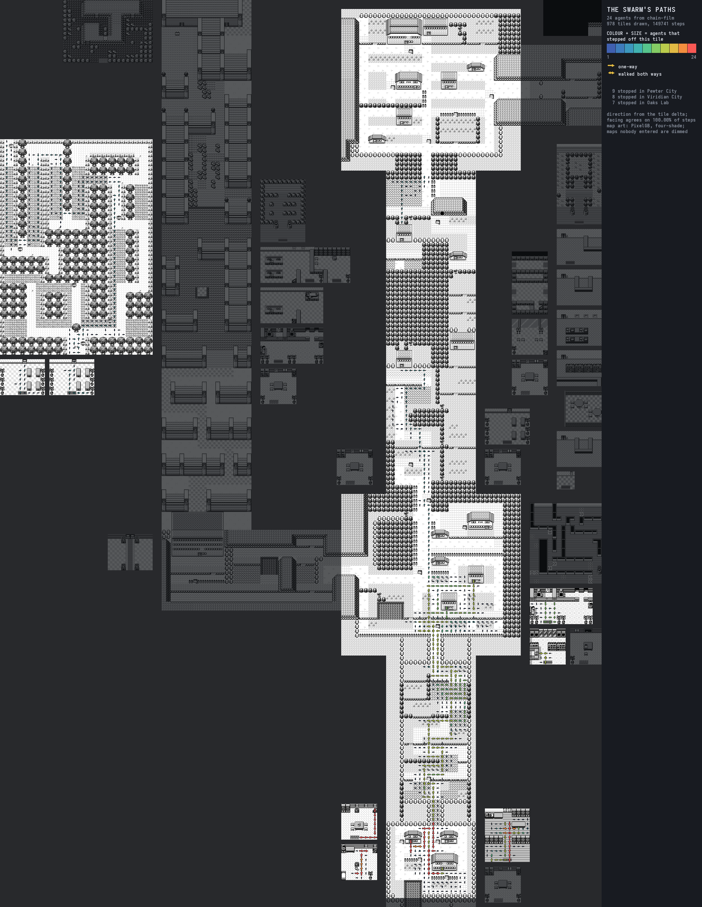
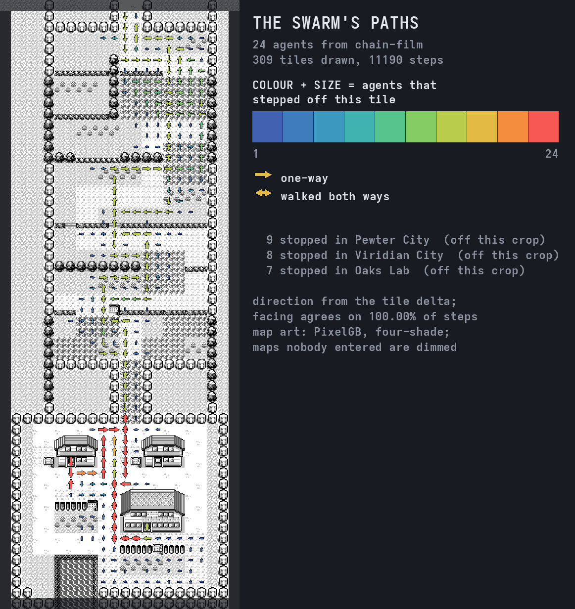
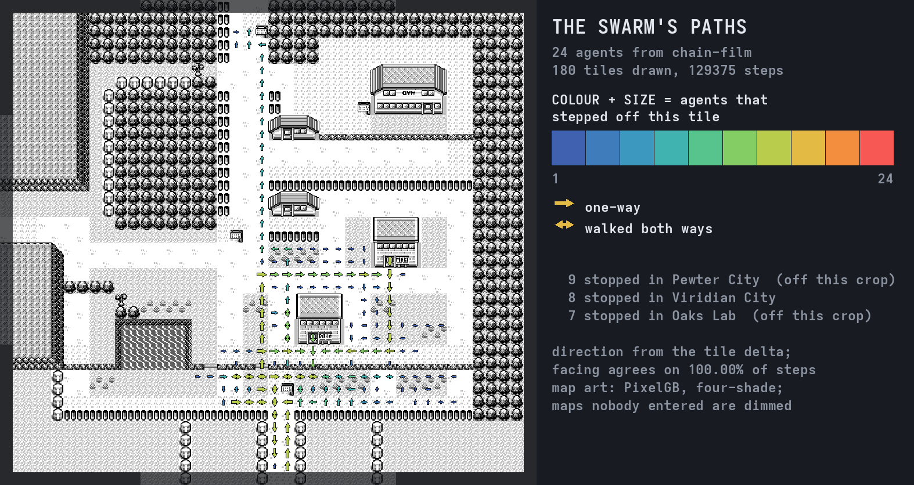

# The swarm's paths — every walked tile as an arrow

<!-- codemap:asof -->

`tools/pewter-chain/path_arrows.py` draws a **movement map**: one directional
arrow per tile the swarm ever walked, over
[PixelGB](https://github.com/Alchemy86/PixelGB)'s photographed Kanto atlas.
Where [`swarm_film.py`](../../tools/pewter-chain/swarm_film.py) answers *where
is everybody right now*, this answers *where did anybody ever go, which way, and
how much of the swarm went there*.



It **emulates nothing**. The position tracks are already on disk — one
`frame,map,x,y,facing,walking,battle` row per change, written by
`pewter_chain film` and `pewter_chain corpus --paths`, stitched per agent by
[`chain_tracks.py`](../../tools/pewter-chain/chain_tracks.py). Rendering the
whole 24-agent chain takes about a second and a half.

---

## 1. Reproduce it

```bash
# what the tracks contain, before anything is drawn
python3 tools/pewter-chain/path_arrows.py summary /home/aaron/pokemon-run/chain-film

# the still at the top of this page
python3 tools/pewter-chain/path_arrows.py still /home/aaron/pokemon-run/chain-film \
    --tile-px 14 --out /home/aaron/pokemon-run/pewter-path-arrows.png

# the video: the arrows appear as the swarm reaches those tiles
python3 tools/pewter-chain/path_arrows.py video /home/aaron/pokemon-run/chain-film \
    --tile-px 12 --speed 900 --fps 30 --mp4 \
    --out /home/aaron/pokemon-run/pewter-path-arrows

# one stretch at a readable size
python3 tools/pewter-chain/path_arrows.py still /home/aaron/pokemon-run/chain-film \
    --maps 0x00,0x0C --tile-px 22 --margin 1 --out /tmp/route-1.png
```

`--mp4` shells out to `ffmpeg`. **Fedora's ffmpeg has no `libx264`** (a
patent-clean build), so the encoder is `libopenh264 -b:v 4M` and `-crf` is not
accepted there — the same substitution
[`docs/swarm-view.md`](../swarm-view.md) records. Without `--mp4` the tool
writes the PNG frames and prints the exact `ffmpeg` line.

The video and the full-resolution still live in `/home/aaron/pokemon-run/`
(`pewter-path-arrows.mp4`, `pewter-path-arrows.png`) rather than in the
repository: a 174 MB frame directory does not belong in git, and the two
commands above regenerate the lot in under a minute. The three stills on this
page **are** committed, under
[`chain-stills/`](chain-stills/), on the line
[`docs/link-trade/`](../link-trade/) already drew — our own compositor's
output, with the game art incidental, and nothing in them can be read back as
game data.

---

## 2. What the arrow means

**The direction is the tile delta**: the tile an agent left and the tile it
arrived on. A step between two *adjacent tiles of the same map* is a walk;
anything else — a map change, or a coordinate that jumps — is a warp, and is
counted rather than drawn. No arrow ever crosses a doorway, because nobody
walked through the wall beside it.

### The direction is over-determined, and that is measured, not asserted

There are two independent readings of a step's direction: the `facing` byte the
cartridge held while the step animated, and the delta. **They agree on every
step in both corpora on this box** —

| corpus | steps | `facing` agrees with the delta |
|---|---:|---:|
| `chain-film` (24 agents) | 149,741 | 149,741 = **100.0000 %** |
| `chain-film-big` (15 agents) | 82,640 | 82,640 = **100.0000 %** |

`summary` re-measures that on whatever tracks it is pointed at and prints it,
and the still and the video both carry the figure in the legend. The delta is
what is *used*, because it is the one that cannot be fooled: a `facing` row is
also written when the player turns on the spot without moving, and only the
delta tells turning from walking.

### A paced tile gets a double-headed arrow

A single arrow claims a *flow*. Where the two commonest directions through a
tile are opposite and comparable — the weaker at least `--paced 0.40` of the
stronger — no such flow exists; the swarm walked back and forth over it. Those
tiles get a head at each end, so a training band does not read as a one-way
corridor. **161 of 978 tiles (16.5 %)** on `chain-film`, 135 of 788 (17.1 %) on
`chain-film-big`.

---

## 3. What the colour means, and why it is not step count

**Hue and size both encode how many DISTINCT AGENTS stepped off the tile.**
One arrow, two channels, one number — the redundancy this repository's panels
already require, so the picture survives being printed small or in grey.

That is the question the picture exists to answer, and step count is
measurably the wrong unit for it. On `chain-film`:

| | tile | steps | agents |
|---|---|---:|---:|
| busiest by **steps** | Viridian City (22,28) | **20,529** | 16 of 24 |
| busiest by **agents** | Oak's Lab (5,5) | 325 | **24 of 24** |

Eight agents spent ten emulated hours pacing one band of Viridian City's grass
and never left it, so a step-count ramp draws that band as the whole map and
the route as nothing. It would be a **dwell** map — which
[`corpus_report.py`](../../tools/pewter-chain/corpus_report.py) already draws,
weighted by frames, and which
[`swarm_film.py`](../../tools/pewter-chain/swarm_film.py) already uses to
colour its agents. Distinct agents is bounded by the swarm size, so the ramp
spends its whole range on "how much of the swarm came this way", and a
one-agent detour cannot out-shout a corridor.

The ramp is deliberately **its own**, not `swarm_film.HEAT_HUE`. That one is
agent-*frames* and is read **inverted** — blue is heavily trodden and warm is
novel, so an agent doing something new lights up. Reusing the same swatches for
the opposite polarity and a different unit would be the worst of both.

Two presentation choices are stated on the picture itself rather than left to
be discovered: **maps nobody in the corpus entered are dimmed** (`--mask 1.0`
leaves the whole crop exact), and the map layer is the cartridge's own
**four-shade** art by default (`--rendering region-tint` for the coloured
atlas) so the arrows carry all the colour.

---

## 4. What it CANNOT tell you

This is the half that matters, and every item is measured on the same corpus.

**It is not a dwell map.** A tile crossed once by sixteen agents and a tile
paced 20,529 times by the same sixteen are drawn identically. Time is not in
this picture at all — for dwell, use `corpus_report.py`'s heat maps.

**It is not a route.** It is the *union* of 24 paths. Two arrows meeting at a
junction do not mean anyone walked both; the picture cannot reconstruct a
single agent's trajectory, and it is not trying to.

**It shows one direction per tile.** A tile walked three or four ways loses
everything past the dominant direction and the both-ways marker: **191 of 978
tiles (19.5 %)** on `chain-film` were walked in three or more directions.

**Battles are invisible.** A battle has no map position, and most of this
chain's emulated time is spent in one. `chain-film` is 233 emulated minutes and
149,741 steps; the swarm is standing still for the overwhelming majority of it.

**Warps are not drawn.** 937 map changes and non-adjacent jumps on
`chain-film`, none of them an arrow. A doorway shows as two corridors that stop
at a wall.

**And it is survivorship-filtered.** See below — this is the big one.

---

## 5. Who is in the picture, and who dropped out

`chain-film` is 24 agents and **they do not all reach the end**. The tracks
stop where an agent failed a link, which is the honest thing for them to do and
means the map is **several different populations laid on top of each other**:

| stopped in | agents | what that is |
|---|---:|---|
| Pewter City | **9** | finished the chain |
| Viridian City | 8 | still grinding, hundreds of thousands of frames in |
| Oak's Lab | 7 | failed a link within the first ~15,000 frames |

The consequence, measured per map — the number of agents that ever took a step
on it:

| map | agents |
|---|---:|
| Red's House 2F / 1F, Pallet Town, Oak's Lab | **24** |
| Route 1, Viridian City, Viridian Mart | 17 |
| Viridian Pokémon Center | 14 |
| Route 2, Viridian Forest and both its gates | **9** |

So the arrows past Viridian are **the nine finishers only**. Read the forest as
"where the nine who got there went", never as "where the swarm went" — a
survivorship-filtered map that reads as the second is exactly the class of
thing this project measures rather than implies. Both the legend and
`summary`'s `endings` table say it, in every render.

---

## 6. What the pictures show

### Pallet Town and Route 1



309 tiles, 11,190 steps. Pallet Town and Oak's Lab are red because every one of
the 24 agents walked them; Route 1 is green-to-yellow because seven had already
stopped by then; the small dark-blue arrows are the 232 tiles exactly one agent
ever stepped off — the detours.

**Route 1's ledges show up as a one-way structure, and the numbers agree with
the finding [`docs/swarm-view.md`](../swarm-view.md) reached independently**:
147 of Route 1's 213 walked tiles carry a vertical step at all, and of those
**22 are northbound only and 40 are southbound only**, with 85 walked both
ways — 1,909 northbound steps against 1,314 southbound. The route up and the
route down are not the same route.

### Viridian City



180 tiles and 129,375 steps — 86 % of every step in the corpus, on one map.
The horizontal double-headed arrows across the lower half are the training
band, and they are the argument for the double head in one picture: a
single-headed arrow there would claim a flow through grass the swarm was
pacing back and forth for ten emulated hours.

It is also the clearest illustration of the limitation above. Those tiles are
mid-ramp green, the same as the corridor through the city, because the same
number of agents walked both. **Nothing in this picture says one of them cost a
thousand times more time than the other.**

---

## 7. The video

`video` writes one PNG per output frame in which an arrow appears the moment
the swarm first steps off that tile, and deepens as more agents reach it.
Conventions are `swarm_film.py`'s: `--speed X` states the compression and lets
the runtime fall out of `seconds_out × speed = the emulated time there is`;
`--seconds` states the runtime instead; `--fps` is the output rate.

The published cut is **467 frames, 15.6 s at 30 fps, a 900× timelapse** over
835,679 emulated frames (233 emulated minutes), 1856×2424, 1.3 MB.

**Expect the map to stop growing halfway through, and that is the finding
rather than a fault.** Read off the film's own panel:

| output frame | emulated minutes | tiles lit | steps |
|---:|---:|---:|---:|
| 60 | 30.5 | 561 | 30,057 |
| 150 | 75.5 | 963 | 70,594 |
| 214 | 107.5 | **977** | 94,978 |
| 466 | 233.2 | **978** | 149,741 |

The last agent to reach Pewter finishes at frame 383,008, 46 % of the way
through. **The final 37 % of every step the swarm takes adds one tile.** The
map visibly stops expanding while the step counter keeps climbing, which is
§4's "it is not a dwell map" stated as motion instead of as a table.

It is **incremental**: an arrow only changes when its agent count crosses a
band, so the map layer is painted once and only changed tiles (and their
neighbours, whose arrows the repaint rectangle can clip) are redrawn. The whole
cut renders in about 34 seconds.

---

## 8. Things worth knowing if you change it

- **`swarm_film.py`'s rendering path is not touched.** This is a sibling that
  imports its `Atlas` and nothing else, by path (the directory has a hyphen in
  it, so it is not a package). Importing the file runs only its constants and
  its `def`s.
- **The left/right rotation was wrong when first written and looked plausible.**
  A picture of a swarm pacing east and west is symmetric, so the eye cannot
  catch an inverted horizontal arrow. It was found by rendering one arrow per
  direction and asserting the tip is at `centre + unit × half`, and confirmed
  end to end by rendering a hand-written six-tile eastward track and looking at
  the result. **Verify a glyph's orientation against a synthetic track, not by
  looking at real data.**
- **The crop is every map the tracks were ON, not every map they walked
  ACROSS.** Pewter City is the worked example: the chain's goal fires the
  instant the player crosses the boundary, so the nine finishers have a single
  row there and never take a step *off* a Pewter tile. It has no arrows, and it
  still has to be in the picture.
- **Every figure on the panel is a figure of what is drawn.** With `--maps` the
  arrows are a subset; reporting the whole corpus's step count beside a filtered
  tile count is two populations in one line.
- **The panel is measured from its own contents.** A clipped caption is worse
  than a short one, because a reader cannot tell it was cut — the rule
  `fit_bar` follows in the terminal frontend. For the video it is sized from the
  *widest line the film will ever hold*, because the counters only grow.
- Memory is bounded on purpose: the per-step record the video replays is four
  parallel `array`s (frame, tile index, direction, agent), about 11 bytes a
  step, rather than a Python tuple each. A whole eleven-link corpus is millions
  of steps.

---

## 9. Related pages

- [the Pewter chain](pewter-chain.md) — the fourteen scenarios these tracks come
  from, the certification that produced them, and §11 on the films.
- [the swarm view](../swarm-view.md) — the same tracks drawn as *agents moving*
  rather than as paths, and the one-way-ledge finding this reproduces.
- [the screen mosaic](screen-mosaic.md) — the same population drawn as its own
  Game Boy *screens*. A position track carries no pixels, so that one needs a
  capture pass where this one needs nothing; it answers "what are they all
  looking at?" where this answers "where did they all go?".
- [heat maps](pewter-chain.md#10-heat-maps) — dwell weighted by frames, which is
  the question this picture deliberately does not answer.
- [the test rig](test-rig.md) — what turns a corpus into a measurement.
