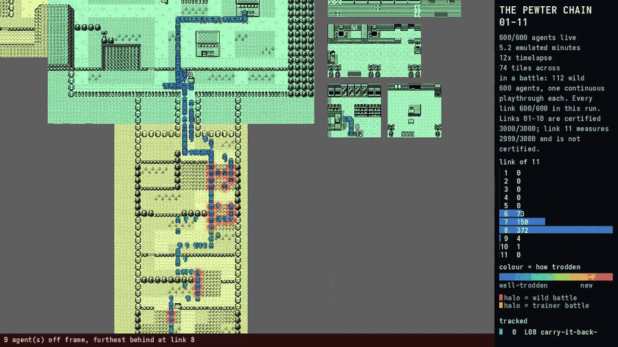

# The Pewter chain — fourteen links from a cold cartridge, and the corpus they produced

A brand-new game of Pokémon Blue, played forward to Pewter City, cut into
fourteen [scenarios](../scenarios.md) whose goals are read out of the
cartridge's own memory. A scripted expert solves them; what comes out is a
corpus of runs — successes and failures — a chain of save states any link can
be started from instantly, and the list of places a solver reliably struggles.

> **Comparing two players on one of these links** — the same entry states, the
> same seeds, the rates, the intervals and the paired gap — is
> [the test rig](test-rig.md), and its entry pool is this chain's own
> `corpus --exits` output.

```text
   cold cartridge
        │  01 new game ─▶ 02 out of the house ─▶ 03 Oak takes you to the lab
        │  04 a starter ─▶ 05 the rival ─▶ 06 Route 1 ─▶ 07 the parcel
        │  08 back to Pallet ─▶ 09 the Pokédex ─▶ 10 back to Viridian
        │  11 train ─▶ 12 heal and climb ─▶ 13 the forest ─▶ 14 Pewter
        ▼
   corpus + chained save states + heat maps
```

- **Scenarios**: [`scenarios/pewter/`](../../scenarios/pewter/) — fourteen JSON
  files, one per link.
- **Solver and runner**: [`examples/pewter_chain.rs`](../../examples/pewter_chain.rs).
- **Cartridge tables**: [`tools/gen1-tables/gen1_tables.py`](../../tools/gen1-tables/gen1_tables.py).
- **Corpus report and heat maps**: [`tools/pewter-chain/corpus_report.py`](../../tools/pewter-chain/corpus_report.py).

---

## 1. What has and has not been done

**Nothing here is trained.** No policy has been learned, no weights exist, and
no number on this page is evidence about a model. What exists is the thing
before that: goals that cannot be argued with, a solver that reaches them, and
a corpus shaped so a learner could use it.

**The solver is scripted, and that is not a detail.** It implements the same
`Driver` trait a live model plugs into — the same JSON snapshot in, the same
JSON plan out, through the same parse-clamp-execute path — and it satisfies
`no_memory_writes` for the same reason a model would: it can only press
buttons. But it knows the route because a person wrote the route down. That is
exactly the role the PokéAgent Challenge winner gave its scripted policies:
solve each subgoal so the trajectories exist. Here the trajectories are the
product.

**No live model has solved any of these links.** `docs/scenarios.md` said that
before this work and it still says it.

---

## 2. The chain, and what defines success

Every goal is a memory read with a citation. Where the cartridge records the
milestone as an event flag, the flag is the goal; where it does not, `wCurMap`
is the most exact record there is, and the table says which is which.

| # | link | goal | defined by |
|---|---|---|---|
| 01 | new game | `map=0x26` and `watch:map_width>0` | `wCurMap` $D35E, `wCurMapWidth` $D369 |
| 02 | leave the house | `map=0x00` | `wCurMap` $D35E |
| 03 | Oak takes you to the lab | `watch:followed_oak_into_lab!=0` | **flag** $D747 bit 0 |
| 04 | take a starter | `watch:got_starter!=0` and `party>=1` | **flag** $D74B bit 2, `wPartyCount` $D163 |
| 05 | the rival battle | `watch:battled_rival_in_lab!=0` | **flag** $D74B bit 3 |
| 06 | cross Route 1 | `map=0x01` | `wCurMap` $D35E |
| 07 | collect Oak's Parcel | `watch:got_oaks_parcel!=0` | **flag** $D74E bit 1 |
| 08 | carry it back to Pallet | `map=0x00` | `wCurMap` $D35E |
| 09 | receive the Pokédex | `watch:got_pokedex!=0` | **flag** $D74B bit 5 |
| 10 | back to Viridian | `map=0x01` | `wCurMap` $D35E |
| 11 | train for the forest | `watch:lead_level>=10` | `wPartyMon1Level`, `wPartyMons` $D16B + 33 |
| 12 | heal and climb Route 2 | `map=0x33` | `wCurMap` $D35E |
| 13 | cross Viridian Forest | `map=0x2F` | `wCurMap` $D35E |
| 14 | arrive in Pewter | `map=0x02` | `wCurMap` $D35E |

Every one of those addresses is in
[AtlasGB's evidenced snapshot](../../third_party/atlasgb/README.md) with its
evidence tier, and every event index was computed by walking
`pokered`'s `constants/event_constants.asm` const list — `const_def`,
`const_skip`, `const_next` — rather than looked up. The anchor that says the
walk is right: `EVENT_FOLLOWED_OAK_INTO_LAB` comes out at index 0, byte 0,
bit 0, which is what `AGENTS.md` already recorded independently.

Each scenario file carries an `evidence` list saying this in prose, and
`scenario check` prints it. A scenario **without** one is reported as
`evidence: NONE STATED`, because a goal nobody can check is back to being a
proxy.

### The dependency order is not the obvious one

The Pokédex does not come with the starter. Read out of the scripts:

1. `PalletTownDefaultScript` fires on `wYCoord == 1` — its own comment says
   *"is player near north exit?"* — and the tiles at x=10,11 on rows 0 and 1
   are tileset tile `$52`, the Overworld grass tile. So the trigger is walking
   into the grass at the top of the map.
2. Oak **escorts** the player in; `OaksLabFollowedOakScript` sets
   `EVENT_FOLLOWED_OAK_INTO_LAB` when the simulated `PAD_UP` × 8 walk finishes.
3. Starter, then the rival — and `OaksLabRivalChallengesPlayerScript` opens
   `ld a,[wYCoord] / cp 6 / ret nz`, so he challenges you on row 6 of the
   laboratory and nowhere else.
4. `ViridianMartDefaultScript` hands over the parcel on the first visit with
   **no prerequisite at all**; entering the shop is the whole of that link.
5. `OaksLabOak1Text`'s `.check_got_parcel` branch needs the parcel in the bag,
   and `OaksLabOakGivesPokedexScript` sets `EVENT_GOT_POKEDEX` and
   `EVENT_OAK_GOT_PARCEL` together.
6. `ViridianCityCheckGotPokedexScript` tests `EVENT_GOT_POKEDEX` before it lets
   the player past the old man. **The Pokédex is the gate on the road north.**

---

## 3. The route came out of the cartridge, and told us two things

Every waypoint the solver walks is a turning point of a breadth-first path over
a walkability grid built from `maps/<Name>.blk`, the tileset's blockset and the
tileset's collision tile list, with the collision probe on the walk tile's
**bottom-left** 8×8 tile (block-definition indices 4, 6, 12, 14 — the anchor
the World Trade Centre work measured). Two things fell out of that grid that no
walkthrough would have said:

- **Route 1 northbound and southbound are different paths.** Its ledges are
  one-way, so the climb is not the descent reversed. The chain carries two
  waypoint lists for one map.
- **Route 2's two halves are separate components of the walkable graph.** The
  southern half reaches Viridian; the northern half reaches Pewter; nothing
  connects them on foot. Viridian Forest is not a scenic route, it is the only
  route — which is why the chain has to cross it.

And a third, from the same grid plus the map's object list:

- **One of the forest's three bug catchers is unavoidable, and it is the one at
  `(2,18)`.** Blocking all three sight cones and re-pathing gives no route at
  any range from one to eight tiles — but taken *individually* only that one
  severs the map, and the other two are each avoidable. (This bullet used to
  read *"the forest's three bug catchers are unavoidable"*, which over-read the
  same grid; a 3,000-attempt run settles it at **exactly one trainer battle per
  attempt**.) The compulsory fight is roster 3, a single level 9 Weedle — which
  is still what makes link 11 necessary, because the threshold is that
  trainer's level plus one.

---

## 4. The most valuable entry: a link that scored 100% on the wrong task

The first version of link 03 was called `cross-pallet-to-the-lab`. Its goal was
`map=0x28 AND watch:oak_appeared_in_pallet!=0` — a position, plus the flag that
*arms* Oak's encounter rather than the flag that records it happening. It
solved 6/6.

It was measuring the wrong thing, and it was caught by a human reading the
results, not by any check we had. `EVENT_OAK_APPEARED_IN_PALLET` is set the
instant the player steps onto row 1; `map=0x28` would be satisfied by walking
to the laboratory door under your own steam, which is *not what the game asks
for at that point*. The milestone the cartridge records is
`EVENT_FOLLOWED_OAK_INTO_LAB`, set at the end of the escort.

**This is precisely the failure this project criticises in guide-derived work**
— a goal authored from a plausible idea of how the game goes — and the atlas
was right there. Two things came out of it:

- the link is re-authored against the flag, and every other link was audited
  the same way (nine have no flag behind the milestone at all and legitimately
  use `wCurMap`; the five that do have one already used it);
- scenarios gained the `evidence` field, so the next person can check the goal
  without re-deriving it, and `scenario check` complains when it is missing.

The frozen artefacts of the wrong version are kept at
`/home/aaron/pokemon-run-versions/v001-prefix-oak-goal-error/`. **A wrong
version is evidence.**

---

## 5. Measured

Machine: 20-core x86-64, headless, no audio, load average 11–18 with other work
on the box. Cartridge: the captain's own Pokémon Blue. Nothing below is an
estimate.

### The chain, end to end

Fourteen links from a cold cartridge — the Nintendo logo, no save state, no
memory writes — to standing in Pewter City. Six seeds per link, carrying each
link's finish forward as the next link's start:

| # | link | solved | median decisions | median frames |
|---|---|---|---|---|
| 01 | new game | 6/6 | 18 | 4,302 |
| 02 | leave the house | 6/6 | 6 | 846 |
| 03 | Oak takes you to the lab | 6/6 | 13 | 2,052 |
| 04 | take a starter | 4/6 | 32 | 4,716 |
| 05 | the rival battle | 3/6 | 40 | 8,400 |
| 06 | cross Route 1 | 6/6 | 24 | 4,032 |
| 07 | collect Oak's Parcel | 6/6 | 17 | 8,772 |
| 08 | carry it back to Pallet | 6/6 | 45 | 5,166 |
| 09 | receive the Pokédex | 5/6 | 22 | 6,108 |
| 10 | back to Viridian | 6/6 | 93 | 11,472 |
| 11 | train for the forest | 2/6 | 767 | 122,142 |
| 12 | heal and climb Route 2 | 6/6 | 61 | 19,050 |
| 13 | cross Viridian Forest | 4/6 | 93 | 13,794 |
| 14 | arrive in Pewter | 6/6 | 7 | 1,152 |

**Six seeds cannot certify anything** and this table is not offered as a solve
rate; it is what the chain did while it was being built.

### The corpus, per link

Attempts fanned across eight workers, each from a pool of entry states taken
from *different winning seeds* of the previous link — so a link is not measured
against one arrival but against several. Every attempt, successful or not, is
in `/home/aaron/pokemon-run/corpus/<link>/`.

| # | link | reached | rate | median decisions | how the rest ended |
|---|---|---|---|---|---|
| 01 | new-game | 120/120 | 100.0% | 18 | — |
| 02 | leave-the-house | 120/120 | 100.0% | 6 | — |
| 03 | oak-takes-you-to-the-lab | 400/400 | 100.0% | 13 | — |
| 04 | take-a-starter | 372/400 | 93.0% | 35 | out of calls ×28 |
| 05 | the-rival-battle | 250/600 | **41.7%** | 46 | party wiped ×350 |
| 06 | cross-route-1 | 599/600 | **99.8%** | 49 | timeout ×1 |
| 07 | collect-oaks-parcel | 199/200 | 99.5% | 10 | out of calls ×1 |
| 08 | carry-it-back-to-pallet | 225/300 | 75.0% | 56 | timeout ×74, out of calls ×1 |
| 09 | receive-the-pokedex | 196/200 | 98.0% | 22 | timeout ×3, out of calls ×1 |
| 10 | back-to-viridian | 300/300 | 100.0% | 69 | — |
| 11 | train-for-the-forest | 53/120 | **44.2%** | 878 | timeout ×67 |
| 12 | heal-and-climb-route-2 | 260/300 | 86.7% | 61 | timeout ×36, out of calls ×4 |
| 13 | cross-viridian-forest | 248/300 | 82.7% | 93 | out of calls ×32, party wiped ×16 |
| 14 | arrive-in-pewter | 197/200 | 98.5% | 20 | party wiped ×3 |

**4,140 attempts across the fourteen links.** Link 08's row is the *pre*-fix
figure — the map-settle change measured below takes it to 90.8% — and link 06
was re-run at 600 attempts for the showcase film, which is why it carries the
larger denominator.

**Links 01-10 are superseded by the certified table below**; the rest of this
one is what the chain did while it was being built. Nothing here is at the bar
— see §7 — and two of the remaining rows are a long way from it. Multiplied
out, the chain end to end at these rates was about **6%**, and that is the
compounding argument made concrete rather than asserted. It is also why the
chain is played link by link from a carried state rather than end to end —
which is exactly what the save-state chain is for.

**Link 05's 41.7% was not a solve rate at all** — it was a scenario failing
itself on a state the cartridge does not treat as a failure. §8.11.

### Certified: links 01-10 and 12-14; link 11 accepted at one failure (§7b)

The bar is 99.9% per link, and 3,000 clean attempts is what supports it (§7).

| # | link | attempts | reached | rate, 95% CI | distinct trajectories | entry pool | median decisions |
|---|---|---|---|---|---|---|---|
| 01 | new-game | 3,000 | 3,000 | **100.0%**, 99.87-100% | 3,000 | 1 (cold cartridge) | 18 |
| 02 | leave-the-house | 3,000 | 3,000 | **100.0%**, 99.87-100% | 3,000 | 3,000 | 8 |
| 03 | oak-takes-you-to-the-lab | 3,000 | 3,000 | **100.0%**, 99.87-100% | 3,000 | 3,000 | 14 |
| 04 | take-a-starter | 3,000 | 3,000 | **100.0%**, 99.87-100% | 3,000 | 3,000 | 26 |
| 05 | the-rival-battle | 3,000 | 3,000 | **100.0%**, 99.87-100% | 3,000 | 3,000 | 64 |
| 06 | cross-route-1 | 3,000 | 3,000 | **100.0%**, 99.87-100% | 3,000 | 3,000 | 49 |
| 07 | collect-oaks-parcel | 3,000 | 3,000 | **100.0%**, 99.87-100% | 3,000 | 3,000 | 12 |
| 08 | carry-it-back-to-pallet | 3,000 | 3,000 | **100.0%**, 99.87-100% | 3,000 | 3,000 | 46 |
| 09 | receive-the-pokedex | 3,000 | 3,000 | **100.0%**, 99.87-100% | 3,000 | 3,000 | 24 |
| 10 | back-to-viridian | 3,000 | 3,000 | **100.0%**, 99.87-100% | 3,000 | 3,000 | 47 |
| 11 | train-for-the-forest | 3,000 | 2,999 | 99.97%, 99.81-100% — **accepted by decision, not a zero-failure pass**, see §7b | 3,000 | 3,000 | 631 |
| 12 | heal-and-climb-route-2 | 3,000 | 3,000 | **100.0%**, 99.87-100% | 3,000 | 2,999 | 64 |
| 13 | cross-viridian-forest | 3,000 | 3,000 | **100.0%**, 99.87-100% | 3,000 | 3,000 | 82 |
| 14 | arrive-in-pewter | 3,000 | 3,000 | **100.0%**, 99.87-100% | 3,000 | 3,000 | 20 |

Measured on the captain's Pokémon Blue, 12 workers, load average 8-55 with
other work on the box. Zero failures in 3,000 bounds each link's failure rate at
about **0.10%** by the rule of three, which is the bar and not better than it —
and **zero is the standard, not "at most three"**: two failures in 3,000 is
99.93%, which sounds like it clears a 99.9% bar and does not, because two
failures bound the rate at about 0.24% at 95% confidence.

**All six were certified in one run against the shared battle policy.** That is
the standing rule and not a courtesy: the policy is code every link runs, so a
link certified against a previous version of it is a claim about a machine that
no longer exists. Links 01-04 have no battle in them and their trajectories were
checked to be unchanged as well — but "it cannot have moved" is an argument, and
3,000 attempts is a measurement.

**And they were run again after a rebase, for a reason worth writing down.**
Landing on the perf work made links 02-05 reproduce **0 of 150** certified
trajectories, which reads as a catastrophe. Decomposing the hash instead of
believing it: same decisions, same frames and same end position for all 150 of
each, and only the final-state hash different — `ScenarioRun::collecting` turns
pixel rendering off when there is no video sink, and the framebuffer is in the
save state. The emulated game was untouched. The run was repeated anyway, so
every rate, pool and hash on this page belongs to one binary; but *"the hash
moved"* and *"the game moved"* are different findings and the index carries
enough to tell them apart.

**The battle report goes beside the pass rate, because a link can pass while the
battle policy is quietly awful.** Link 05's 3,000 attempts are 3,000 trainer
battles and link 06's are 5,288 wild ones — the same policy, opposite jobs:

```text
05  battles 3000: won 2294 (76.5%), lost 706 (23.5%), fled 0; 8.9 turns each
      HP left when it ended: 32.4% of max; faints 706; items used 0
      turns spent lowering a stat: 2450
      damage predictions: 22680 checked, 81.3% inside the roll range,
                          2482 under, 1767 over (a critical hit lands over)

06  battles 5288: won 0, lost 0, fled 5288 (100.0%); 1.0 turns each
      HP left when it ended: 99.7% of max; faints 0; items used 0
      ran because: 5372 the leg forbids a win; 84 escapes failed
```

**Link 07 has no battle at all** — the walk from Viridian's southern entrance to
the mart never crosses grass — so it carries no battle report, which is the
honest thing for a report to do when there is nothing to report.

Link 06 is the flee side of the same policy and it is cheap: a wild encounter
costs one turn and 0.3% of the lead's HP, and **84 of 5,372 escapes failed**,
which is Gen 1's run check and not a policy defect. The 7.8% of link 05's
predictions that land *over* the roll range are critical hits, which the damage
estimate deliberately excludes, and the rate landing on Gen 1's own
base-speed/2-in-256 is itself a check on the model. The full account — including
what a screen-only student would not have, what is implemented but never fires,
and the two counter bugs that had to be fixed before any of these numbers could
be believed — is [the battle policy](battle-policy.md).

**Every attempt varies all three independence axes**, and the run says so
itself rather than being trusted: a held-out entry state (each link's pool is
3,000 *different* winning exits of the link before it, so no two attempts even
start from the same world), the driver seed, and the idle-frame phase. 3,000
distinct trajectories in 3,000 attempts, and `report_independence` exits
non-zero on a single collision. Distinct final states: 2,959 / 2,993 / 3,000 /
3,000 / 3,000 — link 01's 41 collisions are two cold boots that made the same
choices converging on the same bytes, which is a weaker statement than the
trajectory and is why the trajectory is what the gate counts.

**The earlier certification of 01-03 does not carry over and was re-run.** Two
of the fixes below are in shared driver code, so every link's trajectories
changed; certifying 04 on a driver the earlier links had not been measured
against would have been a claim about neither. The four rates above are all on
one binary, and a rebuild from the source as committed reproduces 200 of 200
certified trajectories byte for byte. Determinism under fan-out is checked, not
assumed: `verify` plays five seeds serially and across five workers and requires
identical final-state hashes and frame counts, and they are identical.

**And the same driver change was checked against the links that are not
certified**, because a fix that quietly cost link 08 its route would be a poor
trade. 120 attempts each, carried forward from the certified link-04 exits:

| link | before (recon) | after |
|---|---|---|
| 05 the-rival-battle | 41.7% (600) | **67.5%** (120) |
| 06 cross-route-1 | 99.8% (600) | **100.0%** (120) |
| 07 collect-oaks-parcel | 99.5% (200) | **100.0%** (120) |
| 08 carry-it-back-to-pallet | 90.8% post-fix (120) | **100.0%** (120) |
| 09 receive-the-pokedex | 98.0% (200) | **100.0%** (120) |
| 10 back-to-viridian | 100.0% (300) | **100.0%** (120) |

Nothing regressed, and **link 05's jump is not a repair and must not be read as
one** — it is a different measurement: a 3,000-state entry pool where the recon
had a handful, 120 attempts where it had 600, and the same coin flip underneath.
Link 05 is still the next link to certify and still nowhere near the bar. Links
11-14 were not re-measured; the slow one (11, a median of 878 decisions) costs
more than the check is worth at this point, and that is stated rather than
quietly skipped.

### The adjustment log

The interesting record is what changed and what it bought.

| link | diagnosis | change | before → after |
|---|---|---|---|
| 08 | 74 timeouts clustered on Viridian City row 28, x=27–32. The trace showed the mart exit reporting `(3,7)` — the *mart's* coordinate — with the map already reading Viridian City, so the first `goto` was aimed from where the player had been and walked past the one gap in row 27. | wait 24 frames on the first decision after a map change, so the observation has settled | **75.0% → 90.8%** (120 attempts) |
| 13 | party fainting in the forest | insert link 11, threshold read from `BugCatcherData` | unsolvable → solved |
| 05, 12 | wild encounters fought in the forest at ~15 decisions each for almost no experience | run from wild in the forest, fight on the routes | budget exhausted → crossed |
| all | seeds 0/1 and 2/3 byte-identical | mix the seed before forcing its low bit | half the corpus duplicated → 390 distinct end states of 400 |
| 04 | **53 of 600 failures, every one of them frozen on the same tile** — `(5,5)` in Oak's laboratory, the game still drawing and no button doing anything. §8.10. | route to the table along row 4 from `(5,4)`, not via `(4,4)` behind the rival | **91.2% → 99.7%** (600 attempts) |
| all | the two survivors were the same trap reached through a *random wander*: one step up put a Poké Ball sprite between the player and the table | a wander steps **towards** the waypoint, so it cannot leave the rectangle the `goto` was going to cross | **99.7% → 100.0%** (600), then 3,000/3,000 |
| all | the stuck-recovery sidestep chose its direction by coin flip whichever way the waypoint lay | go the way the waypoint is when that axis is not already level | half the escapes stopped walking back into the hazard |
| 05 | **166 of 216 failures were not failures**: the scenario declared `party_hp=0` a loss, and `HandlePlayerBlackOut` refuses to black the player out of this one fight. §8.11 | delete the failure rule, with the citation in the scenario's `evidence` | 166 of the 216 |
| 05 | the other 50, every one a seed ≡ 1 (mod 12): the approach tile `(8,4)` is where the rival parks when the player took the Squirtle ball | put the four approach tiles on row 5, which no sprite ever stands on | the other 50 |
| all | a battle was "press FIGHT, then A on the first move" | [a shared battle policy](battle-policy.md) reading the cartridge's type chart, move table, HP, PP and bag | rival battle **30.6% → 26.2%** lost |

**Link 05's two fixes were made together and measured together — 64.0% → 100.0%
over 600 attempts — and the split above is an attribution, not two runs.** It is
a sound one, because the endings classify themselves: 166 `failed` on the battle
tile and 50 `timeout` on seeds ≡ 1 (mod 12), with no overlap. Where a number in
this table is a separate measurement it says so with its N.

~~**Link 05 has no adjustment, and that is the finding.**~~ **Withdrawn, and
it was wrong twice over.** It read: *"All 350 failures are the party being wiped
at (4,6)/(5,6) — the rival battle tile. At level 5 both starters have a damaging
move and a status move and neither type matters, so it is close to a coin flip
by the game's design. It is not a routing bug, and more episodes will not move
it: the repair, if there is one, is a precondition (a stronger party) that the
game does not make available before this point."*

Wrong about the failure: **the cartridge does not treat losing that battle as a
loss at all**, and the scenario was failing the episode on a state the game
repairs two seconds later. Wrong about the odds: it is **not** a coin flip, it
is 14.7%, 23.0% or 54.0% depending on which Poké Ball was taken, and base stats
read out of the ROM say why. Both are §8.11, and it is a fair warning about
this page: a paragraph that explains a number is not evidence for it.

### Throughput, and determinism under it

`corpus` fans attempts across threads. Measured on link 06 with 400 attempts
and 8 workers:

```text
400 of 400 reached the goal (100.0%)
72.3 s wall, 5.53 episodes/second, peak concurrency 8   (757% CPU)
```

**Determinism survives the fan-out**, and it is checked rather than asserted:
`pewter_chain verify` plays the same seeds serially and across the workers and
requires identical final-state hashes and frame counts.

```text
seed     0  serial b4515720a865ad50/  9030 frames   parallel b4515720a865ad50/  9030   same
seed     1  serial 5db7d3d5ae74efc9/  5694 frames   parallel 5db7d3d5ae74efc9/  5694   same
seed     2  serial eb9ad5a4e2bafd9b/  7092 frames   parallel eb9ad5a4e2bafd9b/  7092   same
seed     3  serial f6f6d8941bc0a329/  5844 frames   parallel f6f6d8941bc0a329/  5844   same
seed     4  serial 1a271707712fd740/  7014 frames   parallel 1a271707712fd740/  7014   same
DETERMINISTIC — 5 seed(s) identical serially and in parallel
```

A run is a function of (entry state, scenario, seed) and nothing else: the
driver's randomness is a seeded xorshift, the emulator is deterministic, and no
two workers share anything but the read-only cartridge bytes.

---

### Where the wall clock actually goes

Measured over the same 400-episode round: 2,522,856 emulated frames took
570,395 ms of worker time against 578,400 ms of worker capacity (72.3 s × 8).

```text
per worker            4,423 frames/second = 0.226 ms/frame
emulation             98.6% of the round's worker capacity
the scripted driver   the remaining 1.4%, including thread and file overhead
```

**This substrate is environment-bound, not policy-bound, and by a wide margin.**
A purpose-built C toy environment reaches ~200M steps/second and its own
authors conclude that the *policy* is the cap there — a small MLP at roughly
650k inferences/second. Ours is ~4,400 frames/second per core, so we are
env-bound by something like **150×** relative to that.

Stated plainly, both halves: that is the price of running the real cartridge —
their environment has no PPU, no battles, and no game logic — and it means
**optimising the policy's inference cost here would be wasted effort**. If a
round needs to be faster, the emulator or the number of cores is the lever.

### In the unit the community reports, and we are not the fastest

The convention elsewhere is aggregate steps per second across environments, so
here it is in that unit rather than in ms/frame:

| | measured |
|---|---|
| per worker | **4,423 frames/s** (0.226 ms/frame) |
| 8 workers, load average ~12 | **34,894 frames/s aggregate** |
| 8 workers, load average ~40 | 2.25 episodes/s — **half** the above |

Hardware: 20-core x86-64, headless, no audio. **The load average belongs beside
every one of these**: this box is shared, and the same 160-attempt run at 4, 8
and 16 workers under load 37–45 gave 1.40, 2.25 and 3.47 episodes/second — real
scaling, but against a contended machine. A clean 20-worker figure was not
measured, so none is quoted.

**We are not the fastest and should never claim to be.** `pok2gpu-plus` runs
8,192 environments on a GPU at roughly 160k steps/second, about twice what this
does across twenty cores. The claim here is accuracy and verifiability; an
indefensible speed claim would only undermine the defensible ones.

### The directly comparable published work, and what the paper actually says

**SENSEI** (Sancaktar et al., *Semantic Exploration Guided by Foundation Models
to Learn Versatile World Models*, ICML 2025,
[arXiv:2503.01584](https://arxiv.org/abs/2503.01584),
[code](https://github.com/martius-lab/sensei)) plays **Pokémon Red from
pixels**, and its evaluation is this page's evaluation under other names: it
partitions the map into numbered segments from the start (**0 = Oak's Lab**,
**6 = Viridian Forest**, **9 = Brock's Gym**) and plots *the percentage of
random seeds that reach each segment*. That is a chain of links and a per-link
success rate.

It compares against **DreamerV3** and **Plan2Explore**, and reports that *"only
Sensei reaches the first Gym"*.

**One correction, from reading the paper rather than the summary of it.** A
widely repeated version of this result is "first gym badge within 2M steps of
exploration". The paper does not say that. Section 4.4 claims reaching the
Gym; the badge appears only after *a second round of VLM annotations refined
the reward* and the run was continued for a further 200 episodes. Cite the
paper.

**The contrast is the useful part, and it cuts both ways.** SENSEI's
exploration reward is a **model's semantic judgement** — a VLM prompted to rank
pairs of observations by interestingness, distilled into a reward. Ours is a
**bit the cartridge sets**. That is the olmOCR-2 distinction — ground truth
that does not depend on a model's opinion — applied against a directly
comparable system on the same game.

But: **theirs works, from pixels, and is published; ours is not trained at
all.** And their method **generalises to games where no atlas exists**, because
a VLM can rank observations anywhere; ours needs the memory archaeology done
first, per game, before it can express a single goal. That is a real limitation
of this approach and not a small one.

SENSEI is the comparison target for the screen-only student, when there is one.
(If this repository grows a `docs/prior-art.md`, this section belongs there.)

### On native ports, fairly

A view worth engaging with is that *"moving away from emulation to a native
port is the real way to make gains"*. For raw speed that is simply true, and
if approximate dynamics are acceptable it is a reasonable engineering choice.

But a native port is a **reimplementation**, and a reimplementation has no
ground truth: you are training against somebody's copy of Pokémon rather than
Pokémon. The people proposing it say the operational half themselves — that a
recompilation *"would probably break hooks and timing may be off"* (community
reporting) — which is the same objection from the inside. Every reward on this page is a bit the cartridge sets, which is a
guarantee a port cannot offer about itself — the same reconstruct-versus-
photograph argument the map art makes, applied to the environment. The two
goals are incompatible rather than one being wrong.

### One thing this is not a claim to

**Being first.** Community reporting (Discord, June 2026) has people claiming
Pokémon beaten end to end with RL agents, with Peter Whidden's own line being
*"beat it with caveats! im working on a new vid that explains more"*, and
others reported past the third gym. **The video explaining the caveats is not
out, so the nature of the achievement is not public.** The only concrete
caveat visible is from a *different* person about a *different* run — that it
"does skip lt surge and erika most of the time" — and nothing says whether the
completing run was one trained policy end to end, a chain of specialists,
heavily shaped, hand-helped at gates, or skipping content.

So: the claims exist and are attributed and dated; their content is unknown;
and **no argument here rests on either reading**. Anything still citing "no
open-source model has completed a Pokémon RPG" as an open opportunity should
stop, but the opposite claim is not available either.

The differentiator here was never priority, and it is not decomposition
either. **Decomposition is not our idea and it has already won**: the PokéAgent
Challenge winner generated subgoals with explicit success predicates, solved
each with a scripted policy and distilled the result, and third place used
deterministic pathfinding — two of the top three decomposed. The community has
also built real tooling: `poke-rl`, a map visualiser, twenty million battle
trajectories.

**The gap is narrower and duller than "nobody thought of this".** Investment
has gone into the *learner* and into *environment speed*, and very little into
the **game-truth layer**: an atlas with per-address evidence, map art verified
against the running cartridge, a battle engine checked against it. That layer
is what makes a reward a bit the cartridge set, `no_memory_writes` an enforced
rule rather than a request, and a seed reproduce a run.

That is a contribution to the substrate, not to the idea — and it is worth
saying without any smugness, because the people doing the other half publish
their own gap lists and release their code, which is more than most.

## 6. Diversity, measured rather than claimed

A corpus of one trajectory replayed teaches nothing, and "we varied the seed"
is not evidence that anything varied. Link 06, 400 attempts from a pool of
three entry states:

```text
attempts              400
reached the goal      400  (100.0%, 95% CI 99.0-100.0%)
distinct end states   390 of 400
decisions             min 23  p50 49  p90 73  max 178
emulated frames       min 3792  p50 5892  p90 8430  max 22608
distinct routes       344 of 400 (by the set of tiles stood on)
mean pairwise overlap 0.699   (1.0 = one path replayed, 0.0 = no shared ground)
time by map           Route 1 70%, Oak's Lab 18%, Pallet Town 12%
```

The seed moves: which of three preset names, which of three Poké Balls, which
column the rival is met on, how far the solver wanders before resuming, the
`goto` step budget, and which of several entry states the attempt begins from.

**One bug found by measuring it.** The driver seeded its generator with
`seed | 1`, the idiom `RandomDriver` uses to avoid a zero state — which maps
every even seed onto its odd neighbour. Seeds 0 and 1 produced byte-identical
recordings, as did 2 and 3: **half the corpus was a duplicate of the other
half**, and nothing in a success rate would ever have shown it. The seed is
mixed before the low bit is forced now.

---

## 7. The bar, and why none of this meets it

The standing bar is **99.9% per link**, because a chain compounds: fourteen
links at 99.9% completes 98.6% of the time, at 99% it is 87%, and at the 95%
several of these links sit at it is 49%.

**A 400-attempt run cannot demonstrate 99.9%.** By the rule of three, zero
failures in N bounds the failure rate at about 3/N, so 400 clean attempts
support only ≤0.75% — nine times worse than the bar. Roughly **3,000 clean cold
attempts** are needed to support a 99.9% claim. Every rate on this page is
written with its N and its interval for that reason, and `corpus` prints the
bound itself so it cannot be quoted without one.

**Thirteen of the fourteen have had them** — links 01-10 and 12-14, 3,000
attempts each, zero failures, 3,000 distinct trajectories each, tabulated in §5.
**Link 11 has not.** It measures 2,999 of 3,000, which bounds its failure rate at
about 0.16% and does not clear 99.9% under this page's zero-failure convention;
it was *accepted by decision* rather than certified, and §7b is the evidence that
decision was made on. So the chain is not finished: the end-to-end figure stays
what the weakest link makes it, and the weakest link is the one that has not
cleared the bar. The failure modes of every link, including the ones that now
pass, are §8.

---

## 7b. Link 11 — accepted at one failure, and why that is not a pass

**The measurement stands as measured; the acceptance is a decision on top of it,
and the two must not be merged.** `11-train-for-the-forest` measures **2,999 of
3,000**. One failure bounds the rate at about **0.16%** at 95% confidence, which
does **not** clear 99.9% under §7's zero-failure convention. The captain accepted
it on that basis on **2026-08-17**.

So this link is *accepted*, not *certified*. It is not a zero-failure
3,000/3,000 result and must never be recorded as one — if a later run of the
chain reports link 11 green, that is a different claim and needs its own
measurement. Everything below is the evidence the acceptance was made on, kept
because a decision without its evidence is just a number.

Links 01-10 certify at 3,000/3,000 each on the same binary.

### What the failure looks like

Every failing trace is one shape, and **no failing trace contains a wrong
decision**:

```text
  the lead refuses a fight (too hurt), sets off for the Pokemon Center,
  and meets one or two more encounters before it clears the grass;
  Gen 1's run check fails twice; the second hit kills it.
```

Worked example — seed 1682, 182 decisions, Route 1 (11,6):

```text
  lv5 BULBASAUR 10/20  vs  lv3 RATTATA 2/14, and the Rattata is faster
    RUN  "too hurt to pick a fight"    -> Can't escape!  -> took 5, now 5/20
    RUN  "one more hit and we faint"   -> Can't escape!  -> took 5, dead
```

### What has been tried, with numbers

3,000 attempts each, same 3,000-state entry pool, ~40 minutes apiece:

| variant | reached | escapes failed | note |
|---|---:|---:|---|
| no finisher rule | 2,999 | — | the seed-1682 shape |
| finisher on `max >= their HP` | 2,995 | — | **worse**; 3 faints, fires on a *maybe*-kill |
| finisher on `min`, any speed | 2,999 | — | broke two runs that had walked away from *slower* Pidgeys |
| finisher on `min`, gated `!faster()` | 2,999 | 162 | 0 faints; **kept** |
| + grind box narrowed toward the exit | 2,997 | 143 | **worse**; reverted |
| + retreat threshold `2 * incoming_max` | 2,999 | 111 | best secondaries; **kept** |
| + leave a race we are losing ("rule 3b") | 2,996 | 147 | **not landed**; 1,755 extra departures, and a departure is another escape roll — §7c |
| + honest `incoming_expected`, floored | 2,993 | — | measured with rule 3b still in, so it isolates nothing — §7c |
| + honest `incoming_expected`, rounded | 2,996 | 116 | **not landed** — a real defect, but it moves links 05 and 13 too; §7c |

Kept: the speed-gated worst-roll finisher, and the two-ordinary-hits retreat
threshold. Both are written up in [the battle policy](battle-policy.md) with
their measurements. **The last three rows are not in the shipped policy** — §7c
says what they are and why.

**The narrowed grind box is the cautionary one**: it cut failed escapes exactly
as designed and made the pass rate worse. Each variant's surviving failure is a
different seed. That is variance, not cause.

### 7c. Two candidates measured and NOT landed, kept because the measurements are paid for

**Link 11 is signed off. Nothing in this section is in the shipped policy**, and
neither candidate should be re-measured to settle a pass rate — both are recorded
so the next person inherits the evidence instead of the forty minutes.

**The finding worth keeping: `View::incoming_expected` is not an expectation.**
It is the maximum over the opponent's moves of the top damage roll — a near-worst
case, which is what the two fields beside it already carry (`incoming_max` is the
worst ordinary hit, `incoming_crit` the worst including a critical). So the view
holds *three* worst cases where one of them is supposed to be a mean, and both of
that field's readers ask an expectation question: `theirs_turns` is how many turns
until we faint at the ordinary rate, and `useful_stat_move` asks whether one stage
down buys more turns than the turn it costs. `SelectEnemyMove`'s
`.chooseRandomMove` picks a wild Pokémon's move uniformly — the same fact the
critical-hit measurement in [the paper claims](../gen1/paper-claims.md) is built
on — so an honest figure is a mean over its moves as well as over the 217..255
roll, which is roughly **half** what the field reports today.

**Why it is not landed, and this is the whole reason.** It is not confined to
link 11. `incoming_expected` feeds rule 3, the stat-move rule, and a *trainer*
battle reaches rule 3 like any other — link 05 spends **2,450 turns on stat
moves** in its 3,000 certified attempts, and link 13's bug catcher is a trainer
battle too. So correcting it re-opens the certification of links 05, 11 and 13,
and the chain is closed. (The withdrawn rule 3b below really was wild-only, so
*its* blast radius was link 11 alone — the two must not be conflated, and an
earlier note did conflate them.)

**If anyone does return to it: the arithmetic is half the work, because the
obvious correction trades one factor-of-two bias for another.** Computing
`(lo + hi) / 2 * acc / 100` per move and then dividing by the move count floors
three times, on numbers that are single digits. Measured on the Pokémon link 13
meets, a Caterpie with TACKLE 4-5 at 95% and STRING SHOT:

| | reads |
|---|---:|
| today — worst move at its best roll | 4 |
| floored mean | 1 |
| rounded mean | 2 |
| the truth | 2.14 |

Accumulate at 200x and divide **once**, rounded. The floored form was measured at
2,993 on link 11 and the rounded form at 2,996, both against the same pool.

**What the rounded form actually measured, since the run was made:** 2,996 of
3,000, 3,000 distinct trajectories, 2,010 s at 16 workers. Three failures more
than the banked 2,999 — and **the two are not distinguishable**: at equal
exposure the conditional test of 1 against 4 is `Binomial(5, 0.5)`, two-sided
**p = 0.375**. This page already says so in its own words about a 1-versus-3
(*"1-versus-3 cannot decide anything"*), and this is a 1-versus-4. On the
instrument §7b exists to build — the death precursors, at about a hundred times
the event rate — it measured *better*, on a battle count within 0.2% of the
baseline's:

| per 3,000 attempts | banked | rounded estimate | |
|---|---:|---:|---|
| battles | 64,689 | 64,809 | +0.2% |
| escapes failed | 126 | 116 | −8% |
| battles with two escape failures | 30 | 23 | −23% |
| battles that left the lead one hit from death | 216 | 157 | −27% |

Turns spent on a stat move fall 2,085 → 1,516, which is the rule the field feeds
and the direction an honest expectation predicts; the floored version crushed them
to 279, which is how far wrong that arithmetic was. **None of this makes the
change safe to land without re-certifying 05 and 13**, which is the point.

**The withdrawn rule, and why a measured negative result is worth its space.**
Reading the surviving failure at seed 2243 gave a real diagnosis: the policy said
"losing the race on damage" at 21 of 21, spent its two stat turns, fought on at
21, 18, 15, 12, and first tried to run at 9 — where an escape failure is fatal.
Every other reason to run asks how *hurt* we are; none asked whether we were going
to lose. A rule to leave a losing race fixed that seed and measured **2,996**,
four failures against one, and the counters said why: near-deaths halved
(216 → 110) while failed escapes rose (126 → 147), because it added **1,755 extra
departures** and every departure is another escape roll at about one per cent.
**Running is not free, so a rule that runs more often has to pay for itself in
escapes, and this one did not.**

**The margin the policy would actually want, if anyone reopens this.** Not "am I
losing this race" but "can I afford to finish this fight" — projected damage over
the remaining turns against current HP, with a stated allowance for a critical.
That uses an honest expectation and *declares* its safety margin instead of
borrowing one by accident from a broken estimate. Unbuilt and unmeasured.

### Facts established, so they are not re-derived

- **No Potion is purchasable before Pewter.** The mart inventory table at
  `$02442` is `$FE`-framed count + items + `$FF`. Viridian sells
  `POKE_BALL ANTIDOTE PARLYZ_HEAL BURN_HEAL`; the first list containing `POTION`
  is Pewter's, which is where the chain is going.
- **No item balls on Route 1 or in Viridian City** (map object data). Route 2 has
  two, and they belong to link 12's territory.
- **No grass in Viridian City**, so training cannot be moved next to the nurse
  there.
- **Route 1's grass patch IS the grind box** (x 10-17, y 6-9) and the only gap in
  the wall above it is x 14-17, so a retreat crosses three to seven grass tiles:

  ```text
    y= 5 ...###########....#.
    y= 6 ...#.....#GGGGGGGG#.
    y= 7 ...#.....#GGGGGGGG#.
    y= 8 ...#.....#GGGGGGGG#.
    y= 9 ...#######GGGGGGGG#.
  ```
- **The party is one Pokemon**, so `Action::Switch` has nothing to reach for and
  a single faint is `party_hp=0`.
- **The budget is not the constraint**: median 631 decisions, p99 1,164, worst
  1,615 against a 2,500 ceiling.

### The instrument that was being built when the chain moved on

Comparing variants by pass rate is hopeless at ~1 event per 3,000 attempts: the
run above and the two before it all read "1 failure", and each was a different
seed. So the driver counts the two things a death actually *needs*, both of
which happen about a hundred times more often:

- **a battle where an escape failed twice** (`DOUBLE_FAIL`), and
- **a battle that left the lead one hit from death** (`NEAR_DEATH`).

Baseline, 1,000 attempts on the accepted policy: 21,563 battles, 42 failed
escapes, **10 battles with two failures in a row**, **72 battles that left the
lead one hit from death** — against zero deaths in that sample. Ten and
seventy-two are numbers two variants can be told apart on; one is not.

Both counters are in the standard battle report, so anyone returning to this can
compare a change in twenty minutes instead of forty and get a signal rather than
a coin flip. **That is the method to reach for next**, and it is the reason the
narrowed grind box (2,997 against 2,999) should not be treated as settled either
way — 1-versus-3 cannot decide anything.

### Candidates not tried, kept for whoever returns to it

Ranked by how much of the mechanism they remove. **The chain moved on to links
12-14 by captain decision before these were attempted**, so none of them is
ruled out — they are unexplored, not exhausted.

1. **Carry a second Pokemon.** Removes the failure condition outright (one faint
   is no longer `party_hp=0`) and gives the policy's `Switch` branch something to
   do. Viridian Mart *does* sell `POKE_BALL`, and the player has money — so this
   is buy + catch, and it is what a player does. Cost: shop-menu navigation and a
   catch routine, neither of which the chain has.
2. **Train on Route 22 instead of Route 1** — it adjoins Viridian City, so the
   retreat may be shorter. **Unmeasured**: check its grass tiles, its encounter
   levels, and the walking distance to the Pokemon Center door at (23,25).
3. **Retreat less often still.** The threshold has moved once with a measured
   gain; whether there is more in it is unknown.
4. **Reconsider `party_hp=0` as this link's failure condition.** A Gen 1 blackout
   heals the party, keeps all experience and teleports to the last Pokemon
   Center, so the cartridge does not treat it as failure — the same shape as the
   link 05 correction (§8.11). **Deliberately not taken**: for a *training* link,
   fainting is a real setback and redefining it green would be the §4 error.
   Recorded so the next person weighs it rather than rediscovers it.

### Reproducing

```bash
ROM=~/roms/'Pokemon - Blue Version (USA, Europe) (SGB Enhanced).gb'
# one attempt, with a full decision trace
printf -v S 'target/cert2/10/exits/%05d.gbss' 1682
GB_CHAIN_TRACE=1 ./target/release/examples/pewter_chain solve \
    --rom "$ROM" --scenario scenarios/pewter/11-train-for-the-forest.json \
    --seed 1682 --start "$S"
# the measurement, ~40 minutes on a free box at 16 workers
./target/release/examples/pewter_chain corpus --rom "$ROM" \
    --scenario scenarios/pewter/11-train-for-the-forest.json \
    --runs 3000 --workers 16 --start-dir target/cert2/10/exits --out target/probe11
```

Failing seeds seen so far, each against `target/cert2/10/exits` unless noted:
**1682** (against `target/cert/10/exits`), **353**, **968**, **1148**, **2147**,
**2351**, **767**, **2153**, **2902**, **2243**, and from the unlanded rounded
estimate of §7c, **167**, **938**, **1026**, **1742**.

### The residual is a tail, and fourteen seeds is enough to close the question

**Fourteen distinct failing seeds across eight measured configurations, and not
one of them has ever failed twice.** That is the answer to "is there a defect left
in link 11", and it is why the link is signed off rather than still open. A defect
reproduces: it would keep the same seed red while the variants moved around it.
Instead every configuration surfaces its own one-to-seven failures on seeds no
other configuration failed on, and the counts (1, 3, 4, 5, 7) sit where a Poisson
tail with a mean of a few per 3,000 puts them. Several of the eight differ from
each other by less than their own noise — 2,999 against 2,996 is two-sided
**p = 0.375**.

Every failure, in every configuration, is `party_hp=0` on Route 1 in the grass —
the shape §7b opens with, and the one this page already explains: the lead refuses
a fight, sets off for the Pokémon Center, and Gen 1's run check fails twice on the
way out. **No failing trace contains a wrong decision.** The route has no shorter
way out of the grass, the party is one Pokémon so `Switch` has nothing to reach
for, no Potion is purchasable before Pewter, and the budget is not the constraint.
What is left is Gen 1's own escape roll.

So: **further variants measured by pass rate will keep producing 1s and 4s in
whichever order the seeds fall**, and none of it is evidence about the policy. The
instrument to use is the precursor counters, which have about a hundred times the
event rate. The way to move the *outcome* is to change what the leg **has** — a
second Pokémon, a different training route — not how it fights. Those are the
candidates below, and they are preconditions, not policy.

**One instrument gap, found while classifying four of those seeds.** The battle
report said `faints 1` where the scenario recorded four `party_hp=0` endings: a
death that wipes the party ends the episode on the spot, so three of the four were
never observed as a *battle* ending and were not scored as one. Comparisons are
unaffected — every configuration has the same gap and the counters that matter are
per battle — but **`faints` undercounts by exactly the deaths that end a run**, and
the authoritative death count is the scenario's own ruling, not the battle report.

---

### Links 12-14, and what the forest actually costs

Certified on one binary, chained from link 11's exits, each with its own
determinism check (24 seeds identical serially and across workers):

| link | battles | won | fled | HP left | notes |
|---|---:|---:|---:|---:|---|
| 12 heal-and-climb-route-2 | 2,999 | 0 | 2,999 | 95.3% | one wild encounter per attempt, all fled, **no escape failed** |
| 13 cross-viridian-forest | 9,885 | 3,000 | 6,885 | 94.4% | **exactly one trainer per attempt**; 3 escapes failed, no faints |
| 14 arrive-in-pewter | 2,721 | 0 | 2,721 | 82.3% | all fled, no escape failed |

**Link 13 was the link this chain was most afraid of** — §8.9 records it failing
two ways at 300 attempts, running out of decisions in the maze and fainting to
the bug catchers. It now crosses on a median of 82 decisions with 94.4% of the
lead's HP intact and not one faint in 3,000 attempts. Two things did that and
neither is a change to link 13: link 11 exists, so the lead arrives at level 10
instead of 6; and the shared battle policy flees the forest's own wild Caterpie
and Weedle rather than fighting them for almost no experience.

**One observation left open**, recorded rather than chased because the link
passes with no faints: 19.1% of link 13's damage predictions land *over* the
roll range, against about 10% on link 11. The `over` column is critical hits and
a level 10 starter's crit rate is 8-13%, so something else is contributing.
The formula matches `CalculateDamage` including STAB and the type multiplier's
order, so this is a question about the estimate's inputs rather than its
arithmetic. Worth a look before the policy is used as a distillation target.

## 8. Where it gets stuck — with the evidence

Every one of these was found by running the chain and reading
`GB_CHAIN_TRACE=1`, which prints the map, position, stage, screen kind, party
and chosen plan for every decision.

### 8.1 A machine with no sound chip hangs in the Pokémon Center

`Gameboy::new` leaves `MMU.sound` at `None`, which is a machine with **no APU**
rather than a quiet one. The nurse's healing sequence never finishes on such a
machine: the party heals, "OK. We'll need your POKéMON." stays on screen, and
the game accepts no input again. Measured: **700 decisions parked at (3,3)**,
every walk refused.

This is the same rule `testharness/testroms.rs` already records — *never build
a test machine without an APU* — and it cost a day here because the symptom
looks like a routing bug. `sound::SilentPlayer` is the fix and it costs nothing.

### 8.2 A text box with no `▼` still blocks movement

The observer classifies a box the script has finished with as `text` rather
than `dialogue`, with `waiting_for_input` false — "there is text, but nothing
is asking for a button". A solver that reads that as "I may walk" issues walk
plans into a box that swallows every one.

The cure needs a bound, because it is the same deadlock the other way round:
Gen 1 redraws the tilemap when the player *moves*, so pressing A at a finished
box never clears it either. Three tries at an unchanged screen and then walk
anyway.

### 8.3 The battle menu cannot be navigated by a burst of presses

`HandleMenuInput` delays several frames after accepting a press, so the first
of a burst is routinely swallowed and the rest land one step out of phase.
A run policy that fired `down, right, A` blind opened the party list instead —
**2,500 decisions of it**. Reading the `▶` cursor out of the screen and pressing
one key per decision cannot go out of phase, because a swallowed press repeats.

### 8.4 A dead band between "too hurt to fight" and "hurt enough to heal"

With the fight threshold at half health and the heal threshold at a third, the
lead settled at **8 of 23 HP** — too hurt to pick a fight, not hurt enough to
go and get healed — and ran from everything for 2,402 decisions. The heal
threshold has to *be* the fight threshold.

**It re-opened, and §8.14 is why that matters more than the fix did.**

### 8.5 A waypoint is not "near enough"

Allowing one tile of slack on waypoint arrival broke two links in opposite
ways. Link 03 parked at (10,2) with Oak's trigger on (10,1) and waited for
ever. Link 12 oscillated between (20,28) and (21,28) for 430 decisions because
Viridian City's row 27 is `#.###.##############` — two gaps in twenty tiles —
and the waypoint it skipped *was* the gap.

### 8.6 An exit state captured mid-battle forfeits the next link

Link 11's goal fires when the lead reaches level 10, which is inside a battle
about half the time. The next link's battle observer then saw that battle end
in a knockout and counted it as a win — and a `battle flee` leg forfeits on a
win. Three decisions, every seed. The observer primes on its first sample now,
and an inherited battle belongs to whoever produced the start state.

### 8.7 A held START leaks across a link boundary

Link 01's introduction plan ended `press A ×6, press START`. `wCurMapWidth`
becomes non-zero — the goal — while START is still held, so the state carried
forward opened the start menu, and link 02 spent its whole budget in the
OPTION screen changing the text speed. The introduction presses A only now, and
the solver has a start-menu detector that answers with B.

### 8.8 The training link is the slowest thing in the chain

Link 11 is the longest link in the chain by an order of magnitude, and that is
a real cost of the repair rather than a defect in it: the game offers no faster
experience before the forest. It paces Route 1's grass beating level 2-4 Pidgey
and Rattata, walks back to Viridian whenever the lead is too hurt to go on, and
repeats until level 10.

Certified it is **100.0% over 3,000 attempts** with a median of 661 decisions,
a p99 of 1,558 and a worst case of 2,071 against a 2,500 ceiling. The
distribution is long-tailed because the walk to the nurse is a round trip of
four map transitions and a run may need several of them; the ceiling has
headroom over the worst case measured, and the fact that it is only 20% is
stated rather than hidden. It is still where an agent would gain most from
something better than "pace and fight everything".

### 8.9 The forest, which was genuinely hard

**Link 13 is certified now** — 3,000 of 3,000, a median of 82 decisions, 94.4% of
the lead's HP left and not one faint — and neither thing that fixed it was a
change to link 13 (see §7b's closing table). This is what it looked like before
that, kept because it is the entry the repair loop of §9 was built for.

At 300 attempts it failed two ways:

- **it ran out of decisions** — 32 of the 52 failures, the 1,200-call ceiling
  spent in the maze.
- **the party fainted** — the other 16. Bug catchers with six Pokémon between
  them, top level 9, no healing anywhere in the map, and tall grass throwing
  wild encounters the whole way. Observed ending at (1,18) and (26,19), which
  are two of the three trainers. (Only the one at `(2,18)` is compulsory — §3 —
  but a route that walks into the others' sight lines fights them anyway.)

Fighting the forest's own wild Pokémon makes it worse, not better: Caterpie,
Weedle and their cocoons give almost no experience and cost about fifteen
decisions to beat against four to run from. Measured — fighting them spent the
entire budget without leaving the maze.

### 8.13 Link 10 took four goes, and the last cause only appeared at 3,000

Link 10 is the first leg where the policy *fights* wild Pokémon at scale, and it
is the reason the battle policy has the rules it has. Each round was measured,
and each removed a real cause rather than a symptom:

| | attempts | reached | what the failures were |
|---|---|---|---|
| as found | 600 | 98.3% | 10 party wipes on Route 1 |
| + critical hits in the faint test | 600 | 99.0% | 6 wipes |
| + too hurt to pick a fight | 600 | **100.0%** | — |
| the same policy at 3,000 | 3,000 | 99.9% | 3 wipes |
| + accuracy stages | 3,000 | 99.93% | 2 wipes |
| + two-worst-hits threshold | 3,000 | 99.97% | 1 wipe |
| + the leg stops training | 3,000 | **100.0%** | — |

**Two things to take from that table.** The accuracy-stage bug was invisible at
600 attempts twice over, and only a 3,000-attempt run found it — the bar earning
its keep rather than being a formality. And 2,998 of 3,000 is 99.93%, which
*sounds* like it clears a 99.9% bar and does not: two failures in 3,000 bounds
the rate at about 0.24% at 95% confidence, and the standard on this page has
always been **zero failures in 3,000**.

**The last change is a scenario decision rather than a policy one, and it has a
cost.** Once the lead is one hit from death with no Pokémon Center on the leg,
no policy can rescue it: the escape can fail, Gen 1 lets it fail again, and that
is the end. The prevention is not to be there — so link 10 stops training, the
same as links 06 and 08, and training is left to link 11, which exists for
exactly that. **The lead therefore arrives at link 11 a level or so lower and
link 11 has to make it up**, which is a real trade and is written here rather
than buried in a diff.

### 8.15 The last failure in 3,000, and the floor underneath it

Link 11's certification came back **2,999 of 3,000**. Reading that one run found
a real defect; four rounds of trying to remove the *rest* found a floor.

**The defect.** Seed 1682, 182 decisions, Route 1 (11,6):

```text
  lv5 BULBASAUR 10/20  vs  lv3 RATTATA 2/14, and the Rattata is faster
    RUN  "too hurt to pick a fight"    -> Can't escape!  -> took 5, now 5/20
    RUN  "one more hit and we faint"   -> Can't escape!  -> took 5, dead
```

The Rattata was on **2 of 14** and our TACKLE does 4-5. Running does not dodge
the incoming hit unless it works, and 162 escapes failed across those 3,000
attempts — so a failed escape and a swing cost the same hit, and only one of
them removes the opponent. The rule and the two wrong versions of it are in
[the battle policy](battle-policy.md); the short form is that the finisher must
be the **worst** roll, and only worth taking when the escape is the unreliable
half, which is when they are at least as fast as us.

**The floor.** Four variants, 3,000 attempts each from the same 3,000-state
pool, ~40 minutes apiece:

| variant | reached | escapes failed |
|---|---:|---:|
| no finisher | 2,999 | — |
| finisher on `max >= their HP` | 2,995, 3 faints | — |
| finisher on `min`, speed-gated | 2,999, 0 faints | 162 |
| …plus a grind box narrowed to the half of the grass nearest the exit | **2,997** | 143 |
| …plus the retreat threshold at two ordinary hits | 2,999, 0 faints | **111** |

The narrowed grind box is the one to learn from: it did exactly what it was
designed to do — **fewer** failed escapes — and produced **more** failures. A
change that moves the mechanism the right way and the outcome the wrong way is
variance, not cause, and each variant's surviving failure is a different seed.

**What the residual is.** Every failing trace is the same shape and none of them
contains a wrong decision: the lead refuses a fight, sets off for the Pokémon
Center, and meets one or two more encounters before it clears the grass, with
Gen 1's run check failing twice. Route 1's grass patch **is** the grind box —

```text
  y= 5 ...###########....#.     <- the only gap north is x 14-17
  y= 6 ...#.....#GGGGGGGG#.
  y= 7 ...#.....#GGGGGGGG#.
  y= 8 ...#.....#GGGGGGGG#.
  y= 9 ...#######GGGGGGGG#.
```

— so a retreat is three to seven grass tiles, each able to roll another
encounter.

**And it cannot be bought off, which is settled from the cartridge rather than
assumed.** Route 1 and Viridian City have no item balls at all, and the mart
inventory table (`$02442`, `$FE`-framed lists of count + items + `$FF`) reads:

```text
  Viridian: POKE_BALL ANTIDOTE PARLYZ_HEAL BURN_HEAL          <- no POTION
  Pewter:   POKE_BALL POTION ESCAPE_ROPE ANTIDOTE ...
```

**The first mart in the game that sells a Potion is Pewter's, which is where
this chain is going.** So links 11, 12 and 13 have no purchasable healing, the
policy's `Action::Item` branch has nothing to reach for, and the party is one
Pokémon so there is nothing to switch to either. The lead has exactly two
options in every one of these battles and it takes the better one.

**Status: link 11 is at 2,999/3,000.** One failure bounds the rate at about
0.16% at 95% confidence, which does **not** clear the 99.9% bar under this
project's zero-failure convention (§7) — and saying so is the point of having
the convention. What would remove it is a second party member or purchasable
healing, and neither exists before Pewter.

### 8.14 The dead band re-opened, because the policy got cleverer

§8.4 closed a dead band between "too hurt to fight" and "hurt enough to heal" by
making the two thresholds the same number. Link 11 re-opened it, and the way it
re-opened is the finding.

The shared battle policy's "too hurt" is no longer a fraction. It is
**threat-relative** — it weighs the lead's HP against what the Pokémon in front
of it hits for on a critical (§2 of [the battle
policy](battle-policy.md)) — and nothing outside a battle can compute it,
because outside a battle there is no opponent. The solver's walk to the nurse
was still a flat half. So a lead at **12 of 23 HP** against a level 3 Rattata
was too hurt to pick a fight and, being above half, not hurt enough to go and
get healed:

```text
seed 98: 100 battles, won 6, fled 94 — 94 of them "too hurt to pick a fight"
         2,500 decisions, lead still level 7, ended walking into the Pokémon
         Center it should have walked into 2,000 decisions earlier
```

**Nothing failed.** No rule was broken, no assertion fired, the party never
fainted, and the run looked healthy right up to the budget. That is what makes
this class expensive: a dead band is silent, and the only symptom is that the
number the link exists to move stops moving.

The repair does not pick a better threshold, because the next improvement to the
policy would break that one too. **It removes the second threshold.** The
policy's own refusal is the signal — when `decide` returns
`Action::Run { why: why::TOO_HURT }` the solver's next overworld decision walks
to the nurse — and the flat half survives only as a floor, for a lead that is
hurt and has not been attacked yet.

> **When one component decides whether an action is safe, no other component may
> decide the same thing from its own arithmetic.** Two thresholds that agree
> today are two thresholds that will disagree the next time either is improved,
> and the gap between them is silent.

Link 11 went **99.3% → 100.0%** on it, and its win rate 59.4% → **74.4%**.

Reading the reason back also had to stop being a substring guess. It was
`why.contains("too hurt")`, which is fine for a report and not fine for a
decision, so the four run reasons are named constants — `battle::why::{FORBIDDEN,
FAINTING, TRAINED, TOO_HURT}` — matched by name.

### 8.12 A waypoint above a one-way ledge, and the rule that is now three-for-three

Link 08 lost 17 of 600 attempts and every one of them was on Viridian City's row
28, sliding between x=26 and x=32 with the leg's first waypoint at `(29,26)`
unreachable above it.

Measured on the cartridge, one step at a time: **row 27 is a wall across the
whole city with exactly two gaps, at x=15 and x=19**, and walking down from
`(29,26)` lands on `(29,28)` — a two-tile jump over row 27 — while stepping up
from `(29,28)` goes nowhere. So `(29,26)` sits one tile above a **one-way**
ledge, and a `goto` that overshoots it is over the ledge for good: simulated
below it, the walker stops at `(32,28)`, `(27,28)` and `(31,28)` from three
different starts, which is the x=26 to x=32 slide the corpus reported. The
overshoot itself is ordinary: an NPC standing on the target tile, or a detour,
and the walk carries on past it.

*(This paragraph used to say the jump was `(29,27)` → `(29,29)`, which
contradicted the paragraph three below it and put the ledge one row low. Row 27
is the ledge and is not standable. Re-measured with `route_audit.py`'s own `Map`
over the retail cartridge; the working is in
[discoveries](../gen1/discoveries.md#the-one-way-ledge-trap).)*

The repair is not a bigger budget. Row 20 — the row the mart door opens onto —
crosses the city cleanly from x=29 to x=19 (checked), sits six rows above the
ledge, and **the rest of the chain finishes even from below the ledge**: from
`(29,30)`, `(19,30) → (20,30) → (20,35)` all still work. So the leg turns west
first and then goes south, and an overshoot costs nothing.

**That is the third time this exact shape has appeared**, which is what makes it
a rule rather than three anecdotes:

| link | the waypoint | what was one tile away |
|---|---|---|
| 04 | `(4,4)` | the rival's sprite, and a detour south into a cartridge soft-lock |
| 05 | approach `(8,4)` | the rival parks there after taking his ball |
| 08 | `(29,26)` | a one-way ledge |

**A waypoint whose overshoot is unrecoverable is a waypoint pointing at a trap.**
Prefer the turning point with slack around it, and prefer a route whose later
waypoints still work if an earlier one is missed.

**`tools/pewter-chain/route_audit.py` is that rule made checkable** — 
`pewter_chain routes` dumps every route the solver will actually walk, and the
audit replays each one over a walkability grid built from the cartridge. Two
things had to be modelled before it could catch the trap it was written for, and
both were wrong first:

- **The ledge, exactly.** `(29,26)` is topologically fine — there is a 13-step
  path back to the next waypoint crossing no warp tile, and a flood fill says so
  cheerfully. The trap is that stepping *down* off row 26 does not land on row
  27, it **jumps** to row 28. That is `LedgeTiles` in the cartridge (`06:66CF`,
  found by its own shape), and the one-wayness is in the data: eight entries,
  for facing down, left and right, and **none for up**.
- **The walker, exactly.** `Action::GoTo` is not a path-finder — it is greedy on
  the larger remaining delta with committed sideways detours — and below a
  one-way ledge it slides along the wall, which is what the 17 failing runs did
  between x=27 and x=31. A single `goto` call is *also* too pessimistic a model,
  because the solver re-issues one every decision until it arrives; only when
  the retries **cycle** has it really failed.

**And it is a design aid, not a gate, which is worth stating rather than
glossing.** It answers *"if the walker ended up here, could it recover?"*, and
two things it does not model make it over-report: it cannot say whether an
overshoot is *reachable* (that needs the map's NPCs, and an NPC blocking the
walk is what pushed link 08 over its ledge), and it has no **stuck-sidestep** —
the real driver notices a `goto` reporting "stuck at …", or five barren
decisions, and wanders a randomised few steps towards the waypoint before
resuming, so a corner it shakes itself out of reads here as a dead end. Between
them: 21 fragile waypoints across a chain every link of which is certified at
100% over 3,000 attempts. It fails only on the two unambiguous things, a
waypoint you cannot stand on and a waypoint unreachable from the one before it.
Read the rest as *the brittle points of this route* — useful when drawing one,
and the first place to look when a link starts failing. The forest's three are
exactly where link 13 historically ran out of decisions.

### 8.11 Link 05 was failing itself on a state the cartridge repairs

**216 of 600 attempts failed, and 166 of them were not failures.** They ended
`Ending::Failed("party_hp=0")` on the rival battle tile, about two seconds
before the goal would have fired.

The scenario declared `party_hp=0` a failure. Its own objective said the
opposite — *"the cartridge sets EVENT_BATTLED_RIVAL_IN_OAKS_LAB after the battle
either way and heals your party, so the goal is that the battle happened, not
that it was won"* — and the cartridge agrees with the objective.
`HandlePlayerBlackOut` (`engine/battle/core.asm`) special-cases this one fight:

```asm
	ld a, [wCurOpponent]
	cp OPP_RIVAL1
	jr nz, .notRival1Battle
	...
	ld hl, Rival1WinText
	call PrintText
	ld a, [wCurMap]
	cp OAKS_LAB
	ret z            ; starter battle in oak's lab: don't black out
```

The rival says *"Yeah! Am I great or what?"*, the player stays in the
laboratory, `OaksLabRivalEndBattleScript` heals the party on the next map-script
tick and sets the flag. **Reproduced end to end** on a seed that had been
failing: the run reaches the goal at 55 decisions with the party back at 19/19,
money untouched at ₽3000 (a blackout halves it), and `wOaksLabCurScript` at
`SCRIPT_OAKSLAB_RIVAL_STARTS_EXIT` — the same state a win leaves.

So the rule was judging a state the game explicitly refuses to treat as a loss,
and it is gone. **This is the link-03 error again in a different coat**: not a
goal authored from a plausible idea this time, but a *failure* authored from
one, and the giveaway was the same — the scenario contradicted itself and
nobody had read it against the disassembly.

**The other 50 failures were a deterministic route bug, and the seeds said so.**
Every one was a seed ≡ 1 (mod 12), which is what `seed % 4` (the approach tile)
and `seed % 3` (which Poké Ball link 04 took) mean together. The approach list
held `(8,4)`, and `OaksLabChoseStarterScript` walks the rival to the ball *he*
takes and leaves him standing under it — measured on the certified link-04
exits, at `(7,4)`, `(8,4)` and `(6,4)` for a player who took Charmander,
Squirtle and Bulbasaur. A sprite is solid, so those attempts aimed for ever at a
tile the rival was standing on. Row 5 has no sprite on it and every one of its
ten tiles is reachable in a single `goto` from all three starter positions
(checked), so the approaches live there now.

### The rival battle is not a coin flip, and the odds are in the base stats

This page used to say the fight was *"close to a coin flip by the game's
design"*. It is not. Measured over 900 certified exits, by which ball link 04
took:

| player | rival takes | lost |
|---|---|---:|
| SQUIRTLE | BULBASAUR | **14.7%** |
| CHARMANDER | SQUIRTLE | **23.0%** |
| BULBASAUR | CHARMANDER | **54.0%** |

The type chart is irrelevant — at level 5 every starter's damaging move is
Normal — so it is decided by base stats, read out of the cartridge:

```text
             HP  Atk  Def  Spd  Spc
BULBASAUR    45   49   49   45   65
CHARMANDER   39   52   43   65   50
SQUIRTLE     44   48   65   43   50
```

Bulbasaur draws Charmander, which is **faster at every level** (65 against 45,
so it moves first every turn and lands the last hit) and hits harder (52) into a
softer target (49) for six more HP. Squirtle draws Bulbasaur and simply tanks
it: Defense 65 against Attack 49, at a near speed tie. That is a fact about the
cartridge, it is one query away from `gen1_tables.py`, and it was sitting behind
a sentence of plausible reasoning.

**It is also why the chain's exit pool is not one population.** 30.6% of link
05's exits carry a level-5 lead that lost, against level 6 for one that won, and
every link after it inherits the mix. That is the honest population — a real
playthrough loses sometimes — and link 11 trains to level 10 regardless.

### 8.10 Link 04 was walking the game into a soft-lock, and the cluster said so

Every one of link 04's 53 failures in 600 ended on **the same tile** — `(5,5)`
in Oak's laboratory — and one of them, classified `Stuck` rather than
out-of-calls, printed the diagnosis itself: *"the last 24 moves covered 4
tile(s): 0x28(5,3) 0x28(5,4) 0x28(5,5) 0x28(5,6)"*. A hundred and eighty
decisions of walking with nothing moving.

**It was not the solver being stuck; the cartridge was.** `Gameboy::debug_pc`
put the CPU in `DelayFrame`'s wait loop — which is where a Game Boy spends most
of every frame, so that on its own means nothing — but the play-time counter
advanced at exactly the healthy rate, so the game was alive and simply refusing
every button. Copying the whole of work RAM and high RAM from a healthy machine
standing on the same tile did not unfreeze it. Copying **one byte** did:
`$C434`, which is `wTileMap` row 7 column 8, which is
`GetTileAndCoordsInFrontOfPlayer`'s `lda_coord 8, 7` — the tile the game reads
when the player faces up. A healthy machine has `$11`, floor. This one had
`$A0`.

`$A0` was stamped into every fourth byte of the tilemap for twelve rows, and
the four bytes at `$C3A0` were a well-formed OAM quad. That is Pokémon Blue's
own `PrepareOAMData` writing an eleventh sprite past the end of a forty-entry
buffer whose end **is** `wTileMap`, and then clearing "unused" OAM from there to
the end of the next page. The full mechanism, with the pokered citations and the
reason Oak's Lab runs one sprite under the limit, is
[`docs/gen1/sharp-edges.md`](../gen1/sharp-edges.md#standing-in-the-wrong-two-rows-of-oaks-laboratory-locks-the-game-up-for-good).
Both picture engines produce it identically, and nothing outside the ROM writes
OAM-shaped data into work RAM, so it is the cartridge and not us.

**How the solver got there is the part that was ours.** The leg's first waypoint
was `(4,4)`, and `(4,3)` is the rival — a solid sprite. So the first press of
`goto (4,4)` from `(5,3)` only turned the player, `GoTo` did what it is designed
to do and committed to a run along the other axis, and that run went south
through row 5 into row 6. Row 6 is where
`OaksLabPlayerDontGoAwayScript` fires, and rows 5-6 are where the sprite count
tips over. The waypoint was one tile from the hazard and pointed at it.

`(5,4)` is the turning point of the path that actually exists — one step down
from where Oak's escort leaves you, then straight along row 4 to the balls — and
with it nothing detours and nothing goes south. **91.2% → 99.7%.**

**The last two failures were the same trap reached a different way, and they
falsified a claim this page used to make.** The diversity wander is documented
here as something that "changes the trajectory and cannot change the route".
It can: `GoTo` is greedy on the larger remaining delta, so where it starts from
decides which obstacle it meets. One wandered step from `(5,4)` up to `(5,3)`
put a Poké Ball sprite between the player and the table, the detour ran south,
and the attempt was over. A wander now steps *towards* the waypoint — it picks
an axis that still has distance on it and walks part of the way — so it varies
which axis is walked first and how far, and cannot leave the rectangle the
`goto` was going to cross anyway. **99.7% → 100.0%,** with 3,000 distinct
trajectories in 3,000 attempts, so the diversity the wander was there for
survived.

---

## 9. The repair loop, and the tables that make it actionable

Link 13 kept failing by fainting. **More episodes is the wrong response to
that**; the right question is which precondition is unmet, and the cartridge
answers it.

1. **Diagnose.** Read the party. The lead entered at level 6 with 21 HP.
2. **What is it up against?** `BugCatcherData`, read out of the ROM: the
   forest's three rosters are level 6 (Weedle, Caterpie), level 7 (Weedle,
   Kakuna, Weedle) and level 9 (Weedle).
3. **Are they avoidable?** No — blocking their sight cones and re-pathing gives
   no route at four, five or six tiles.
4. **So the precondition is a lead above their top level**, and the threshold
   is `max(roster level) + 1 = 10`. Not a round number somebody liked.
5. **Insert a remedial link** whose goal is exactly that:
   `watch:lead_level>=10`, an atlas read, trainable by the same machinery.

That is link 11, and the chain completes with it.

### The tables, read out of the cartridge

[`tools/gen1-tables/gen1_tables.py`](../../tools/gen1-tables/gen1_tables.py)
locates the type chart, the wild encounter tables, the base stats, the species
names and `PokedexOrder` **by signature in the ROM the user supplied**, then
reads their contents from it — the same technique
`plugins/battle-control/src/wram.rs` uses for WRAM, so a hack or a translation
is a mismatch rather than a silent mis-read.

```console
$ python3 tools/gen1-tables/gen1_tables.py --rom <blue.gb> --report
cartridge:
  path: <blue.gb>
  version: BLUE
tables[5]{table,at,detail}:
  MonsterNames,0x01C21E,190 names
  PokedexOrder,0x041024,-
  BaseStats,0x0383DE,150 records
  TypeEffects,0x03E474,82 rows
  WildDataPointers,0x00CEEB,"bank 3, 55 maps with grass"
```

`PokedexOrder` at `$41024` is where `AGENTS.md` independently records it, which
is the corroboration that says the signatures are landing on the right tables.

So *"what beats Rock, and where do I get one"* is a query rather than a wiki
lookup:

```console
$ … --effective-against rock
effective_against[4]{target,attacking_type}:
  ROCK,FIGHTING
  ROCK,GRASS
  ROCK,GROUND
  ROCK,WATER

$ … --catch-for rock --max-level 12
catch_for:
  target: ROCK
  max_level: 12
candidates[15]{species,types,map,kind,level_lo,level_hi,slots}:
  TENTACOOL,POISON/WATER,map 0x1E,water,5,40,10/10
  SANDSHREW,GROUND,Route 4,grass,6,12,4/10
  GEODUDE,GROUND/ROCK,Mt Moon 1F,grass,8,10,2/10
  PARAS,BUG/GRASS,Mt Moon 1F,grass,8,8,1/10
  …
```

**And the derived answer for Brock is a negative one worth having.** Every map
in that list is *past* Pewter City. On Blue specifically, Route 22's grass is
Rattata, Spearow and the two Nidoran — Red's Mankey is not there — and Viridian
Forest is Caterpie, Metapod, Kakuna, Weedle and Pikachu, none of which is
super-effective against Rock. So before Pewter there is **nowhere to catch
anything effective against Brock**, and the precondition has to be satisfied
earlier in the chain, at link 04, by which Poké Ball is taken: Squirtle is
Water and Bulbasaur is Grass.

That is a derivation, not a walkthrough: the type chart said which types, the
encounter tables said where, and the answer came back "not here". **Brock is
not in the chain yet**, so this is the query working, not the repair loop
closing on a real gate.

---

## 10. Heat maps

`corpus_report.py` draws where the corpus actually spent its time, over
[PixelGB](https://github.com/Alchemy86/PixelGB)'s map art, per map, from the
per-frame position track. (Parallel work worth crediting: Philo Groves has been
extracting Gen 1's ROM resources — text, images, UI, audio — and re-rendering
them in Rust *with the game's own logic*, which is the same idea from the other
end and a useful comparison whenever PixelGB's art is discussed.) Dwell is weighted by *frames*, not by steps, so a
corner the solver hesitates at is visibly hotter than one it walks through.

Written to `/home/aaron/pokemon-run/scenarios/` (game art, so not in the
repository):

```text
heat-06-cross-route-1-map0C.png    Route 1 — the climb, with the ledge corners hot
heat-06-cross-route-1-map00.png    Pallet Town
heat-06-cross-route-1-map28.png    Oak's Lab
```

---

## 11. The films

Two kinds, because they cannot be one: an overview has to compress tens of
emulated minutes to be watchable, and a showcase has to *not* compress if the
walk cycle is to be visible. All of them come out of the same compositor
([`tools/pewter-chain/swarm_film.py`](../../tools/pewter-chain/swarm_film.py)),
and **the videos** live in `/home/aaron/pokemon-run/` (the older ones under
`training/`) rather than in the repository — a 190 MB artefact does not belong in
git whatever is in it. **Stills do**, and §11a is them: everything above and
below this line was a number until then, and a reader could not see the thing it
describes.

| film | what it is |
|---|---|
| `pewter-chain-01-14-600agents.mp4` | **the whole journey: links 01 to 14 in one continuous cut**, ending in Pewter City. 600 agents, 1280x720, 3 min 21 s at **12×, 60 fps**, `--cover 0.90`. The current one. It carries a **stage timeline** with a playhead, so the long middle says what it is instead of reading as a stuck picture. |
| `pewter-chain-01-11-600agents.mp4` | links 01 to 11, 3 min 36 s — superseded, and superseded by a film that is *shorter* while covering three more links (see `--cover` below). It stops at the forest's door, which is why a viewer asked where the bug catchers were. |
| `pewter-chain-01-10-600agents.mp4` | the same cut over the ten links that certify at 3,000/3,000, 47.6 s — the shorter half of the length question below. |
| `pewter-chain-01-03-600agents.mp4` | the three-link cut this all started from, 7.2 s, superseded. |
| `route1-showcase-600agents.mp4` | 600 agents crossing Route 1, **2× real time**, 83 s. The columns, the bottlenecks and the ledges are the picture. |
| `pewter-chain-swarm-24agents.mp4` | the whole fourteen-link chain at 52×, 60 s, clearly labelled a timelapse. |

```sh
# one 600-attempt corpus per link, each entering from the previous link's exit
# pool, with per-frame position tracks. `--exits 600` is what makes agent `s`
# of every link the same playthrough — see chain_tracks.py's own header.
prev=
for l in 01-new-game 02-leave-the-house 03-oak-takes-you-to-the-lab \
         04-take-a-starter 05-the-rival-battle 06-cross-route-1 \
         07-collect-oaks-parcel 08-carry-it-back-to-pallet \
         09-receive-the-pokedex 10-back-to-viridian 11-train-for-the-forest \
         12-heal-and-climb-route-2 13-cross-viridian-forest \
         14-arrive-in-pewter; do
  cargo run --release --features scenario --example pewter_chain -- corpus \
      --rom <blue.gb> --scenario scenarios/pewter/$l.json --runs 600 --exits 600 \
      --workers 8 --paths --out target/film14/${l%%-*} ${prev:+--start-dir $prev}
  prev=target/film14/${l%%-*}/exits
done
python3 tools/pewter-chain/chain_tracks.py --out target/film14/tracks \
    01-new-game:target/film14/01 … 14-arrive-in-pewter:target/film14/14
# --speed states the PACE and lets the runtime fall out of the material, which
# is the right direction round. `--dry-run` first: it prints the stage table and
# the --cover trade-off in seconds, and rendering is half an hour.
python3 tools/pewter-chain/swarm_film.py target/film14/tracks \
    --out target/film14/frames --speed 12 --fps 60 --cover 0.90 --width 1280 \
    --title "THE PEWTER CHAIN 01-14" --method "…"
ffmpeg -y -framerate 60 -i target/film14/frames/f%05d.png \
    -c:v libopenh264 -b:v 8M -pix_fmt yuv420p pewter-chain-01-14-600agents.mp4
```

### 11a. What it looks like

Eight stills in [`chain-stills/`](chain-stills/) — because everything else on
this page is a number, and a reader could not see the swarm at all. **1-6 are
from the eleven-link cut and 7-8 from the fourteen-link one**, which is where
the parts of the journey that did not exist until links 12-14 certified are:
the forest and its bug catchers, and Pewter City. They are frames of the film,
downscaled to 900 px and quantised to 64 colours so the set is 952 KB rather
than 5 MB; the videos stay out of git.



*Route 1, 5.2 emulated minutes in: 73 agents on link 06, 150 on link 07 and 372
on link 08 at the same time, 112 of them in a wild battle. The camera is at 74
tiles across because that is how spread out the field is, not because anybody
framed it.*

**On the licence line, since it is the same one `docs/link-trade/` sits on:**
these are our compositor's own output — the HUD, the heat colouring, the battle
halos, the link bars and 600 of our sprites over a cropped camera view. The test
is *our interface, doing something, with the game incidental*, and that is what
these are. They are not an asset comparison (which is why
`docs/upscale-samples/` stays MIT-ROM-only) and nothing here can be read back as
game data.

| | what it shows |
|---|---|
| [1 — the two houses](chain-stills/1-the-houses.png) | 0.2 emulated minutes in. **Interiors are panels beside their own town**, drawn from PixelGB's manifest, and the swarm is *inside* one of them — Red's bedroom, with the ground floor as the panel above it and Pallet Town down the right-hand side. 25 agents are still on link 01, 575 already on link 02. The line at the foot says 90 are out of shot and how far behind the furthest is. |
| [2 — the rival battle](chain-stills/2-the-rival-battle.png) | **All 600 agents in one trainer battle, in one room.** Every trainer battle in links 01-11 is this one, which is why wild and trainer are coloured apart: `in a battle: 600 trainer`, and the orange halo is why the crowd standing on two tiles is legible instead of inexplicable. |
| [3 — Route 1, mid-crossing](chain-stills/3-route-1-crossing.png) | The picture the film exists for: the swarm as a **column** up the route, 73 agents on link 06, 150 on 07 and 372 on 08 at once, red halos where wild encounters caught them, and Viridian's interiors as insets top right. |
| [4 — pulled back over Route 1](chain-stills/4-route-1-pulled-back.png) | The camera at **67 tiles across**, the whole route in frame with 309 agents in wild battles. Nobody authored this shot — it fits the 5th-95th percentile of the swarm, so the zoom *is* how spread out the field is. |
| [5 — the training grind](chain-stills/5-the-training-grind.png) | Link 11, and the reason it owns the runtime: **396 of 597 agents in wild battles at once**, a solid red mass in one patch of Route 1's grass, with a thin stream walking north to heal at the Pokémon Center inset. Without the halo this frame is a swarm frozen for no reason. |
| [6 — the thinning tail](chain-stills/6-the-thinning-tail.png) | 41 emulated minutes in, **12 of 600 still running**. The honest half of the `--cover` finding below: the back of this cut is a draining crowd, because link 11's own length is long-tailed. |
| [7 — the forest, and its bug catchers](chain-stills/7-the-forest-and-its-bug-catchers.png) | *Fourteen-link cut, 30.4 emulated minutes in.* **Viridian Forest is the map at the top left**, and the orange halos scattered across it are the bug catchers: `in a battle: 50 trainer`, against 118 red wild encounters everywhere else. Exactly one of the forest's three trainers is unavoidable (§3), so those 50 orange rings are 50 agents each having the one compulsory fight of the whole leg. 144 agents are still on link 11 while 124 are in here — and the camera is at **156 tiles across**, its widest possible, because that is what holding both takes. |
| [8 — arriving in Pewter City](chain-stills/8-arriving-in-pewter.png) | *The last frame.* The **gold marker reading 540** sits on the Pewter City boundary — the tile every agent finishes on — with Pewter itself the strip along the top and the north end of Route 2 below it, and red halos where the stragglers are still fighting their way up. `540/600 arrived`, `60/600 agents live`, and `51 agent(s) off frame` because the camera is 28 tiles wide here and the rest of the swarm is still in the forest. Without the marker this frame has nobody in Pewter City in it, because an agent stops being drawn the moment it arrives. |

### 11b. What each stage costs, and the only honest lever

**All 600 agents ran all fourteen links** in the corpus this cut is made of —
600/600 at every link, 600 distinct trajectories at every link, chained exit to
entry so agent *s* is one playthrough. `swarm_film.py --dry-run` prints the
table below, so it is measured on the same tracks the film is drawn from rather
than transcribed:

| lk | stage | median | agent-time | on screen | covered |
|---:|---|---:|---:|---:|---:|
| 1 | new-game | 5.0 s | 0.3% | 0.2% | 100.0% |
| 2 | leave-the-house | 13.1 s | 0.7% | 0.5% | 94.9% |
| 3 | oak-takes-you-to-the-lab | 32.1 s | 1.7% | 1.3% | 96.1% |
| 4 | take-a-starter | 30.0 s | 1.6% | 1.3% | 100.0% |
| 5 | the-rival-battle | 114.3 s | 6.0% | 4.7% | 99.2% |
| 6 | cross-route-1 | 85.7 s | 4.4% | 3.9% | 97.0% |
| 7 | collect-oaks-parcel | 24.3 s | 1.2% | 0.1% | 98.0% |
| 8 | carry-it-back-to-pallet | 81.1 s | 4.1% | 4.0% | 98.4% |
| 9 | receive-the-pokedex | 17.9 s | 0.9% | 0.0% | — |
| 10 | back-to-viridian | 78.8 s | 4.0% | 3.6% | 99.7% |
| **11** | **train-for-the-forest** | **1057.6 s** | **58.2%** | **64.7%** | 82.2% |
| 12 | heal-and-climb-route-2 | 121.2 s | 6.3% | 0.0% | — |
| 13 | cross-viridian-forest | 175.6 s | 9.1% | 15.6% | 66.4% |
| 14 | arrive-in-pewter | 31.0 s | 1.5% | 0.0% | — |

**Two share columns, because they answer different questions and merging them
is how a share goes wrong.** *agent-time* is the stage's share of all the
emulated time the swarm spends — a property of the chain, and the honest answer
to "how much of this journey is the grind". *on screen* is the share of output
frames on which that stage is what most of the *live* swarm is doing, which is
the timeline's own partition and therefore what a viewer watches. They diverge
in the back half because **an agent that finishes stops being drawn**, so the
surviving population drifts towards the later links: link 13 is 9.1% of the
journey and 15.6% of the film, and links 12 and 14 are real stages that are
never the plurality of anybody — which is why they have no segment on the
timeline and are still in the HUD's per-link bars every frame.

**`--cover` cuts stragglers, never a stage — measured, not assumed.** The
training stretch is **130 s of film at every cover value**, because it is the
same stretch of emulated time either way; all `--cover` decides is how much
thinning tail follows it. The trade-off, printed by `--dry-run`:

| `--cover` | film | runtime at 12× | agents seen reaching Pewter | still going at the end |
|---|---:|---:|---:|---:|
| 0.7 | 34.6 emulated min | 2 m 52 s | 421/600 | 179 |
| 0.8 | 37.4 min | 3 m 06 s | 481/600 | 119 |
| **0.90** | **40.5 min** | **3 m 21 s** | **541/600** | **59** |
| 0.95 | 43.0 min | 3 m 34 s | 571/600 | 29 |
| 0.99 | 49.4 min | 4 m 06 s | 595/600 | 5 |
| 1.0 | 54.2 min | 4 m 30 s | 600/600 | 0 |

**0.90 is the choice**: a film that ends in Pewter City has to land the ending
for the mass, 90% is where that happens, and at 3 m 21 s it is *shorter than the
eleven-link cut it replaces* while carrying three more links. Below 0.9 the
saving is seconds and the cost is agents who never arrive on screen.

**And the pace is not a lever here.** Running link 11 faster than the walking
would make the film lie about the single most interesting thing this chain has
measured, so it is not done; §"Runtime and speed are not independent" is the
arithmetic that leaves `--cover` as the only dial.

**The timeline is what stops the long middle reading as a stuck picture.** A
strip along the foot of the view, one pixel column per output frame, coloured
by that frame's stage, labelled, with a playhead crossing it and a `now: link 11
train-for-the-forest — 65% of this film` caption above. The segment widths *are*
the "on screen" column, so the picture and the table cannot disagree.

#### A fourteen-link cut cannot show the whole swarm, and that is geometry

Coverage falls from **99.3%** on the eleven-link cut to **82.9%** here — 85.9%
of it is the extra links and the last 3 points are the camera also following the
agents that have arrived, which is the next section. **43.1% of frames are below
90% covered, and none of it is camera tuning.** `report_impossible` measures the
reason directly: the camera may not widen past the world it crops from (a wider
crop is black bars, not more picture), the atlas window for fourteen links is
**2496x3936**, so the tallest view available is **1755 px** — and the 5–95 swarm
box **does not fit in it on 5,207 of 12,091 frames (43.1%), every one of them
too tall**, against 5,211 frames below 90% covered. The two match to four
frames: the shortfall is *entirely* geometric. On the eleven-link cut the same
measurement is **0 frames**, which is why it scored 99.3% with identical camera
rules.

The cause is the chain continuing: while the slow half is still pacing Route 1's
grass at atlas *y* 4112, the fast half is already in Viridian Forest at *y*
2272, over two thousand pixels away. In the eleven-link cut those leaders simply
*ended* and stopped being drawn. The HUD's off-frame line counts them every
frame, which is the condition for this being honest rather than flattering.

#### A film that ends in Pewter City showed nobody in Pewter City

Two defects with one cause, both found by measuring rather than by watching, and
both of them the price of the film outliving the eleven-link chain it was built
for.

**An agent stops being drawn the frame after its track ends, and link 14's goal
fires the instant the player crosses the boundary.** So its entire stay in
Pewter is one row of its track — and measured on this corpus **all 600 agents
finish on the same tile**, `PEWTER_CITY (18, 35)`, so at most *one* is ever
visible there. The ending was invisible by construction. An agent that completes
the last link now leaves a **counted gold marker** on the tile it arrived at,
and the HUD carries an `N/600 arrived` row. It is deliberately not a sprite (six
hundred sprites on one tile is one sprite) and deliberately not folded into the
"agents live" count — an arrived agent is done, not live, and merging the two
would misreport both.

**And the camera never went there.** With finished agents excluded from what it
follows, the Pewter arrival tile is in frame on **0 of 12,091 frames**: the
camera's northernmost view top is 998 px against the tile's 952, so it comes
within 46 px and never arrives, because the slow half is always 2,400 px south
in Route 1's grass and the 5–95 box always contains it. **"The majority" had
silently come to mean "the surviving minority."** Counting arrived agents at
their arrival tile puts Pewter in frame for the **last 1,033 frames — 17 s**,
which is the arrival sequence.

None of the six camera rules changes; only the population their 5–95 box is
pointed at. It is a real trade and it is stated rather than hidden: coverage of
the *live* agents falls **85.9% → 82.9%** and its 1st percentile **58.6% →
32.8%**, all of it in those last seconds where 541 arrived agents outvote 59
live stragglers. `--no-follow-arrivals` reproduces the older shot exactly.

### Runtime and speed are not independent, and one link owns the runtime

**`seconds_out × speed = the emulated time there is.`** That is the whole
constraint and it decides both numbers, so neither is a taste call. The three
certified links run 86.3 emulated seconds for 99% of agents (154 for the single
slowest), which gives **7.2 s at 12×** — a 50-second cut at 12× would need
**10 emulated minutes** and three links do not contain them. The fourteen-link
chain's 52× timelapse is not a different aesthetic, it is a different amount of
material.

Eleven links do contain them, and then some. Summed **per seed** across the
3,000-attempt runs — the identity mapping (`--exits 3000`) means seed `s`'s
eleven links really are one playthrough, so this is a distribution over 2,999
whole chains and not a sum of medians:

| chained, 3,000 attempts a link | p50 | p99 | longest |
|---|---:|---:|---:|
| links 01-10 | 10.7 emulated min | **12.3 min** | 13.6 min |
| links 01-11 | 28.7 emulated min | **45.2 min** | 57.7 min |
| link 11 alone | 18.0 min | 34.6 min | 55.4 min |

**Link 11 is 63% of the median chain and 77% of the p99 one**, so at the chosen
pace it is also 63-77% of the film: minutes of Route 1's grass being paced,
which is exactly what §8.8 says that link is. That is not a fault in the film
and there is no pace that fixes it — 12× is the compression the original swarm
film used and the runtime is the material. It is a genuine choice about what
the cut is *for*, so both cuts exist and the numbers are here rather than one
of them being picked quietly:

- **01-10 is the run of links that certify at 3,000/3,000** (§5), and it is
  inside the 50-90 s the film-regression note asks for.
- **01-11 is the whole journey to the forest's door.** Link 11 is *accepted at
  one failure* rather than certified (§7b), which the caption says rather than
  rounding up, and the cut is minutes longer because the training grind really
  is that long.

**Links 12-14 certified while the eleven-link cut was being made, and the
fourteen-link film exists now** (§11b). The prediction made here at the time —
"another 9 emulated minutes and about 45 s of film on top of 01-11" — was
measured and is **wrong in the direction that matters**, and the reason is worth
keeping because it is not about the material at all. The material really did
grow: the median chain went 28.7 → **31.3** emulated minutes. But the film got
**shorter**, 3 m 36 s → 3 m 21 s, because the eleven-link cut was made at
`--cover 0.99` and the fourteen-link one at `--cover 0.90`. **Runtime is set by
the cover as much as by the material**, and an estimate that carries the
identity but not the cover is an estimate of a different film.

The shape of the problem is otherwise unchanged, because link 11 still owns the
runtime — 58.2% of the swarm's emulated time even with three more links after
it.

The two films' own figures, from the 600-attempt run they are made of — a
smaller sample than the certification, so its p99 is shorter and the film's
length is the film's rather than the chain's:

| the cut | material filmed | output at 12×, 60 fps |
|---|---:|---:|
| links 01-10, cover 0.99 | 34,291 frames, 9.6 emulated min | **2,858 frames, 47.6 s** |
| links 01-11, cover 0.99 | 155,584 frames, 43.4 emulated min | **12,966 frames, 3 min 36 s** |
| links 01-14, **cover 0.90** | 145,090 frames, 40.5 emulated min | **12,091 frames, 3 min 21 s** |

**Neither is a pace decision and neither can be fixed by one.**
The original swarm film ran 50 s because it filmed ten emulated minutes, not
because it was paced differently — it used the same 12×. Measured side by side:

| | original dot film | 01-03 cut | 01-11 cut | **01-14 cut** |
|---|---:|---:|---:|---:|
| compression | 12.05× | 12.05× | 12.05× | **12.05×** |
| stride, emulated frames per output frame | 24 | 12 | 12 | **12** |
| frame rate | 30 fps | 60 fps | 60 fps | **60 fps** |
| material filmed | 602 emulated s | 86.3 s | 2,605 s | **2,429 s** |
| output | 1,500 frames, 50 s | 432 frames, 7.2 s | 12,966 frames, 216 s | **12,091 frames, 201 s** |

**`--speed 12` is how that is spelled now, not `--seconds`.** `step` is a whole
number of emulated frames, so typing a runtime to hit a pace does not work:
`--seconds 29.7` at 60 fps over the six-link stitch lands on step 13 and a
13.06× cut while the caption says 12×. Measured, and only noticed because the
tool prints the ratio it chose. State the pace and let the runtime fall out —
which is the identity above used as an interface.

The original's stride of 24 is *longer* than a 17-frame walk step, so it
teleported by construction — it had no interpolation and did not need one,
because a dot has no walk cycle to contradict. Drawing the cartridge's own
sprite is what makes the stride matter, and 60 fps is what buys the same
compression back.

**`--cover` is the other half and it matters more than it looks.** The swarm is
essentially finished by frame 4,000 of the three-link chain: at 40% through a
`--cover 1.0` timeline only 50 of 600 agents are still running, and at 50% only
8. Covering the single longest straggler therefore spends **60% of the runtime
on fewer than ten agents** — measured, and visible as a film that empties out
and then keeps playing. `--cover 0.99` ends shortly after the mass does.

**And on the eleven-link cut it is the sharper half of the length question, not
the pace.** How full the frame is, measured on the two cuts' own tracks at
`--cover 0.99`:

| through the film | 01-10, agents still running | 01-11 |
|---|---:|---:|
| 50% | 600/600 | 478/600 |
| 60% | 600/600 | **282/600** |
| 70% | 587/600 | 145/600 |
| 80% | 420/600 | 61/600 |

The ten-link cut holds the whole swarm for **70%** of its runtime and drains in
the last third. The eleven-link cut is under **half** the swarm by 60% through,
because link 11's own length is long-tailed — median 63,574 frames against a
p99 near 124,000, so agents do not cross a finish line together, they dribble.
So the honest statement of the cost is not "63% of the film is grinding" but
**the back half of it is a thinning crowd**, and that is a property of the
training link and not of the film. The dial that moves it is `--cover`, not the
pace: `--cover 0.6` would end the cut where 40% are still going. §11b is that
dial actually turned — 0.99 → 0.90 on the fourteen-link cut, which is what makes
a longer journey a shorter film.

Peter Whidden's *Training AI to Play Pokémon with Reinforcement Learning* is
where the swarm view comes from and the credit is his. What differs here is a
property of the substrate rather than a flourish:

- **The map art is photographed from the running cartridge** (PixelGB), not
  reconstructed from data files.
- **The agents are the game's own player sprite**, read out of OAM and VRAM
  with the hardware's own transparency rule (colour index 0), facing the way
  the game says they face.
- **The world is read out of PixelGB's atlas manifest**, and out of nothing
  else. An agent at `(map, x, y)` is drawn at `rect.x + x * tile_px`; that is
  the whole of the placement. Outdoor maps sit where the cartridge's own
  connection records put them and interiors are grouped into blocks beside
  their own area. That matters because **half the chain does not happen on a
  map**: the starter, the rival, the parcel and the Pokédex are all indoors,
  and a pure overworld view shows only the walking between them.
- **The whole thing is deterministic**, so the film regenerates from the seeds.

### The layout used to be a guess, and the guess is deleted

Before the atlas existed the compositor carried its own: five outdoor origins
transcribed from the map headers' `connection` lines, a table putting each
interior beside its own door, a gutter-packer, and a connector line drawn from
each panel back to the door it belonged to. It was an honest stand-in and it
looked like one — a floating panel, a void between the two halves of the world,
and threads across the gap.

All of it is gone. `WORLD`, `INTERIOR`, `PANEL_GAP` and `build_layout` are
deleted rather than kept as a fallback, because two ways to place a map is one
way too many, and the per-map short-name table went with them (the manifest
names all 226).

**The swap immediately found something the guess had been hiding.** Every one
of the 600 agents carries exactly one row reading `OAKS_LAB (12,11)` — and
(12,11) is Pallet Town's own `warp_event 12,11, OAKS_LAB, 2`, while Oak's Lab
is ten tiles wide. A warp changes `wCurMap` one frame before it changes
`wXCoord`/`wYCoord`, so on that frame a track names the destination map and the
*departure's* door tile. It is the same trap `chain_tracks.py::settle` handles
at boot, arriving mid-track instead of at the head. The old layout hid it
because the stray point landed on top of a neighbouring sheet; the atlas has
real gaps, so an agent stood in one. `Atlas.holds` drops any row whose
coordinate is not on the map it names, the count is printed, and the agent
holds its last real tile until the destination arrives — which is what a warp
is.

### The colour is the heat map, and it is a declared exception

The world stays grey — a Game Boy frame is four shades already, so nothing has
to be desaturated to get there — and the agents carry the colour. The hue is
**how trodden the tile under an agent's feet is**, weighted by frames, from the
same visitation count `corpus_report.py` draws its heat maps from. So the
frontier lights up on its own: an agent doing something genuinely new stands
apart from the crowd milling in well-worn ground, and the colour *is* the
count-based exploration signal an RL agent would be rewarded on.

That is **a declared exception to the categorical colour guard**, not a silent
one. The guard — no colour on screen that was not in the source framebuffer —
still applies to the map layer, which is reproduced exactly. The agent overlay
is deliberately outside it.

### A fighting agent is not walking anywhere, and the film has to say so

Links 05 and 11 are the first battles any chain film has contained, and a battle
has no map position at all: the agent stands on the tile it entered from until
the fight is over. Drawn as positions alone, **the single most misleading frame
this cut can produce is a swarm frozen across Route 1 with no reason on screen**
— and link 11 is nothing but pacing grass and fighting what comes out of it, so
that frame is most of the film.

So a fighting agent gets a **halo underneath it**, and the HUD carries a live
count and a two-swatch legend. Underneath rather than over: the sprite is 16
source pixels and already carries the heat colour, so a mark on top of it fights
the encoding the legend explains, and the two-pixel outline ring that was there
before is invisible in a crowd of six hundred at this zoom. Alpha, so the map
still reads through it — the halo says *something is happening here*, the map
says where. And drawn in one overlay pass before any sprite, so a halo can never
land on top of a neighbour.

**Two colours, because `wIsInBattle` is not a boolean and a catch-all arm over
it is a defect.** The track carries `$D057` verbatim: **1 is a wild encounter, 2
is a trainer, and `$FF` means the player blacked out** — which is the end of the
run, not a fight. The old `if battle:` was truthy for all three. That is the
same defect `plugins/agent`'s own reader shipped once, where a catch-all `_ =>
Trainer` put a whole stale battle panel in the overworld
([`encounter.rs`](../../plugins/trainer/src/encounter.rs)); only 0, 1 and 2
occur in the corpus today, and the point is that the fourth value cannot quietly
become a battle marker. Wild and trainer are separately coloured because on this
chain one of them is a story beat: every trainer battle in links 01-11 is the
rival in Oak's lab, and **250 agents turning orange together in one room** is
the picture.

What is deliberately *not* built is the framebuffer collage — an agent's own
160x144 screen composited at its world position, which is the only thing that
can show a lab, a menu or a battle as itself. It is scoped in
`/home/aaron/pokemon-run/FILM-STAGES.md` and it is a different project from
placing a marker honestly.

### What made it smooth, which was not the compression

Lowering the compression was the obvious answer and it was not the cause. The
compositor positioned agents from `wXCoord`/`wYCoord`, **and those do not move
during a walk** — measured from the tracks themselves, `wWalkCounter` runs
7,6,5,4,3,2,1 with each value held two frames, and the coordinate updates on
the frame it reaches 0. So an agent drawn from coordinates teleports tile to
tile *by construction*, at any compression and any frame rate.

Reading that sub-tile offset out of WRAM fixes it only at sampling rates fine
enough to catch it. **Interpolating between consecutive recorded tiles fixes it
at every rate** — it is the same four lines Peter Whidden's own map visualiser
uses (`pwhiddy/pokerl-map-viz`, `visualizer_live.js`), it needs no re-simulation
because the tracks are already on disk, and it is far less work. One refinement
on top: the progress fraction runs over the **last fourteen frames before the
arrival** rather than the whole gap between tiles, so an agent that stood still
for a thousand frames and then took one step does exactly that instead of
drifting the whole time.

Measured over 120 agents at the showcase's own sampling rate, before and after:

| | ≥12 px snaps | <4 px slides |
|---|---:|---:|
| positioned from the tile coordinate | 68% | 25% |
| interpolated between recorded tiles | **0.0%** | **100.0%** |

**The compositor measures this itself now, on every run, dry or not** — the
figure above was read off a screenshot once, which is exactly the kind of claim
that goes stale unnoticed. It prints the displacement distribution and the
camera's coverage before it renders a single frame.

**And the 14-frame window was wrong for the data.** It was reasoned from
`wWalkCounter` and is right about the cartridge; measured over the certified
chain, **no adjacent-tile arrival is ever that close together** — the gaps are
17 frames (34%), 27–31 (40%) and 52–55 (9%), because a track is sampled every
2–3 frames and the solver's own decision cadence sits between some steps. A
14-frame glide inside a 17-frame gap freezes the agent for 3 frames before
*every* step, and inside a 31-frame gap for 17. That is precisely the reported
"agents jump then pause", and it is a constant that was never checked against
the tracks it was applied to. `walk_span` measures the modal step time from the
tracks in hand — 17 on the three-link chain, **29 on the eleven-link one** — and
the glide never exceeds the gap. That the span *moves between corpora* is the
argument for measuring it: with a hand-written 14 the long cut would freeze for
15 frames before every step, and with a hard-coded 17 for 12.

**Interpolation is what lets the cut be fast *and* smooth, and that is
measurable rather than asserted.** A walking agent covers 16 px per step, so at
a timelapse factor X it covers about 1.9·X source pixels per output frame: at
1× that is 1.9 px and sub-4px steps are 99.7% of all motion; at 8× it is 15 px
**by construction**, and no amount of interpolation can make a fast film move
in small steps. What interpolation removes at speed is the *quantisation*:

| of the moving samples in the 8× cut | land exactly on a whole-tile multiple |
|---|---:|
| positioned from the recorded tile | **100.0%** |
| interpolated between recorded tiles | **0.0%** |

Without it an agent teleports 0, 16 or 32 px depending on how the stride lands
against the step; with it the phase is right and the motion is continuous. That
is the entire reason the compression can go back up.

**The compositor prints that figure itself now, on every run** — see
`report_motion`. It matters more than the `>=12 px` line beside it, and the two
must not be confused: the absolute threshold saturates above about 6× (a
walking agent clears 12 px by construction) and is a teleport detector for slow
cuts only, whereas the quantised fraction is scale-free and is what a
compression decision actually turns on. Teeth proven by neutralising
`interpolate` — 100.0% at both 8× and 12×, against 0.0% and 18.0% with it.

### A cut is smooth only while its stride is shorter than one walk step

This is the ceiling, it is arithmetic, and it decides the compression:

> `stride = speed × 59.7275 / fps` emulated frames per output frame, and
> interpolation can only place an agent *inside* a step while `stride ≤ span`.

`span` is the step time measured from the tracks — **17** emulated frames on the
three-link chain, **29** on the eleven-link one, which is why it is measured and
not written down — so at 30 fps nothing above **8.54×** can be smooth on the
short chain, and the 8× cut was sitting just underneath it without that being
said. Push to 12× at 30 fps and each output frame swallows a whole step:
**18.0%** of moving samples land back on the tile grid, which is the teleporting
the interpolation exists to remove.

**The way past it is frame rate, not a slower film.** At 60 fps the same 12×
needs a stride of 12, comfortably inside a 17-frame step, and the ceiling rises
to 17.08× (and to 28.9× on the eleven-link chain's longer span). Measured on the
same tracks, 12×/60 fps beats 8×/30 fps on *every* motion figure while being
half as long again:

| on the same tracks and the same atlas | 8× at 30 fps | 12× at 30 fps | **12× at 60 fps** |
|---|---:|---:|---:|
| stride, emulated frames per output frame | 16 | 24 | **12** |
| walking agent, source px per output frame | 15.1 | 22.6 | **11.3** |
| whole-tile quantisation | 0.0% | 18.0% | **0.0%** |
| `>=12 px` snaps | 20.8% | 31.5% | **1.25%** |
| `<4 px` slides | 62.8% | 55.4% | **67.2%** |
| camera coverage | 98.1% | 96.6% | **98.6%** |

The middle column is the ceiling being crossed, and it costs on every row at
once — including the camera, which has the same deadzone and pan cap to work
with and twice the ground to cover per frame.

On the **shipped eleven-link cut**, 4,786,076 samples of which 1,401,034 are
moving — and every figure printed by the compositor itself, before it renders a
frame:

```text
600 agents; longest run 173901 frames, filming to 155584 (43.4 emulated minutes)
12966 output frames at 60 fps -> every 12th emulated frame, a 12x timelapse
glide span 29 emulated frames, measured from these tracks
agent displacement per output frame, in source pixels (a walk tile is 16):
  median 0.00  p90 6.62  p99 9.60  max 825.82
  >=12 px (a snap) 0.53%   <4 px (a slide) 73.66%
  whole-tile quantisation 0.7% of 1401034 moving samples land on the tile grid
camera coverage: mean 99.3% of live agents on screen, worst frame 236 with 365 of 600 off
  p1 93.5%  p5 96.2%  median 100.0%; 52 frame(s) (0.4%) below 90% covered
camera over 12966 frames (216.1 s): 15 distinct crop width(s), resample ratio
  changed on 65 frame(s) (0.5%)
  still 93.7% of frames in x, 91.4% in y; direction reversals 0.16/s in x, 0.17/s in y
  largest single-frame pan 42 px in x, 17 px in y; width 416-1580 px
```

The tail past 40 px is warps, and a warp is a jump — `interpolate` refuses to
lerp across one by design, and the quantisation figure excludes them so the
renderer is not credited for the cartridge's own teleports. The 825 px maximum
is Viridian Mart's panel against Viridian City, which is the longest door in
this chain.

The three-link cut for comparison, on 163,041 samples of which 65,001 move:
`median 0.00, p90 11.29, p99 144.89, max 244.75; snaps 1.25%, slides 67.17%,
quantisation 0.0%; coverage 98.6%`. **Every motion and camera figure is as good
or better on the long cut**, which is the answer to the worry that rules tuned
over four rooms would not survive Pallet to Viridian and back three times.

### Where an agent is drawn, measured against the cartridge

Reported as agents sitting left of a path's centre line, straddling its edge.
It was a real anchor bug and it was settled by measurement, not by reasoning
about OAM — [`tools/pewter-chain/measure_anchor.py`](../../tools/pewter-chain/measure_anchor.py)
reproduces it in one command.

The method needs only two things we already have. `terminalgb-mcp` gives a real
game screen (`screenshot`) and the player's exact tile (`observe`); PixelGB's
four-shade atlas is photographed from the same cartridge, so **its tile grid is
the game's and its shades are the game's four**. Sweep the hypothesis "the
player's tile top-left is at screen `(ax, ay)`" over the whole frame and count
disagreeing pixels in the overlap:

```text
screen ( 64, 64)     153 of 12288 px differ =  1.25%
screen ( 64, 56)    1297 of 11264 px differ = 11.51%
screen ( 64, 48)    1469 of 10240 px differ = 14.35%
```

One answer, by a 9.2× margin, and the 153 pixels that do differ are the player
— absent from the atlas. Their bounding box is x 65..78, **y 60..75**: sixteen
tall, four pixels *above* the 64..79 tile box. So an agent stands in the middle
of its tile and its sprite is lifted a quarter of a tile. The compositor was
returning the tile's *corner* and then centring the sprite on it, which is half
a tile up and to the left — exactly what was reported.

**Both halves of a wrong answer can look like one bug.** The same pass found
the camera genuinely lagging *and* the off-frame count overstating it, and the
anchor error was independent of the atlas swap and would have survived onto any
corrected placement.

**Reported a second time as "still over to the left a little" — and that one
was the atlas, not the anchor.** Re-run against the cartridge it reproduces to
the pixel: screen (64, 64), 1.25%, a 9.2× margin, player box x 65..78. Its
horizontal centre is 71.5 against the tile's own centre of 72, so the sprite is
**dead centre on its tile by measurement** and there is no leftward bias left to
find. What the second report was looking at is a stale atlas that bundled every
Pallet Town interior to the *left* of the town regardless of which side its door
is on. The measurement is also structurally independent of that: it compares one
game frame against one map's own art and never consults where the map is placed,
so a layout change cannot move it.

**And the sweep is allowed to fail now, because it quietly did not.** Pointed at
a save that continues into the Viridian Pokémon Center — whose NPCs are in the
frame and not in the atlas — every hypothesis differs by ~36%, the best of them
is arbitrary at a 1.0× margin, and it printed `SPRITE_LIFT = 0.0000` in the same
confident sentence as the real measurement. A sweep always has a winner and a
winner is not an answer: it refuses below a 3× margin or above 10% mismatch and
names the scene that works.

### The camera follows the majority, and says who it left behind

A link is not left behind until nearly every agent clears it, so the mass is
guaranteed to advance and the story is wherever the mass is — the certification
gate *is* the camera track, with no hand-authored shot list. It fits the
5th–95th percentile of agent positions rather than the full extent, so a
handful of stragglers cannot force a permanent zoom-out.

**And it must not hide them.** A persistent line says how many agents are off
frame and how far behind the furthest is, because a clean-looking crowd must
never be mistakable for a clean run.

**A steady shot of the wrong place is not a good shot.** The five smoothing
rules — a slow EMA, a deadzone, a quantised zoom, a pan cap and an axis bias —
are every one of them calibrated for *jitter*, and when the swarm genuinely
walks somewhere else they are calibrated for the wrong thing. Measured on this
chain: the picture was perfectly steady and **78.7%** covered, with stretches
of hundreds of frames where most of the swarm was outside the frame. A sixth
rule keys a catch-up on how far the 5th–95th box pokes past the view, which is
*exactly zero* whenever the swarm is already on screen — so it is provably a
no-op on every frame that was already right. Coverage 78.7% → **98.9%**, and
smoothness held: one direction reversal in seventy seconds, 81% of frames with
the camera perfectly still on X, three distinct zoom levels in the whole cut.

**And part of that 78.7% was the measurement, not the shot.** The off-frame
test compared an agent's *centre* against the boundary, so seventy-one agents
sitting 0.15 px outside the left edge — drawn, plainly, half in frame — were
reported missing. It is judged by the sprite now. Both halves were real: the
camera was lagging *and* the number overstated it.

**A mean and a worst frame cannot tell a transient from a stretch**, and over a
long journey that is the whole question — a swarm splitting between two
interiors at a warp loses half the crowd for a handful of frames and recovers,
while a camera calibrated for the wrong scale loses it for hundreds, and both
report the same mean. So the coverage line carries percentiles and a count of
frames below 90% now, printed on every run beside the smoothness figures the
five rules were tuned against. On the eleven-link cut the rules **held with no
change**: the ones tuned over four rooms are the same ones that follow Pallet to
Viridian and back three times, and the long cut is *better* covered than the
short one (1.2% of frames below par against 4.9%) because the mass is spread
over open ground rather than split between two panels.

### A raw row list cannot hold an eleven-link chain

Measured rather than feared. A track row is written whenever the position, the
facing, the walk counter or the battle flag moves, so a *walking* agent costs a
row every couple of frames — and link 11 paces grass for tens of emulated
minutes: **65,463 raw rows per agent for that link alone, 39.3M across 600
agents**, about 5 GB of Python tuples on a box whose free memory is measured in
single-figure gigabytes because several crews share it. The three-link film got
away with holding everything because three links is 5,156 frames.

`Corpus` reduces each track *as it streams past* instead of after: the
tile-change list the renderer interpolates along (**8,004 rows per agent for the
same link, 4.8M across the swarm**), the change points of the battle flag, and
the visitation count. Peak is one agent's rows rather than six hundred agents'.
It is a reduction and not a sampling — every figure is still computed from the
raw rows, the visitation count still weighted by the gap between consecutive
*raw* rows, and the three-link cut reproduces bit-identically: same 600
straddles, same 119 tiles, same 558,614 agent-frames on the hottest, same
motion figures, same 98.6% coverage.

---

## 12. Reproducing it

Nothing here needs anything that is not in the repository except a cartridge.

```sh
# every link validated, its cost ceiling and its evidence printed, no ROM needed
for f in scenarios/pewter/*.json; do
  cargo run --release --features scenario --example scenario -- check "$f"
done

# the whole chain from a cold cartridge, six seeds a link
cargo run --release --features scenario --example pewter_chain -- \
    chain --rom <blue.gb> --seeds 6 --out target/pewter-chain

# a corpus for one link, fanned out, with per-frame position tracks
cargo run --release --features scenario --example pewter_chain -- \
    corpus --rom <blue.gb> --scenario scenarios/pewter/06-cross-route-1.json \
    --start-dir target/pewter-chain/entry/05 --runs 400 --workers 8 --paths

# determinism, serially against in parallel
cargo run --release --features scenario --example pewter_chain -- \
    verify --rom <blue.gb> --scenario scenarios/pewter/06-cross-route-1.json \
    --start target/pewter-chain/states/05.gbss

python3 tools/pewter-chain/corpus_report.py <corpus-dir>
python3 tools/gen1-tables/gen1_tables.py --rom <blue.gb> --report
```

`GB_CHAIN_TRACE=1` prints one line per decision — map, position, stage, screen
kind, party, plan. Every finding in §8 came out of it.

**The save states are not in the repository.** A Game Boy save state is a dump
of RAM and VRAM, so it carries the cartridge's own tile data; every state in
the chain is derived by playing forward from a fresh cartridge, which is the
point of the chain. The corpus, the heat maps and the films live under
`/home/aaron/pokemon-run/`.

---

## 13. What is designed and not built

Written down because several of these were asked for, are good ideas, and do
not exist:

- **No learner.** No behavioural cloning, no policy, no weights, no cold
  evaluation of anything. The corpus is shaped for one — one row per decision,
  observation in, action out, replayable to reconstruct the observations — and
  that is as far as it goes here.
- **No screen-only student.** The agreed deliverable is a policy that takes
  pixels and emits buttons. The solver takes the observer's memory-derived
  snapshot, so nothing here is evidence about that student, and a number from
  one would not be comparable with a number from this.
- **`battle_advice` is still not wired**, so the battle engine's verified
  outcome distribution is not being used to choose moves. The solver picks the
  first move.
- **Potential-based shaping is not implemented.** The walkable graph that would
  supply Φ (real path distance to the trigger tile, not straight-line) exists;
  nothing consumes it.
- **The milestone/precondition graph is not built.** §9 is one repair, done by
  hand with the tables the tool provides. There is no representation that holds
  the game's progression as a graph over its event flags, and no automatic
  diagnosis.
- **Brock is not a link**, so the repair loop has not been closed on a real
  gate.
- **Entry tolerance is measurable and unmeasured.** The corpus runner takes a
  pool of entry states and the chain keeps every winning seed's exit state, so
  "how far off nominal can a link start and still succeed" is one command away.
  It has not been run.
- **One of the fourteen links has not cleared the bar.** Links 01-10 and 12-14
  certify at 3,000/3,000 each (§5); link 11 measures 2,999 of 3,000 and is
  *accepted by decision* rather than certified (§7b). The chain's end-to-end
  figure is what that link makes it.

## 14. Related pages

- [scenarios](../scenarios.md) — the goal/rules/knowledge machinery this is
  built on, and the recording format.
- [long runs and episodes](../longplay.md) — the episode primitive underneath.
- [the swarm view](../swarm-view.md) — the null model a trained agent has to
  beat, and where the film work continues.
- [Gen 1 mechanics](../gen1/README.md) — the memory map, battle control and the
  citation standard these goals follow.
- [discoveries](../gen1/discoveries.md) — the faults and corrected beliefs this
  chain turned up, written as *how each was found*: the soft-lock in §8.10, the
  ledge shape in §8.12, the blackout carve-out in §8.11 and the dead band in
  §8.14, each under a permanent slug the memory atlas links back to.
- [as an agent environment](../agent-environment.md) — determinism, throughput
  and save states as episode resets.
