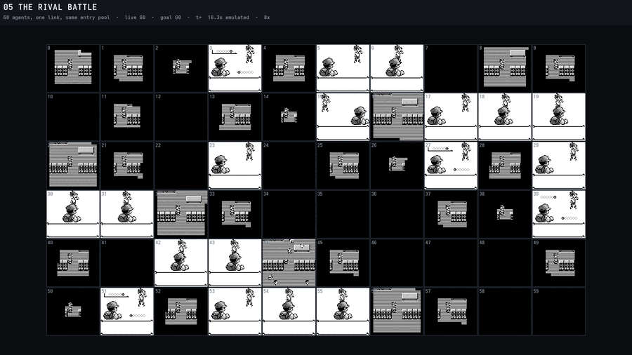
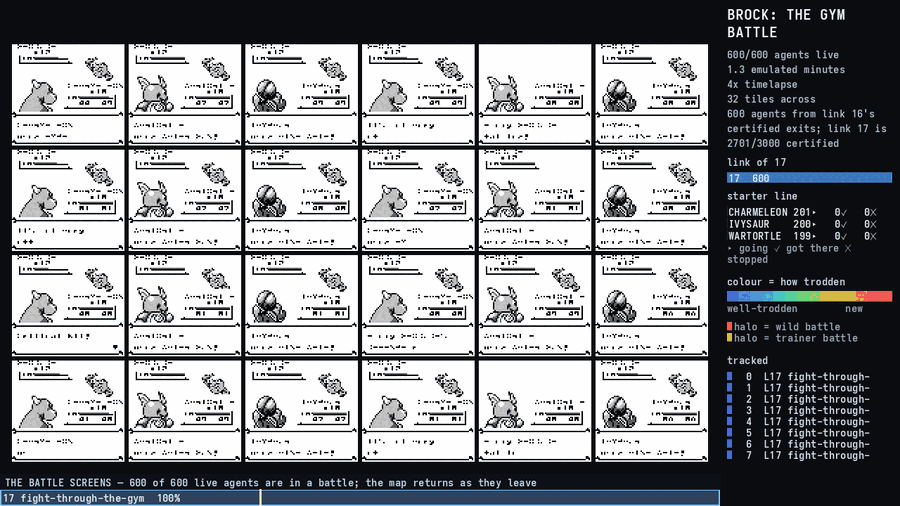

# The screen mosaic — sixty agents' screens at once

> `tools/pewter-chain/screen_mosaic.py`, fed by `pewter_chain corpus --screens`.
> Video: `~/pokemon-run/screen-mosaic-05-rival-battle.mp4`.

[The swarm view](../swarm-view.md) and [the chain film](https://github.com/Alchemy86/AgentGB/tree/main/docs/agent/pewter-chain.md#11-the-films)
draw where every agent **is**, on one world. This draws what every agent
**sees**, side by side: sixty Game Boys in a rack, all playing the same link
from the same pool of entry states, at the same seeds, at the same moment of
their own runs. It is the other half of the same question. A map says the swarm
converged on a doorway; a rack of screens says whether they are all in the same
menu.



| still | what it shows |
| --- | --- |
| [all in the battle](chain-stills/mosaic-1-all-in-the-battle.png) | ten seconds in: every agent is in the rival battle, and the three starters are already visible as three different opponents |
| [the first finishers](chain-stills/mosaic-2-the-first-finishers.png) | t+107 s: fifteen agents have reached the goal (dimmed, green border, `GOAL`) while forty-five are still fighting |
| [nearly all done](chain-stills/mosaic-3-nearly-all-done.png) | t+184 s: fifty-nine finished, one still in a battle — the spread in how long the same fight takes, in one picture |
| [a scenario that fails](chain-stills/mosaic-4-a-scenario-that-fails.png) | the tutorial `town-map` scenario, which the expert has no route for: red border, `NO CALLS`, twenty agents standing in Blue's house |

## 1. It cannot be derived from a corpus that has already been collected

This is the whole reason there is a capture mode at all, and it is worth being
blunt about because every other film in this repository *is* derived from what
is already on disk.

Every `pewter_chain corpus` run writes `path-NNNNN.gbtrk`, a record per change
of `map,x,y,facing,battle` ([the track format](track-format.md)). There is **no
picture in it**. A position track is enough to draw a dot on a map — that is what `swarm_film.py` does — and
it is enough for a heat map, a route audit and every measurement on
[the Pewter chain page](https://github.com/Alchemy86/AgentGB/tree/main/docs/agent/pewter-chain.md). It is not enough for a screen, and no
amount of reprocessing turns it into one.

So a mosaic needs a capture pass, and a capture pass has to be designed for size
**before** a byte is written.

## 2. The three decisions that make a capture affordable

A 160x144 RGBA framebuffer at sixty frames a second is **3.3 GB per emulated
minute per agent**. Sixty agents of one link would be a quarter of a terabyte.
Three decisions bring that down by about four orders of magnitude, and each is a
property of the machine rather than a compression trick.

1. **Two bits per pixel, because that is the Game Boy's own depth.** A DMG frame
   is four shades; storing it as RGBA stores those same four values in
   thirty-two bits. The quantisation is by **luminance rank**, the same rule
   `tools/conformance/image.py` and `testharness/pngdec.rs` use to compare a
   frame against somebody else's reference — a rank rather than a palette lookup
   because our shades are `000000/606060/c0c0c0/ffffff` and nobody else's are.
   `screens::tests::the_four_dmg_shades_map_onto_the_four_ranks` pins it.
2. **Downscale, because a mosaic tile is small.** Sixty tiles in a 1920-wide
   frame is 160 px of tile before any gap, so a half-scale 80x72 capture is
   already at or above what will be drawn. Sampled at **pixel centres**, the
   rule `video::fit_maps` and `screen::halfblocks` already follow;
   `the_capture_is_symmetric_because_it_samples_pixel_centres` is the check, and
   it is a check edge sampling fails.
3. **Sample, because a mosaic is a timelapse.** One frame in twelve is five
   samples per emulated second, finer than any pace a mosaic is watchable at.

That is **1,440 bytes per sample**, or about **7.0 KiB per emulated second per
agent**.

### The format, `GBSCR1`

A 24-byte header — magic, width, height, `every`, `scale`, sample count — then
the samples back to back, each `height * ceil(width / 4)` bytes, two bits per
pixel, most significant bits first, rows padded to a whole byte. Sample *i* is
emulated frame `(i + 1) * every` of its run, because a sample is taken *after*
the frame it names. Hand-rolled, like every other codec here: the dependency
count is a contract `make embed` measures.

## 3. The cost, measured

Printed by the capture itself **before it emulates a frame**, and refused above
`--screens-budget` (2048 MiB by default) rather than filling a disk that has
somebody else's certification run on it. The ceiling is computed from the
scenario's own `timeout_frames` — the most frames an attempt is *allowed*, which
is the honest worst case:

```
screens: 80x72 at 2 bpp, one every 12 frames — 1.4 KiB per sample,
         7.0 KiB/emulated second, 13.7 MiB worst case per attempt
         (120000 frames, the scenario's own timeout)
screens: 60 of 60 attempt(s) record — at most 824.0 MiB on disk
```

What actually landed for that run: **49 MB, about 823 KiB per agent**, because a
link-05 attempt is ~7,500 frames rather than the 120,000 it is allowed. **The
estimate is a ceiling and is about seventeen times the outturn on this link.**
That is the right way round — an estimate that is sometimes low is an estimate
that sometimes fills a disk — but do not quote it as a prediction.

Rules of thumb at the defaults (`--screens 12 --screens-scale 2`):

| link | emulated frames | on disk per agent | 60 agents |
| --- | ---: | ---: | ---: |
| 05 the rival battle | ~7,500 | ~0.8 MiB | ~49 MB |
| a Pewter-chain link of ~4,000 frames | 4,000 | ~0.5 MiB | ~29 MB |
| 11 train for the forest (~64,000 frames) | 64,000 | ~7.5 MiB | ~450 MB |

**Link 11 is the one to think about before running.** It is 58 % of the chain's
emulated time and its capture is ten times any other link's; either bound it
with `--screens-runs`, or coarsen it with `--screens 60`.

### What the capture costs in emulation time

One attempt of link 05, three runs each, same seed and entry state:

| | wall |
| --- | ---: |
| no capture | 0.97–0.99 s |
| `--screens 12` | 1.22–1.25 s |
| `--screens 60` | 1.22 s |
| `--screens 1200` | 1.24 s |

**The cost is the picture, not the capture** — about 26 %, and it does not move
with the sample rate. A collecting run has the PPU's pixel path switched off
([`ScenarioRun::collecting`](../../src/scenario/run.rs)); asking for screens
switches it back on for the whole run, exactly as `filming` does. Everything a
cartridge can see is unchanged either way: the framebuffer is emulator output
and is reachable from no address.

### A capture run's save-state digest is not a non-capture run's

Expect this, because it looks alarming and is not: **a save state holds the
framebuffer**, so a run that drew pixels leaves a different `final_state` hash
from one that did not, having played exactly the same game. The same phenomenon
[`ScenarioRun::collecting`](../../src/scenario/run.rs) already causes, from the
other direction.

Measured on one attempt of link 05, seed 11, same entry state, with and without
`--screens 12`: **7,398 frames, 71 decisions, the same ending** — and different
`final_state` digests. Every one of the 66,993 differing bytes lies inside a
**92,159-byte window**, against a framebuffer of 160x144x4 = 92,160, and
`pewter_chain states` reads back the identical map, position, money, badges,
party, level, HP and moves from both. The picture bytes moved; the machine did
not.

Two rules follow. **Do not compare a capture run's digests against a
certification run's** — compare decisions, frames, endings and the state's
*contents*. And **a capture is still bit-reproducible against itself**: the same
seed and entry state give a byte-identical `.gbscr`, checked in both directions.

## 4. Reproducing the video

Two commands. The entry pool is the previous link's exits — any
`--exits`-bearing corpus run of link 04 will do; the numbers above were measured
against a 3,000-state pool from a certification run.

```sh
ROM=~/roms/"Pokemon - Blue Version (USA, Europe) (SGB Enhanced).gb"

# capture — 9 s at 8 workers, 49 MB
./target/release/examples/pewter_chain corpus \
    --rom "$ROM" \
    --scenario scenarios/pewter/05-the-rival-battle.json \
    --start-dir target/cert2/04/exits \
    --runs 60 --workers 8 --screens 12 \
    --out target/mosaic/05-the-rival-battle

# tile — 35 s, 630 frames at 1920x1080
python3 tools/pewter-chain/screen_mosaic.py \
    target/mosaic/05-the-rival-battle --out target/mosaic-frames

ffmpeg -y -framerate 30 -i target/mosaic-frames/m%05d.png \
    -c:v libopenh264 -b:v 6M \
    ~/pokemon-run/screen-mosaic-05-rival-battle.mp4
```

`--dry-run` reports the grid, the pace and the capture size without writing a
frame; run it first. Running the tool with **no arguments** lists the captures
that exist under the current directory, which is the AXI content-first home view
the rest of this project's agent-facing tools follow.

The failing example is the same shape against a scenario the expert has no route
for — deliberately, because [every certified link passes](#6-what-the-picture-cannot-tell-you):

```sh
./target/release/examples/pewter_chain corpus --rom "$ROM" \
    --scenario scenarios/tutorial/town-map.json \
    --start-dir target/cert2/09/exits \
    --runs 20 --workers 8 --screens 24 --out target/mosaic/town-map
python3 tools/pewter-chain/screen_mosaic.py target/mosaic/town-map \
    --out target/mosaic-fail --speed 12
```

## 5. A finished agent must not look like a stuck one

A tile whose run has ended has no more samples, so the naive drawing is its last
frame held for the rest of the film — which is **exactly what a stuck agent
looks like**, and the mosaic's whole value is telling those two apart. Three
things mark it, and all three at once because a colour alone is not a reading
(the redundancy rule `src/screen/panel.rs` states):

* the tile is **blended 55 % towards the panel background**, so the live tiles
  read as the live ones at a glance and from across a room;
* its **border is coloured** — green for the goal, red for anything else,
  against the neutral grey of a live tile;
* and the **ending is written on it** in words: `GOAL`, `TIMEOUT`, `NO CALLS`,
  `STUCK`, `BROKE RULE`, `FAULT`, taken from `Ending::tag`
  (`src/scenario/record.rs`) and rendered as a **whole short word**. A tag with
  no short form falls back to its first hyphen-separated part rather than being
  cut mid-word: the first version printed `OUT-OF-CA`, which is not a reading and
  which a reader cannot tell was cut.

The banner carries the live count beside the goal count, so the thinning is a
number as well as a picture.

## 6. What the picture cannot tell you

Read this before drawing a conclusion off a still.

* **A tile is 80x72 at two bits.** Menu text is legible as shape, not as
  letters. Anything about *what* a box says belongs in `agent-NNNNN.ndjson`.
* **Thin horizontal detail aliases.** The vertical halve drops alternate source
  rows, and Gen 1 draws one-pixel-tall stripes on some interior floors; those
  come out as banding that is not on the machine's own screen. Capture at
  `--screens-scale 1` if a fine pattern is the subject.
* **Agents are ordered by seed, not by progress**, so a row is not a cohort and
  two neighbouring tiles are related only by their seed.
* **The sample rate is coarse.** A screen that flashes for four frames may not
  be in a twelve-frame capture at all.
* **A finished agent's tile is its last captured frame**, not a live machine.
* **The population shown is the one that was captured**, which is the low seeds —
  the same seeds `--exits` keeps and the same ones a chain film stitches, so a
  mosaic and a film are of the same agents. It is a sample of the corpus, and the
  corpus is the population.
* **A certified link has nothing to fail.** Every Pewter link passes 60 of 60 on
  this build — measured, on links 12, 13 and 14, alongside link 05's own 60 of
  60 — so the red border does not appear in the headline film. That is a
  statement about the chain, not about the tool, and it is why the failing
  example above is a scenario the expert has no route for rather than a link.
* **It is a picture of the picture, not of the machine.** Two agents whose
  screens are identical may be in wildly different WRAM states; the mosaic is a
  fast way to *find* the question, and `index.ndjson` plus the per-attempt
  recording is where it gets answered.

## 7. The mosaic as a SHOT inside the swarm film

**A position film cannot show a battle, and a gym cut is mostly battle.** Every
agent walks to Brock's tile and fights there, so six hundred sprites stack into
one sprite and the picture goes still for most of the runtime. Reported on the
gym cut: *"as a gym battle we SHOULD have been treated to a full screen of
Brock battles before switching back to the map as they all leave."*

Both renderers already existed and they now share
[`chainrender`](chainrender.md), so this is a **sequencing** decision rather
than new machinery: `swarm_film.py --screens <corpus-dir>` cuts to the battle
screens while the swarm is overwhelmingly in a battle, and cuts back to the map
as they leave.



```bash
# the SAME run must produce both, or the map and the mosaic are two different
# populations. One corpus pass writes the tracks and the captures together.
target/release/examples/pewter_chain corpus --rom <blue.gb> \
    --scenario scenarios/pewter/17-fight-through-the-gym.json \
    --start-dir target/cert2/16-heal-in-pewter/exits \
    --runs 600 --workers 16 --paths \
    --screens 8 --screens-scale 2 --screens-runs 72 --screens-budget 4096 \
    --out ~/pokemon-run/brock-screens

python3 tools/pewter-chain/chain_tracks.py --out ~/pokemon-run/brock-screen-tracks \
    --agents 600 17-fight-through-the-gym:~/pokemon-run/brock-screens

python3 tools/pewter-chain/swarm_film.py ~/pokemon-run/brock-screen-tracks \
    --out <frames> --speed 4 --fps 60 --cover 0.90 --width 1280 \
    --screens ~/pokemon-run/brock-screens
```

**When it cuts is a rule with hysteresis, and the film prints it.** The share of
live agents in a battle enters at `--battle-cut` (0.60) and leaves at the lower
`--battle-back` (0.45), with a `--battle-hold` (30 output frames) minimum dwell
so a one-frame dip cannot cut the film in half — the same shape as the camera's
own rule 3. On the gym cut that gives three runs and the reason for each:

```
72 screen capture(s); the battle view holds 1731 of 3315 output frames (52%) in 3 run(s)
  frames 921-1862 (15.7 s), cut in at 523 of 600 live agents in a battle
  frames 2218-2819 (10.0 s), cut in at 198 of 300 live agents in a battle
  frames 3128-3314 (3.1 s), cut in at 56 of 93 live agents in a battle
```

Four things that are load-bearing:

* **The tiles are the agents that are in a battle RIGHT NOW**, chosen per frame
  from those that have a capture — never a fixed list, or the picture would
  show somebody walking while the caption says six hundred are fighting.
* **`--battle-tiles` is a ceiling, not a count.** What is drawn is the most
  tiles that fit at a *legible* whole zoom (`mosaic.best_grid`) — 24 at 2x on a
  1024x720 picture area. Two obvious objectives are both wrong and were both
  measured: maximising the count gives 48 tiles at 1x covering a third of the
  picture, and maximising the covered area gives **12** at 3x, because coverage
  always prefers fewer bigger tiles. A dozen battles is not a screen full of
  battles.
* **A cut with no reason on screen reads as a glitch**, so the bottom bar says
  which view is up and why: *"THE BATTLE SCREENS — 600 of 600 live agents are
  in a battle; the map returns as they leave"*. The HUD keeps running
  underneath, including the arrival count, which accumulates on a battle frame
  even though its marker belongs to the map and the map is not on screen.
* **The whole zoom is checked, not assumed.** A tile's interior contains
  exactly four colours — `000000/606060/c0c0c0/ffffff`, our DMG shades to the
  byte — because a fractional resample would invent shades the Game Boy never
  drew. Same categorical guard as everywhere else here.

## See also

* [the Pewter chain](https://github.com/Alchemy86/AgentGB/tree/main/docs/agent/pewter-chain.md) — where the links, the entry pools and the
  corpus come from
* [the swarm view](../swarm-view.md) — the same population drawn as positions on
  one world instead of as screens
* [the swarm's paths](path-arrows.md) — the same population as the *union* of
  its paths: one arrow per walked tile, from a corpus already on disk and with
  no capture pass at all
* [the test rig](https://github.com/Alchemy86/AgentGB/tree/main/docs/agent/test-rig.md) — when the question is a number rather than a
  picture
