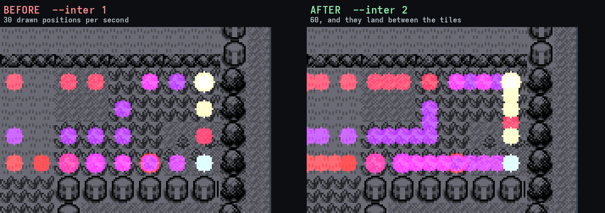
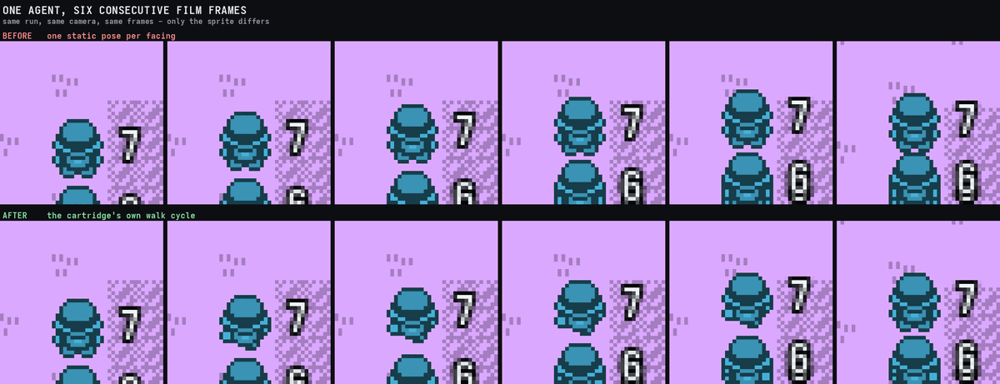

# Why Peter Whidden's swarm reads smoother than ours

<!-- codemap:asof -->

**Question asked:** re-check [*Training AI to Play Pokémon with Reinforcement
Learning*](https://www.youtube.com/watch?v=DcYLT37ImBY) (Peter Whidden,
[`PWhiddy/PokemonRedExperiments`](https://github.com/PWhiddy/PokemonRedExperiments)),
find what tooling actually produced the swarm and battle-swarm shots, and say
**honestly** why ours [(`swarm-view.md`)](../swarm-view.md), the chain film
(`tools/pewter-chain/swarm_film.py` + [`chainrender`](chainrender.md)) and the
[screen mosaic](screen-mosaic.md) are not yet at that bar — aside from map
layout, which another crew already owns.

**Scope and honesty rules followed throughout:** every claim about *his*
implementation is cited to a primary source (his repo, a raw file, or a
transcript summary) and marked **primary** (read from his actual code/README)
or **inference** (plausible but not directly observed — flagged as such, never
presented as fact). Every claim about *our* implementation is cited to a
`path:line` in this tree. Map placement/atlas accuracy is out of scope per
instruction — everything here is about **motion smoothness and presentation**,
not "is the map geographically right."

## 1. What his tooling actually is — two systems, not one

He built (at least) two separate things, and the video's own chapter
structure treats them separately (**primary**, timestamps read from a
third-party transcript summary — see §5 for the caveat on that source):

| System | What it's for | Tech (primary, cited) |
|---|---|---|
| **Live web viewer** — [`PWhiddy/pokerl-map-viz`](https://github.com/PWhiddy/pokerl-map-viz), hosted at `pwhiddy.github.io/pokerl-map-viz` | watching a *running* training job during the day, many contributors' agents on one shared map | PixiJS/WebGL, `requestAnimationFrame`, positions arrive over a websocket per agent |
| **Offline video renderer** — `visualization/BetterMapVis*.py` + `.ipynb` in the main repo | the actual swarm shots cut into the YouTube video | matplotlib/PIL-style static compositing, gzip'd CSV logs, `ffmpeg`/`VideoWriter` output |

These are not the same code, and conflating them is the single easiest way to
misattribute a technique. The live viewer's zoom/pan/LOD tricks (§2) are
**not** evidence about how the video's swarm shots were smoothed — the offline
script that most plausibly produced those has **no camera motion at all**
(§2). Treat the two rows separately below.

**On "how many agents":** primary evidence only bounds an SB3 `DummyVecEnv`
training loop at *4* parallel envs in one documented configuration, and a
grid-video notebook loading *84* full-length rollout `.mp4`s
(`raw…/visualization/Create_Video_Grids.ipynb`, cell `runs_dir =
Path('baselines/video_session_ff80d382/rollouts')`, `parse_reward` sorting).
Neither number is definitely the swarm-map agent count — **inference**: the
swarm-map shot in the video plausibly draws whatever population a given
training run had (his README separately claims later runs use "16 cores"),
which could be anywhere from dozens to low hundreds. We could not pin an exact
figure and are not asserting one. Our own chain films already run **600
agents** on one map (`AGENTS.md`, "The Pewter chain" §"Certifying a link…",
and `docs/agent/chainrender.md`) — on raw agent count we are very unlikely to
be behind him, so this is **not** a candidate for "why his reads smoother."

## 2. The technique-by-technique table

| Property | His (cited, primary unless marked) | Ours (cited) | Verdict |
|---|---|---|---|
| **Position interpolation, offline renderer** | `inter_steps=4` (8 in a test render), linear, between coordinate samples — `raw…/BetterMapVis_script_version.py`: `"fract in np.arange(0,1,1/inter_steps)"` | `chainrender.tracks.interpolate` — linear, span from `walk_span()` (measured per corpus, ~17-31 emulated frames) — [`tools/pewter-chain/chainrender/tracks.py:265`](../../tools/pewter-chain/chainrender/tracks.py); and `--inter` in [`examples/swarm_view.rs`](../../examples/swarm_view.rs) | **CLOSED — parity both ways.** `swarm_view.rs` gained the same lerp; see §7.1 |
| **Position interpolation, live viewer** | linear + *adaptive* duration: `animationDuration = max(1000, batchTimingAvg * 0.95)`, EMA `alpha=0.3` on the batch timing itself — `raw…/visualizer_live.js` | fixed sample stride, fixed output pace (`--speed`/`--fps`); no adaptation to data arrival rate (n/a offline — every frame is ground truth, not a sparse network update) | **not comparable** — his problem (sparse live telemetry) is not ours (full emulated ground truth). Not a gap. |
| **Sprite art** | 16×16 tiles cut from a spritesheet at `sy=34+17*y, sx=9+17*x`; **4-frame walk-cycle** per direction (`[1,4,6,8]` on the sheet) | `pewter_chain sprites` reads the real OAM/VRAM sprite — the standing facing **and now the walk cycle**, captured while the player is actually stepping — [`examples/pewter_chain.rs`](../../examples/pewter_chain.rs) `cmd_sprites` / `capture_walk_cycle` | **CLOSED.** Three poses per vertical facing, two per side-on one, and the cartridge's own sequence measured rather than assumed; see §7.2 |
| **Camera, offline renderer** | **none.** Fixed `global_offset` plus a hand-authored per-map offset dict; no zoom, no pan, no smoothing — `raw…/BetterMapVis_script_version.py`: `"global_offset = np.array([1056-16*12, 331])"` | seven tuned rules (EMA target, deadzone, quantised zoom ladder, pan cap, axis bias, catch-up, box-smoothing) — [`tools/pewter-chain/chainrender/camera.py:1`](../../tools/pewter-chain/chainrender/camera.py) | **structural, not a bug** — see §3.3 |
| **Camera, live viewer** | user-driven wheel zoom (`scaleFactor = 1 - deltaY*0.0015`) blending two background textures with `smoothstep(2, 4.5, val)` for LOD | quantised-ladder zoom with hysteresis, hard snaps between rungs (`AGENTS.md`, "THE ZOOM WAS THE LOUDEST CAUSE") | **his LOD-blend idea is applicable to us** — see §3.4. Not proof his *video* used it (that's the live viewer, not the offline renderer). |
| **Video codec/pixel format, offline renderer** | `codec='prores_ks', encoded_format='yuva444p'` (ProRes 4444 **with alpha**) — a mezzanine/compositing format, not a delivery one | current defaults are already `-c:v libx264 -pix_fmt yuv420p` (or `libopenh264` fallback) — [`examples/swarm_view.rs:1537`](../../examples/swarm_view.rs), [`tools/pewter-chain/path_arrows.py:824`](../../tools/pewter-chain/path_arrows.py), [`tools/pewter-chain/swarm_film.py:1344`](../../tools/pewter-chain/swarm_film.py), [`tools/pewter-chain/screen_mosaic.py:543`](../../tools/pewter-chain/screen_mosaic.py) | **codec is not currently a gap in our tooling** — see §3.5 for what the "VP9 4:4:4" report probably was |
| **Battle-specific swarm view** | **no evidence found** — see §4 | dedicated: chain-film battle halos ([`swarm_film.py:1037-1094`](../../tools/pewter-chain/swarm_film.py)) *and* a dedicated screen-mosaic capture pass for exactly one battle scenario ([`screen_mosaic.py`](../../tools/pewter-chain/screen_mosaic.py), `docs/agent/screen-mosaic.md`) | **we appear to be ahead here, not behind** — see §4 |
| **fps (offline render)** | 60 — `raw…/BetterMapVis_script_version.py`: `fps=60` | 30-60, configurable (`--fps`); chain-film default is 60 (`chain-film` trace: "--speed 12 --fps 60", `camera.py` docstring) | parity when we choose 60; we default lower in some tools — cheap to standardize, see §3.6 |
| **Timelapse factor** | not established from primary sources (interp/fps numbers found, not a "Nx" figure) | `--speed` 4x-52x depending on cut, derived from `stride <= walk_span` ceiling (`AGENTS.md` "THE SMOOTHNESS CEILING IS `stride <= one walk step`") | not comparable — no primary number for his |
| **"Giant game grid" (thousands of tiled clips)** | `ffmpeg` tiling of many pre-rendered rollout videos, general-purpose, not battle-specific ("Rendering the Giant Game Grid" / "Generating FFMpeg Commands for Video Tiling", ~27:15-27:49 per transcript summary — **inference**, secondary source) | screen mosaic caps at dozens (48-60) per run, because each tile needs a dedicated capture pass at ~7 KiB/agent/s (`docs/agent/screen-mosaic.md`) | **scale gap, not quality gap** — see §3.7 |

## 3. Ranked: what we do worse, cheap before expensive

### Cheap (hours, no new capture pipeline, no new dependency)

**3.1 — `examples/swarm_view.rs` has zero position interpolation and draws a
flat dot, not a sprite.** *(**Closed** — the interpolation half. See §7.1 for
what landed and what it measured; the dot is still a dot, deliberately.)* [Highest-value cheap fix if this is the video being
judged.] It samples position every `--sample N` frames (`docs/swarm-view.md`
example: every 24 frames) and stamps `agent_colour(i)` straight onto the
canvas with `Compositor::marker` — [`examples/swarm_view.rs:1084-1098`]
(../../examples/swarm_view.rs). There is no lerp between samples anywhere in
that file (`grep -n interpolat examples/swarm_view.rs` returns nothing). Every
agent **teleports** on every sampled frame; at 24-frame sampling and a typical
DMG walk step of ~17 emulated frames, that is visibly worse than
one-tile-per-jump. This is the file `docs/swarm-view.md`'s hero video is built
from and the one most likely to be "ours" in a side-by-side against his — and
it is strictly behind the newer `swarm_film.py`/`chainrender` path, which
**already has** `interpolate()`. Fix: either retire `swarm_view.rs` in favour
of the newer renderer (AGENTS.md already records this consolidation as
"deferred, not cancelled" — `docs/agent/chainrender.md` "Why it exists"), or
port `chainrender.tracks.interpolate`'s approach into it. No new capture, no
new dependency — this is the single cheapest, highest-leverage fix available.

**3.2 — Our agents don't animate while walking; his do.** *(**Closed.** See
§7.2 — and note that the fix is not the one this section predicted: the
`walking` field it expected to drive the cycle from is not in a track any more,
and the phase is reconstructed instead.)* Whidden's sprite
sheet carries four walk-cycle frames per direction
(`sx = 9 + 17*x` for `x in [1,4,6,8]`, `raw…/BetterMapVis_script_version.py`
— **primary**). Ours captures **one static standing frame per facing**,
once, from a held state (`cmd_sprites`, [`examples/pewter_chain.rs:5076`]
(../../examples/pewter_chain.rs): "Face each way in turn and grab what the
machine draws" — no attempt to also grab a mid-stride frame). A sprite that
glides smoothly (§3.1's fix) but never swings its legs still reads as
*sliding*, not *walking* — this is plausibly a large share of "his reads
smoother" even after interpolation is fixed. The infrastructure to fix this
already exists in this codebase: Gen 1's own overworld code animates the
player's OAM tile id as `wWalkCounter` (`$CFC5`) counts 7→1
(`chainrender/tracks.py:16-22`, already documents this exact register).
`cmd_sprites` would need to sample OAM at two points in a walk (e.g.
`wWalkCounter` near 6 and near 2) instead of only at rest, and the renderer
would alternate frames keyed on interpolation phase the same way `interpolate()`
already computes a 0..1 progress fraction. Medium-cheap: no new capture pass,
reuses the existing OAM-read machinery, touches `cmd_sprites` and the sprite
selection in `swarm_film.py`.

**3.3 — The quantised zoom ladder still hard-snaps between rungs.** `AGENTS.md`
already measures this as the single loudest cause of "our camera vibrates":
resampling the pixel art at a continuously-varying ratio every frame. The
current fix (snap to a geometric ladder, change only on hysteresis) removed
the *continuous* shimmer but did not remove the *discrete* jump when a rung
changes — `docs/agent/chainrender.md`'s own camera notes still report **18-20
distinct crop widths** across a 15,632-frame render. His live viewer's
approach — cross-fading two background textures at two zoom levels with
`smoothstep(2, 4.5, val)` (`raw…/visualizer_live.js` — **primary**, but for
the *live viewer*, not necessarily the video's offline renderer — flagged) —
is directly portable to our zoom-ladder rungs: render the frame at the
current and the next rung, alpha-blend across the hysteresis band instead of
snapping. Cheap in the sense that it's a compositing change inside
`chainrender/camera.py`'s existing rung logic, not a new subsystem; moderate
in that it roughly doubles per-frame render cost while inside a transition
band.

**3.4 — Codec is very likely already fixed; the "VP9 4:4:4" report is stale
or was a manual override.** Every `ffmpeg` invocation currently checked into
this tree already defaults to `yuv420p` (`libx264` or the `libopenh264`
fallback) — see the citations in the table row above. No `vp9`/`libvpx`/`444`
string exists anywhere in `tools/pewter-chain/*.py`, `examples/swarm_view.rs`,
or the docs (`grep -rn "vp9\|libvpx\|444\|yuv" …` returns nothing outside the
already-`yuv420p` lines). If a specific rendered artefact (e.g. one of the
`.mp4`s under `/home/aaron/pokemon-run/`, which are not committed) was
produced with a hand-typed VP9/4:4:4 command outside these scripts, that is a
one-off operator mistake, not a tooling defect — worth confirming which file
was affected, but there is nothing to fix in the source. Filed here as
**resolved / needs confirmation**, not as an open gap. (For contrast: his own
choice is ProRes 4444 with an **alpha channel** — see §3.5, a different
concern entirely from a lossy delivery codec being 4:4:4.)

**3.5 — His deliverable format implies a manual compositing/edit pass we
don't do.** `codec='prores_ks', encoded_format='yuva444p'`
(`raw…/BetterMapVis_script_version.py` — **primary** for the *choice*,
**inference** for the *reason*): ProRes 4444 is a broadcast/edit mezzanine
codec, and the `yuva` variant specifically carries an **alpha channel**. A
script exporting alpha is producing an element meant to be composited over
something else in an editor (After Effects/Premiere/DaVinci/Final Cut), not a
finished YouTube-ready file. That strongly implies the swarm shots in the
final video went through a manual edit pass — colour grading, possibly
hand-keyframed camera moves or crossfades, music sync, maybe a vignette or a
background plate composited under the transparent swarm layer — that no
script alone reproduces. This is the most plausible single explanation for
"his reads smoother" that isn't about our code at all: **we render and ship
`ffmpeg`-tiled PNG sequences directly; he (very likely) rendered an element
and hand-edited it.** This is filed as an *expensive* item (§ below) because
it's a workflow change, not a code fix, but it's flagged here because it's
adjacent to the codec finding and easy to conflate with it.

**3.6 — fps is inconsistent across our own tools.** His offline renderer is a
flat `fps=60`. Ours varies: `chainrender`'s docstring examples use `--fps 60`,
but `docs/swarm-view.md`'s own recipe encodes at `-framerate 30` with a
`--sample 24` position stride (`docs/swarm-view.md` §"Running it", step 3).
Standardizing every renderer on 60 fps output (even if the position sample
rate stays coarse, since §3.1/§3.2's fixes make interpolation and animation
independent of it) is a same-day change and removes one more inconsistency
between "how we look" across our own demos.

### Expensive (structural, multi-day, or a workflow/process change)

**3.7 — No equivalent of the "giant tiled grid" at his implied scale, and it's
capture-cost-bound, not code-bound.** Our screen mosaic already exists and is
purpose-built for exactly the situation the task asks about (§4), but it caps
at **48-60 agents** per run because each tile needs a **dedicated capture
pass** — a `pewter_chain corpus --screens N` run that stores a
`screen-NNNNN.gbscr` per attempt on top of the existing position track, at a
measured **~7 KiB/agent/second** even at the already-aggressive 2-bit,
half-resolution, 12-frame-sampled encoding (`docs/agent/screen-mosaic.md`,
`AGENTS.md`'s "The screen mosaic" section). Scaling this to "thousands," the
way his `ffmpeg`-tile segment implies, is a genuine cost problem (disk and
capture time), not a rendering-quality one. This is the one item on this list
that is honestly about **scale**, not **smoothness** — worth doing eventually,
not a quick win.

**3.8 — The camera's structural complexity is solving a problem he sidesteps
entirely, and closing the remaining 30-40% "impossible" fraction needs a
different camera model, not another tuning pass.** His offline renderer has
**no camera** — a fixed global offset plus a hand-placed per-map dict, so
there is nothing to judder because nothing ever moves or zooms
(`raw…/BetterMapVis_script_version.py`, confirmed no zoom/smoothing logic —
**primary**). Ours tries to auto-follow a scattered population across however
many maps it's currently split across, and `chainrender/camera.py`'s own
measurement admits **34.2% of frames are geometrically impossible** to fit
(the 5th-95th percentile box is taller than the widest crop the world atlas
allows) on the fourteen-link chain film (`AGENTS.md`, "A COVERAGE FIGURE MUST
SAY WHETHER THE SHOT WAS MISSED OR WAS NEVER AVAILABLE"). Two real options,
both expensive: (a) split the render into **per-map fixed shots** the way he
does whenever the swarm is confined to one map — camera motion only kicks in
during a genuine map transition — trading "one continuous camera" for "several
static plates, cut between," which is closer to what a hand-edited video does
anyway (dovetails with §3.5); or (b) accept the auto-follow camera but bound
its claims by cutting to a split-screen/inset when the swarm is provably
unable to fit one frame, instead of reporting a single (sometimes empty)
crop. Either is a multi-day change to `chainrender/camera.py` and its
call sites, not a tuning constant.

## 4. The "battle swarm" specifically — no evidence he built one

The task asked pointedly about *battle* swarms because we just shipped ours.
**We could not find a battle-specific visualization anywhere in his repo or
in a transcript summary of the video** (secondary source —
`videohighlight.com/v/DcYLT37ImBY`, queried for the Brock-gym section
~10:30-13:00 and the grid-visualization sections ~20:00-21:30; the summary
names the Brock fight narratively and describes a "Pokémon caught" catch-rate
grid, but names no dedicated battle grid or battle-specific swarm marker).
What we *did* find in his repo:

- `visualization/Create_Video_Grids.ipynb` loads and ranks **whatever rollout
  clips exist** by final reward, then (per the "Generating FFMpeg Commands for
  Video Tiling" / "Rendering the Giant Game Grid" chapters, ~27:15-27:49,
  secondary source) tiles many of them with `ffmpeg`. This is a **general**
  screen-grid tool — it would show a battle if a battle happened to be
  on-screen for a tiled clip at that moment, the same as it would show
  walking, menus, or anything else. There is no code path in the notebook we
  could read (see §attempt in research log) that selects, detects, or
  specially marks battle frames.
- No `battle` string, no HP-bar overlay, no "% in combat" counter, nothing
  battle-aware was found in any fetched file.

Compare our own: `swarm_film.py` draws a **battle halo** under any agent whose
recorded `wIsInBattle` byte reads wild or trainer, coloured by which
(`BATTLE_HUE`/`BATTLE_KIND`, [`tools/pewter-chain/swarm_film.py:1037-1094`]
(../../tools/pewter-chain/swarm_film.py)), plus a live "in a battle: N wild, M
trainer" HUD row, gated so it never prints a permanent zero on a scenario with
no battles. Separately, `screen_mosaic.py` is a **dedicated capture-and-tile
tool built expressly for one battle scenario** — `docs/agent/screen-mosaic.md`
opens with "sixty Game Boys in a rack, all playing the same link... video:
`screen-mosaic-05-rival-battle.mp4`" and its whole design (dimmed/bordered
"finished" tiles, per-tile ending labels, a live goal counter) exists because
watching a battle specifically was the goal.

**Honest conclusion for §4:** on the specific question "how does his battle
swarm work," the most defensible answer is **there probably isn't one, as a
distinct feature** — what he has is a general multi-video tiling tool that
happens to sometimes show a battle, discovered via secondary-source
transcript summaries rather than direct code inspection of a
battle-detection path (absence of evidence, not proof of absence — flagged).
Our screen mosaic is more purpose-built for exactly this than anything we
found of his. If ours still looks worse side by side, the reasons are the
general ones in §3 (interpolation/animation/camera/encoding), not a missing
battle-specific mechanism — we appear to already be ahead on that specific
axis.

## 5. Source reliability notes

- **Primary sources** (fetched and read directly): `raw.githubusercontent.com`
  copies of `BetterMapVis_script_version.py`, `visualizer_live.js`,
  `pokerl-map-viz/README.md`, `PokemonRedExperiments/README.md`, and a
  directory listing of `visualization/`. These are the strongest evidence in
  this report and are cited with exact code fragments where found.
- **Secondary sources** (used only where primary code could not be reached):
  `videohighlight.com/v/DcYLT37ImBY`, a third-party AI-generated timestamped
  summary of the video, not a verbatim transcript — every claim sourced from
  it is marked **secondary** or **inference** above and should be re-verified
  against the actual video before being treated as settled fact. The `github.com`
  web UI itself was unreachable from this environment (fetch tool refused the
  domain); every GitHub-hosted fact here was obtained via `raw.githubusercontent.com`
  or `WebSearch` snippets instead, which is why some files (e.g.
  `Map_Stitching.ipynb`'s full stitching logic, `Agent_Visualization.ipynb`)
  could not be read past a partial excerpt.
- **Not found at all, despite searching**: exact agent counts for the video's
  swarm-map shot; whether the shots were cut in a video editor (§3.5 is
  inference from the codec choice alone); the specific hardware/render time
  for the offline renderer.

## 6. Where we are *not* behind (for balance)

- **Agent count on a map swarm**: our chain films already run 600 agents on
  one map; no primary source pins his swarm-map count that high.
- **Battle-awareness**: see §4 — we have a dedicated mechanism, he apparently
  does not.
- **Determinism/reproducibility**: `swarm-view.md`'s own "Proof they diverged"
  section is a stronger transparency claim than anything found in his
  materials — not directly about smoothness, but relevant to "as good if not
  better."
- **Ground-truth sampling**: because emulation here is exact and headless-fast,
  every renderer has access to *every* emulated frame if it wants it; his live
  viewer is working from sparse websocket telemetry and has to guess timing
  (its adaptive EMA duration exists to paper over that). This is a structural
  advantage for us that §2's table already notes as "not comparable."

## 7. What has since been closed, and what it measured

Both of §3's cheap items are done. Neither changed a byte of emulation; both
are **strictly opt-in on their input**, so an already-published film reproduces
exactly.

### 7.1 — Interpolation in `examples/swarm_view.rs`

`--inter <n>` draws *n* video frames per recorded position, lerping between
them: the same model as `chainrender.tracks.interpolate` and as Whidden's own
`inter_steps`. `--fps <n>` (default 60, his figure) says what the printed
`ffmpeg` recipe encodes at, so **`--inter` buys smoothness and never speed** —
`seconds_out x speed = the emulated time there is`, and interpolation adds no
emulated time.

**Measured on the hero recipe from [`docs/swarm-view.md`](../swarm-view.md)**
(24 agents, 36,000 frames, `--sample 24 --zoom`, Pokémon Blue, the shiny
hunter's `route1.gbss`) — the tool prints all of this itself now:

| | `--inter 1 --fps 30` (before) | `--inter 2 --fps 60` (after) |
|---|---:|---:|
| drawn frames | 1,500 | 2,999 |
| film length / pace | 50 s at 12x | **50 s at 12x** — unchanged |
| stride, emulated frames per drawn frame | 24.0 (**over** the 16-frame walk step) | 12.0 |
| displacement per drawn frame, p90 | 16.00 px | **8.00 px** |
| p99 | 32.00 px | **16.00 px** |
| moving samples landing on the tile grid | 100.0 % | **62.7 %** |

One agent's drawn positions over the same fourteen frames, read off the
rendered PNGs rather than out of the renderer: **16, 23, 16, 16, 16, 0, 31, 16,
16, 16, 16, 32 px** before, against **7, 8, 8, 0, 23, 8, 8, 8, 8, 8, 8, 0, 0,
15 px** after.



*One second of film, every drawn position of every agent superimposed. Left:
separate dots, one per tile. Right: continuous trails.*

Three things worth keeping:

* **`--inter 1` reproduces the old renderer byte for byte** — checked against a
  build of the pre-change source, 375 frames, identical md5. So is
  `swarm_film.py` with a sprite directory that has no walk cycle in it (700
  frames, identical md5), and both camera/arrow equality gates in
  [`chainrender.md`](chainrender.md) still hold.
* **The ceiling is `stride <= one walk step`, and the tool says when it is over
  it.** A DMG step crosses 16 px in ~16 emulated frames (`wWalkCounter` 7..1,
  two frames each, 2 px a frame); above that an agent finishes a whole step
  between two drawn frames and *no* amount of interpolation can smooth
  something that is never drawn in progress. The documented recipe was at 24,
  i.e. over it.
* **A straight multi-tile interval is glided; a bent one is not.** These
  samples are fixed-rate, so at `--sample 24` an agent walks two tiles in one
  interval about one interval in five (3,401 of ~16,700). A run along one axis
  really did pass through the tiles between and is glided; a move that changed
  *both* axes is an L, and a straight glide across it would draw a diagonal
  nobody walked — refused, and counted on the report line (**47** of those,
  against **53** warps, in that same run). `chainrender`'s version refuses both,
  correctly, because its tracks are event-recorded and a gap of two tiles there
  means a teleport.

### 7.2 — The walk cycle

`pewter_chain sprites` now also holds the direction down and keeps every
distinct 16x16 cut-out the cartridge draws *while the player is stepping*,
writing them as `player-<dir>-w<n>.png` in cycle order beside the standing
`player-<dir>-f<n>.png` it always wrote.

**The sequence was measured, not assumed** — eight consecutive steps walking
south, logging `wWalkCounter` against the pose drawn:

```text
counter  7 7 7 6 6 5 5 4 4 | 3 3 2 2 1 1
pose     0 0 0 0 0 0 0 0 0 | 1 1 1 1 1 1     <- one step
pose     0 0 0 0 0 0 0 0 0 | 2 2 2 2 2 2     <- the next
```

So the standing pose covers the **first half** of a step and a stepping pose
the second, and **which** stepping pose alternates from one step to the next.
Two more measurements fall out: pose 2 is the exact horizontal mirror of pose 1
(0 differing pixels), and the right-facing standing frame is the exact mirror of
the left-facing one (0 differing pixels) — which is what lets a side that is
walled in on every sidestep have its cycle *derived* from the other side and
still be checked rather than guessed.

**§3.2 predicted the wrong mechanism, and this is the correction.** It expected
the renderer to be driven from a `walking` field already in the track data.
That field is not there: `terminalgb::scenario::track` measured that **83 % of
all track rows changed nothing but the walk counter** and dropped it, saying in
as many words that "the step is expanded back at draw time". So the phase is
reconstructed — `chainrender.tracks.walk_phase`, over the *same* segment
`interpolate` positions the agent from, so the legs and the feet cannot
disagree. Which of the two stepping poses leads is taken from the parity of the
destination tile, which changes by exactly one every step; *which* leads first
is a function of how many steps the player has taken since the game began,
which no position track carries and which nobody can see, the two poses being
mirrors.

**Measured on a 700-frame film** (8 agents, the Pewter gym approach, 2x, 60 fps,
identical captions so only the sprites differ): **125 of 233 sampled frames
differ, median 42 differing pixels, max 277** — the scale of a few agents
changing pose, on the frames where agents are mid-step.



*Six consecutive frames of the same film. Top: the same pose every frame.
Bottom: the legs move.*

**A still cannot prove animation**, which is why the numbers above are the
claim and the pictures are supporting. The two side-by-side clips are
`~/pokemon-run/smoothness/swarm-interp-ab.mp4` and `swarm-walkcycle-ab.mp4` —
not committed, for the same reason no film in this repository is.

### 7.3 — What was deliberately *not* done

* **His camera was not copied**, because §2 found he has none: a fixed
  `global_offset` and a hand-authored per-map dict. Our seven (now nine) tuned
  rules are solving a problem he sidesteps, and §3.8 still stands.
* **The codec was not touched** — §3.4 is still the answer, and his ProRes 4444
  with alpha is a mezzanine format rather than a delivery one.
* **`swarm_view.rs` still draws a dot rather than a sprite.** It is a
  twenty-four-agent proof of concept whose whole diagnostic value is that a pile
  of agents on one tile reads as *brighter*; a sprite does not stack that way,
  and the sprite renderer is `swarm_film.py`. A dot has no legs to swing, so
  §7.2 does not apply to it.
* **The map layout is still another crew's**, per the original instruction.

## Sources

- [Peter Whidden — *Training AI to Play Pokemon with Reinforcement Learning*](https://www.youtube.com/watch?v=DcYLT37ImBY)
- [`PWhiddy/PokemonRedExperiments`](https://github.com/PWhiddy/PokemonRedExperiments)
- [`PWhiddy/pokerl-map-viz`](https://github.com/PWhiddy/pokerl-map-viz)
- [`raw…/visualization/BetterMapVis_script_version.py`](https://raw.githubusercontent.com/PWhiddy/PokemonRedExperiments/master/visualization/BetterMapVis_script_version.py)
- [`raw…/visualization/Create_Video_Grids.ipynb`](https://raw.githubusercontent.com/PWhiddy/PokemonRedExperiments/master/visualization/Create_Video_Grids.ipynb)
- [`raw…/visualization/Map_Stitching.ipynb`](https://raw.githubusercontent.com/PWhiddy/PokemonRedExperiments/master/visualization/Map_Stitching.ipynb) (ORB feature-matching, not coordinate-based — noted, not used above; **inference** that this is an alternative/exploratory approach rather than what shipped)
- [`raw…/pokerl-map-viz/visualizer_live.js`](https://raw.githubusercontent.com/PWhiddy/pokerl-map-viz/main/visualizer_live.js)
- [`raw…/pokerl-map-viz/README.md`](https://raw.githubusercontent.com/PWhiddy/pokerl-map-viz/main/README.md)
- [`raw…/PokemonRedExperiments/README.md`](https://raw.githubusercontent.com/PWhiddy/PokemonRedExperiments/master/README.md)
- [videohighlight.com summary of the video](https://videohighlight.com/v/DcYLT37ImBY) (secondary, AI-generated — see §5)
- This repository: [`docs/swarm-view.md`](../swarm-view.md), [`docs/agent/chainrender.md`](chainrender.md), [`docs/agent/screen-mosaic.md`](screen-mosaic.md), [`examples/swarm_view.rs`](../../examples/swarm_view.rs), [`tools/pewter-chain/swarm_film.py`](../../tools/pewter-chain/swarm_film.py), [`tools/pewter-chain/chainrender/`](../../tools/pewter-chain/chainrender/), [`examples/pewter_chain.rs`](../../examples/pewter_chain.rs), `AGENTS.md`
