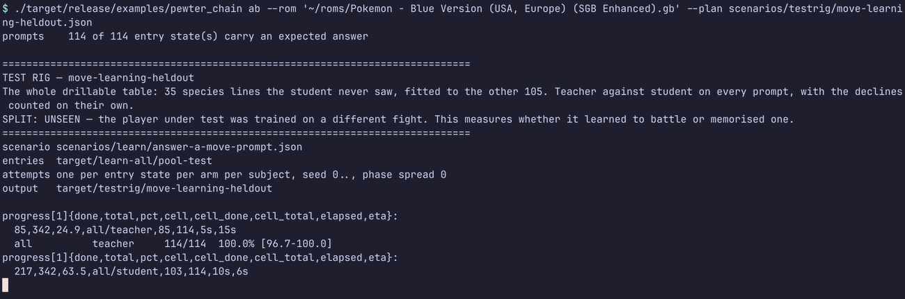
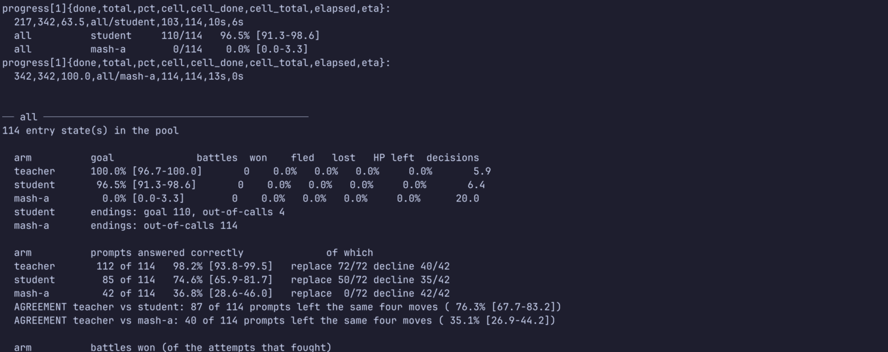
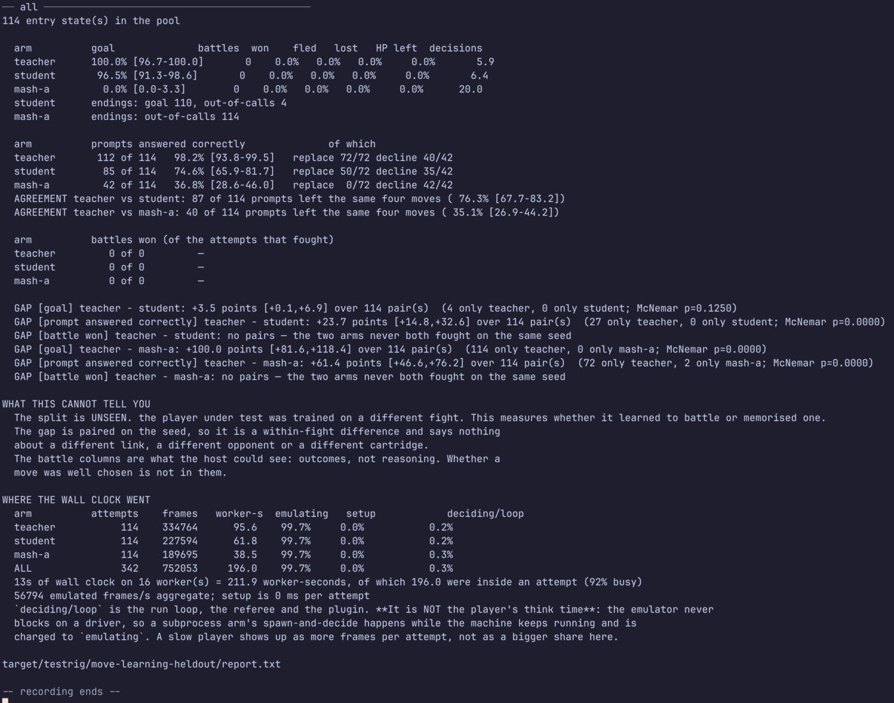
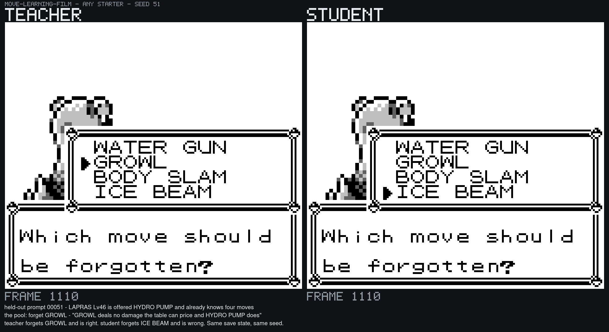
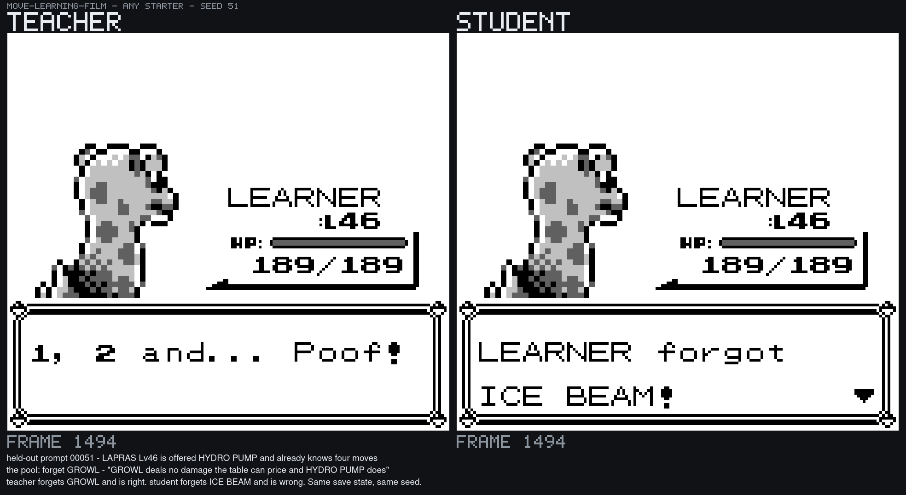
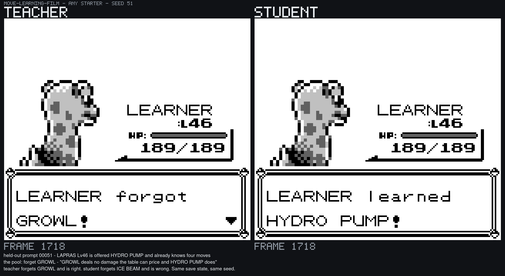

# The test rig

**Point it at a fight, a set of starting states and two or more players, and
get back the rates, the intervals, the paired gap between them and a report a
stranger can re-run.** One command.

```
cargo run --release --features scenario --example pewter_chain -- \
    ab --rom <blue.gb> --plan scenarios/testrig/starter-rival-battle.json
```

Everything below is about that command: what it measures, how to set a test
up, how to read what comes back, and — the section people skip and shouldn't —
[what it cannot tell you](#7-what-it-cannot-tell-you).

---

## 0. Watch it run

Everything else on this page is prose about a measurement. **These are the
measurement happening.** Two recordings, because the rig has two halves worth
seeing: the **instrument** — one command, a progress line, a table — and the
**thing it measures**, which is a decision taken inside a running Game Boy.

The **stills are in git**, in [`rig-stills/`](rig-stills/); the mp4s are not,
for the reason [the chain films](pewter-chain.md#11a-what-it-looks-like) are
not — a seven-megabyte artefact does not belong in a repository when the
command that makes it is three lines away. Both are written to
`~/pokemon-run/testrig/`.

### 0.1 The instrument — `test-rig-running.mp4`

`ab`, from the command line to the table, in real time. 23 s.



*The first ten seconds: the command, the plan's own question, **`SPLIT: UNSEEN`
printed with its meaning** before a single figure appears, the scenario and the
entry pool it will use, and the progress line. `all/teacher` has just finished
its 114 attempts.*



*Ticks are every five seconds and go to **stdout**, as TOON with a name of
their own (`progress[1]{…}`), so a tick can never be mistaken for a row of the
result — and the same tick goes to `progress.ndjson`, so a run can be followed
after the fact. `eta` is derived from the arm's own rate.*



*The whole report on one screen. Rates with Wilson intervals; the prompt
outcome split into `replace` and `decline` because a player that does nothing
scores every decline; agreement, which is not the same question as both being
right; the paired McNemar gap; **what this cannot tell you**; and where the
wall clock went.*

```sh
ROM=~/roms/'Pokemon - Blue Version (USA, Europe) (SGB Enhanced).gb'

REC_FPS=3 REC_FONT=10 REC_TAIL=10 tools/testrig/record-terminal.sh \
    target/rigfilm/heldout 150 60 -- \
    ./target/release/examples/pewter_chain ab --rom "$ROM" \
        --plan scenarios/testrig/move-learning-heldout.json

ffmpeg -y -framerate 2.530 -i target/rigfilm/heldout/frames/%05d.png \
    -vf scale=1800:-2 -c:v libopenh264 -b:v 2500k -pix_fmt yuv420p -r 30 \
    ~/pokemon-run/testrig/test-rig-running.mp4
```

[`tools/testrig/record-terminal.sh`](../../tools/testrig/record-terminal.sh)
is the repository's own screenshot recipe turned into a loop — there is no
`asciinema` on this box, so it drives a real WezTerm window on **XWayland**,
grabs it by window id and reports the frame rate it actually achieved, which
is what the `-framerate` above is. **Read `timing.txt` and use that number**:
`import` is most of the period and its cost moves with the window's size, so a
hard-coded rate plays the recording faster or slower than it happened.

### 0.2 The thing it measures — `teacher-vs-student.mp4`

**One row of that table, from inside the game.** The same held-out prompt, the
same save state, the same seed, played by both arms with the panes side by
side. 36 s, and the whole story is in one frame of it:



*Frame 1110 of both runs. LAPRAS at level 46 is offered HYDRO PUMP and already
knows four moves, so the cartridge asks which to forget. **The teacher's cursor
is on GROWL and the student's is on ICE BEAM.** Nothing separates the two
machines but the player.*

| | |
| --- | --- |
|  | The student commits first: **`LEARNER forgot ICE BEAM!`** — it has thrown away the strongest move on the list to keep a growl. The teacher is still working the menu. |
|  | The teacher's answer, and the student's, on one frame: `LEARNER forgot GROWL!` beside `LEARNER learned HYDRO PUMP!`. Both reached the goal; one of them is [the pool's answer](../gen1/learning-moves.md) and one is a row of the 27 the gap is made of. |

```sh
./target/release/examples/pewter_chain abfilm --rom "$ROM" \
    --plan scenarios/testrig/move-learning-film.json \
    --seed 51 --runs 1100 --out target/rigfilm/lapras

tools/testrig/caption-film.sh target/rigfilm/lapras/frames \
    ~/pokemon-run/testrig/teacher-vs-student.mp4 2 \
    'held-out prompt 00051 - LAPRAS Lv46 is offered HYDRO PUMP and already knows four moves' \
    'the pool: forget GROWL - "GROWL deals no damage the table can price and HYDRO PUMP does"' \
    'teacher forgets GROWL and is right. student forgets ICE BEAM and is wrong. Same save state, same seed.'
```

[`scenarios/testrig/move-learning-film.json`](../../scenarios/testrig/move-learning-film.json)
is the held-out plan with **two arms instead of three**: a side-by-side is for
watching a decision, and the `mash-a` floor is not making one — it presses A
until its call budget runs out. Everything else about it is the held-out plan,
so the pane you are watching *is* a row of §0.1's table.
[`caption-film.sh`](../../tools/testrig/caption-film.sh) puts the band on:
`abfilm` captions each arm but cannot know which prompt the entry state holds,
because that lives in the pool's own `00051.expect.json` beside the save state.
Seed 51 was picked out of `attempts.ndjson` — 27 of the 114 seeds are
discordant and every one of them falls the same way.

### 0.3 What was filmed, and what the numbers on it are

**The plan is [`move-learning-heldout.json`](../../scenarios/testrig/move-learning-heldout.json),
split `unseen`, 114 prompts × 3 arms = 342 attempts, one per entry state.**
Nothing on either recording is staged; the run on camera is the run whose
report is in `target/testrig/move-learning-heldout/report.txt`.

Neither the entry pool nor the student is committed — both are the game's own
text and frames — so both recordings begin with the drill
([move-learning result §5](move-learning-result.md#5-reproducing-it)):

```sh
python3 tools/learn-student/drill_all.py    --rom "$ROM" --out target/learn-all
python3 tools/learn-student/split_heldout.py             --out target/learn-all
python3 tools/learn-student/policy.py train \
    --corpus target/learn-all/corpus-train.ndjson --out target/learn-student/train.json
```

* **The figures reproduce [§4a of the move-learning result](move-learning-result.md#4a-at-scale--432-prompts-105-species-and-the-held-out-split-that-works)
  exactly** — teacher 112 of 114, student 85, floor 42, paired gap **+23.7
  points [+14.8, +32.6]** over 114 pairs — from a pool and a model rebuilt from
  scratch on the day, **five runs — twice off camera, once on it, and twice
  more after this branch was rebased onto a `main` that had changed
  `examples/pewter_chain.rs` and `src/scenario/` underneath it** — identical
  every time. **Including `mash-a`'s 42**, which that page warns is the one arm
  whose figure is not bit-stable; it simply did not move here.
* **The pool was rebuilt, not reused.** `drill_all.py` drilled **140 lines, 0
  failed, 432 prompts** in 29.8 s of wall clock on this box (855 worker-seconds
  in the published run; 450 here, on a quieter box) — the same counts the drill
  page records.
* **Do not read a wall clock off a recorded run.** The same command measured
  19 s unrecorded at load average 2.7 and **13 s on camera** at load average
  0.9; the capture loop is about half a core and the box moved under it. The
  recording is honest about what the rig printed, and what it printed is a
  figure for a box being screenshotted three times a second.
* **The nine-prompt plan is too fast to film, and that is worth saying rather
  than filming a longer one and calling it that plan.**
  [`move-learning.json`](../../scenarios/testrig/move-learning.json) — the
  plan the top of this page and §5a point at — is 27 attempts and **1.8 s**, so
  it finishes before the first five-second progress tick. It is the plan to
  *run*; the held-out plan is the one with something to watch.
* **A `command` arm's frame count is wall-clock sensitive and its answer is
  not.** The side-by-side run gives the teacher 2,148 frames and 6 decisions on
  seed 51; the batched run of the same seed gives 4,908 frames. The emulator
  never blocks on a driver, so a subprocess that replies faster leaves fewer
  emulated frames behind — exactly what `WHERE THE WALL CLOCK WENT` says at the
  foot of the report. The four moves each player left are identical either way,
  which is what is being measured.

---

## 1. Why this exists

Every measurement this project has published came from code written once for
that question and then left behind: the four-emulator conformance score, the
81-84 % damage agreement against the cartridge, the ablations that came back
null, the fourteen certified chain links. None of those numbers is wrong. The
problem is what having no instrument costs:

* **No two claims are strictly comparable.** A win rate measured by
  `ChainDriver`'s own bookkeeping and a win rate measured by a Python harness
  over MCP are two different quantities with the same name.
* **Nothing is re-runnable by someone who was not there.** The command that
  produced a figure lived in a shell history.
* **Every new question costs a new harness**, and the harness is where the
  subtle errors live — the sampling rate, the priming, the pairing, the
  denominator.

So: the harness once, with the question as its input. The first question it was
pointed at is in [§6](#6-the-first-result--a-battle-comparison-not-the-move-learning-one), and it immediately found something
the pass rate alone could not see.

---

## 2. What it measures

An **attempt** is one play of one scenario from one starting state at one seed.
A **cell** is all the attempts one *player* made on one *subject*. The report is
a grid of cells.

| | teacher | student | random |
| --- | --- | --- | --- |
| **CHARMANDER** | cell | cell | cell |
| **BULBASAUR** | cell | cell | cell |

* An **arm** is who is pressing the buttons. Three kinds:
  `expert` (the scripted, memory-derived solver — the ceiling),
  `random` (six buttons uniformly — the floor),
  `command` (a subprocess speaking the agent's JSON protocol — how a trained
  player arrives; see [§5](#5-plugging-a-trained-player-in)).
* A **subject** is the thing held constant while the arms vary. Today that is a
  lead species, because that is what the first question needed; it is a struct
  rather than a number so a different opponent or a different moveset is a
  field rather than a rewrite.

Per cell it reports up to three **outcomes**, each with its own rate, interval
and paired gap, because one measured event is rarely the only one worth having:

| outcome | what it asks | applies when |
| --- | --- | --- |
| `prompt answered correctly` | did the player leave the party holding the four moves the pool says it should? | the entry carried an expected answer ([§5a](#5a-measuring-move-learning--the-unit-is-a-prompt)) |
| `goal` | did the scenario's own goal condition fire? | always |
| `battle won` | of the attempts that fought, did it win every battle? | the attempt fought |

An outcome that does not apply to an attempt puts it in **neither** column
rather than scoring it as a failure — "did not fight" is not "lost", and an
un-annotated entry is not a wrong answer.

Beside them come the numbers a rate cannot carry: battles, won/fled/lost, HP the
lead had left when a battle ended, mean decisions, a histogram of *how* the
failures failed, and — when two arms answered the same prompts — how often they
left **the same** four moves, which is not the same question as both being
right.

### It says how far it has got, by default — on STDOUT

A long run prints a progress tick every five seconds and appends the same tick
to `<out>/progress.ndjson`:

```
progress[1]{done,total,pct,cell,cell_done,cell_total,elapsed,eta}:
  1200,2700,44.4,CHARMANDER/random,300,300,6m12s,7m50s
```

**It goes to stdout, not stderr**, which is a deliberate departure from the AXI
rule that progress belongs on stderr — and it is the same correction `9d02819`
made to the other two agent-facing front ends. An agent drives this through a
shell and does not read stderr, so a rig that reports progress only there is
silent to the thing it exists to serve. It is safe beside the report because it
is TOON with a name of its own: nothing can mistake a `progress[1]{…}` block
for a row of the result, and an agent that wants only the result can drop every
block with that name.

It is a one-row table rather than the object form because a tick is a *sample*
and a stream of samples is a collection — every tick carries its own header, so
any one of them parses on its own. Two lines a tick, every five seconds, is what
being followable costs.

On by default, because a run that prints nothing until it finishes cannot be
told from a wedged one. `--quiet` silences it; **the file is written either
way**, so a `--quiet` run is still followable by anything that can read a file.
The estimate is a linear extrapolation and is labelled one: the cells are not
equally expensive, so it moves as the run crosses a cell boundary.

### The three things it is careful about

**Arms are paired.** Every arm plays the same entry states, the same seeds and
the same phase offsets. Which entry state, which driver seed and how far into
the world an attempt starts are all functions of the seed alone, so two arms at
seed *N* play the same fight. That makes the right test McNemar's on the
discordant pairs rather than two independent proportions, and it means far
fewer attempts buy the same resolution. A gap between two arms that did **not**
play the same seeds is refused, not approximated.

**Subjects are never averaged.** "The student is nine points behind" that pools
two fights with different ceilings is a number about the mixture and about
neither fight. Each subject gets its own row, its own gap, and — when there is
more than one — an explicit test of whether the *gaps* differ.

**The seen/unseen split is stated, loudly, at the top of every report**, and a
plan that does not declare one is refused:

* `seen` — the player was trained on this fight. Measures **how well the
  distillation worked**. It is *not* evidence of generalisation.
* `unseen` — the player was trained on a different fight. Measures whether it
  learned to *battle* or memorised one.
* `n/a` — no trained player took part; the arms are the expert and its
  baselines, so the numbers are a ceiling and a floor.

The `unseen` control is the one nobody runs. The competition benchmark everyone
quotes is a fixed route, so a memorising agent and a battling agent score
identically on it and the question never comes up.

---

## 3. Setting a test up

A test is a `gbtestrig/1` JSON file, so it is a committed artefact somebody else
can re-run rather than a shell command in somebody's history. The one that
produced [§6](#6-the-first-result--a-battle-comparison-not-the-move-learning-one) is
[`scenarios/testrig/starter-rival-battle.json`](../../scenarios/testrig/starter-rival-battle.json):

```json
{
  "schema": "gbtestrig/1",
  "name": "starter-rival-battle",
  "question": "The rival battle in Oak's lab, one subject per starter. How much of the expert's rate does a player that cannot see the machine get, and is the shortfall the same on every starter?",
  "split": "n/a",
  "scenario": "scenarios/pewter/05-the-rival-battle.json",
  "entry_pool": "target/abrig-states/04-take-a-starter/exits",
  "runs": 300,
  "seed0": 0,
  "idle_spread": 3001,
  "subjects": [
    { "name": "CHARMANDER", "lead_species": 176 },
    { "name": "BULBASAUR",  "lead_species": 153 },
    { "name": "SQUIRTLE",   "lead_species": 177 }
  ],
  "arms": [
    { "name": "teacher", "player": "expert" },
    { "name": "mash-a",  "player": "command",
      "program": "tools/agent-docs/hello_adapter.sh", "args": [] },
    { "name": "random",  "player": "random", "seed_base": 2654435769 }
  ]
}
```

`question` is required in spirit and printed at the top: a rig that does not
make you write it produces tables nobody can interpret six months later.

**A second plan runs the same three arms on a link where the ceiling and the
floor are further apart than any battle:**
[`cross-route-3.json`](../../scenarios/testrig/cross-route-3.json), 20 attempts
a cell on [link 20](cerulean.md), a corridor whose three compulsory trainer
battles cannot be walked round. **Teacher 60/60 on all three starter lines,
`mash-a` 0/60, `random` 0/60** — gap +100.0 points [+56.2, +143.8] on every
subject, McNemar p = 0.0000, and the subjects cannot be separated: one gap and
three identical ceilings. The endings are the interesting half, and they differ:
`mash-a` is **stuck** on all twenty and `random` runs **out of calls** on all
twenty.

Every field is also a flag, and a flag wins, so a committed plan can be re-run
with one thing changed without editing it:

```
ab --rom R [--plan FILE] [--scenario S] [--start-dir D] [--runs N]
   [--lead NAME|N ...] [--split seen|unseen|n/a] [--student "CMD ARGS"]
   [--seed0 N] [--idle-spread N] [--workers N] [--out DIR]
```

`--lead` takes a species **name** — resolved from the cartridge's own
`MonsterNames`, never from a table written down here — or an index, and may be
repeated once per subject.

### Where the entry states come from

The rig needs a pool of starting states, and the pool is the *previous* link's
successful exits. `corpus --exits N` writes them:

```sh
ROM="$HOME/roms/Pokemon - Blue Version (USA, Europe) (SGB Enhanced).gb"
BIN=target/release/examples/pewter_chain
prev=""
for link in 01-new-game 02-leave-the-house \
            03-oak-takes-you-to-the-lab 04-take-a-starter; do
  args=(corpus --rom "$ROM" --scenario scenarios/pewter/$link.json \
        --runs 700 --workers 10 --exits 700 --out target/abrig-states/$link)
  [ -n "$prev" ] && args+=(--start-dir "$prev")
  "$BIN" "${args[@]}"
  prev="target/abrig-states/$link/exits"
done
```

Measured on a twenty-core box at ten workers: **700 exits through four links in
2 m 27 s**, every link 700/700. The starter is a one-tile difference in link 04
(`ball_x = 6 + seed % 3`), so the pool comes out very nearly evenly split —
234 / 233 / 233 for Charmander, Bulbasaur and Squirtle out of 700.

**Reading the lead species out of a state costs one machine and no emulated
frames**: the state carries the party, so the rig loads each one, reads
`wPartyMon1Species` through the `lead_species` named watch, and files it under
a subject. That is the whole of "a different starter is a flag rather than a
rewrite".

---

## 4. Reading what comes back

`report.txt` and `report.json` land in `--out` (default
`target/testrig/<plan name>/`), and the text is also printed. One block per
subject:

```
── CHARMANDER ─────────────────────────────────────────────
234 entry state(s) in the pool

  arm          goal              battles  won    fled   lost   HP left  decisions
  teacher      100.0% [98.7-100.0]     300  100.0%   0.0%   0.0%    47.4%      66.9
  mash-a         0.0% [0.0-1.3]         0    0.0%   0.0%   0.0%     0.0%     250.0

  arm          battles won (of the attempts that fought)
  teacher       300 of 300  100.0% [98.7-100.0]
  mash-a          0 of 0         —

  GAP [goal] teacher − mash-a: +100.0 points [+88.7,+111.3] over 300 pair(s)
    (300 only teacher, 0 only mash-a; McNemar p=0.0000)
```

* **The interval is Wilson, not the normal approximation.** The one everybody
  reaches for is indefensible exactly where this rig lives: at 300 attempts and
  a rate near 1.0 it puts the upper bound above 100 %, and at a rate of 0 it
  returns `[0, 0]` — certainty from no evidence.
* **The gap's standard error is `sqrt(b + c) / n`**, the conventional McNemar
  form, deliberately not the maximum-likelihood `(b + c − (b−c)²/n)/n²`. The
  corrected form degenerates to *zero* when every discordant pair falls the same
  way, so a run of two attempts would print a hundred-point gap with an interval
  of zero width — which looks like certainty and is an artefact. The
  conventional form is slightly conservative and cannot manufacture confidence.
  A gap interval can therefore exceed 100 points; that is the estimator being
  honest at the boundary, not a bug.
* **`only teacher` / `only arm` are the discordant counts.** Only pairs where the
  two arms disagreed carry any information about which is better; a pair both
  won or both lost says nothing. That is why the McNemar `p` can be decisive on
  a handful of pairs.
* **`endings:` is the failure histogram** — `stuck`, `out-of-calls`, `failed`,
  `violated`. A rate says an arm failed; this says how, and the two failure
  modes above are different findings (see `looping()` in
  [`src/scenario/run.rs`](../../src/scenario/run.rs)).

### Where the time went

```
WHERE THE WALL CLOCK WENT
  arm          attempts    frames   worker-s  emulating   setup   deciding/loop
  teacher             6     51165       5.0      89.6%    10.2%            0.2%
  screen              6    371213      38.3      98.1%     1.7%            0.2%
  ALL                12    422378      43.3      97.1%     2.7%            0.2%
```

**A rig like this is worth having only if it is fast**, so it says which part to
attack rather than leaving anyone to guess. `setup` is building the machine,
burning the phase offset and loading the start state — the per-attempt tax an
*episode* pays, and the number that decides whether short episodes are
affordable.

**`deciding/loop` is NOT the player's think time, and reading it as such is the
trap.** The emulator never blocks on a driver, so a subprocess arm's
spawn-and-decide happens while the machine keeps running and is charged to
`emulating`. A slow player shows up as **more frames per attempt** — the world
runs on while it thinks — which is why `frames` is in the table beside the
shares.

When there is more than one subject, a final block asks the question the
subjects were chosen for:

```
IS THE GAP THE SAME ON EVERY SUBJECT?
  [battle won] arm : CHARMANDER vs BULBASAUR — gaps +0.0 and +50.0,
    difference −50.0 (se 7.1, p=0.000)
    THE GAP ITSELF DIFFERS — something subject-specific is happening in this arm
```

Two subjects are independent samples, so the difference of their two paired gaps
has variance equal to the sum. If the gap is the same on two fights whose
absolute rates differ, the distillation is subject-independent and the fights
merely have different ceilings. If the gap moves, something subject-specific is
happening in the player under test. **When the sample cannot separate the two,
it says so** rather than picking the flattering reading.

### 4a. The rig claims the throughput work, and it was measured rather than assumed

`corpus` is the fair comparator — the same emulator doing the same work on the
same entry states — and the bar is that the rig is **as fast or faster**. Three
things this repository already paid for, checked against `ab` specifically. All
figures are the same fixed job: **60 attempts of pewter link 04, from the same
600-state entry pool, at the same seeds and the same phase spread 3001**, on a
20-core box (8 P + 12 E) shared with other crews, load average stated because a
wall clock on a shared box measures the box's afternoon.

| | measured | ratio, and of what |
|---|---|---|
| **fan-out** | 41.87 s at `--workers 1`, 3.65 s at `--workers 16`, load 1.67/1.52 | **11.47x** — wall clock of the identical 60-attempt run, serial against 16-way |
| **collector mode** | 42.07 s with `collecting()` + `set_render_pixels(false)` + `set_render_audio(false)`, 51.88 s with all three removed, `--workers 1`, load 3.92 | **1.23x** — wall clock of the same 60 attempts, drawing for nobody against not drawing |
| **the battery** | 0 `.sav`/`.gbsave` files, 24 KB written in total | not a ratio: the machine is built with no save path, so there is nothing to fsync |

The declaration order matters and is right: pixels and audio are turned off
**before** `phase_start`, because a phase offset averages half its spread — 1,500
frames against an attempt's ~3,500 — so a third of everything the program
emulates happens before `ScenarioRun` exists.

Two wastes were found that neither tool had been measured for:

* **The entry pool was copied, once per subject and again per worker.** 600 save
  states at 142 KB is 85 MB; sixteen workers is 1.4 GB of memcpy for data
  nothing mutates, and on the three-subject, three-arm plan it is nine cells'
  worth of it. It is one `Arc` and a per-subject list of indices now. Measured,
  interleaved before/after at load 1.98 and 4.22: **wall 4.28 s -> 3.85 s and
  4.27 s -> 3.85 s (1.11x), peak RSS 1,911,508 KB -> 160,560 KB (11.9x less).**
  The same correction is applied to `corpus`, whose trajectory and final-state
  hashes are byte-identical either side of it.
* **The lead species was read serially for every state in the pool**, one whole
  `Gameboy` each — including for plans where no subject filters by lead and the
  answer is never consulted. It is skipped entirely in that case and fanned
  across the workers when it is needed.

**Parity, both sides in seconds.** Five interleaved rounds of the job above at
16 workers, load rising 3.2 -> 17.4 as another crew fanned out: `ab`
3.86 / 8.07 / 7.67 / 7.29 / 8.28 s against `corpus`
7.72 / 8.34 / 8.23 / 9.00 / 9.37 s — `ab` faster in five rounds of five, the
closest pair 8.07 against 8.34. Pinned to one P-core at `--workers 1` over 20
attempts, which is contention-immune because it is CPU seconds: `ab`
13.78 / 13.56 / 13.43 against `corpus` 13.73 / 13.48 / 13.39. So `ab` is **0.3 %
behind at one worker** — it reads the lead's four move slots out of every
finished state, which is the rig's own product — and **ahead at fan-out**,
because it writes no per-attempt recording. `--workers` also used to be ignored
whenever the value typed happened to equal `cores - 4`; comparing against the
default cannot tell "not given" from "given the default", so there is a flag.

---

## 5. Plugging a trained player in

An arm of kind `command` is a subprocess speaking the contract in
[`plugins/agent/src/subprocess.rs`](../../plugins/agent/src/subprocess.rs) —
state snapshot on stdin, plan on stdout, exit 0:

```sh
ab --rom R --plan p.json --split unseen \
   --student "python3 -m agentgb.adapter --policy runs/link05/policy.npz"
```

**A player that looks at the screen is given one.** The snapshot carries a
`frame_png` field pointing at the current frame whenever the arm is a
subprocess; the expert and the random baseline keep the pixel skip, which is
worth about half a frame's cost. A machine that is not drawing hands a
screen-only policy whatever was last in the buffer, and that is not a failure a
rate would ever explain — so the skip is conditional on nobody wanting the
picture, and the arm that wants it pays for it.

The smallest possible adapter is
[`tools/agent-docs/hello_adapter.sh`](../../tools/agent-docs/hello_adapter.sh),
eighteen lines, and it is used as a real arm in §6. The one to **copy** is
[`tools/testrig/screen_adapter.py`](../../tools/testrig/screen_adapter.py):
stdlib-only Python that decodes `frame_png` and returns a plan, written so that
swapping its `decide()` for a forward pass makes it a real student arm. It also
documents by example the rule that matters — **a screen-only player must ignore
every other field in the snapshot**, because `screen.text`, the position and the
party are all derived from memory, and reading `game.party[0].hp` is reading the
answer out of RAM.

Verified end to end: run as an arm it decodes a **160×144, 4-shade** frame on
every decision and its plans are executed like any other player's.

### Where the rig belongs, and why the student is not in this repository

**The trained network lives in [AgentGB](https://github.com/Alchemy86/AgentGB)
and must not be copied here.** AgentGB already depends on TerminalGB as its
environment — it drives `terminalgb-mcp` over JSON-RPC on stdin/stdout
(`src/agentgb/mcp.py`) — and it already has the shape of this comparison in
`src/agentgb/baselines.py`: teacher, random, open-loop and student on the same
starts.

The two repositories have **two different harnesses**, and that is the whole
difficulty. AgentGB's `LinkEnv` presses buttons over MCP with its own settle
frames, its own press timing and its own goal judgement; TerminalGB's
`ScenarioRun` has its own sampling clock, referee and budget. A comparison whose
two halves ran through different harnesses is not a comparison. So one of them
has to be the one, and the cheapest way to guarantee both arms ran through the
same code is to have one code path — which is what
[`play_with`](../../examples/pewter_chain.rs) is: an arm is a driver and nothing
else, and the entry state, phase offset, scenario, referee, sampling clock and
battle bookkeeping are literally the same for every player.

That gives two workable arrangements, and they answer slightly different
questions:

1. **The student comes to TerminalGB's harness**, as a `command` arm. Everything
   needed for this is landed and described above. The student runs one process
   per decision, which is a few milliseconds against a network forward pass.
2. **The teacher goes to AgentGB's harness.** AgentGB's own teacher is a
   *navigator* (`src/agentgb/expert.py`, a shortest path over a walked graph);
   it has no move-choosing battle policy, and `src/agentgb/battle.py` only
   *detects* battles and whether they can be fled. TerminalGB owns the battle
   brain ([`plugins/agent/src/battle.rs`](../../plugins/agent/src/battle.rs)),
   and today it is reachable only from a Rust plugin inside the emulator. Making
   it callable from outside — "what would the expert do in this battle?" — is
   the piece TerminalGB would still owe, and it is also what AgentGB would need
   to label battle states for a DAgger round.

Route 1 is what this page documents because it needs nothing from either side
that is not already here. Route 2 is a real and separate piece of work and
belongs to whoever takes the AgentGB half.

---

## 5a. Measuring move learning — the unit is a PROMPT

**This is what the rig is for.** When a Pokémon levels up already knowing four
moves, the game stops and asks which one to forget.
[`docs/gen1/learning-moves.md`](../gen1/learning-moves.md) shows the set of
questions the cartridge can ever ask is finite and enumerable — 840 distinct
decisions across 151 species — so a level-up prompt is a **closed** problem with
one right answer per case, which is exactly what a distillation can be measured
on. The unit of measurement is therefore a prompt, not an episode: *what was
held, what was offered, what the teacher did, what the student did, do they
agree, and across how many.*

### The corpus contract

A producer of prompts — the level-up drill, or anything else — owes this rig
exactly two things, and **nothing about its own training-corpus format needs to
be agreed**:

1. **A save state per prompt**, `<pool>/NNNNN.gbss`.
2. **Beside it, the right answer**, `<pool>/NNNNN.expect.json`:

```json
{
  "schema": "gbtestprompt/1",
  "species": 176,
  "level": 13,
  "held": [10, 45, 52, 0],
  "offered": 43,
  "correct_moves": [10, 45, 52, 43],
  "why": "the offered move goes into the empty slot; nothing is forgotten"
}
```

Only `correct_moves` is load-bearing; the rest is provenance, carried so a row of
the report can be read without opening the producer's notes. **An entry with no
file beside it is not scored on this outcome** — a pool that is half annotated
measures its annotated half rather than marking the rest wrong.

The rig loads each state, reads the lead's species to file it under a subject,
runs every arm from it, and then reads `wPartyMon1Moves` out of the state each
arm left behind. **That is the whole observation**: what a player chose is
legible from the party it produced, so nothing has to be inferred from the
recording and any player is scored identically.

**Slot order matters and the comparison respects it.** Gen 1 replaces a
forgotten move in place, so *which slot* the new move went into is part of the
answer; a set comparison would score a wrong choice as right whenever the
multiset happened to match. Pinned by
`a_prompt_is_answered_in_slot_order_not_as_a_set`.

**The state→action training corpus never touches this rig.** That is the
producer's business and the distillation's; what arrives here is a player, as a
`command` arm.

### The drill supplies it now — `--prompts`

[`docs/gen1/level-up-drill.md`](../gen1/level-up-drill.md) already triggers every
level-up, answers every prompt and verifies the resulting party against the
cartridge, and it already writes the training corpus in this emulator's own
agent format (`agent.ndjson`, one record per button, observation verbatim in
`request`) plus an index (`events.csv`:
`species,level,arm_species,offered,kind,answer,reached,verified,rows`). Nothing
about either needs to change.

**The one thing that was missing was a pool this rig can start from.** A corpus
records what happened; a rig needs to *re-run* the same prompt with a different
player, which means a save state taken at the moment the prompt is on screen.
`gen1_learn_drill drill --prompts <dir>` writes it, per **verified decision**:

* `gb.save_state()` as `<pool>/NNNNN.gbss` on the first frame the
  `Delete an older move…?` box is answerable — before the cursor exists the
  question is still typing itself out and a press there would only advance
  text; after the first press the answer has been given;
* `<pool>/NNNNN.expect.json` as above, whose `correct_moves` is the party the
  drill already verifies.

**Only a verified decision earns a place.** A prompt the drill could not itself
answer correctly is a prompt whose "right answer" is a claim rather than a
measurement. Numbering continues from what is already in the directory, because
both lines are drilled into one pool and that pair is the point.

Everything else on this page then works unchanged: the rig files each state
under a subject by reading its lead species, runs the teacher and the student
from it, and compares the four moves each left. The result is
[**teacher against student on the move prompts**](move-learning-result.md).

Two small things the rig grew for it, both general:

* **A subject may name several lead species** (`"lead_species": [178, 180]`),
  because a subject is usually an evolutionary *line* and a line is several
  forms. The Charmander line meets its prompts as a CHARMELEON and a CHARIZARD;
  filing those under two subjects of two prompts each answers a question nobody
  asked. One number still parses and is the same thing with one member.
* **`"runs": "pool"`** — one attempt per entry state the subject holds. An entry
  is taken as `seed % pool.len()`, so a fixed count that does not divide the
  pool runs some prompts twice and others not at all, and the interval beside
  the rate is computed over an *n* that is not the number of questions asked.
  Meaningless for a battle pool, where the entries are interchangeable starting
  worlds and the run count is the sample size.

### What the report says, and why there are two numbers

```
  arm          prompts answered correctly              of which
  teacher         4 of 4    100.0% [51.0-100.0]   replace  3/3  decline  1/1
  student         3 of 4     75.0% [30.1-95.4]    replace  2/3  decline  1/1
  mash-a          1 of 4     25.0% [4.6-69.9]     replace  0/3  decline  1/1
  AGREEMENT teacher vs student: 3 of 4 prompts left the same four moves (75.0%)
```

**A decline gets its own column, and it earned that on the first run.** A
decline's right answer is the move set the prompt arrived with, so a player that
answers nothing at all is scored correct on every one of them: pooled,
`mash-a` above reads as a quarter of the task; split, it reads as *zero of three
replacements and one of one decline by inaction*, which is the truth. Pinned by
`declines_are_counted_on_their_own`.

**Agreeing with the teacher and being right are different questions, and the rig
reports both.** Two players can each be wrong *and wrong in the same way* —
which is what a student that has faithfully learnt its teacher's mistake looks
like, is a success for the distillation and a failure for the criterion, and is
invisible in a correctness column alone. Pinned by
`agreeing_with_the_teacher_is_not_the_same_as_being_right`.

Per-attempt rows land in `<out>/<subject>-<arm>/attempts.ndjson`, carrying the
four moves each attempt left. A summary cannot be debugged: when a prompt scores
wrong the only useful question is *which* four moves the player chose.

### Reporting note: a species difference cannot come from the decision itself

[`docs/gen1/learning-moves.md`](../gen1/learning-moves.md) measured that of the
840 decisions there are **581 distinct (four held, offered) pairs, and the
number whose correct answer differs by species is zero**. So if a student does
better on one starter than another, **that difference cannot be coming from the
move-learning decision**, which is species-independent by construction. The
report must say so rather than leaving a reader to infer a species-specific
skill the underlying task does not contain. Look instead at how much of each
species' training data the distillation saw, and at the level curve that decides
how many prompts each species even asks.

---

## 6. The first result — a BATTLE comparison, not the move-learning one

> **Read this as what it is.** It measures the rival battle, because that is
> what the instrument was first pointed at while the move-learning prompts were
> still being built. It is **not** the move-learning result and must not be
> quoted as one — that one is
> [here](move-learning-result.md). It is still useful: it is what proved the
> rig, and it produced two findings.

**Plan:** [`scenarios/testrig/starter-rival-battle.json`](../../scenarios/testrig/starter-rival-battle.json).
Pokémon Blue, link 05 (the rival battle in Oak's lab), three subjects, three
arms, 300 attempts per cell — 2,700 attempts. Entry pool: 700 states from link
04's certified exits, split 234/233/233 by starter. Phase spread 3001.

<!-- The measured table is in docs/agent/test-rig-results.md, generated by the
     run and quoted from there so this page and the artefact cannot drift. -->
See [**the measured result**](test-rig-results.md) for the table as the rig
printed it. The findings:

**The pass rate is blind to the fight underneath it, and that is the first thing
the instrument found.** Link 05's goal is that the rival battle *happened* —
`HandlePlayerBlackOut` special-cases this battle so losing it does not black the
player out, and `OaksLabRivalEndBattleScript` sets the flag whoever won. So the
expert passes every attempt with all three starters while *losing* that battle
at very different rates. A rig that reported only the goal would have said the
three starters were identical. This is why the battle outcome is reported and
gapped as a second outcome rather than as a footnote.

**The battle column independently reproduces a figure this project already had.**
Over 900 certified rival-battle exits the loss rates were Squirtle 14.7 %,
Charmander 23.0 %, Bulbasaur 54.0 % — Bulbasaur draws Charmander, which is
faster at every level and so lands the last hit. The rig, measured a different
way on a different pool, lands in the same place. Two independent measurements
agreeing is the check; if they had disagreed, that would have been the finding.

**Both screen-blind arms score zero on all three starters, and for the same
reason.** Neither can navigate: the endings histogram shows `stuck` and
`out-of-calls`, never a lost battle. The goal gap is therefore the maximum on
every subject and the battle gap has **no pairs at all** — the two arms never
both fought on the same seed, which the report says in those words rather than
printing a zero. That is a floor worth having: none of the expert's rate on this
link is available by accident.

---

## 7. What it cannot tell you

* **A `seen` number is not generalisation.** It is stamped on every report for
  that reason. A player trained on this fight and tested on this fight has been
  measured for distillation quality and nothing else.
* **The gap is paired on the seed**, so it is a within-fight difference. It says
  nothing about a different link, a different opponent or a different cartridge.
  Run those as their own subjects.
* **The battle columns are outcomes, not reasoning.** Whether a move was well
  chosen is not in them. `ChainDriver`'s own tally reports the expert's damage
  predictions, flee reasons and stat-move spending — but it is *driver-side*, so
  only the expert can produce it, and driver-side numbers are exactly what
  cannot be compared between players.
* **A cell is only as good as its entry pool.** Every attempt takes
  `seed % pool.len()`, so a pool smaller than the attempt count means entry
  states repeat — the phase offset still makes the attempts distinct, but the
  three independence axes are not all live. The pool size is printed per subject
  for that reason.
* **It does not judge a moveset.** The moveset is whatever the entry states
  carry; choosing one is a separate question with its own criterion.
* **Nothing here has been run against a trained network.** The `command` seam is
  exercised by a real subprocess arm in §6 and by
  `a_command_arm_carries_its_program_and_arguments`, but no model has ever been
  on the far end of it in this repository. Say that plainly rather than
  implying otherwise.

---

## 8. The arithmetic, and where its teeth are

All of it is in [`examples/support/abrig.rs`](../../examples/support/abrig.rs),
which is pure — no Game Boy, no driver, no scenario — so it is unit-tested with
no cartridge. `cargo test --release --features scenario --example pewter_chain`.

| test | what it pins |
| --- | --- |
| `a_perfect_score_still_has_a_lower_bound_below_one` | Wilson behaves at both boundaries |
| `wilson_matches_a_published_rate` | agrees with this project's own 2999/3000 |
| `mcnemar_agrees_with_arithmetic_that_can_be_done_on_paper` | the exact test against hand arithmetic |
| `a_gap_is_refused_when_the_arms_did_not_play_the_same_seeds` | pairing is required, never silently dropped |
| `a_pass_rate_can_be_blind_to_the_battle_under_it` | the §6 finding, as a test with teeth |
| `a_species_difference_is_separated_only_when_the_evidence_separates_it` | and refuses when it cannot |
| `a_plan_must_declare_its_split` | a plan with no split is an error, not a default |

The host-side battle observation the arms are scored by lives in
[`src/scenario/run.rs`](../../src/scenario/run.rs) (`Battles`,
`BattleSummary`), with its own tests — including
`a_blackout_sentinel_is_not_a_battle`, because `wIsInBattle` is a raw byte and
`$FF` means blacked out. That is the third time this repository has been bitten
by a catch-all arm over that byte.

---

## See also

* [`docs/agent/battle-policy.md`](battle-policy.md) — the expert's battle brain,
  and §4 "What a screen-only student would not have".
* [`docs/agent/pewter-chain.md`](pewter-chain.md) — the fourteen links, the
  certification protocol and where the entry states come from.
* [`docs/scenarios.md`](../scenarios.md) — the scenario language, the referee
  and the recording format, and
  [`docs/writing-a-scenario.md`](../writing-a-scenario.md) if you do not have a
  scenario to point this at yet: it builds one end to end and finishes by
  handing it here.
* [`docs/agent-reference.md`](../agent-reference.md) — the snapshot a driver
  receives and the plan it returns.
