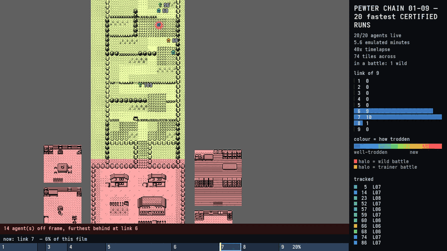

# Every run records where it was, so any run can be filmed

<!-- codemap:asof -->

**The captain's instruction, in his words:** *"all runs should have the position
data... then a sample of them can be used to make more or less on a swarm video
at will... from best to worst, success to fail. with ease."*

Position recording used to be opt-in (`corpus --paths`), so a certification pass
and a film pass were two different runs of the same work. The consequence is
exactly the one that bit us: **you could never film the runs you actually
certified.** Wanting a picture of a certified attempt meant re-running the whole
thing, and the interesting material — the failures, the blackouts, the tail —
was thrown away at the moment it happened and could not be recovered.

It is on by default now, in a format small enough that the argument for the
split is gone. This page is the format, the measurements, and how to choose
which runs a film gets.

- The format: [`src/scenario/track.rs`](../../src/scenario/track.rs)
- The exit-pool archive: [`src/scenario/pool.rs`](../../src/scenario/pool.rs)
- Selecting and stitching: [`tools/pewter-chain/chain_tracks.py`](../../tools/pewter-chain/chain_tracks.py)
- Reading either form from Python: [`tools/pewter-chain/chainrender/tracks.py`](../../tools/pewter-chain/chainrender/tracks.py)

---

## 1. Where a corpus's bytes actually are — all four numbers, measured

The cost argument against always-on recording was aimed at the wrong file. A
real 720-attempt Mt Moon film pass, 143 MB on disk:

| | files | on disk | share |
|---|---:|---:|---:|
| exit save states (`.gbss`) | 720 | **126.08 MB** | **88 %** |
| recordings (`.json`) | 720 | 10.27 MB | 7 % |
| position tracks (`.csv`, the old form) | 720 | 9.07 MB | 6 % |

And the four numbers the tracks themselves cost, measured over those same 720
files rather than estimated:

| | total | vs. the CSV |
|---|---:|---:|
| CSV, seven columns (what was written before) | 9.07 MB | 1.0x |
| the same, `gzip -9` per file | 2.06 MB | **4.4x** |
| `GBTK` (what is written now) | 0.23 MB | **39.1x** |
| `GBTK`, `gzip -9` per file | 0.18 MB | 50.3x |

Two things follow and both matter.

**Compression is the cheap win and it is not the big one.** `gzip -9` is 4.4x
for no format change at all — worth knowing, and it is the number to beat rather
than a reason to stop. The format beats it by **nine times**, because most of
what gzip was compressing did not need to be written down (§2), and once it is
gone there is only 1.3x of redundancy left for a compressor to find. The binary
form also needs no decompressor to read, is written per file by sixteen
concurrent workers, and carries its own record count and last frame in a
fourteen-byte header a reader can stat without decoding anything.

**Position recording was never the expensive part.** Even in its old form it was
6 % of a corpus directory. §5 is about the 88 %.

Two other corpora, same measurement:

| corpus | agents | CSV | `GBTK` | |
|---|---:|---:|---:|---:|
| `chain-film` (fourteen links) | 24 | 26.04 MB | 0.68 MB | 38.2x |
| `mtmoon-tracks` (six links) | 120 | 9.45 MB | 0.22 MB | 42.9x |
| `showcase-route1` (one link) | 600 | 9.60 MB | 0.27 MB | 35.3x |

A whole fourteen-link playthrough is **~28 KB per agent** instead of ~1.1 MB.

### What a certification really costs now

Measured on the nine-link, 200-attempt-per-link certification in §6 — 1,800 runs
of the real chain, every one of them recorded:

| | files | on disk |
|---|---:|---:|
| position tracks (`.gbtrk`) | 1,800 | **0.28 MB** |
| recordings (`.json`) | 1,800 | 7.69 MB |
| index (`.ndjson`) | 9 | 0.39 MB |
| exit save states (`.gbss`) | 1,800 | **315.21 MB** |

**Recording where the player was, for every attempt of a nine-link
certification, cost 0.28 MB.** Scaled to the chain's real 3,000-attempt,
fourteen-link shape that is single-figure megabytes. The old CSV form would have
been roughly 10 MB and would still have been affordable — which is the honest
statement, and it is why this page leads with where the bytes actually are
rather than with the compression ratio.

---

## 2. What a track carries, and the one thing it does not

`GBTK` records a point whenever any of **map, x, y, facing or `wIsInBattle`**
moves, and at no other time. A standing character costs one record however long
it stands.

**The walk counter is not part of a position track.** `wWalkCounter` ($CFC5)
ticks 7,6,5,4,3,2,1 across a step, so a *walking* agent used to cost a row every
two frames: measured across three real corpora, **83 % of every row ever written
changed nothing but that counter**. Nothing downstream has ever read it — both
Python readers unpacked it into `_walk` and dropped it — because the renderer
reconstructs the glide by interpolating between consecutive recorded tiles
(`chainrender.tracks.interpolate`), which is independent of the sampling rate
and works on tracks already on disk. Dropping it and expanding the step back at
draw time is exactly what *"store transitions, not frames"* means here.

**That expansion now drives the sprites' walk cycle as well as their
positions.** `chainrender.tracks.walk_phase` answers "how far through a step is
this agent", from the *same* segment `interpolate` places it on, so a renderer
that wants both cannot end up with the feet and the legs disagreeing. The
counter stays out of the format: what a film needs is the phase, and the phase
is derivable. See
[the render comparison](swarm-render-comparison.md#72--the-walk-cycle) for the
sequence the cartridge actually draws.

Two consequences to know:

- **The CSV `--paths` writes is six columns now** — `frame,map,x,y,facing,battle`
  — not seven. Every reader in this repository accepts both widths and drops the
  counter from a legacy file on the way in, so a corpus collected before this
  still renders.
- A track carries **no pixels**. That asymmetry is the point: positions are
  cheap enough to keep for every run and pictures are not, which is why a mosaic
  needs [`screen_mosaic`](screen-mosaic.md)'s own capture pass.

### The bytes

```text
magic   "GBTK"        4 bytes
version u8            1
flags   u8            0; reserved, refused when non-zero
count   u32 LE        records that follow
last    u32 LE        the last emulated frame the run reached
records...
    mask    u8        bit0 map, bit1 x, bit2 y, bit3 facing, bit4 battle
    dframe  varint    frames since the previous record (LEB128)
    bytes             one per set bit, in bit order
```

The first record carries every field, so a decoder never invents a starting
value. **3.18 bytes a record measured**, against ~19 for a line of CSV.

`last` is worth its four bytes: a run that ends standing still has its final
record long before its final frame, and an agent that vanishes early reads as an
agent that stopped. A CSV cannot say it at all.

---

## 3. Turning it on and off

Recording is the default. Nothing needs a flag.

```
pewter_chain corpus --rom R --scenario S --runs 3000 ...
    writes <out>/path-NNNNN.gbtrk for every attempt

    --paths       ALSO write the CSV form beside it
    --no-tracks   record nothing at all — for a throughput measurement, and
                  for nothing else: it makes the run unfilmable
```

`solve`, `chain` and `film` follow the same rule; `film` writes
`agent-NN.gbtrk`.

**`--no-tracks` buys nothing measurable.** The per-frame work is four bus reads
and a comparison against the last point, and a point that changed nothing is
dropped rather than pushed — which is also what keeps a sixteen-worker fan-out's
memory flat, because a half-million-frame run holds its ~8,000 records rather
than half a million points. Measured on link 06, 25 attempts, **pinned to one
P-core and interleaved five rounds each** (min of five, load average 43 because
another crew had the box): **1.97 s recording against 1.94 s not** — 1.5 %, on a
box whose own run-to-run spread over those ten runs was 1.94-2.04 s. Under 2 %
between two binaries is code layout, and this is not even two binaries.

---

## 4. Choosing which runs a film gets

`chain_tracks.py` stitches a certification's per-link tracks into one continuous
track per agent, and it is where selection lives — for one link or for fourteen.

```
--select goal|failed|all   by OUTCOME  (default: all)
--sort   fastest|slowest|seed          (default: seed)
--count  N                 how many to keep
--seeds  3,7,11-14         exactly these
```

**A film of the failures is a one-liner**, which it could not be at all before:

```bash
python3 tools/pewter-chain/chain_tracks.py --out target/film-failed \
    --select failed \
    01:target/cert/01-new-game 02:target/cert/02-leave-the-house
```

The twenty quickest complete playthroughs:

```bash
python3 tools/pewter-chain/chain_tracks.py --out target/film-fastest \
    --select goal --sort fastest --count 20 \
    01:target/cert/01-new-game ... 09:target/cert/09-receive-the-pokedex
```

Then film whichever directory:

```bash
python3 tools/pewter-chain/swarm_film.py target/film-fastest \
    --out target/render --speed 40 --fps 30
```

An agent's **outcome** is the outcome of the last link it attempted: it reached
the goal only if it reached every link's goal, and it failed the moment one of
them stopped it. Its **speed** is the total emulated frames of the stitched
track — the shortest playthrough, not the shortest wall clock, because a wall
clock measures the box's afternoon.

### The honesty property, and why sampling did not weaken it

The chain-film tooling refuses to stitch runs that did not actually happen
together: attempt *s* of one link must genuinely continue attempt *s* of the
last. **That property is now computed rather than assumed, which is a repair as
well as a preservation.**

`corpus --exits N` keeps the first N *successful* exits of a link and names each
after the seed that produced it; the next link's attempt *s* enters from slot
`s % len` of that pool. The old rule was "agent *s* is seed *s* at every link" —
and it is only true of a chain that never failed. **A link that failed even once
leaves a pool with gaps** (`00000, 00001, 00003, …`), so attempt 2 of the next
link entered from seed **3**, and stitching it against seed 2 would have shown a
playthrough that never happened.

`chain_tracks.provenance` reads the names instead and walks an agent's ancestry
backwards exactly, so a gapped pool stitches correctly rather than silently
wrongly. It is cross-checked twice against what the corpus recorded about itself:

- the **slot** each attempt took (`"entry"` in `index.ndjson`), against the
  arithmetic; and
- **how big the pool was** when the attempt ran (`"pool"`, added for this),
  against how big the directory is now — because a pool that has since lost or
  gained a state maps every slot above the gap to a different seed.

An attempt whose ancestry cannot be proved is **refused rather than stitched**,
and a `--seeds` that names one is refused by name. Selection then happens over
the set that was proved, never over the raw seeds, so `--select failed --count
60` is sixty real continuous playthroughs that failed.

*Teeth, and they were proven rather than claimed*: deleting one state from link
08's exit pool of a nine-link certification takes `chain_tracks` from 200
stitched agents to **0**, naming all 200 as refused, and `--seeds 7` exits
non-zero saying why. Restoring it takes it back to 200.

The `agent-NNN.links.csv` beside each track now carries a sixth column naming
the seed each link really was.

---

## 5. The 88 % — packing the exit pool

A pool's states are the same machine a few thousand frames apart. Measured on
the 720 states above: they are all 175,114 bytes, and **93.2 % of every state's
bytes are identical across all 720 of them**. `gzip -9` on each file separately
finds only 5.4x, because a 32 KiB window cannot see across a 175 KB file to the
one beside it.

Referencing one state and storing the runs that differ costs no compressor at
all:

```bash
pewter_chain pool pack   --start-dir <dir>/exits --out <dir>/exits.gbpool
pewter_chain pool list   --start-dir <dir>/exits.gbpool
pewter_chain pool unpack --start-dir <dir>/exits.gbpool --out <dir>/exits
```

Measured, on a real link's pool of 120 exits: **21.01 MB → 0.54 MB, 39.0x**,
and the unpacked directory is byte-identical to the original (`diff -r`). Every
`exits/` of the same 143 MB film pass: **126.08 MB → 3.31 MB**.

`--start-dir` accepts a `.gbpool` file wherever it accepts a directory, so a
packed pool is usable in place — and it is the *same* pool: twelve attempts of
link 06 run from `05.gbpool` (200 states, 35.02 MB → 0.55 MB, **64.2x**)
produce an index identical field for field to the same twelve run from the
directory, and byte-identical position tracks. `pool pack` decodes what it just wrote and
compares it against every source file before the archive is offered as a
replacement — a pool that packed wrong and was then deleted from is a corpus
nobody can re-enter.

The A/B rig and `states` still want a directory (they pair a state with the
`.expect.json` beside it), so `pool unpack` is how a packed pool is handed to
them.

---

## 6. The demonstration — two films of runs that were certified

One certification, three films, nothing re-run for the camera.

```bash
# certify: nine links, 200 attempts each, from a cold cartridge.
prev=""
for f in scenarios/pewter/0*.json; do
  n=$(basename $f .json)
  pewter_chain corpus --rom blue.gb --scenario $f --runs 200 --workers 16 \
      --exits 200 --out target/demo/cert/$n ${prev:+--start-dir $prev/exits}
  prev=target/demo/cert/$n
done
```

All nine links **200 of 200**, 1,800 attempts, ~2.5 minutes of wall clock on
sixteen workers, and **0.28 MB of position tracks**. Then, with no further
emulation at all:

```bash
chain_tracks.py --out target/demo/film-fastest --select goal --sort fastest --count 20  01:... 09:...
chain_tracks.py --out target/demo/film-slowest --select goal --sort slowest --count 20  01:... 09:...
chain_tracks.py --out target/demo/film-failed  --select failed                          01:... 10:town-map
```

| film | agents | frames, shortest → longest |
|---|---:|---|
| twenty fastest certified playthroughs | 20 | 29,066 → 31,616 |
| twenty slowest certified playthroughs | 20 | 36,506 → 39,716 |
| every failure of a tenth link | 60 | 32,871 → 73,213 |



The third film needed material that genuinely fails, and the current chain does
not: links 01-09 are 200/200. `scenarios/tutorial/town-map.json` is the
scenario [`docs/writing-a-scenario.md`](../writing-a-scenario.md) builds and the
expert has no route for it — **0 of 60** — so its sixty attempts are sixty real
ten-link playthroughs that failed at the last one, certified and then filmed
without re-running anything. That is the proof: *a film of runs that were
certified, not re-run for the camera.*

---

## 7. Sharp edges

- **`_walk` is gone from the row tuple.** A reader that unpacks seven values
  from `chainrender.read_track` will fail; it yields six.
- **A legacy seven-column CSV is accepted and deduplicated on read**, so its row
  count drops to the track's record count. `path_arrows summary` on an old
  corpus therefore reports a smaller "rows read" than it used to, for identical
  output.
- **`Track::last_frame` is not the last record's frame.** Use it for how long an
  agent was there; use the last record for where it ended.
- **`wIsInBattle` is a raw byte in the track**, exactly as it is in memory: 1
  wild, 2 trainer, `$FF` blacked out. `if battle:` is a defect — the fifth time
  that byte has been read as a boolean in this repository.
- **A `.gbpool` is not a general archive and must not become one.** Its reference
  is a real member rather than a synthesised one, so a pool round-trips even if
  the delta coder is wrong about everything else, and its order is preserved
  because a seed takes slot `seed % len`.
