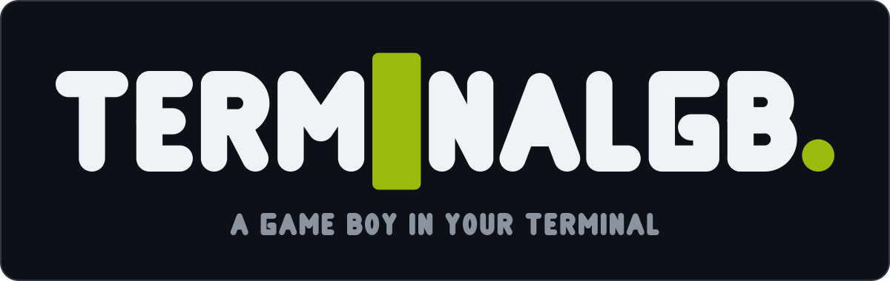

# TerminalGB brand

**The final mark is [`terminalgb-logo.svg`](terminalgb-logo.svg), and its square icon
lockup is [`terminalgb-icon.svg`](terminalgb-icon.svg). These two files are the only ones
to ship — anywhere.** Everything under [`exploration/`](exploration/) is a retired design
study kept for the record; do not use those files.



The composition, chosen by the captain against a reference he picked: one heavy geometric
wordmark, tight-tracked, white on a near-black panel; the motif **replacing one letter** —
a solid DMG-green terminal **block cursor** stands where the I of TERMINAL would be, the
glyph hidden beneath it exactly as a terminal shows a block cursor; a single accent-colour
**full stop** closing the word; and the tagline underneath, lighter, grey, wide-tracked.
The accent is the DMG LCD lit shade (`#9bbc0f`).

The cursor is solid **on purpose**: an inverse-video knockout of the I inside the green
cell was tried at several cell ratios and always read as a zero or an empty box. Do not
reintroduce it.

Everything here is **hand-authored**: the letterforms are original stroked skeleton paths
drawn in [`generate.py`](generate.py); **no font is embedded, subset or traced**, so there
is no third-party licence in any of these files, and no Nintendo artwork, logotype or
trade dress is used or imitated — the whole vocabulary is a terminal block cursor and a
full stop.

Regenerate deterministically with `python3 docs/brand/generate.py` — **edit the generator,
never the SVGs by hand** — and re-render the previews in the same commit:

```bash
cd docs/brand
magick terminalgb-logo.svg preview/logo.png
magick terminalgb-icon.svg preview/icon-128.png
magick -background none terminalgb-icon.svg -resize 16x16 preview/icon-16.png
```

Every SVG paints its own panel with a faint border, so it survives GitHub light mode, dark
mode and a pure-black page — the `prefers-color-scheme` trap recorded in the project
memory never arises because nothing is theme-conditional.

## Tagline

> **A GAME BOY IN YOUR TERMINAL**

True, and the shortest honest description of the project. Naming the console a product
emulates is nominative use (the standard practice for emulators).

## Using the mark elsewhere (the portal, avatars, favicons)

Other repositories — `terminalgb-portal` first among them — should copy
**`terminalgb-logo.svg`** (page header / hero) and **`terminalgb-icon.svg`** (avatar,
favicon) from this directory; this file is the source of truth for which files those are.
Do not copy anything from `exploration/`. The icon is the wordmark's ending distilled —
the block cursor and the full stop — and stays legible at 16 px
([`preview/icon-16.png`](preview/icon-16.png) is the real favicon test, not a resized
illustration).

## Files

- [`terminalgb-logo.svg`](terminalgb-logo.svg) — **the** wordmark lockup, 1200×380
- [`terminalgb-icon.svg`](terminalgb-icon.svg) — **the** square icon lockup, 128×128
- [`preview/logo.png`](preview/logo.png), [`preview/icon-128.png`](preview/icon-128.png),
  [`preview/icon-16.png`](preview/icon-16.png) — rendered previews at hero, avatar and
  favicon size
- [`generate.py`](generate.py) — the only source of truth; edit it, never the SVGs by hand
- [`exploration/`](exploration/) — the three retired design-study options (A block cursor
  with inverse-video knockout, B screen tile, C dot matrix) and their previews; kept for
  the record, never to be shipped
