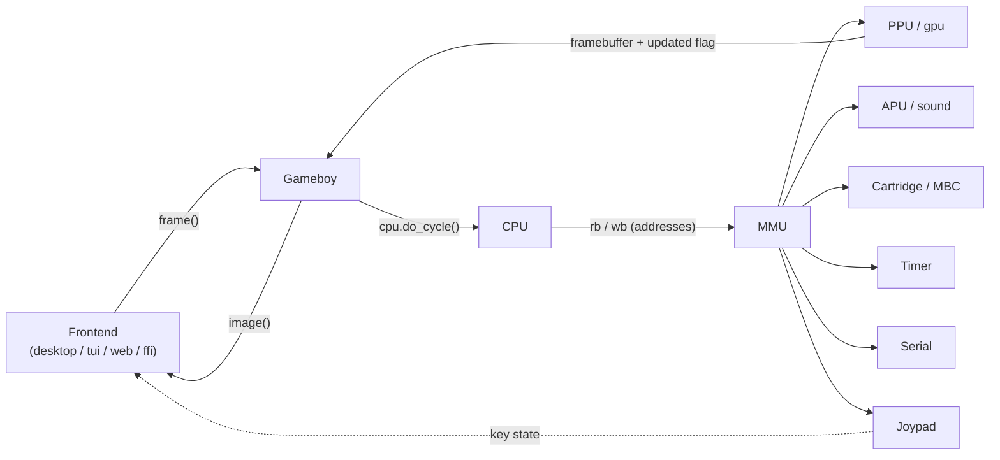
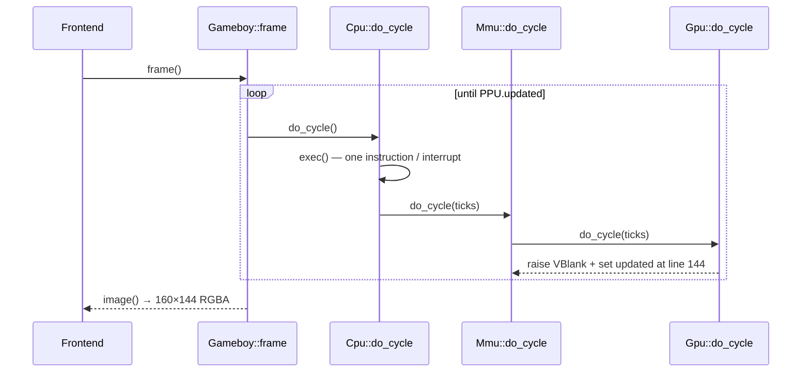
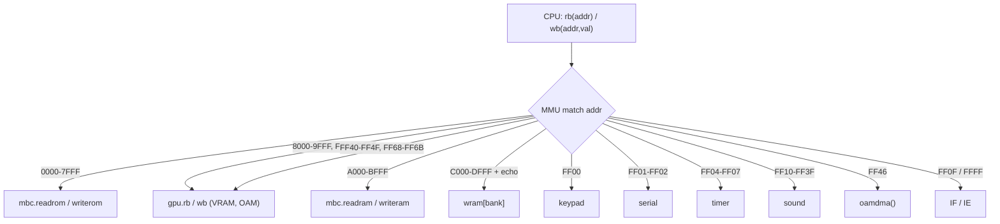

# Code map — how the emulator fits together

> A single orientation page for someone new to the tree: **how a frame flows**, **how a
> memory access travels**, **how an interrupt is delivered**, and **where the frontends
> attach**. Every code reference below is a clickable link; the per-component deep dives
> live in [`docs/components/`](components/README.md).
> [README](../README.md) · [component index](components/README.md) · [testing](testing.md) · [debugging](debugging.md) · [display](display.md)

---

<!-- codemap:asof -->
> 🗺️ **Code map** · source links target [`main`](https://github.com/Alchemy86/gameboy/tree/main); line references documented as of commit [`a82eaa6`](https://github.com/Alchemy86/gameboy/tree/a82eaa62024ad5694dfaf355aa4798baa34a3239) · regenerate with `make docs-links`, verify with `make docs-check`.

## The one-paragraph model

The **CPU** ([`src/cpu/core.rs`](../src/cpu/core.rs)) executes one instruction at a time. It
never touches devices directly — it only reads and writes 16-bit addresses through the
**MMU** ([`src/mmu/mod.rs`](../src/mmu/mod.rs)), which is the switchboard: every address is
routed to ROM/RAM or to a device (PPU, APU, timer, serial, joypad, cartridge). After each
instruction the MMU advances those devices by the elapsed cycles. The **PPU**
([`src/gpu/mod.rs`](../src/gpu/mod.rs)) is the clock that paces a frame: when it finishes the
154th scanline it raises its `updated` flag, and the **frontend** reads the finished
160×144 framebuffer and draws it. Everything else hangs off that loop.



## 1. The components (each links to its deep dive)

| Component | Source | One line |
|---|---|---|
| **[CPU](components/cpu.md)** | [`src/cpu/`](../src/cpu) | Sharp LR35902 (SM83) core: fetch, decode+execute (fused), interrupts. |
| **[MMU](components/mmu.md)** | [`src/mmu/mod.rs`](../src/mmu/mod.rs) | The 64 KB address switchboard, DMA engines, and `IF`/`IE` wiring. |
| **[PPU](components/ppu.md)** | [`src/gpu/mod.rs`](../src/gpu/mod.rs) | Scanline pixel engine and the mode/timing clock that ends a frame. |
| **[Cartridge / MBC](components/mbc.md)** | [`src/mbc/`](../src/mbc) | Bank switching, MBC3 RTC, battery saves. |
| **[APU](components/apu.md)** | [`src/sound.rs`](../src/sound.rs) | Four channels + the 512 Hz frame sequencer (native playback only). |
| **[Timer](components/timer.md)** | [`src/mmu/timer.rs`](../src/mmu/timer.rs) | `DIV`/`TIMA`/`TMA`/`TAC` interrupt heartbeat. |
| **[Serial](components/serial.md)** | [`src/mmu/serial.rs`](../src/mmu/serial.rs) | Link cable — and how Blargg ROMs report results. |
| **[Joypad](components/input.md)** | [`src/input.rs`](../src/input.rs) | The `0xFF00` button matrix + joypad interrupt. |
| **[Frontends](components/frontends.md)** | [`src/screen/`](../src/screen), [`examples/`](../examples), [`web/`](../web) | Desktop (OpenGL), terminal (ratatui), web (canvas), C FFI. |

## 2. How a frame flows

One call to [`Gameboy::frame`](../src/gameboy.rs) drives the machine forward until the PPU
signals a completed frame, then the frontend blits the framebuffer.

1. The frontend calls `frame()` ([`src/gameboy.rs:230`](https://github.com/Alchemy86/gameboy/blob/main/src/gameboy.rs#L230)). It loops,
   accumulating cycles, until the PPU's `updated` flag flips.
2. Each iteration calls `cpu.do_cycle()` ([`src/cpu/core.rs:218`](https://github.com/Alchemy86/gameboy/blob/main/src/cpu/core.rs#L218)), which
   runs **exactly one instruction** (or services a pending interrupt) via `exec`
   ([`src/cpu/core.rs:197`](https://github.com/Alchemy86/gameboy/blob/main/src/cpu/core.rs#L197)) and returns its M-cycle count.
3. `do_cycle` hands those cycles (×4 T-cycles) to `mmu.do_cycle`
   ([`src/mmu/mod.rs:347`](https://github.com/Alchemy86/gameboy/blob/main/src/mmu/mod.rs#L347)), which advances the **timer**, **APU**,
   **serial**, and **PPU** by the elapsed time, folding any interrupts they raise into `IF`.
4. The PPU steps its mode clock ([`src/gpu/mod.rs:244`](https://github.com/Alchemy86/gameboy/blob/main/src/gpu/mod.rs#L244)); when line 144 is
   reached it enters VBlank, raises the VBlank interrupt, and sets `updated = true`
   ([`src/gpu/mod.rs:314`](https://github.com/Alchemy86/gameboy/blob/main/src/gpu/mod.rs#L314)).
5. `frame()` sees `updated` via `check_and_reset_gpu_updated`
   ([`src/gameboy.rs:224`](https://github.com/Alchemy86/gameboy/blob/main/src/gameboy.rs#L224)), breaks the loop, and the frontend reads the
   pixels with `image()` ([`src/gameboy.rs:290`](https://github.com/Alchemy86/gameboy/blob/main/src/gameboy.rs#L290)).



## 3. How a memory access travels

The CPU has no wires to the devices; it calls `rb` (read byte) / `wb` (write byte) on the
MMU, and the MMU's address `match` routes the access. This is the single most important
control-flow fact in the tree.

- **Read:** `mmu.rb` ([`src/mmu/mod.rs:391`](https://github.com/Alchemy86/gameboy/blob/main/src/mmu/mod.rs#L391)) matches the address to a
  region or device — e.g. `0x8000–0x9FFF` → `gpu.rb`, `0xA000–0xBFFF` → `mbc.readram`,
  `0xFF10–0xFF3F` → `sound.rb`, `0xFF00` → `keypad`.
- **Write:** `mmu.wb` ([`src/mmu/mod.rs:450`](https://github.com/Alchemy86/gameboy/blob/main/src/mmu/mod.rs#L450)) mirrors it, plus the side
  effects — writing `0xFF46` triggers OAM DMA ([`src/mmu/mod.rs:521`](https://github.com/Alchemy86/gameboy/blob/main/src/mmu/mod.rs#L521)).
- **Quirks that live in this match:** echo RAM mirrors WRAM via `& 0x0FFF`
  ([`src/mmu/mod.rs:399`](https://github.com/Alchemy86/gameboy/blob/main/src/mmu/mod.rs#L399)); `IF` reads back with its top three bits set
  ([`src/mmu/mod.rs:409`](https://github.com/Alchemy86/gameboy/blob/main/src/mmu/mod.rs#L409)); the prohibited region and unmapped I/O read
  `0xFF` ([`src/mmu/mod.rs:442`](https://github.com/Alchemy86/gameboy/blob/main/src/mmu/mod.rs#L442)). See [MMU](components/mmu.md) for the
  full map and the honest approximations (instantaneous OAM DMA, no mode-based bus blocking).



## 4. How an interrupt travels

Devices never call the CPU. Each device sets a bit in its own `interrupt` byte; the MMU
folds those into the `IF` register during `do_cycle`; the CPU checks `IF & IE` before the
next instruction and dispatches the **lowest set bit first**.

1. A device raises its flag — e.g. the PPU ORs `0x01` for VBlank
   ([`src/gpu/mod.rs:313`](https://github.com/Alchemy86/gameboy/blob/main/src/gpu/mod.rs#L313)); the timer ORs `0x04` on overflow.
2. `mmu.do_cycle` folds each device's `interrupt` byte into `intf` (`IF`).
3. Before executing, the CPU runs `handleinterrupt`
   ([`src/cpu/core.rs:161`](https://github.com/Alchemy86/gameboy/blob/main/src/cpu/core.rs#L161)): it takes `triggered.trailing_zeros()` so the
   fixed priority is **VBlank → STAT → Timer → Serial → Joypad**, pushes `PC`, and jumps to
   the vector `0x40 | (n << 3)`.

See [CPU §Interrupts](components/cpu.md) and [MMU §interrupt wiring](components/mmu.md). Pan
Docs: [Interrupts](https://gbdev.io/pandocs/Interrupts.html).

## 5. Where the frontends attach

Every frontend drives the **same tiny surface** — construct, step, read pixels, feed keys —
so the core stays frontend-agnostic ([`src/gameboy.rs`](../src/gameboy.rs)):

- `Gameboy::new(rom, filepath)` ([`src/gameboy.rs:68`](https://github.com/Alchemy86/gameboy/blob/main/src/gameboy.rs#L68))
- `frame()` ([`src/gameboy.rs:230`](https://github.com/Alchemy86/gameboy/blob/main/src/gameboy.rs#L230)) → `image()` ([`src/gameboy.rs:290`](https://github.com/Alchemy86/gameboy/blob/main/src/gameboy.rs#L290))
- `keydown` / `keyup` ([`src/gameboy.rs:298`](https://github.com/Alchemy86/gameboy/blob/main/src/gameboy.rs#L298))

The attach points: **desktop** owns an OpenGL window and the event loop in
`render_desktop` ([`src/gameboy.rs:98`](https://github.com/Alchemy86/gameboy/blob/main/src/gameboy.rs#L98)); **terminal** and **web** live in
[`src/screen/`](../src/screen); the **C FFI** re-exports the surface as `#[no_mangle]`
functions in [`src/lib.rs`](../src/lib.rs). Full detail: [Frontends](components/frontends.md).

## 6. How the links stay honest

Every `path:line` reference on these pages is a real GitHub link, generated — never
hand-typed — from a small tool so the map cannot silently rot.

- **Branch links, not permalinks.** Line references point at
  [`blob/main`](https://github.com/Alchemy86/gameboy/tree/main), so they track the code as it
  moves rather than freezing at one revision. The known trade-off — a line number can drift —
  is covered by the two mechanisms below.
- **A "documented as of `<sha>`" marker** sits at the top of every deep-dive page (and just
  under the heading here). It records the commit the line numbers were true at, so a reader
  always knows the snapshot and can browse the frozen tree if a branch link has drifted.
- **File and directory links stay relative** (e.g. [`src/cpu/`](../src/cpu)) so they resolve
  in a local editor as well as on GitHub; only references that carry a `:line` become
  absolute GitHub links, because only GitHub can anchor to a line.
- **Regenerate and verify with one command each:**

  ```sh
  make docs-links   # rewrite every reference to a fresh blob/main link + restamp the marker
  make docs-check   # fail if any referenced file is missing or a line number is out of range
  ```

  The tool is [`docs/tools/codemap_links.py`](tools/codemap_links.py); `docs-check` runs in
  CI-friendly fashion (non-zero exit on any broken reference). Because several components are
  under active development, expect line numbers to drift between releases — `docs-check` is
  how you catch it, and `docs-links` is how you fix it.
