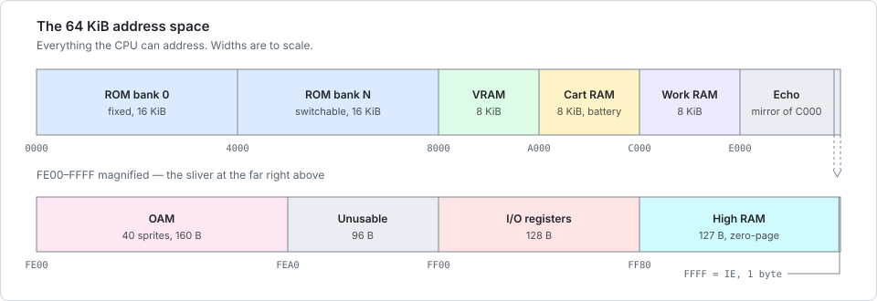

# MMU — memory bus, DMA & interrupt wiring

> Source: [`src/mmu/mod.rs`](../../src/mmu/mod.rs) · Related: [Cartridges/MBC](mbc.md) · [PPU](ppu.md) · [Timer](timer.md) · [Serial](serial.md) · [Joypad](input.md)
> [← Component index](README.md) · [🗺️ Code map](../codemap.md)

---

<!-- codemap:asof -->
> 🗺️ **Code map** · source links target [`main`](https://github.com/Alchemy86/TerminalGB/tree/main); line references documented as of commit [`6c20451`](https://github.com/Alchemy86/TerminalGB/tree/6c20451306663018288d34253c199fad507ae6f6) · regenerate with `make docs-links`, verify with `make docs-check`.

## 1. What it is

The MMU ("Memory Management Unit", `MemoryManagementUnit` here) is the **switchboard**.
The CPU only ever says "read the byte at address `X`" or "write byte `V` to address `X`".
The MMU decides what that address actually *is*: cartridge ROM, video RAM, work RAM, a
hardware register, the joypad, the sound chip, and so on. It is the single hub every other
component hangs off; almost every interesting hardware behaviour is really "what happens
when you touch address `X`".

It also owns two things that don't belong to any one chip: the **DMA engines** (bulk
memory copies), and the **interrupt flags** (`IF`/`IE`) that let the components signal the
CPU.

<p align="center">
  
</p>

<p align="center"><em>What the switchboard is switching between. Drawn to scale, which is the
point: the regions with the most hardware behaviour packed into them — OAM, the I/O
registers, HRAM and <code>IE</code> — are the sliver at the far right, magnified into the
second bar. The exact bounds are tabulated in §2 below.</em></p>

## 2. The real hardware

The Game Boy CPU has a **16-bit address bus**, so it can address **65,536 bytes (64 KB)**.
That space is a fixed map (Pan Docs — [Memory Map](https://gbdev.io/pandocs/Memory_Map.html)):

```
0x0000–0x3FFF  ROM bank 0 (fixed)        0xE000–0xFDFF  Echo of C000–DDFF
0x4000–0x7FFF  ROM bank N (switchable)   0xFE00–0xFE9F  OAM (sprite attributes)
0x8000–0x9FFF  VRAM (bank 0/1 on CGB)    0xFEA0–0xFEFF  Prohibited
0xA000–0xBFFF  Cartridge RAM             0xFF00–0xFF7F  I/O registers
0xC000–0xCFFF  WRAM bank 0               0xFF80–0xFFFE  High RAM (HRAM)
0xD000–0xDFFF  WRAM bank 1–7 (CGB)       0xFFFF         Interrupt Enable (IE)
```

Notable real-hardware behaviours the map implies:

- **Echo RAM** (`0xE000–0xFDFF`) mirrors `0xC000–0xDDFF`; using it is discouraged but legal.
- **The I/O page** (`0xFF00–0xFF7F`) is not memory — each address is a different chip's
  register with its own read/write rules (many bits read back as 1).
- **DMA:** `0xFF46` triggers an **OAM DMA** (copy 160 bytes into OAM); on CGB, `0xFF51–55`
  drive **HDMA/GDMA** (VRAM block copies). During OAM DMA the CPU can only touch HRAM.
- **`IF` (`0xFF0F`) and `IE` (`0xFFFF`)** are the request/enable pair for the five
  interrupts; the CPU services one when `IME` is set and `IF & IE != 0`.

## 3. History and versions

| Model | Memory differences |
|---|---|
| **DMG / MGB / SGB** | 8 KB WRAM, 8 KB VRAM, single banks. One flat map. |
| **CGB** | **32 KB WRAM** in 8 switchable banks (`SVBK`/`0xFF70`), **16 KB VRAM** in 2 banks (`VBK`/`0xFF4F`), the HDMA/GDMA engine (`0xFF51–0xFF55`), a **double-speed switch** (`KEY1`/`0xFF4D`), and three undocumented registers (`0xFF72/73/75`). Non-Color cartridges run in a compatibility mode. |

**This emulator always constructs the CGB MMU** (`new_cgb`) and gates the CGB-only
registers behind mode checks, returning `0xFF`/no-op in Classic mode.

## 4. How it works here

Mirrors rboy's MMU: components expose `rb`/`wb`/`do_cycle` and raise interrupts by ORing a
per-device `interrupt` byte, which the MMU folds into `IF`.

**The struct** — [`src/mmu/mod.rs:45`](https://github.com/Alchemy86/TerminalGB/blob/main/src/mmu/mod.rs#L45). Owns `wram` (`0x8000` = 8
banks), `zram` (HRAM, note it's named `zram`), `gpu`, `timer`, `serial`, `keypad`,
`Option<Sound>`, `mbc`, the interrupt bytes `inte` (IE) and `intf` (IF), the HDMA state,
`wrambank`, and mode/speed fields.

**Three constructors over one builder.** `raw` ([`mod.rs:103`](https://github.com/Alchemy86/TerminalGB/blob/main/src/mmu/mod.rs#L103))
maps the cartridge and `fill_random`s the WRAM but does *not* choose a console; `new`
([`mod.rs:144`](https://github.com/Alchemy86/TerminalGB/blob/main/src/mmu/mod.rs#L144), DMG, rejects CGB-only carts), `new_cgb`
([`mod.rs:159`](https://github.com/Alchemy86/TerminalGB/blob/main/src/mmu/mod.rs#L159)) and `new_with_model`
([`mod.rs:168`](https://github.com/Alchemy86/TerminalGB/blob/main/src/mmu/mod.rs#L168)) then commit a mode via `set_mode`
([`mod.rs:216`](https://github.com/Alchemy86/TerminalGB/blob/main/src/mmu/mod.rs#L216)) and run `set_initial`
([`mod.rs:180`](https://github.com/Alchemy86/TerminalGB/blob/main/src/mmu/mod.rs#L180)) to write the post-boot I/O defaults — this is the
**boot-ROM handoff** (see §5). Sharing `raw` is deliberate: the DMG and CGB paths used to be
two copies of the same struct literal and could drift apart. `new_with_model` takes a
[`Model`](../../src/mode.rs) — nine consoles, `Model::NAMES` — and is what `Cpu::new` calls.

**The dispatch** — `rb` ([`mod.rs:391`](https://github.com/Alchemy86/TerminalGB/blob/main/src/mmu/mod.rs#L391)) / `wb`
([`mod.rs:450`](https://github.com/Alchemy86/TerminalGB/blob/main/src/mmu/mod.rs#L450)) are the address `match`. Echo RAM is folded into the
WRAM arms with `& 0x0FFF` masking ([`mod.rs:399–400`](https://github.com/Alchemy86/TerminalGB/blob/main/src/mmu/mod.rs#L399)). `IF` reads
back with the top three bits set (`intf | 0b11100000`, [`mod.rs:409`](https://github.com/Alchemy86/TerminalGB/blob/main/src/mmu/mod.rs#L409)).

**`do_cycle`** ([`mod.rs:347`](https://github.com/Alchemy86/TerminalGB/blob/main/src/mmu/mod.rs#L347)) ticks the sub-components and folds
their interrupts into `intf`: it runs VRAM DMA first, then `timer` and `sound` on
double-speed-aware `cputicks`, and `gpu`/VRAM-DMA on `gputicks`. **The timer, however, is
advanced per memory access, not just here.** While a CPU instruction executes, every
`rb`/`wb` first calls `bus_tick` — one M-cycle of timer — so accesses land on the correct
sub-instruction cycle (this is why Blargg `mem_timing` passes); `do_cycle` then applies
only the instruction's *remaining* internal cycles to the timer so the per-instruction
total is unchanged. `bus_tick` is a no-op unless a CPU instruction is executing, so OAM
DMA (which re-uses `rb`/`wb`) and boot-time setup do not double-count — `oamdma` toggles
the flag off around its copy.

**OAM DMA** — `oamdma` ([`mod.rs:521`](https://github.com/Alchemy86/TerminalGB/blob/main/src/mmu/mod.rs#L521)):

```rust
fn oamdma(&mut self, value: u8) {
    let prev = self.set_bus_ticking(false); // don't tick the timer per byte
    let base = (value as u16) << 8;
    for i in 0..0xA0 {
        let b = self.rb(base + i);
        self.wb(0xFE00 + i, b);
    }
    self.set_bus_ticking(prev);
}
```

**HDMA/GDMA (CGB)** — `HDMA1-4` are **not** a shadow of the registers, they *are* the
registers: `hdma_src`/`hdma_dst` are the live address counters the transfer advances,
which is why a second `$FF55` write with no re-write of `HDMA1-4` continues where the
last transfer stopped rather than repeating it. Both are masked on the way in (the low
4 bits of each address, and the destination's top 3 bits — it is a 13-bit offset into
VRAM) and the destination **wraps inside VRAM** rather than running past `$9FFF`.
`HDMA1-4` are write-only and read back `0xFF`. An HBlank transfer armed while the PPU
is already in mode 0 — including with the LCD off, where the mode reads 0 forever —
moves its first block at once instead of waiting for the next mode-0 *entry*;
`hdma_run_block` is that one-shot. A `$FF55` write with bit 7 clear during a running
HBlank transfer cancels it *and* writes the length register, so `$FF55` then reads
`$80`, not `$80 | the blocks that were left`. See `hdma_write`/`hdma_read` ([`mod.rs:549`,`534`](https://github.com/Alchemy86/TerminalGB/blob/main/src/mmu/mod.rs#L549)),
`perform_gdma` (all rows at once, [`mod.rs:603`](https://github.com/Alchemy86/TerminalGB/blob/main/src/mmu/mod.rs#L603)) and `perform_hdma`
(one 16-byte row per HBlank, gated on `gpu.may_hdma()`, [`mod.rs:590`](https://github.com/Alchemy86/TerminalGB/blob/main/src/mmu/mod.rs#L590)).

### Honest approximations

- **OAM DMA is timed but only *OAM* is guarded.** [`src/mmu/oamdma.rs`](../../src/mmu/oamdma.rs)
  models the real schedule — the write to `$FF46` is M=0, the transfer starts at M=2, and
  it copies one byte per M-cycle for 160 M-cycles — and while it runs the CPU reads `$FF`
  from OAM and its writes there are dropped. What is **not** modelled is the rest of the
  bus restriction: hardware also stops the CPU seeing ROM/RAM during the transfer (which is
  why DMA-wait routines must run from HRAM), and a CPU read that collides with the
  transfer's own bus returns the byte the DMA is moving. Programs that run their wait loop
  from HRAM — i.e. all of them — see no difference.
- **VRAM/OAM access is never blocked by PPU mode.** The CPU can read/write VRAM and OAM in
  any mode; hardware returns `0xFF` during modes 2/3. This interacts with the OAM
  corruption bug (see §5).
- **GDMA/HDMA cycle costs are approximate** (`len*8` / `8` ticks;
  [`mod.rs:610`,`593`](https://github.com/Alchemy86/TerminalGB/blob/main/src/mmu/mod.rs#L610)) and GDMA does not stall the CPU for its full
  duration.
- **Prohibited region `0xFEA0–0xFEFF`** is not given the documented OAM-block-dependent
  read behaviour; unmapped reads return `0xFF` ([`mod.rs:442`](https://github.com/Alchemy86/TerminalGB/blob/main/src/mmu/mod.rs#L442)).

## 5. Known quirks and edge cases

- **OAM corruption bug (DMG) — MODELLED.** On a DMG, any bus cycle that puts an address
  in `0xFE00–0xFEFF` on the bus while the PPU is scanning OAM (mode 2) corrupts OAM. That
  includes cycles with no memory access behind them at all: the CPU's 16-bit
  increment/decrement unit is wired to the address bus, so `inc rr` / `dec rr` /
  `ld a,[hl±]` / `push` / `pop` with the register in that range assert the address anyway.
  The three corruption patterns and the trigger list are in [`src/gpu/oambug.rs`](../../src/gpu/oambug.rs);
  the trigger points are `rb`/`wb` plus `MemoryManagementUnit::idu_tick` and `share_idu`.
  **Blargg `oam_bug` passes all 8 sub-tests on `@dmg`.** It is expected to keep *failing*
  on `@cgb`: Game Boy Color silicon does not have this defect even running a monochrome
  cartridge, so a real CGB fails the ROM too. (Pan Docs —
  [OAM corruption](https://gbdev.io/pandocs/OAM_Corruption_Bug.html).)
  - *Honest approximation:* the PPU is stepped once per instruction, so the dot a
    mid-instruction bus cycle lands on is **predicted** arithmetically from the
    free-running dot counter (`Gpu::oam_scan_row_in`), and one constant —
    `mmu::OAM_BUG_PHASE` — absorbs the phase the batched PPU accumulates when `LCDC`
    bit 7 is switched on part-way through an instruction. That constant is calibrated for
    the 3-M-cycle `ldh [rLCDC],a` every test ROM (and essentially every game) uses; a
    4-M-cycle `ld [$FF40],a` would leave the corruption one row off.
- **OAM DMA restricted bus.** During a real OAM DMA the CPU running from ROM would read
  DMA-bus garbage unless it runs from HRAM; games copy a tiny wait loop into HRAM for
  exactly this. The emulator's instant DMA sidesteps the whole mechanism.
- **The boot-ROM handoff.** There is no boot ROM here (they are copyrighted and cannot be
  shipped); `set_initial` ([`src/mmu/mod.rs`](../../src/mmu/mod.rs)) writes the state the
  boot ROM would have left, and the CPU starts at `PC=0x0100` with the boot registers (see
  [CPU](cpu.md)). The Nintendo logo scroll and the header checksum lock are therefore
  skipped. That state is **per console** and larger than the handful of values usually
  quoted: the I/O page (`P1=$CF` on a DMG but `$FF` on a Color console *and on an SGB*,
  `IF=$E1`, `LCDC=$91`, `BGP=$FC`, …), the 16-bit system counter's exact value *and phase*
  (`$ABCC` DMG / `$2678` Color-with-a-DMG-cartridge / `$1EA0` Color with a genuine
  CGB-flagged one — see [Timer](timer.md)), where the PPU sits in its frame
  (`Gpu::set_boot_position` — see [PPU](ppu.md)), and, in compatibility mode, the
  palette-index registers the CGB boot ROM leaves pointing past the compatibility palettes
  (`BCPS=$C8`, `OCPS=$D0`). Mooneye's four `boot_hwio` ROMs walk the whole page byte by byte
  and all four pass.
  - **"Per console" means per *revision* — and, on a Color console, also per `GbMode`.** A
    boot ROM is part of the silicon, so a DMG 0, a DMG ABC and an MGB are three machines that
    present identical hardware from `PC=$0100` and arrive there differently;
    `MemoryManagementUnit::console` keeps the resolved [`Model`](../../src/mode.rs) for exactly
    this and is deliberately not serialised. See AGENTS.md, "Console revisions". The one thing
    the *cartridge* also decides is the **system counter on a Color console**: a CGB-flagged
    header and a DMG one take different routes through the same boot ROM, so `set_initial`
    matches on `GbMode::ColorAsClassic` before its wildcard and hands over `$2678` or `$1EA0`
    accordingly (`CGB_COMPAT_BOOT_SYSTEM_COUNTER` / `CGB_BOOT_SYSTEM_COUNTER`). `Cgb0` and
    `Agb` match *ahead* of that guard and keep one compatibility-path value for either
    cartridge — a documented gap, because no suite ROM measures those two consoles on the
    genuine path.
  - **A Super Game Boy's boot ROM does not take a fixed time.** It clocks the cartridge
    header to the SNES bit by bit through an unbalanced loop, so a zero bit costs one
    M-cycle more than a one bit and the counter the cartridge inherits is a function of the
    header — which is what `acceptance/boot_div-S` and `boot_div2-S`, identical but for two
    bytes, exist to catch. `mmu::sgb_boot_system_counter`.
  - The APU's share of it is **not** written here — the sound chip is installed later by
    `enable_audio` (a headless machine may never get one), so it lives in
    `Sound::set_post_boot_state`. Writing it in `set_initial` was dead code for as long as
    audio has been optional: `self.sound` is `None` at that point and all twenty-two writes
    were dropped.
  - What is deliberately *not* reproduced is the boot ROM's beep, still ringing at hand-off
    on real hardware. Its envelope volume is not readable from any register, so how far it
    has decayed cannot be derived; the channel-enable flip-flop `NR52` reports is set, as
    hardware has it, but the envelope is left fully decayed.
- **Echo RAM** is faithfully mirrored (writes to `0xE000+` change `0xC000+`).
- **CGB double-speed** halves per-cycle divisions for timer/sound and doubles DMA cost via
  `cpudivider` ([`mod.rs:348`](https://github.com/Alchemy86/TerminalGB/blob/main/src/mmu/mod.rs#L348)), but `STOP`-based speed switching
  itself is only plumbed, not cycle-accurate.

## 6. Expected behaviours as tests

> **Coverage today: none.**

1. **Address routing.** `wb(0xC000, v)` then `rb(0xC000) == v`; VRAM writes land in `gpu`,
   cartridge-RAM writes route to the MBC. *(Not covered.)*
2. **Echo RAM mirror.** `wb(0xC000, 0xAB)` makes `rb(0xE000) == 0xAB`, and vice versa.
   *(Not covered.)*
3. **`IF` read-back.** After `wb(0xFF0F, 0x00)`, `rb(0xFF0F) == 0xE0` (top three bits
   read as 1). *(Not covered.)*
4. **OAM DMA copies 160 bytes.** After `wb(0xFF46, 0xC0)` and 162 M-cycles, OAM
   `0xFE00–0xFE9F` equals `0xC000–0xC09F`. *(Covered: Mooneye `acceptance/oam_dma/basic`.)*
5. **OAM DMA takes 160 M-cycles, starting two M-cycles after the write, and OAM is the
   DMA's for the duration.** *(Covered: `src/mmu/oamdma.rs` unit tests, and Mooneye
   `acceptance/oam_dma_start`, `oam_dma_timing`, `oam_dma_restart`, `oam_dma/basic`,
   `oam_dma/reg_read`, `oam_dma/sources-GS` — all pass.)* Restricting the **rest** of the
   bus is still not modelled and would need a cycle-stepped CPU. *(Partially covered.)*
6. **VRAM is unreadable during mode 3** (returns `0xFF`). **Documented non-goal — not
   enforced.** Same structural dependency as #5 (needs cycle-accurate PPU/CPU bus
   arbitration). *(Not covered; structural non-goal.)*
7. **CGB WRAM banking.** With `SVBK` selecting bank 3, `0xD000` accesses WRAM bank 3;
   bank 0 selection aliases to bank 1. *(Not covered.)*
8. **CGB VRAM banking.** `VBK` (`0xFF4F`) switches the `0x8000–0x9FFF` bank. *(Not covered.)*
9. **GDMA transfers `(len+1)*16` bytes** and reports complete via `HDMA5` bit 7.
   *(Covered: SameSuite `dma/gbc_dma_cont`, and `mmu::vramdma_tests`.)*
10. **HDMA transfers one 16-byte row per HBlank** and stops after the programmed length.
    *(Covered: SameSuite `dma/hdma_mode0`, and `mmu::vramdma_tests`.)*
13. **The DMA addresses are masked.** The low 4 bits of source and destination and the
    destination's top 3 bits are dropped, and the destination wraps inside VRAM.
    *(Covered: SameSuite `dma/gdma_addr_mask`, and
    `mmu::vramdma_tests::the_dma_addresses_are_masked`.)*
14. **A transfer armed during mode 0 moves a block at once**, and with the LCD off it
    moves exactly one and then stalls — there is no mode-0 *entry* to trigger the next.
    *(Covered: SameSuite `dma/hdma_lcd_off`, `dma/hdma_mode0`, and
    `mmu::vramdma_tests`.)*
15. **`HDMA1-4` are write-only** and read back `0xFF`.
    *(Covered: `mmu::vramdma_tests::the_dma_address_registers_read_back_as_open_bus`.)*
16. **No value a guest can put in the DMA registers may abort the process.**
    *(Covered: the two `..._does_not_kill_the_process` tests in `mmu::vramdma_tests`.)*
11. **Post-boot register defaults.** After construction the whole I/O page reads back what
    the console's boot ROM leaves, per console *revision*. *(Covered:
    `mmu::boot_state_tests::a_dmg_boots_into_the_state_its_boot_rom_leaves`,
    `a_color_console_boots_into_a_different_state` and
    `each_console_revision_boots_into_its_own_state`, which transcribe Mooneye's own tables;
    all four `boot_hwio` ROMs pass — `-dmgABCmgb`, `-dmg0`, `-S` and `misc/-C`.)*
17. **A Super Game Boy's boot duration follows the cartridge header.** Two ROMs differing
    only in their global checksum must hand over with *different* system counters.
    *(Covered: `mmu::boot_state_tests::an_sgb_boot_takes_longer_for_a_header_full_of_zero_bits`,
    and `acceptance/boot_div-S` + `boot_div2-S`, which cannot both be passed by a
    hard-coded duration.)*
18. **A Color console's boot program follows the cartridge header.** Two cartridges differing
    only in `$0143` must hand over with *different* system counters — `$2678` for a DMG header
    (the compatibility path) and `$1EA0` for a CGB-flagged one.
    *(Covered: `mmu::boot_state_tests::a_color_console_boots_div_from_the_cartridge_header`
    for the routing and `mmu::timer::tests::a_genuine_cgb_cartridge_boots_div_where_gambatte_measures_it`
    for the value, plus Mooneye `misc/boot_div-cgbABCDE` and gambatte
    `div/start_inc_{1,2}_cgb04c` — all pass.)*
12. **OAM corruption bug.** A qualifying mode-2 OAM bus cycle corrupts OAM per the
    documented pattern, on a DMG only. *(Covered: Blargg `oam_bug` passes 8/8 on `@dmg`
    and is pinned PASS in `baseline.txt`; the patterns themselves by `gpu::oambug::tests`.)*

## 7. Test ROMs that exercise it

| Suite | What it checks | Meaning of a failure |
|---|---|---|
| **Blargg `oam_bug`** | The DMG OAM corruption bug | **8/8 sub-tests pass on `@dmg`.** A failure means a trigger, a corruption pattern or the mode-2 phase has moved (§5). `@cgb` is expected to fail — CGB hardware has no such bug. |
| **Blargg `mem_timing` / `mem_timing-2`** | Cycle-exact timing of memory reads/writes | **PASS** — timer stepped per memory access (see [CPU §4](cpu.md), [Timer §4](timer.md)). |
| **Mooneye `acceptance/oam_dma*`** (`basic`, `reg_read`, `sources-GS`, `oam_dma_start`, `oam_dma_timing`, `oam_dma_restart`) | OAM-DMA copy, start delay, duration, restart, legal sources | **6/6 pass.** A failure means the transfer schedule or the OAM guard has moved. |
| **Mooneye instruction-timing tests** (`rst_timing`, `call_timing*`, `push_timing`, `ret*_timing`, `jp*_timing`, `add_sp_e_timing`, `ld_hl_sp_e_timing`) | Which M-cycle each memory access of an instruction lands on — measured *through* the OAM-DMA guard | **All pass.** They are only measurable because OAM DMA is timed; see [`src/mmu/oamdma.rs`](../../src/mmu/oamdma.rs). |
| **Mooneye `acceptance/bits/`** (`unused_hwio-GS`, `reg_f`) | Unused-bit read-back behaviour of hardware registers | Bad `\| 0b…` masks in `rb`. Blargg's `bits-unused`/`bits-bank1` are the repo's known failures here. |
| **SameSuite `dma/`** (`gbc_dma_cont`, `gdma_addr_mask`, `hdma_lcd_off`, `hdma_mode0`) | VRAM-DMA address masking, register continuation, and when an HBlank transfer moves its first block | **4/4 pass.** A failure means the address counters, the mask, or the mode-0 arming one-shot has moved. Not in CI — run `cargo run --release --example samesuite -- <samesuite>`. |
| **Mooneye `emulator-only/mbcX/`** | (routes into the MBC — see [MBC](mbc.md)) | — |

The declared submodule `retrio/gb-test-roms` (Blargg) is **uninitialised**; Mooneye is a
separate, unwired suite. See [testing](../testing.md).
