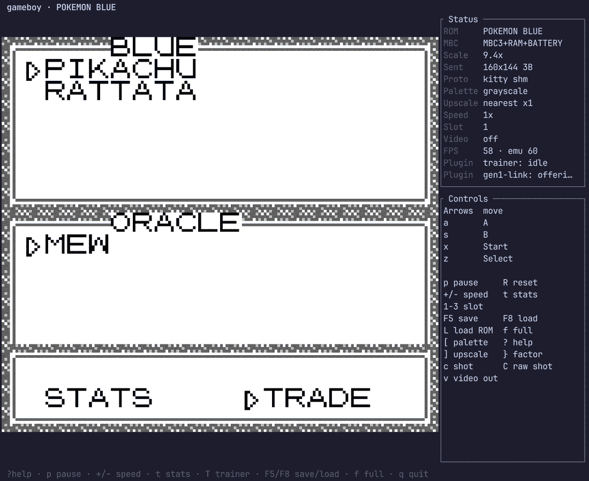

# Serial — the link cable

> Source: [`src/mmu/serial.rs`](../../src/mmu/serial.rs) · Related: [MMU](mmu.md) · [testing](../testing.md)
> [← Component index](README.md) · [🗺️ Code map](../codemap.md)

---

<!-- codemap:asof -->
> 🗺️ **Code map** · source links target [`main`](https://github.com/Alchemy86/gameboy/tree/main); line references documented as of commit [`239426e`](https://github.com/Alchemy86/gameboy/tree/239426ed55fd95ccf87f5ab19f8cc57850187742) · regenerate with `make docs-links`, verify with `make docs-check`.

## 1. What it is

The serial port is the Game Boy's **link cable**: two consoles connected wire-to-wire to
trade one byte at a time (Tetris versus, Pokémon trades, four-player games via an adapter).
One console supplies the clock (the "master"), shifts its byte out one bit per clock, and
shifts the other console's byte in on the same wire.

It earns its own page for a reason far beyond gameplay: **the standard Blargg test ROMs
report their pass/fail result by "printing" text out the serial port.** A headless test
harness reads that serial output to know whether a test passed. So serial is the plumbing
our future test suite depends on — see [testing](../testing.md).

<p align="center">
  
</p>

<p align="center"><em>The other end of the cable, with nothing plugged into it. A
<a href="../plugins.md">plugin</a> holding <code>SERIAL_LINK</code> answers
<code>Serial::wb</code> directly, so the game is talking to software rather than to a second
console — the <code>Plugin</code> row in the Status panel is what tells the player that.
Answering the handshake byte <code>$01</code> with <code>$02</code> makes the <em>game</em> take
the clock, which is why this needs no timing tolerance at all: the reply happens synchronously
inside the <code>SC = $81</code> write. Full protocol in <a href="../link-trade.md">link-trade</a>.</em></p>

## 2. The real hardware

Two registers (Pan Docs — [Serial](https://gbdev.io/pandocs/Serial_Data_Transfer_(Link_Cable).html)):

- **`SB` (`0xFF01`)** — the 8-bit shift register: the byte being sent, and (as it shifts)
  the byte being received.
- **`SC` (`0xFF02`)** — control: **bit 7** starts a transfer, **bit 0** selects the clock
  source (`1` = internal/this console is master, `0` = external), CGB **bit 1** selects
  fast clock.

A transfer shifts 8 bits; when the internal clock is used the rate is **8192 Hz**
(≈1 KB/s), or ~256 KB/s in CGB fast mode. When all 8 bits are done, `SC` bit 7 clears and
the **Serial interrupt** (`IF` bit 3) fires. With no cable connected, an internal-clock
transfer shifts in `0xFF` (all ones).

## 3. History and versions

| Model | Serial differences |
|---|---|
| **DMG / MGB** | 8192 Hz internal clock only. |
| **SGB** | Link functionality present; the SNES doesn't expose a physical link. |
| **CGB** | Adds the **fast clock** (`SC` bit 1) at ~256 KB/s for CGB-aware games; still backward-compatible with the DMG rate. |

The link *protocol* is unchanged across models; a DMG and a CGB can link for DMG games.

## 4. How it works here

**The `Serial` struct** — [`src/mmu/serial.rs:7`](https://github.com/Alchemy86/gameboy/blob/main/src/mmu/serial.rs#L7): `data` (SB),
`control` (SC), a `callback`, and `interrupt`.

**Registers** — `wb`/`rb` ([`serial.rs`](../../src/mmu/serial.rs)). Writing `SC`
with **bit 7 and bit 0 both set** (`v & 0x81 == 0x81`, an internal-clock transfer) offers
the outgoing byte to the callback and then **starts** the transfer. The reply — or `$FF`, if
nothing answered — only reaches `SB` eight shift clocks later:

```rust
0xFF02 => {
    self.control = v;
    if v & 0x81 == 0x81 {
        self.incoming = match (self.callback)(self.data) {
            Some(v) => v,
            None => { self.pending = Some(self.data); 0xFF }
        };
        self.bits_left = 8;                   // ~1 ms, not now
    } else if v & 0x80 == 0 {
        self.bits_left = 0;                   // clearing the start bit aborts
    }
}
```

**The shift clock is the system counter, not a private divisor.** `Serial::shift_clock`
is fed falling edges of counter bit 8 (8192 Hz on a DMG, 512 T per bit) by
`Timer::take_serial_edges` — the *same* free-running counter `TIMA` is tapped from, so a
transfer's edges are aligned to when the counter was last reset and not to when `SC` was
written. On the eighth edge `SB` takes the incoming byte, `SC` bit 7 clears and `IF` bit 3
is set. Mooneye `acceptance/serial/boot_sclk_align-dmgABCmgb` measures all of that from a
cold boot and passes.

One subtlety that only that ROM can see: the edge is taken from the counter **as a bus
access observes it** (`Timer::observed_counter`), which is one M-cycle ahead of the raw
field because this core's per-access tick advances the counter before the access. Take it
from the raw field and the serial interrupt arrives one instruction late.

`SC` reads back with the unused bits set (`control | 0b01111110`,
[`serial.rs:43`](https://github.com/Alchemy86/gameboy/blob/main/src/mmu/serial.rs#L43)).

**The capture hook is now used — and there is a second seam beside it.** A
[plugin](../plugins.md) holding `SERIAL_LINK` can *be the console on the other end of the
cable*: when the host callback declines a transfer, the byte is parked in `Serial::pending`
and answered by the plugin host from `Cpu::do_cycle`, before the interrupt is folded into
`IF` — so the game sees unchanged timing. That is what completes a real Generation 1 Pokémon
trade (see [plugins.md](../plugins.md) §7). Historically, though:

**The capture hook existed but was unused.** There is a `SerialCallback` type, a
`new_with_callback`, and `set_callback`/`unset_callback`
([`serial.rs:1`,`15`,`66`](https://github.com/Alchemy86/gameboy/blob/main/src/mmu/serial.rs#L1)) — exactly the seam a Blargg harness
needs. But both MMU constructors install `Serial::default()`, whose callback is a `noop`
returning `None` ([`serial.rs:3`,`75`](https://github.com/Alchemy86/gameboy/blob/main/src/mmu/serial.rs#L3)), and **nothing in the repo
ever calls `set_callback`**. So today serial output is silently dropped.

### Honest approximations

- **The byte is exchanged up front, then the clock runs.** The whole reply is obtained from
  the callback (or the plugin) at the `SC` write and parked; the eight shift clocks only
  decide *when* it lands. So the transfer's duration and completion are right, but a game
  that reads `SB` mid-transfer sees the byte it sent rather than a half-shifted register,
  and there is no per-bit interleaving with a partner that changes its mind mid-byte.
- **The CGB fast clock (`SC` bit 1, 262144 Hz) is not modelled** — an internally clocked
  transfer always runs at the 8192 Hz rate. Double speed *is* handled, because the system
  counter itself runs twice as fast there.
- ~~**External-clock transfers** (`SC` bit 0 = 0) are ignored.~~ **Fixed** — see §4a. A
  console armed with `SC = $80` is now a real state that a cable can clock, which is what
  a *second console* needs and what no single-cartridge test could ever have asked for.

## 4a. The slave half, and a cable between two consoles

**`SC = $80` — transfer start with the *external* clock — used to do nothing at all.** That
is correct for one console on its own (nothing was ever going to clock it) and it is exactly
the half a second console needs, so adding it was the substantive part of joining two cores.

`Serial` now exposes the port as a **cable** sees it rather than as the game does:
[`LinkRole`](../../src/mmu/serial.rs) (`Idle`/`Master`/`Slave`, decoded from `SC` bits 7 and
0), the byte in the shift register, a per-transfer sequence number, and two operations — answer
a master, and clock a slave. On top of that sit two arrangements, both in
[`docs/link-cable.md`](../link-cable.md):

* [`LinkCable`](../../src/link.rs) — two cores in **one process**, stepped by one loop an
  instruction at a time, so they never differ by more than ~24 T-cycles against 4096 per byte.
* [`LinkPeer`](../../src/link/peer.rs) — two **processes** that discover each other over a
  unix socket and pair automatically. This is the default (`link = auto`).

Two hardware readings that measurement forced, both recorded in
[`conformance-notes.md`](../conformance-notes.md):

- **A torn byte keeps its data.** When the far console arms `SC = $80` and rewrites `SC`
  before the eighth edge, the master keeps what was latched. Voiding it — the obvious
  reading — makes Gen 1's handshake impossible, because that handshake *is* a
  hundred-cycle window (`.establishConnectionLoop` offers `SB = $02` behind `SC = $80` and
  replaces it with `SB = $01` / `SC = $81` about 100 T-cycles later, every frame).
- **A master transfer is held until the far console answers** (`Serial::link_hold`), for the
  cross-process case only. Two frame-paced emulators each emulate a whole frame in a
  fraction of a millisecond and then sleep, so a 4096-cycle transfer that completed on
  schedule would shift in `$FF` every time. Holding costs the game nothing it can observe: a
  program waiting on a transfer is already spinning on `SC` bit 7.

## 5. Known quirks and edge cases

- **Blargg's serial console.** Blargg's CPU/timing ROMs write their result string to `SB`
  and pulse `SC = 0x81` per character. A working `set_callback` that appends each byte to a
  string reconstructs "Passed"/"Failed" — the foundation of the headless harness
  ([testing](../testing.md)).
- **Disconnected-cable read-back shifts in `0xFF`.** The console is driving the clock, so
  an unanswered transfer still completes — with all ones, which is what an empty link port
  presents. It used to be dropped entirely (no interrupt, `SB` unchanged), which is what
  `boot_sclk_align` reported as "No serial intr".
- **`SC` bit 7 auto-clears** when the transfer completes.

## 6. Expected behaviours as tests

> **Coverage today: one test ROM** — `acceptance/serial/boot_sclk_align-dmgABCmgb`, which
> passes. The rest is structural per
> [conformance-notes.md](../conformance-notes.md): a link partner is a second machine, so a
> single-ROM harness has nothing to talk to — **half of this port is invisible to every
> ROM-driven suite in existence**, and it is the half every multiplayer feature depends on.
> The two-console half is covered instead by `examples/gen1_trade.rs` (a real Gen 1 trade
> against an impersonating partner), by `examples/link_two.rs` (a real Gen 1 trade between
> **two whole cores**, in one process and across two), and by the unit tests in
> `src/link.rs` and `src/link/peer.rs`.

1. **Callback capture.** After `set_callback`, writing a byte to `SB` then `0x81` to `SC`
   invokes the callback with that byte. *(Not covered — but this is the hook the test
   harness itself relies on.)*
2. **Serial interrupt on transfer.** A completed internal-clock transfer sets `IF` bit 3.
   *(Covered — `mmu::boot_state_tests::a_link_transfer_takes_eight_shift_clocks_and_completes_unanswered`.)*
3. **`SC` read-back mask.** `rb(0xFF02)` ORs `0x7E`. *(Not covered.)*
4. **Disconnected read.** An internal-clock transfer with no partner shifts in `0xFF`.
   *(Covered — same test.)*
5. **Transfer duration.** A DMG internal transfer takes 8 × (1/8192 s); `SC` bit 7 stays
   set until it completes. *(Covered — same test, and by
   `acceptance/serial/boot_sclk_align-dmgABCmgb`, which additionally pins the edges'
   alignment to the system counter.)*
6. **A partner's reply does not arrive early.** A plugin holding `SERIAL_LINK` answers at
   the `SC` write, but the byte must not appear in `SB` until the shift clock runs out.
   *(Covered — `plugin::tests::a_plugin_answers_a_transfer_the_running_program_started`.)*
7. **A slave with no partner waits for ever.** `SC = $80` leaves bit 7 set and `SB`
   unchanged indefinitely. *(Covered — `link::tests::a_slave_with_no_cable_waits_for_ever`.)*
8. **Two cores exchange a byte, and both raise `IF` bit 3.** *(Covered —
   `link::tests::two_cores_exchange_a_byte_through_the_cable`,
   `completing_a_transfer_interrupts_both_consoles`.)*
9. **Two masters shift in `$FF`; two slaves deadlock.** A cable must not invent a byte for
   either. *(Covered — `link::tests::two_masters_shift_in_an_idle_line`,
   `two_slaves_deadlock_quietly`.)*
10. **A torn byte keeps its data.** *(Covered —
    `link::tests::a_slave_that_disarms_mid_transfer_leaves_the_master_an_idle_line`.)*

## 7. Test ROMs that exercise it

| Suite | What it checks | Meaning of a failure |
|---|---|---|
| **Blargg (all suites)** | Not testing serial itself — **using** it as the results channel | If the capture callback isn't wired, the harness can't read *any* Blargg result (see [testing](../testing.md)). |
| **Mooneye `acceptance/serial/`** (`boot_sclk_align-dmgABCmgb`) | Serial clock alignment/timing from a cold boot | **PASSES.** A failure means either the transfer is completing on the `SC` write, or the shift clock is not being divided from the system counter, or the post-boot counter value is wrong. |

The declared `retrio/gb-test-roms` submodule is Blargg, whose entire reporting mechanism is
serial — making a working `set_callback` the **first** thing a test harness must add.
**Uninitialised** today. See [testing](../testing.md).
