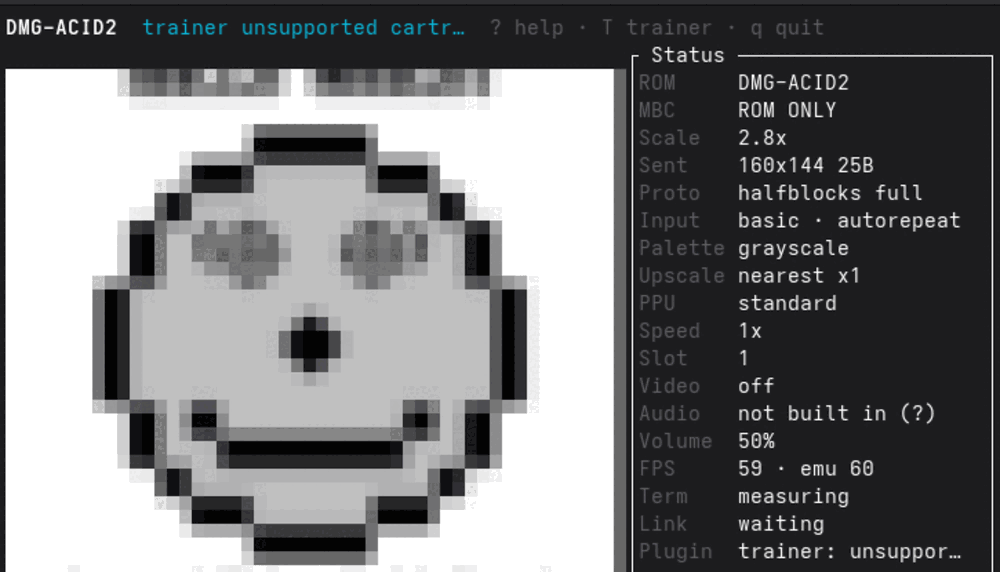
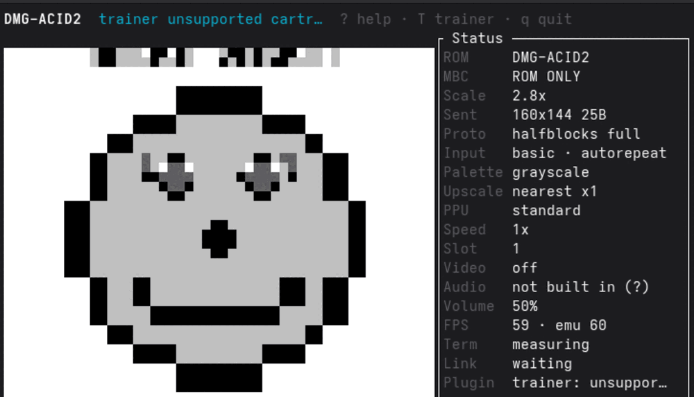

# Display scaling — enlarging the 160×144 screen

> **Keys:** `[` palette · `f` / `Esc` fullscreen · `]` `}` upscaler. [Every control →](controls.md)

> Source: [`src/screen/`](../src/screen), [`src/gameboy.rs`](../src/gameboy.rs), [`web/`](../web) · Related: [How the picture reaches you](picture.md) · [Frontends](components/frontends.md) · [PPU](components/ppu.md) · [🗺️ Code map](codemap.md)
> [← Docs: components index](components/README.md) · [testing](testing.md) · [debugging](debugging.md)

---

> ⚠️ **In flux — line hints may lag.** The terminal renderer (`src/screen/tui.rs`) was
> rewritten (in-app ROM picker, centred `fit_metrics` scaling) after this analysis was
> written, so the terminal-specific `tui.rs:NNN` numbers below point at the file rather than
> exact lines and the terminal narrative is provisional. This page is intentionally left out
> of the `make docs-links` rewrite (see the `EXCLUDE` set in `docs/tools/codemap_links.py`)
> until the terminal-scaling story is refreshed; the desktop/web parts remain accurate.

---

The Game Boy panel is **160×144** — a tiny, fixed grid of pixels resolved to 4 grey
shades (DMG) or 15-bit RGB (CGB). Every frontend has to blow that up to fill a real
window/canvas/terminal, and **how** it does the blow-up is the whole question the captain
asked: *"it's just pixel screens — can we enlarge, smoothly, scale like vector?"*

> **Implementation status (2026-08-13).** The 🥇 desktop fix and 🥈 web fix below
> are now **implemented** on the desktop GL path (`src/screen/desktop.rs`,
> `src/gameboy.rs`) and the web frontend (`web/index.html`, `web/index.js`):
> `NEAREST` filtering, a `gl::Viewport` update on resize, integer-scale +
> black letterbox (default, with a documented N=0 clamp-to-1×-and-crop), and a
> `image-rendering: pixelated` + integer-CSS-scale web canvas that fills the
> viewport and re-fits on window resize. The integer-scale maths is unit-tested
> (`integer_scale_viewport`, `src/screen/desktop.rs`), and both paths were
> visually verified headlessly — desktop through a faithful replica of the GL
> pipeline on llvmpipe, web in Chrome via computed-layout + screenshot.
>
> **The pixel-art upscalers (§2 option 3) are now IMPLEMENTED too** — a
> dependency-free `src/upscale/` module with `nearest` / `scale2x` / `mmpx` /
> `lcd`, runtime-switchable and wired into all three frontends (desktop `U`/`I`,
> terminal `]`/`}`, web `]`/`\`). Full design, licensing rationale and measured
> per-frame costs: **[docs/upscaling.md](upscaling.md)**. Only the CRT/full-shader
> pipeline remains a proposal. Per-frontend detail is corrected inline below.
>
> ⚠️ The **terminal** narrative in §1/§3 predates both the `tui.rs` rewrite and
> the upscaler, and `src/screen/tui.rs` is under active development right now — so
> treat terminal specifics below as provisional and prefer the in-app `?` help for
> the current keys.
>
> **The terminal blur is fixed and documented (2026-08-15).** All three frontends
> are now crisp, and each got there a different way: desktop `gl::NEAREST`, web
> `image-rendering: pixelated`, terminal
> [`screen::halfblocks`](../src/screen/halfblocks.rs) replacing `ratatui-image`'s
> hard-coded `FilterType::Triangle`. Full story, before/after screenshots in the
> captain's own terminal, the per-terminal matrix and the regression guard:
> [**§1 → the half-block path
> smoothed**](#the-half-block-path-smoothed--the-terminals-version-of-the-desktop-linear-bug).

This page answers three things:

1. **[What each frontend does today](#1-what-happens-today-per-frontend)** — from the code,
   with `path:line`.
2. **[The scaling options and how they differ](#2-the-options-and-how-they-actually-differ)**
   — nearest vs. smooth vs. "like vector" (pixel-art upscalers), plus LCD/CRT shaders.
3. **[What to do, per frontend, honest about cost](#3-recommendation-per-frontend)**.

---

## 1. What happens today, per frontend

| Frontend | Native size | Scaled by | Filter | User can resize? | Aspect ratio |
|---|---|---|---|---|---|
| **Desktop** | opens at **160×144** logical px | the **GPU** (textured quad) | ~~`LINEAR`~~ → **`NEAREST`** — *crisp* ✅ | **Yes** (`resizable(true)`) | **preserved** — integer scale + black letterbox; resize updates the viewport ✅ |
| **Web** | backing store **160×144**, CSS-scaled up | **CSS integer scale** (GPU compositor) | **`pixelated`** — *crisp* ✅ | **Yes** — fills viewport, re-fits on resize ✅ | **preserved** (integer multiple, centred, letterboxed) |
| **Terminal** (image protocol) | source **160×144** (optionally pixel-art upscaled) | the **terminal**, over a cell-addressed placement (kitty/iTerm2) or `Resize::Scale(None)` = `Nearest` (sixel) | nearest / scale2x / mmpx / lcd, then protocol scale — *crisp* ✅ | **Yes** — auto-re-fits on resize | **preserved** (aspect-correct centred rect) |
| **Terminal** (half-blocks) | source **160×144** | **us** — [`screen::halfblocks`](../src/screen/halfblocks.rs) samples straight into `ratatui`'s buffer | ~~`FilterType::Triangle`~~ → **nearest at pixel centres** — *crisp* ✅ ([why](#the-half-block-path-smoothed--the-terminals-version-of-the-desktop-linear-bug)) | **Yes** — auto-re-fits on resize | **preserved** (aspect-correct centred rect) |

### Desktop — GPU-scaled, but smoothed *and* the resize is broken

The window opens at exactly the native resolution — `LogicalSize { width: 160, height: 144 }`
([`gameboy.rs:107`](../src/gameboy.rs)) — and is **resizable**
([`gameboy.rs:114`](../src/gameboy.rs) `.with_resizable(true)`). Each frame is uploaded as a
160×144 RGBA texture (`gl::TexImage2D`, [`desktop.rs:306`](../src/screen/desktop.rs)) and
drawn onto a quad whose vertices span the full **normalised device coordinates** `-1..1`
([`desktop.rs:160`](../src/screen/desktop.rs)) — i.e. the image is stretched to fill whatever
the GL viewport is. So there **is** a real GPU scaling pipeline (glutin 0.28 + raw OpenGL).

Two problems used to live in that pipeline — **both are now fixed**; the original
diagnosis is kept here for context, with the fix noted after each:

- **It smoothed.** Both the min and mag texture filters were `gl::LINEAR`
  ([`desktop.rs`](../src/screen/desktop.rs)) — bilinear. Enlarging the window made the
  picture **blurry**, not crisp. → **Fixed:** both filters are now `gl::NEAREST`, so every
  Game Boy pixel stays an exact square. (Verified: a headless llvmpipe render of the pipeline
  shows hard pixel edges and a staircased diagonal instead of a soft ramp.)
- **Resize didn't actually work.** There was **no `gl::Viewport` call anywhere**, and the
  `Resized` window event was a no-op. OpenGL set the viewport once, at context creation
  (160×144), and never again, so dragging the window bigger left the image pinned to a
  160×144 patch with the rest showing the (blue) clear colour. → **Fixed:** the `Resized`
  event now calls `gl_window.resize()` + `Glcx::resize()` (`src/gameboy.rs`), and `draw()`
  re-applies the integer-scaled viewport every frame, so the image tracks the window. The
  clear colour is now **black** for a clean letterbox.
- **No aspect-ratio handling.** Even with a live viewport, the quad fills the whole viewport,
  so a non-10:9 window would **stretch/distort** the image. → **Fixed:** `integer_scale_viewport()`
  picks the largest N where `160N×144N` fits, centres it, and the black clear letterboxes the
  border — preserving 10:9 and keeping pixels even. **N=0** (window smaller than 160×144) is
  clamped to **1× and centre-cropped**, so the image never divides to zero or vanishes.

So the honest summary for desktop: *it enlarges on the GPU, crisply (`NEAREST`), with a
working viewport and integer-scale letterboxing that preserves 10:9.*

### Web — pixel-perfect, and now enlargeable (was stuck at 160×144)

> **Now implemented.** The backing store stays 160×144 (the `put_image_data` blit is
> unchanged — no Rust/WASM change), but the canvas now carries
> `image-rendering: pixelated` (+ `-moz-crisp-edges` / `crisp-edges` /
> `-webkit-optimize-contrast` fallbacks) and `web/index.js`'s `fitCanvas()` sets its CSS
> size to the largest integer multiple of 160×144 that fits the viewport, re-running on
> `resize` and when the wasm renderer appends the canvas (`MutationObserver`). `#game`
> becomes a fixed, flex-centred black backdrop once it holds the canvas (`#game:not(:empty)`),
> giving a centred, aspect-correct, letterboxed, crisp image that grows with the window.
> Verified in Chrome: at 640×480 → 3×, 900×500 → 3× (height-limited), 1280×800 → 5×, each
> centred with 10:9 preserved and `image-rendering` computing to `pixelated`; a live
> window resize re-fit 3×→5× without reload. The original 1:1 analysis follows for context.


The canvas backing store is set to the native size — `canvas.set_width(160)` /
`set_height(144)` ([`web.rs:54-55`](../src/screen/web.rs)) — and the frame is written with
`context.put_image_data(&d, 0.0, 0.0)` ([`web.rs:123`](../src/screen/web.rs)).
`put_image_data` writes **raw device pixels**: it ignores any canvas CSS size and any 2D
context transform, so there is **no scaling step at all** — the image is 1:1.

The CSS then displays the canvas at its intrinsic size. The host `<div id="game">` is fixed
at `width:160px; height:144px` (inline `<style>` in [`web/index.html`](../web/index.html);
the id rule out-specifies the `.glass` class rule), and the canvas inside has no CSS of its
own, so it renders at **160×144 CSS pixels — a ~4 cm postage stamp** on a modern monitor.

- **The user cannot enlarge it.** There is no zoom, no scale control, no resizable element.
- **`image-rendering: pixelated` is *not* set** anywhere (confirmed: no occurrence in `web/`
  or `src/`). Today that is invisible because the canvas is 1:1 — but the moment anyone scales
  the canvas up (via CSS, a zoom control, or a WebGL path), the browser will **bilinear-smooth
  it by default** and blur the pixels. This is the single most common accidental-blur trap on
  the web and it is one property away from biting us.

### Terminal — nearest-neighbour, aspect-correct, and now uncapped

> **Updated after the `tui.rs` rewrite (file under active development — line hints omitted).**
> The old text below described a capped `o`-key pre-scale and `Resize::Fit`; both are gone.
>
> **Superseded again (2026-08-13) by the render-performance work.** The frontend no longer
> hands the frame to `ratatui-image` at all on the Kitty and iTerm2 paths: it transmits the
> picture at the resolution the emulator computed and asks the terminal to scale it to a
> cell-addressed placement, because resizing to the display rectangle cost ~40 ms and 11.6 MB
> **per frame** on a large window (≈20 fps). Measurements, the fix, and the emulation/render
> decoupling that goes with it: **[terminal-render.md](terminal-render.md)**.

`framebuffer_image` in [`tui.rs`](../src/screen/tui.rs) maps the framebuffer through the
selected palette ([`frame.rs`](../src/screen/frame.rs)) and then the selected **pixel-art
upscaler** (`nearest`/`scale2x`/`mmpx`/`lcd`, cycled with `]`/`}` — see
[upscaling.md](upscaling.md)), at the *transmission* factor rather than the display scale.

The result is placed by [`termimage.rs`](../src/termimage.rs) into a centred, aspect-correct
`fit_metrics` rect that **re-fits automatically on resize** — there is no manual scale key any
more. Enlargement is the terminal's job: Kitty scales a virtual placement carrying `c=`/`r=`,
iTerm2 scales an inline image whose `width`/`height` are given in cells. Sixel and halfblocks
have no cell-addressed placement, so they keep the `ratatui-image` `Resize::Scale` path —
`Scale`, not `Fit`, because `Fit` refuses to enlarge a source smaller than the area, which is
why a 160×144 image used to render tiny. (On scaled-Wayland HiDPI terminals the `cell_scale`
config corrects a logical-vs-physical pixel mismatch — see the top-level README.)

#### The half-block path smoothed — the *terminal's* version of the desktop `LINEAR` bug

**Reported 2026-08-15:** *"running gameboy on our normal terminal is blurry again — so only
wezterm is looking good, we have corrected that before so get on it team."* Status panel:
`Proto halfblocks full`, `Upscale nearest x1`.

It was **not** the desktop `gl::LINEAR` regression above coming back, and it was not the
upscaler. It is the same *class* of defect one layer further out — something downstream
applying its own interpolation — and the layer was `ratatui-image`.

**The mechanism, measured rather than argued.** A terminal that speaks no image protocol
draws the picture out of the upper-half-block glyph `▀`: foreground paints the top half of a
character cell, background the bottom, two vertical pixels per cell. That is crisp *by
construction* — a cell is two flat colours and there is nothing in it that can be soft. The
softness was in the **sampling**: `ratatui-image`'s half-block encoder resizes the frame onto
the cell grid with a hard-coded smoothing filter,

```rust
// ratatui-image-4.2.0/src/protocol/halfblocks.rs
let img = img.resize_exact(rect.width as u32, (rect.height * 2) as u32,
                           FilterType::Triangle);
```

so every cell was a *weighted average* of the Game Boy pixels beneath it. Two facts pin it as
the cause rather than a suspect: the same crate's **sixel** encoder does no such thing, and
`Resize::Scale`'s own default filter is `FilterType::Nearest` — half-blocks is the single path
with a filter baked in, which is exactly why WezTerm looked right and Ptyxis did not.

Measured on dmg-acid2 at 80×24 cells: **271 distinct colours in a four-shade picture**, 268 of
which no Game Boy shade maps to.

**The fix** is [`src/screen/halfblocks.rs`](../src/screen/halfblocks.rs) — we sample the cells
ourselves, nearest-neighbour at pixel centres (`(2i+1)·s / 2t`, the same rule as
[`video::fit_maps`](../src/video.rs)), straight from the framebuffer into `ratatui`'s buffer.
The same move [`src/termimage.rs`](../src/termimage.rs) already made for kitty and iTerm2, for
a related reason: the library's general-purpose answer is wrong for a 60 Hz four-colour video
source. A uniform cell is written as a **space**, not `▀` — visually identical but it asks the
terminal to rasterise no glyph, so a font with a poor `▀` cannot soften the large flat areas a
Game Boy picture is mostly made of. `render_path = legacy` still takes the library's path, so
one binary can A/B the two in the same terminal.

Before and after, both in **Ptyxis 50.1 (VTE)** — the captain's own terminal — at the same
80×24, same 2.8× scale, same `Proto halfblocks`:

| before (`render_path = legacy`) | after (default) |
|---|---|
|  |  |

**Cost: it is *cheaper*.** Telemetry over ~1,070 frames at 146×54 cells, WezTerm forced to
half-blocks, same ROM and window both sides: whole-frame `frame_ms` **0.460 → 0.349**. Our
encoder pays its full sampling cost on *every* frame (it does no picture dedup at all, because
`ratatui`'s own per-cell diff is what suppresses an unchanged screen) and still wins, because
it replaces two `image`-crate resizes — a nearest upscale to the display's pixel size followed
by a Triangle downscale back to the cell grid. That is the worst case for us and the best case
for the old path.

##### Per-terminal matrix

Crispness is decided by **who resamples the picture**, so that is the column that matters.

| Terminal | Protocol chosen | Who resamples | Crisp? |
|---|---|---|---|
| **Ptyxis 50.1 / VTE** (also GNOME Terminal, GNOME Console) | `halfblocks` | **us** (`screen::halfblocks`) | ✅ *measured here* — was ❌ before this fix |
| **WezTerm** (default) | `kitty` + shared memory | the terminal scales a cell-addressed placement | ✅ *measured here* |
| **WezTerm** (`protocol = halfblocks`) | `halfblocks` | **us** | ✅ *measured here* — was ❌ before this fix |
| kitty, Ghostty | `kitty` | the terminal | *not run here* — same wire path as WezTerm's kitty |
| foot, xterm with sixel | `sixel` | `ratatui-image`, `Resize::Scale(None)` = `Nearest` | *not run here* — no smoothing filter on that path |

Only the three ✅ *measured here* rows were actually executed on this machine; the rest state
which code path the terminal takes, which is a claim about our source, not a screenshot.

Two honest caveats:

* **Fedora builds VTE without sixel.** Verified previously by `vte_get_feature_flags()` and by
  DA1 (`ESC[?61;1;21;22;28c`, no `4`) — see [rendering.md](rendering.md) §4a. So GNOME-family
  terminals genuinely get half-blocks and there is nothing this end can do about it.
* **Crisp is not full resolution.** Half-blocks resolution *is* the character grid: at 80×24
  the picture is about 87×78 against the Game Boy's 160×144, so fine in-game text is lost
  whatever the filter. That is a limit of the host, so the frontend now **says so** —
  `HALFBLOCKS_NOTICE` in [`tui.rs`](../src/screen/tui.rs) reaches the same four surfaces every
  config warning does (stderr scrollback, picker footer, a toast on entering a game, the `?`
  overlay), naming the cause and the remedy; and the Status panel's `Proto` row carries the
  picture's **real resolution** (`halfblocks 146x108`) in place of the transport word `full`,
  which for half-blocks meant nothing — there is no wire transport, the picture goes through
  `ratatui`'s buffer. Same contract as the existing key-release and no-audio notices: a player
  must never be left thinking the emulator is broken when it is a property of the host.

##### The regression guard

Blur has now been reported twice, so something has to fail loudly if it returns. Two layers,
both asserting the same property — **every colour on screen must be a colour that was in the
framebuffer**, which no interpolating resampler can satisfy:

* `screen::halfblocks::tests::no_colour_appears_that_was_not_in_the_framebuffer` — unit speed,
  a one-pixel checkerboard (the worst case for a smoothing filter) at five window sizes.
* `screen::tui::tests::the_halfblock_picture_uses_only_real_game_boy_shades` — end to end
  through the real `App::render` on dmg-acid2 at four window sizes, comparing against the four
  colours the live palette maps to. **This is the test that reproduced the bug**: against the
  unfixed code it reports *"the picture contains 268 colour(s) no Game Boy shade maps to"*.

Plus `an_exact_fit_reproduces_the_framebuffer_pixel_for_pixel` (the mapping is right, not
merely un-blurred), `sampling_is_symmetric_so_no_edge_is_shaved_off`, and
`the_proto_row_reports_the_half_block_picture_resolution`.

**A note for whoever meets this next:** a colour count is a far better blur detector than a
pixel diff. The Game Boy emits exactly four shades, so "a colour that is not one of the four"
is a *categorical* error with no threshold to tune, and it stays true at every window size,
palette and scaling ratio.

### FFI — no scaling; the embedder owns it

`image()` ([`lib.rs`](../src/lib.rs)) hands back the raw 160×144 RGBA buffer; any scaling is
the host application's job. (`image_base64` even has a commented-out `Nearest` resize.) Out
of scope for this page, but worth stating so the picture is complete.

---

## 2. The options, and how they actually differ

The captain named three things. They are genuinely different techniques with different looks
and different costs. Here they are on a diagonal edge — the case where the difference is
most visible.

```
 source (2×2)      nearest / integer      bilinear (smooth)      pixel-art ("vector")
   ██··              ████ ····              ▓▓▒░ ····              ███▙ ····
   ····      →       ████ ····      →       ▓▒░· ····      →       ██▜· ····
                     (hard square edge)     (soft grey ramp)       (clean anti-aliased curve)
```

### Option 1 — Nearest-neighbour / **integer** scaling  *(crisp, blocky)*

Each source pixel becomes an N×N block of identical pixels. No new colours, no blur — every
Game Boy pixel stays an exact square. This is what most emulator users want as the default.

The catch is in the word **integer**: at a whole-number multiple (2×, 3×, 4×) every source
pixel gets the *same* number of screen pixels, so the grid stays even. At a **non-integer**
scale (say 2.5×) nearest-neighbour has to give some pixels 2 screen-pixels and some 3 —
producing **uneven pixel sizes and shimmer**, which looks visibly wrong. The fix is to scale
by the largest integer that fits the window and **letterbox** the leftover with a border
(black, or a DMG-green bezel). Aspect ratio (10:9) must be preserved either way.

- **Cost: effectively free.** A GPU sampler set to `NEAREST`, or a trivial CPU block copy.
- **Verdict: this should be the default.**

### Option 2 — **Bilinear / smooth**  *(soft, blurry)*

The hardware interpolates each output pixel from its 4 nearest source pixels. Trivial to
enable — it's usually one flag (`gl::LINEAR`, or the browser's default canvas smoothing) —
which is why it so often shows up *by accident*, as it does on desktop today. It looks fine
for photos and terrible for 4-colour pixel art: edges turn into grey ramps. Generally
disliked for retro content.

- **Cost: free** (it's the hardware's default path).
- **Verdict: offer it as an option, never as the default.**

### Option 3 — "Like vector" — **pixel-art upscaling algorithms**  *(the interesting one)*

This is what the captain means by *"scale like vector"*: algorithms that look at each pixel's
neighbourhood, **detect edges**, and synthesise smooth diagonals and curves — so a blocky
sprite comes out looking like it was drawn as vectors, **not** blurred. They are a real middle
ground between blocky and smeary.

| Algorithm | How it looks on a 160×144 4-colour screen | Relative cost | Rust / shader availability |
|---|---|---|---|
| **scale2x / scale3x (AdvMAME / EPX)** | Mild edge-smoothing, stays close to the original; great for a 4-shade DMG image where there's little colour detail. | **Very cheap** (~9 neighbour reads/pixel). Trivial to hand-write or vendor. | Small pure-Rust helpers exist (e.g. `scalenx`); the algorithm is ~40 lines. GLSL versions ship in RetroArch. |
| **MMPX** | Modern successor to scale2x; better with thin lines and 2-px features. Designed exactly for low-res sprites. | **Cheap**, fixed 2×. | Reference is a public GLSL/C shader; no prominent maintained Rust crate — easy to port. |
| **hqx (hq2x/3x/4x)** | Smooth anti-aliased curves; the classic "vector-ish" look. Can look slightly soft. | **Moderate** CPU. | **`hqx`** crate exists (pure-Rust port, 2×/3×/4×). Also a well-known GLSL shader. |
| **xBRZ** | The best-looking of the family — clean curves, preserves sharp corners. | **Heaviest** CPU (large per-pixel kernel + edge analysis). | `xbrz`-style crates exist but are **not actively maintained**; also available as a `.slang`/GLSL shader in RetroArch. |
| **Omniscale** | Very high quality, continuous scale factor. | Moderate–heavy; GPU-oriented. | Distributed as a GLSL shader (not a Rust crate); licensing worth checking before adopting. |

**Cost in context — the 160×144 source is your friend.** The screen is only **23,040
pixels**. Even xBRZ (the most expensive) chews through a source that small in low single-digit
milliseconds on a CPU, and its 4× output (640×576 ≈ 368k px) is still tiny. So — unusually —
**even a CPU-side xBRZ per frame at 60 fps is affordable here**, precisely because the source
is so small. That is *not* true of a full-resolution console; it's a happy accident of the
Game Boy's size. As a **GPU shader** any of these is essentially free once a shader pipeline
exists.

- **Verdict: a genuine, worthwhile option — and now IMPLEMENTED.** `src/upscale/` ships
  **scale2x** (reimplemented from the published rule, not the GPL reference) and **MMPX** (ported
  from the MIT reference), plus an **lcd** dot-matrix grid, as a selectable per-frame filter
  across all frontends. hqx (LGPL tables) and xBRZ (GPLv3) were deliberately **not** vendored —
  a licensing constraint for this MPL-2.0 repo — so the "maximum smoothing" tier is not offered.
  Full rationale and measured costs: **[docs/upscaling.md](upscaling.md)**.

### Also worth naming — **LCD and CRT shaders**  *(different goal: authenticity, not sharpness)*

Many people don't actually want *sharper* — they want it to **look like a Game Boy**. That is
a separate axis from the three above:

- **DMG green tint** — remap the 4 shades to the pea-green DMG LCD palette (the core currently
  hands over already-resolved RGBA; see [PPU](components/ppu.md)).
- **LCD grid / dot-matrix** — a subtle darkening between pixels reproducing the reflective
  panel's sub-pixel gaps. This is the signature DMG look.
- **Ghosting / motion blur** — blend a little of the previous frame, mimicking the slow LCD
  response many games relied on for transparency effects.
- **CRT** (for the Super Game Boy / TV-out fantasy) — scanlines, mask, mild curvature.

These are cosmetic overlays, cheapest as fragment shaders, and compose *on top of* whichever
scaler you pick. They're the highest "feels right" payoff for the least accuracy risk, and
libretro/RetroArch ship a large, battle-tested free shader library (`dmg`, `lcd-grid`,
`crt-*`) that can be adapted rather than written from scratch.

---

## 3. Recommendation, per frontend

Ranked by **value-for-effort**. The decisive fact: **desktop already has a GPU pipeline**
(glutin + OpenGL), so nearest-scaling and shaders are nearly free *there*; the terminal
already does the right thing; and the web path did **no** scaling at all, so its fix was the
biggest visible win for the least code. The 🥇 and 🥈 items below are now **implemented**
(status noted in each heading); 🥉 and the follow-ups remain as before.

### 🥇 Desktop: crisp + working resize + integer letterbox — ✅ DONE

The most likely complaint ("it's blurry / it won't enlarge properly") was entirely in the
desktop GL path. Three changes, all in the existing pipeline, now landed:

1. **Texture filter `LINEAR` → `NEAREST`** ([`desktop.rs`](../src/screen/desktop.rs), the
   `TEXTURE_MIN/MAG_FILTER` params) — instantly crisp instead of blurry. ✅
2. **`gl::Viewport` on the `Resized` event** — `src/gameboy.rs` intercepts `Resized` and calls
   `gl_window.resize()` + `Glcx::resize()`; `draw()` also re-applies the viewport every frame,
   so enlarging the window fills it. ✅
3. **Integer scale + letterbox (default).** `integer_scale_viewport()` picks the largest N
   where `160N×144N` fits the framebuffer, centres it, and the black clear letterboxes the
   border — preserving 10:9 and keeping pixels even. **N=0** clamps to 1× and centre-crops.
   No stretch/fill mode was added (integer is the only mode); a fill mode remains an easy
   opt-in follow-up. ✅

Cost: all three live in the existing GL pipeline — **essentially free per frame**. The scale
maths is unit-tested (`integer_scale_viewport` tests in `desktop.rs`: exact multiples, largest
fitting N, non-integer framebuffers, N=0 clamp, degenerate source) and the pipeline was
rendered headlessly on llvmpipe to confirm crisp `NEAREST` output with a centred black
letterbox.

### 🥈 Web: enlargeable + pixelated — ✅ DONE (no Rust/WASM change)

Web used to show a 160×144 postage stamp with **no** way to grow it. Now, with **no** change
to the `put_image_data` blit:

1. The canvas carries **`image-rendering: pixelated`** (with `-moz-crisp-edges` /
   `crisp-edges` / `-webkit-optimize-contrast` fallbacks) so the CSS upscale stays crisp. ✅
2. **`fitCanvas()`** ([`web/index.js`](../web/index.js)) sets the canvas CSS size to the
   largest integer multiple of 160×144 that fits the viewport, centred (via the flex-centred
   `#game:not(:empty)` black backdrop), re-running on `resize` and when the wasm renderer
   appends the canvas. The backing store stays 160×144 (cheap); CSS scales on the GPU
   compositor (free). ✅

Only [`web/index.html`](../web/index.html) (CSS) and [`web/index.js`](../web/index.js) (JS)
changed. Verified in Chrome across window sizes (3×/5×, centred, 10:9, `pixelated`) plus a
live resize.

### 🥉 Terminal: rebuilt — now fills the pane and upscales

The terminal was the "leave it" frontend, but the `tui.rs` rewrite went further: it swapped
`Resize::Fit` for **`Resize::Scale`** (so a 160×144 source now enlarges to fill a centred,
aspect-correct pane instead of rendering tiny), dropped the capped `o`-key pre-scale for
automatic re-fit on resize, and gained the shared **pixel-art upscaler** (`]`/`}`) and palette
(`[`). The remaining follow-up is the same as everywhere: CRT/LCD shaders (the `lcd` grid filter
already exists). `src/screen/tui.rs` is still under active development.

### Optional follow-ups (all cheap once the above lands)

- **DMG green palette + LCD-grid shader on desktop** — highest "feels like a Game Boy" payoff
  for little cost, on the GL pipeline you'll already have. Adapt a libretro `dmg`/`lcd-grid`
  shader.
- **A selectable pixel-art filter (scale2x → MMPX → hqx → xBRZ)** — offer as a menu, GPU
  shader on desktop/web-WebGL, CPU path viable on the terminal because the source is tiny.

### Constraints honoured

- **No new dependencies were adopted** — the shipped upscalers (`src/upscale/`) are
  dependency-free: scale2x reimplemented from the published rule and MMPX ported from the MIT
  reference. The crates named above (`hqx`, `scalenx`, xBRZ/Omniscale shaders) were **not**
  pulled in (licensing — see [upscaling.md](upscaling.md)).
- Nearest/integer scaling and CSS `pixelated` are **free**; a GPU shader is cheap **because a
  GL pipeline already exists on desktop**; a *CPU* xBRZ-per-frame would normally be the
  expensive path, but is affordable here only because the source is 160×144.
- **Aspect ratio (10:9) and integer-scale letterboxing must be handled regardless of filter.**

---

## 4. As tests / next steps

Phrased like the component pages' test lists, so this slots into the same spec-first flow
(and ties into the deterministic frame-hashing in [debugging](debugging.md)):

1. **Desktop enlarges crisply.** Resizing the window scales the image with `NEAREST`
   filtering; no blur. ✅ **Done** — filters are `NEAREST`; verified by headless llvmpipe render.
2. **Desktop resize actually fills the window.** A `gl::Viewport` update on `Resized` makes
   the image track the window. ✅ **Done** — `Resized` handler + per-frame viewport in `draw()`.
3. **Integer scale + letterbox.** At any window size the image is the largest `160N×144N` that
   fits, centred, 10:9 preserved, border cleared (N=0 → 1× crop). ✅ **Done** — `integer_scale_viewport()`,
   unit-tested including non-integer sizes and the N=0 edge case.
4. **Web canvas can be enlarged and stays crisp.** With `image-rendering: pixelated` and an
   integer CSS size, the canvas scales up without browser smoothing. ✅ **Done** — verified in
   Chrome at several window sizes and across a live resize.
5. **Terminal fills the pane, aspect-correct.** `Resize::Scale` upscales 160×144 to a centred
   `fit_metrics` rect and re-fits on resize; nearest/scale2x/mmpx/lcd selectable via `]`/`}`.
   ✅ **Done** (part of the `tui.rs` rewrite).

**Remaining next steps:** the pixel-art upscalers **have landed** (`src/upscale/`,
[upscaling.md](upscaling.md)); what remains are the **CRT / full-shader** overlays (§2's LCD/CRT
list — the `lcd` grid filter is done) and a non-integer "fill" desktop mode as an easy opt-in.
