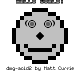
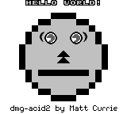
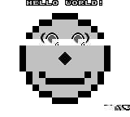
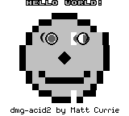

# How we know it is right

> An emulator that "runs games" is a claim nobody can check. A test ROM is a program written
> to make the machine answer a question it cannot fudge — and the best of them answer with a
> **picture**, because for a video chip a picture is stronger evidence than a number.
>
> [What an emulator is](README.md) · [the machine chip by chip](the-machine.md) ·
> [where exact begins](accuracy.md) · [the FPGA question](fpga.md)

---

<!-- codemap:asof -->
> 🗺️ **Code map** · source links target [`main`](https://github.com/Alchemy86/TerminalGB/tree/main); line references documented as of commit [`72a5454`](https://github.com/Alchemy86/TerminalGB/tree/72a545438d2a2422f1b55c3452032d76259993be) · regenerate with `make docs-links`, verify with `make docs-check`.

The problem with testing an emulator is that there is no reference to test against. You
cannot diff your framebuffer with a real console's unless somebody photographed one, and you
cannot assert that an instruction took four cycles unless something measured it.

The community's answer is elegant: **write the test as a Game Boy program.** A cartridge runs
on real hardware and on your emulator, and it can measure the machine from the inside — count
its own cycles, read back a register it just wrote, catch its own interrupt — and then say
what it found. The verdict comes from the ROM, not from you.

That gives the rule this repository is built on, and it is worth stating before anything
else:

> **No check's expected result may be defined by our own output.** Every expectation is
> somebody else's: the string the ROM printed, the text it wrote to cartridge RAM, or its
> author's photograph of real hardware. A harness that judges itself stays green through any
> regression — which ours did, for four ROMs, until it was caught.

That is not a hypothetical. Four ROMs in `testharness/baseline.txt` were once recorded as a
hash of our own framebuffer, and the documented response to a changed hash was to re-bless
it. Every one of them is now judged by the ROM's own report. The same principle is written
into the conformance tool we hand to other projects
([`docs/conformance-action.md`](../conformance-action.md)).

---

## dmg-acid2: the picture *is* the diagnosis

The centrepiece is [dmg-acid2](https://github.com/mattcurrie/dmg-acid2) by Matt Currie (MIT;
the prebuilt ROM and its reference image are vendored under
[`third_party/dmg-acid2/`](../../third_party/dmg-acid2)). It is named after the
[Acid2](https://www.acidtests.org/) browser tests, which had the same idea: instead of a
thousand assertions, draw one page that only renders correctly if the whole engine is right.

dmg-acid2 draws a smiley face.

<p align="center">
  
</p>

That single frame is composed out of the background, the window and the object layer at once,
and it comes out looking like a face only if **all** of the following are simultaneously
right:

- object-to-object priority, which on a monochrome Game Boy is decided by X coordinate first
  and position in object memory second;
- the ten-objects-per-line limit — the picture processor scans object memory in order and
  **stops after ten**, so which ten it keeps is part of the answer;
- the tall-object rule: in 8 × 16 mode bit 0 of the tile index is ignored, so an odd index
  still starts on an even tile;
- object flipping, horizontally and vertically;
- background-over-object priority — an object with its priority bit set is hidden behind any
  background pixel that is not colour 0;
- window rendering, including the offset of 7 built into the window's X register;
- and the tile-data addressing mode, where one of the two blocks is indexed by a **signed**
  byte.

It is a genuinely clever design. Every one of those is a *different* bug, and every one of
them deforms the face differently — so an emulator author who renders the ROM does not get
"fail", they get a symptom, and the symptom names the bug.

### The failure gallery — measured, not illustrated

The pictures below are not from the upstream README. Each one was produced **here**, by
deliberately breaking one behaviour in [`src/gpu/mod.rs`](../../src/gpu/mod.rs), rebuilding,
rendering 600 frames, and comparing against the author's reference image with the same
shade-rank comparison the test harness uses. The pixel count beside each is what that
comparison reported.

Our unbroken score, for reference, is **0 of 23,040 pixels**, on both a Game Boy and a Game
Boy Color, asserted in CI on every release test run.

| Broken behaviour | Pixels wrong | What the face does |
|---|---:|---|
| [`x-flip`](faces/x-flip.png) — object X-flip ignored | 119 | The nose stops being a diamond: its right half is a mirrored copy of the left, so it becomes a double arrowhead pointing left. The eye highlights swap sides. |
| [`x-priority`](faces/x-priority.png) — object draw order by memory position only, ignoring X | 12 | One stray dot appears on the left cheek. Twelve pixels: the smallest, subtlest failure in the set, and the reason a *count* is a poor verdict. |
| [`ten-per-line`](faces/ten-per-line.png) — the ten-per-line limit removed | 28 | The exclamation mark vanishes from "HELLO WORLD!". An eleventh object hardware would have discarded takes the place of one it keeps. |
| [`bg-priority`](faces/bg-priority.png) — background-over-object priority ignored | 144 | White rectangles punch through both eyes, where an object that should be hidden behind the background is drawn over it instead. |
| [`tall-tile-bit`](faces/tall-tile-bit.png) — bit 0 of an 8 × 16 tile index not masked | 256 | The mouth collapses: the smile loses its left half and the remainder slides down and sideways into a smirk. |
| [`wx-offset`](faces/wx-offset.png) — the window's offset of 7 dropped | 733 | The window — the right side of the face — shifts seven pixels left, cutting a white notch through the right eye and out of the chin. |
| [`y-flip`](faces/y-flip.png) — object Y-flip ignored | 868 | The nose becomes an upward arrow and **the smile becomes a straight line**. The mouth's curve is built from vertically flipped copies of one tile. |
| [`tile-data-select`](faces/tile-data-select.png) — the `$8800` block indexed unsigned instead of signed | 1,044 | The top third of the head tears away from the rest and the eyes fall out of their sockets; the caption at the bottom dissolves into fragments. |

<p align="center">
  
  
  
</p>

<sub>Left: Y-flip. Middle: signed tile indexing. Right: the window offset. Full-size images in
<a href="faces/">faces/</a>.</sub>

**Reproduce any row of that table.** The whole method is three steps and no special tooling:

```sh
cargo build --release --example conformance_adapter
GBCONFORM_FRAMES=600 GBCONFORM_FRAME_OUT=/tmp/frame.raw \
    ./target/release/examples/conformance_adapter third_party/dmg-acid2/dmg-acid2.gb
python3 - <<'PY'
import sys; sys.path.insert(0, "tools/conformance")
import image
ref = image.decode(open("third_party/dmg-acid2/reference-dmg.png", "rb").read())
act = image.decode(open("/tmp/frame.raw", "rb").read(), expect=(160, 144))
print(image.compare(act, ref)[0], "pixels differ")
PY
```

Then break one line of the picture processor and run it again. That is exactly how the table
above was made, and it is also how this harness was proved to have teeth in the first place
— ignoring object X-flip turns the row red at 119 pixels, which is the number the table now
independently reproduces.

### Two things the gallery teaches that a pass/fail line cannot

**The severity of a bug has almost nothing to do with how wrong the picture is.** Ignoring
X-priority is 12 pixels; getting the signed tile-data block wrong is 1,044. Both are complete
failures of a documented behaviour. If the only output were a number, the first would look
like a rounding error and the second like a catastrophe, and an author would fix them in the
wrong order.

**The comparison must be by shade *rank*, not by colour.** Our four shades are
`000000 / 606060 / c0c0c0 / ffffff`; the author's reference PNG uses
`000000 / 555555 / aaaaaa / ffffff`. A literal RGB comparison fails on every pixel of every
run, forever, for a picture that is perfectly correct. So every image check in this
repository — the harness, the conformance runner, the Mealybug scout — sorts the distinct
luminances in each image and compares *positions in that ordering*
(`testharness/pngdec.rs`, `tools/conformance/image.py`).

That has a sharp edge worth knowing before reading any pixel count: **ranks are computed per
frame, so producing one extra distinct shade re-ranks the whole image** and reports ~23,040
out of 23,040. A row near 23,040 usually means "wrong number of shades", not "nothing works",
and four wrong pixels have scored 22,070. Never turn one of these numbers into a percentage.

---

## The other three kinds of verdict

dmg-acid2 is one of four families, and they answer in four different ways. All four are
gated: the first is a Cargo test that runs on every release build, the other three are fetched
at pinned versions by `make test-external` and scored in CI.

### Blargg — the ROM prints its own verdict

[Blargg's test ROMs](https://github.com/retrio/gb-test-roms) are the classic battery:
`cpu_instrs` (every opcode's result and flags), `instr_timing`, `mem_timing` and
`mem_timing-2`, `halt_bug`, `oam_bug`, `dmg_sound`, `cgb_sound`, `interrupt_time`.

They report in **English**. The ROM writes a byte to the link port's `SB` register, sets `SC`
to start a transfer, and repeats — so a harness that installs a serial callback and
concatenates the bytes reads out `01-special\n\nPassed` or `Failed #3`. The ones that never
touch the link port still *print*: some to cartridge RAM behind a signature, and some only to
the screen — and because Blargg loads a font in which **a tile's index is the ASCII code of
the glyph it draws**, the background tile map can be decoded straight back into text. That is
how `oam_bug` reports `01:ok 02:02 …` instead of an opaque hash.

Our baseline therefore records not just PASS or FAIL but *the sentence the ROM printed*, so a
change in any sub-test, register dump or checksum line shows up as a readable diff.

Score: <!--score:harness-->46 / 47<!--/score--> ROM × console rows. The single red row is
`oam_bug` on a Game Boy Color, and **it must stay red**: the object-memory corruption bug is a
defect of monochrome silicon that Color hardware does not have, so a real Color console fails
that ROM too. Turning it green would mean emulating a machine nobody ever owned.

### Mooneye GB — pass/fail through the registers

[Gekkio's suite](https://github.com/Gekkio/mooneye-test-suite) is the timing microscope:
individual tests for when the timer increments relative to a `DIV` write, how many cycles
interrupt dispatch takes, which M-cycle of an instruction an access lands on, and what state
each console's boot ROM leaves behind.

It needs neither screen nor link port. On completion the ROM executes `LD B,B` — an
instruction that does nothing, used as a magic breakpoint — with the **Fibonacci sequence in
its registers**: `B=3 C=5 D=8 E=13 H=21 L=34`. Anything else is a failure. A test that needs
no output device can measure things a test that must draw its own report cannot.

Score: <!--score:mooneye_acceptance-->67 / 75<!--/score--> `acceptance`,
<!--score:mooneye_emulator_only-->28 / 28<!--/score--> `emulator-only`, and
<!--score:mooneye_cgb-->8 / 8<!--/score--> Color `misc` in the default picture mode;
`acceptance` rises to <!--score:mooneye_acceptance_accurate-->75 / 75<!--/score--> under
`identical`. Every remaining failure is a picture-timing test — see
[measured/scoreboard.md](../measured/scoreboard.md#mooneye-gb--every-remaining-failure-is-a-ppu-test).

*A warning about that denominator.* "Mooneye acceptance" is 75 rows here, 66 in the community's
usual count, and 66 again in the GB Emulator Shootout's manifest — for two different reasons.
Nine ROMs target console revisions most emulators do not model, and dropping them silently is
how a real gain measures as zero.

### Mealybug Tearoom — the ROM cannot judge itself, so a camera did

[Mealybug Tearoom](https://github.com/mattcurrie/mealybug-tearoom-tests), also by Matt
Currie, asks what happens when a register is written *in the middle of a scanline*. The ROM
cannot check the answer, because the answer is a picture and the picture is the thing under
test. So the author photographed the output of real consoles and shipped the photographs.

Three sets of them — one monochrome, and two from *different steppings of Color hardware*,
because those two consoles genuinely disagree. A suite shipping more than one reference for
the same ROM is telling you there is more than one machine.

This is where our numbers hurt, and where they should:
<!--score:mealybug-->3 / 79<!--/score--> pixel-exact rows in the default picture mode,
<!--score:mealybug_accurate-->20 / 79<!--/score--> with the per-dot pipeline. The baseline
records **how many pixels differ** on every row rather than PASS/FAIL, precisely because at
3 out of 79 a pass count is a flat wall that cannot show a rewrite getting closer. The
consequence to expect: any change to the picture processor turns that file red, and reading
the diff is the point.

For calibration before anyone quotes those figures as bad: on the **24 Mealybug rows the
[GB Emulator Shootout](https://gbdev.io/GBEmulatorShootout/) publishes**, SameBoy scores 15,
bgb scores 2, and PyBoy scores 0. This is not a suite a competent emulator sweeps. (Those
three figures are the board's, not ours, and are deliberately *not* wired to our baselines —
they can only be updated by re-reading the board.)

### And SameSuite, for the sound chip

[LIJI32/SameSuite](https://github.com/LIJI32/SameSuite), by SameBoy's author, is the
equivalent microscope for audio and Color-specific behaviour — and it reports through a
result code the ROM writes into work RAM. Score: <!--score:samesuite-->73 / 76<!--/score-->,
of which the audio group is <!--score:samesuite_apu-->66 / 69<!--/score-->. Two of the four
red rows are ROMs targeting older Color steppings; one the suite's own author does not pass
and documents as not understood.

---

## Why a picture beats a number, for a video chip

It is tempting to think that a boolean is the cleanest possible verdict, and for the timer it
very nearly is. For the picture processor it is the wrong instrument, for four reasons the
gallery above demonstrates rather than asserts.

**A number can only test what the ROM's author thought to assert; a picture tests everything
at once.** dmg-acid2 does not check seven things — it checks whatever it takes to make one
frame come out right, which happens to include seven things somebody could name and possibly
some nobody has. Every pixel is an assertion, and there are 23,040 of them.

**A picture can only be produced by a machine that got the *composition* right, not just the
parts.** Every behaviour in that list could be individually correct while the layers stack in
the wrong order. A per-feature test suite would report seven passes. The face would still be
wrong.

**A picture is self-diagnosing.** "FAIL" tells an author to start bisecting. A smile that has
become a straight line tells them their vertical object flip is broken, before they have
opened an editor. That is a categorically different quality of feedback, and it is why the
upstream READMEs ship a table of deformed faces.

**And a picture is checkable by a human, which matters most exactly when the automation is
wrong.** Both defects this harness has actually suffered were methodology defects — a hash of
our own output, and a reference image that was checked in but never compared. In both cases
the automated verdict was green and the picture would have said otherwise. That is the
argument, in one line: *when two verdict methods disagree, the disagreement is the finding —
do not pick the flattering one.*

---

## Where the rest of it lives

- **[`docs/testing.md`](../testing.md)** — the mechanics: every suite, how each publishes a
  verdict, how our harness detects one, and how to run them.
- **[`docs/measured/scoreboard.md`](../measured/scoreboard.md)** — every suite scored today,
  group by group, with a named and evidenced reason for **every** row still red.
- **[`docs/measured/symptoms.md`](../measured/symptoms.md)** — the reverse index: *"my
  emulator does X"* → the cause, the test that catches it, the citation. Including what no
  suite catches at all.
- **[`docs/conformance-action.md`](../conformance-action.md)** — the same machinery pointed
  at somebody else's emulator: a GitHub Action, a four-line adapter contract, and a badge.
- **[`docs/mealybug.md`](../mealybug.md)** — the picture-timing campaign in full.
