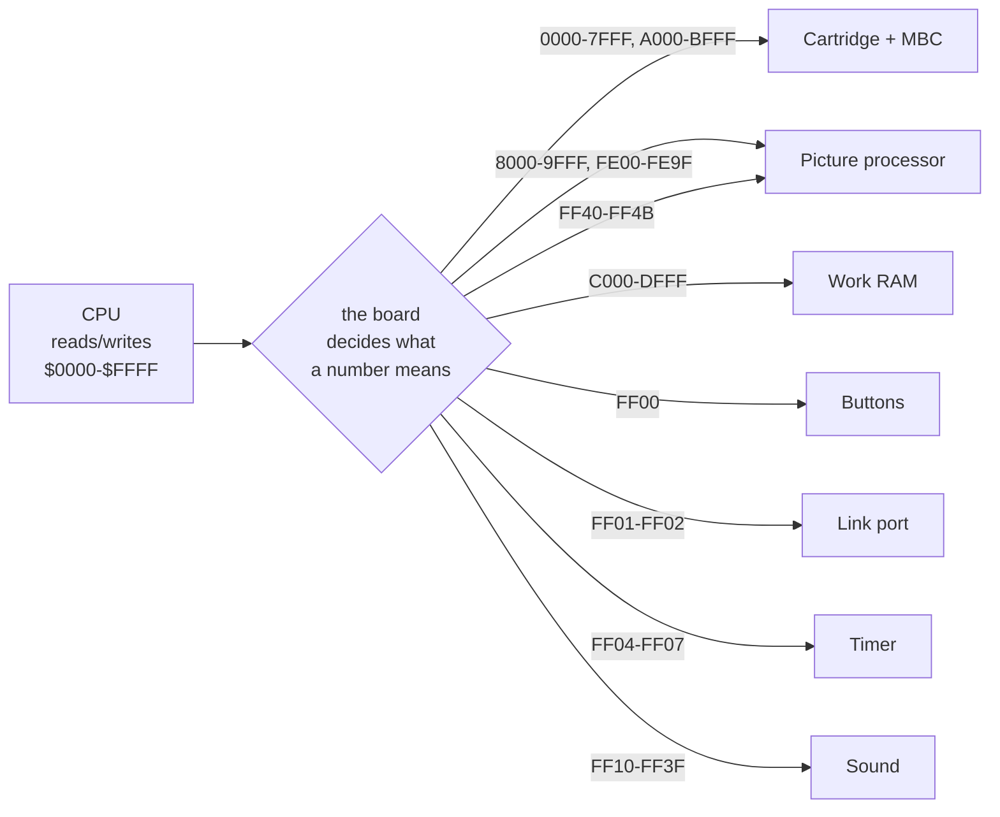
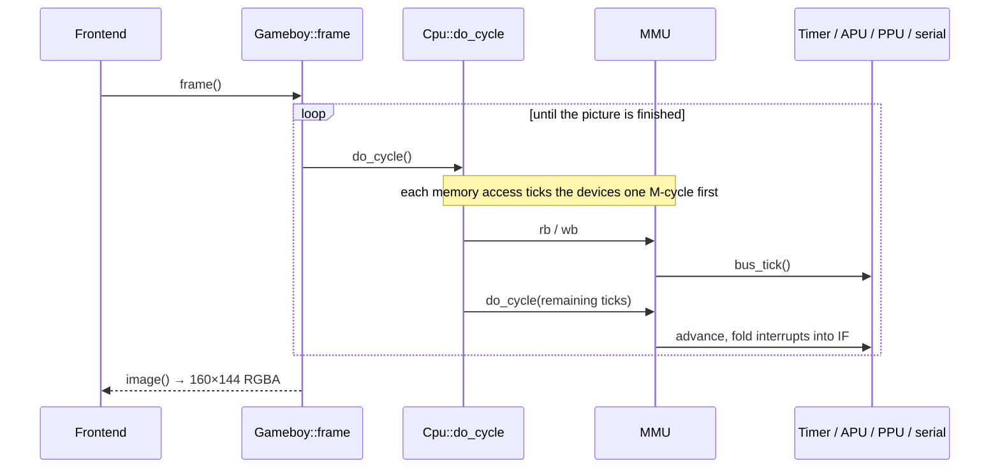

# The machine, chip by chip

> What each piece of a Game Boy actually is, what makes each one hard to imitate, and where
> ours lives. Every section ends by handing you to the page that goes deeper — this one is
> for understanding the machine, not for reading the code.
>
> [What an emulator is](README.md) · [where exact begins](accuracy.md) ·
> [how we know it is right](test-roms.md) · [the FPGA question](fpga.md)

---

<!-- codemap:asof -->
> 🗺️ **Code map** · source links target [`main`](https://github.com/Alchemy86/TerminalGB/tree/main); line references documented as of commit [`72a5454`](https://github.com/Alchemy86/TerminalGB/tree/72a545438d2a2422f1b55c3452032d76259993be) · regenerate with `make docs-links`, verify with `make docs-check`.

## The board, before any of the chips

Start with the wiring, because it is the part people skip and it is the part that explains
everything else.

The processor has sixteen address lines and eight data lines. That is the whole of its
vocabulary: it can name any of **65,536** locations and move one byte to or from it. It has
no idea what a screen is, no concept of sound, and no way to ask a button whether it is
pressed. What it has is a number.

The board turns that number into a destination. Some ranges land on real memory. Some land on
the cartridge. And a narrow band near the top — `$FF00`–`$FF7F` — lands on **the chips**,
where the byte you write is not stored at all but is *interpreted*: writing to `$FF40` turns
the screen on, writing to `$FF46` starts a 160-byte block transfer that takes 160 cycles and
locks the processor out of a region while it runs, and writing to `$FF04` — whatever value
you write — resets a counter to zero.

That is the single most important idea in this whole section, so it is worth stating flatly:

> **A memory-mapped register is not memory. It is a doorbell wired to a chip.** Reading one
> may return something the program never wrote. Writing one may have an effect and store
> nothing.

The joypad register is the cleanest example on the machine, and it is only nine lines of
code — see [Buttons](#buttons--nine-lines-that-explain-memory-mapped-io) below.

**Ours:** [`src/mmu/mod.rs`](../../src/mmu/mod.rs) —
`MemoryManagementUnit::rb` and `wb` are one big `match` on the address, and essentially
every quirk of the machine's memory map lives in that match: echo RAM mirroring, the
prohibited region reading `$FF`, `IF`'s top three bits reading back set. Deep dive:
**[MMU](../components/mmu.md)**.



---

## The processor — a loop over instructions

The chip is a **Sharp LR35902**, usually called SM83 after its core. It is often described as
"a Z80" and it is not; it is its own design, sharing some of the Intel 8080's instruction
encoding, dropping the Z80's index registers and alternate register set, and adding
instructions the Z80 never had.

What it holds is small enough to list: seven 8-bit registers (`A`, `B`, `C`, `D`, `E`, `H`,
`L`), a flags byte, a 16-bit stack pointer, and a 16-bit program counter. Most of the pairs
can be used as one 16-bit register. That is all the state there is, apart from a flag
saying whether interrupts are allowed.

And what it does, forever:

1. **Fetch.** Read the byte at the program counter, then advance the counter.
2. **Decode.** That byte *is* the instruction. There are 256 of them, plus a second bank of
   256 reached through the prefix byte `$CB` (the bit-manipulation instructions).
3. **Execute.** Do the thing — add two registers, copy a byte, jump somewhere, push the
   return address and call a subroutine.
4. **Charge the clock** for however many cycles that instruction took, and go round again.

Two details make this concrete rather than hand-wavy.

**A cycle here means an *M-cycle*, four ticks of the crystal.** The Game Boy's bus does one
memory access per M-cycle, so an instruction's cost is very nearly a count of how many times
it touched memory. `NOP` is 1. `LD B, n` — load a constant — is 2, because it had to fetch
the constant. `CALL nn` is 6: two bytes of address, two bytes of return address pushed, and
internal work.

**Decode and execute are fused in our core.** [`Cpu::operation`](../../src/cpu/core.rs) reads
the opcode and drops straight into a 256-arm `match` where each arm calls the routine and
evaluates to the M-cycle count:

```rust
match op {
    0x00 => 1,                                  // NOP
    0x01 => { ld::bcnn(self);   3 }             // LD BC, nn
    0x04 => { data::incr_b(self); 1 }           // INC B
    …
}
```

This is fast, and it has a real cost: **there is no decode step to ask.** A disassembler has
to be written separately rather than reusing the decoder, which is exactly what
[`docs/debugging.md`](../debugging.md) records as the constraint on our debug tooling.

It also means an instruction's memory accesses all happen *inside* one `match` arm, with no
natural place to advance the rest of the machine between them. That problem, and how it is
solved, is the subject of [the next page](accuracy.md#the-first-crack-a-memory-access-is-a-moment-in-time).

<details>
<summary><b>Another way to build the same chip — and what it buys</b></summary>

[mGBA](https://github.com/mgba-emu/mgba) (MPL-2.0, the same licence as this repository)
takes the other approach: its SM83 core is an explicit **per-cycle state machine**.
`enum SM83ExecutionState` in `include/mgba/internal/sm83/sm83.h` names the states —
`SM83_CORE_FETCH`, `SM83_CORE_MEMORY_LOAD`, `SM83_CORE_MEMORY_STORE`, `SM83_CORE_READ_PC`,
`SM83_CORE_STALL`, `SM83_CORE_IDLE_0/1` — and `_SM83Step` in `src/sm83/sm83.c` advances
exactly one M-cycle per call, performing **at most one bus operation** in it:

```c
static void _SM83Step(struct SM83Core* cpu) {
    cpu->cycles += cpu->tMultiplier;
    enum SM83ExecutionState state = cpu->executionState;
    cpu->executionState = SM83_CORE_IDLE_0;
    switch (state) {
    case SM83_CORE_FETCH:
        …
        cpu->bus = cpu->memory.cpuLoad8(cpu, cpu->pc);
        cpu->instruction = _sm83InstructionTable[cpu->bus];
        ++cpu->pc;
        break;
    case SM83_CORE_MEMORY_LOAD:
        cpu->bus = cpu->memory.load8(cpu, cpu->index);
        break;
    …
```

The advantage is that "where in the instruction are we?" is a first-class value, so nothing
special is needed to interleave devices correctly. The cost is that every instruction becomes
a small program over states, and the whole core is written in that idiom.

Neither design is wrong. They put the same complexity in different places, and knowing that
both exist is most of what "cycle accuracy" means as an engineering choice rather than a
slogan.

</details>

**Ours:** [`src/cpu/`](../../src/cpu) — `core.rs` (dispatch, interrupts, `HALT`, `STOP`),
`registers.rs`, and `ld.rs` / `data.rs` / `misc.rs` / `stack.rs` for the instruction
families. Deep dive: **[CPU](../components/cpu.md)**. Measured: the timing fixes are in
[measured/timing.md](../measured/timing.md).

### Interrupts — how a chip gets the processor's attention

Devices cannot call the processor. What they can do is set a bit.

Each device raises a flag; the board ORs those flags into one register, `IF` at `$FF0F`; the
program decides which of them it cares about in `IE` at `$FFFF`; and before each instruction
the processor checks `IF & IE`. If anything is set and interrupts are enabled, it pushes the
program counter and jumps to a fixed address — `$40` for the picture processor's VBlank,
`$48` for its status line, `$50` for the timer, `$58` for the link port, `$60` for the
buttons. Lowest bit wins, so that list is also the priority order.

The interesting part is that dispatch is not instantaneous. It takes **five M-cycles**, laid
out the way the silicon does it — two idle cycles, the high byte of the return address
pushed, the low byte pushed, then the vector fetched — and the vector is chosen *between the
two pushes*, from `IF & IE` as they stand at that moment. A program that arranges for its
own push to overwrite `IE` can therefore cancel or redirect the interrupt it is in the middle
of taking. Two Mooneye ROMs measure exactly that
([measured/timing.md § interrupt dispatch](../measured/timing.md#interrupt-dispatch-is-five-m-cycles-and-picks-its-vector-halfway-through)).

---

## The picture processor — the hard one

The PPU (Nintendo's documentation calls it that; the code here calls it the GPU for
historical reasons) drives a **160 × 144** LCD, four shades of grey, at 59.7275 Hz.

It is not a framebuffer device. There is no bitmap of the screen anywhere in the machine —
144 × 160 pixels at 2 bits each would be 5,760 bytes and the console only has 8 KB of video
memory to hold *everything*. Instead the PPU composes each line, live, from three sources:

- a **background** — a 32 × 32 grid of 8 × 8 tile references, scrolled by two registers, so
  the visible screen is a 20 × 18 window onto a larger map that wraps;
- a **window** — a second map that is not scrolled, drawn over the background from a
  programmable corner; used for status bars and text boxes;
- up to 40 **objects** (sprites), 8 × 8 or 8 × 16, positioned freely, each with its own
  palette, flip flags and a priority bit deciding whether it goes over or under the
  background.

It walks 154 scanlines, of which 144 are visible and the last 10 are the vertical blanking
period, and each line takes 456 ticks of the crystal divided into three modes: **80 ticks**
scanning object memory to find which objects touch this line, **172–289 ticks** actually
pushing pixels, and the rest idle. The program can read which mode it is in, and take an
interrupt on any of them, which is how games do mid-screen effects.

Everything that makes the PPU hard follows from one fact: **it is reading its registers while
it draws.** Change the background palette in the middle of a line and hardware changes the
colours of the pixels *after* that point and not before. Change the scroll register and the
rest of the line shifts. Those are not exotic; they are how a game splits the screen into a
scrolling playfield and a stationary status bar.

This project therefore has **two picture engines**, switchable at run time
([`src/gpu/mod.rs`](../../src/gpu/mod.rs)):

- **`standard`** draws a whole scanline in one go when the line ends. It reads each register
  exactly once per line, so a mid-line write is invisible to it by construction. It is the
  default and it is right for essentially every commercial game.
- **`identical`** is the real pipeline: a fetcher reading one tile every six ticks, an 8-deep
  queue, and one pixel shifted out per tick with the palette applied *at the moment it
  leaves the queue*. Mid-line writes land exactly where hardware puts them. Measured on this
  machine it costs **2.11×** the standard engine.

**Ours:** [`src/gpu/mod.rs`](../../src/gpu/mod.rs) (mode cycle, registers, whole-line
renderer) and [`src/gpu/fifo.rs`](../../src/gpu/fifo.rs) (the per-dot pipeline). Deep dives:
**[PPU](../components/ppu.md)** · **[picture modes](../picture-modes.md)** ·
**[measured/ppu.md](../measured/ppu.md)** · **[Mealybug, measured](../mealybug.md)**.

---

## The sound chip — four voices and a metronome

Four channels, mixed in hardware, all of them counters rather than samples: two **square
waves** with adjustable duty cycle (one of them with a frequency sweep unit), one **wavetable**
channel playing a 32-entry, 4-bit waveform the program uploads into 16 bytes of RAM, and one
**noise** channel built from a linear-feedback shift register — a shift register that feeds
bits of itself back through an XOR, producing a sequence that does not repeat for a long time
and sounds like static.

The thing worth knowing is the **frame sequencer**: a 512 Hz metronome that clocks the
envelopes (volume ramps), the length counters (note cut-off) and the sweep. It is not free
running from its own oscillator — it is derived from the same system counter the timer uses,
firing on a falling edge of one of that counter's bits. Which means writing to the divider
register `$FF04`, whose *documented* purpose is resetting a timer, also moves the phase of
every note that is playing. Programs rely on this.

**Ours:** [`src/sound.rs`](../../src/sound.rs) — synthesis is event-driven and band-limited
through `blip_buf`, then handed to `cpal` natively or to the Web Audio API in a browser. One
thing to know before measuring anything: `Sound::do_cycle` returns immediately when no player
is installed, so a test harness that forgets to attach one has **no sound chip at all**, not
a quiet one. Deep dives: **[APU registers](../components/apu.md)** ·
**[audio pipeline](../audio.md)** · **[measured/apu.md](../measured/apu.md)**.

---

## The timer — one counter, and why that matters

Four registers: `DIV`, `TIMA`, `TMA`, `TAC`. The obvious way to build it is two counters — a
free-running one behind `DIV`, and a private divisor for `TIMA` reset every *N* cycles.

That model is wrong, and it is wrong in a way test ROMs are built to catch. On the die there
is **exactly one** 16-bit counter. `DIV` is its top byte. `TIMA` counts **falling edges** of a
single bit of that same counter, selected by `TAC`, ANDed with `TAC`'s enable bit
([`src/mmu/timer.rs:75`](https://github.com/Alchemy86/TerminalGB/blob/main/src/mmu/timer.rs#L75) is the tap table: bits 9, 3, 5, 7).

Three behaviours fall out for free once you build it that way, and have to be special-cased —
or missed — if you do not:

- Writing *any* value to `DIV` clears all sixteen bits. If the tapped bit happened to be high,
  clearing it **is** a falling edge, so `TIMA` increments. Resetting the divider can advance
  the timer.
- Turning the timer off with `TAC` while its tapped bit is high is also a falling edge, with
  the same result.
- The increment phase is absolute. `TIMA` steps 1024 ticks after a `DIV` write, not 1024
  ticks after you configured `TAC`.

This is the whole thesis of accurate emulation in one peripheral: **model the circuit and the
quirks are free; model the specification and you will be writing special cases forever, and
still missing some.** With the circuit modelled, all thirteen of Mooneye's timer tests pass.

**Ours:** [`src/mmu/timer.rs`](../../src/mmu/timer.rs). Deep dives:
**[Timer](../components/timer.md)** · **[measured/timing.md](../measured/timing.md)**.

---

## The link port — the half no test ROM can reach

Two bytes: `SB` holds the byte being shifted, `SC` starts a transfer and says who supplies the
clock. Eight shift-clock edges later the byte is gone and another has arrived, and an
interrupt fires. That is the entire interface, and the Game Boy Printer, the Pokémon trade
cable and every link battle are built on it.

Its peculiarity as an emulation problem is that **it is the one part of the machine whose
correctness needs two machines to observe.** A single console clocking a transfer into thin
air receives `$FF` and completes normally; every test ROM in every suite runs alone, so none
of them can tell a correct link port from a stub. Everything we know about ours was measured
by running two cores against each other, or against another program over a socket.

It is also the channel most test ROMs *report* through: Blargg's ROMs write "Passed" or
"Failed" to `SB` a byte at a time, which is why a serial callback is the cheapest way to build
a headless test harness.

**Ours:** [`src/mmu/serial.rs`](../../src/mmu/serial.rs) plus
[`src/link.rs`](../../src/link.rs) (two cores, one cable) and
[`src/bgblink.rs`](../../src/bgblink.rs) (BGB's protocol over TCP). Deep dives:
**[Serial](../components/serial.md)** · **[measured/serial.md](../measured/serial.md)** ·
**[the link cable](../link-cable.md)**.

---

## Buttons — nine lines that explain memory-mapped I/O

If you read one piece of code from this page, read this one. Input is usually described as
"translating a modern keypress into the byte pattern the game expects", which is right — and
here is the byte pattern, in full.

There is **one** register, `$FF00`. Eight buttons, four bits. It works because the buttons
are wired as a 2 × 4 matrix: the program pulls one of two *select* lines low, then reads the
four *result* bits to find out about that half of the matrix.

```rust
fn update(&mut self) {
    let old_values = self.data & 0xF;
    let mut new_values = 0xF;

    if self.data & 0x10 == 0x00 {  // direction line selected
        new_values &= self.row0;
    }
    if self.data & 0x20 == 0x00 {  // button line selected
        new_values &= self.row1;
    }

    if old_values == 0xF && new_values != 0xF {
        self.interrupt |= 0x10;    // something went from released to pressed
    }

    self.data = (self.data & 0xF0) | new_values;
}
```

— [`src/input.rs:156`](https://github.com/Alchemy86/TerminalGB/blob/main/src/input.rs#L156)

Four things a newcomer should take from those nine lines:

1. **Everything is active low.** A `1` bit means *not pressed*. That is not a convention
   someone chose to be difficult; it is what the hardware does, because a pressed button
   connects a line to ground. Hence `keydown` clearing a bit and `keyup` setting it.
2. **Selecting neither row reads `$0F`** — all released, whatever is physically held. Selecting
   *both* ANDs them together, so the program cannot tell Up from A. Real games select one at a
   time, and the register is genuinely ambiguous if you do not.
3. **The interrupt is an edge, not a level.** It fires on the transition from "nothing in the
   selected row" to "something", which means changing the *selection* can raise a joypad
   interrupt with nobody touching the console.
4. **Reading it does not tell you what was written.** The top nibble is the program's own
   selection; the bottom nibble is the world answering back.

That last point is the doorbell idea from the top of the page, made concrete in one byte.

**Ours:** [`src/input.rs`](../../src/input.rs). A frontend calls `Gameboy::keydown` /
`keyup`; anything driving the machine from outside (a plugin, the MCP server, the agent)
goes through `InputQueue`, which schedules presses **in frames**, because a frame is the
granularity a game samples input at. Deep dive: **[Joypad](../components/input.md)**.

---

## The cartridge — a chip that ships with the game

The last piece is not in the console at all. The address bus has room for 32 KB of cartridge
ROM, and games are up to 8 MB. The gap is closed by a **memory bank controller**: a small
chip inside the cartridge, wired to the same address lines, that watches for writes to what
looks like ROM. Since ROM cannot be written, those writes are free to mean something else —
and what they mean is "swap which slab of the cartridge appears in the upper 16 KB from now
on".

So a Game Boy game is a program that periodically writes to its own read-only memory in order
to change what its own read-only memory contains. There are several such chips (MBC1, 2, 3,
5, plus plain no-mapper cartridges), each with its own register layout, and some carry extra
hardware: battery-backed save RAM, a **real-time clock** that keeps running with the console
switched off, a rumble motor.

Two emulation lessons live here and neither is about accuracy:

- **A save file is somebody's saved game.** Persisting it only in a destructor means never
  persisting it at all — a window frontend that exits via `process::exit`, a `SIGTERM`, or a
  build with `panic = 'abort'` all skip destructors. Cartridge RAM is written out on a timer
  during play instead, atomically.
- **A cartridge is untrusted input.** Its header bytes choose the mapper, the ROM size and
  the RAM size, and a corrupt or bootleg one can nominate values that divide by zero or index
  off the end of an array. In a build that aborts on panic, that is not a bug report — it is
  the loss of the player's save.

**Ours:** [`src/mbc/`](../../src/mbc) — one file per mapper, plus `battery.rs` and `rtc.rs`.
Deep dives: **[Cartridges](../components/mbc.md)** ·
**[measured/cartridges.md](../measured/cartridges.md)**.

---

## Putting it back together



The `bus_tick` in the middle of that diagram is the difference between the naive loop on the
[previous page](README.md#the-loop-and-what-it-hides) and a machine that passes timing tests.
It is the subject of [the next one](accuracy.md).
