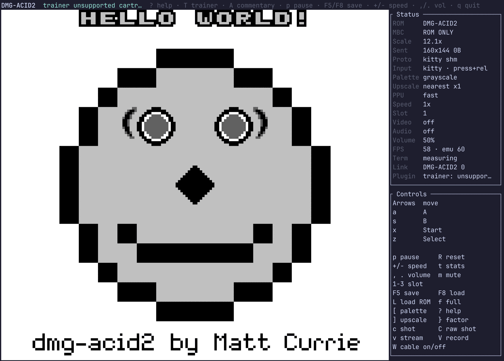

# The link cable — two consoles, one wire

> Code: [`src/link.rs`](../src/link.rs) · [`src/link/peer.rs`](../src/link/peer.rs) ·
> [`src/mmu/serial.rs`](../src/mmu/serial.rs) · [`examples/link_two.rs`](../examples/link_two.rs) ·
> [`examples/gen2_timecapsule.rs`](../examples/gen2_timecapsule.rs)
> Related: [`docs/plugins.md`](plugins.md) (the *impersonating* link partner),
> [`docs/gen1/link-from-outside.md`](gen1/link-from-outside.md).
> Conformance record: [`docs/conformance-notes.md`](conformance-notes.md), 2026-08-14 —
> including why **no public test suite can see half of the link port**.

**Start a second copy of the emulator and the cable is already plugged in.**
Nothing to arm, nothing to configure, no flag. Two games running on one machine
find each other and link, the way plugging a real cable in does.

<p align="center">
  
</p>

<p align="center"><em>Two instances of the emulator, linked automatically. The
<code>Link</code> row names the cartridge on the other end; <code>W</code> unplugs the cable
and plugs it back in. (Both consoles here are the MIT
<a href="../third_party/dmg-acid2/">dmg-acid2</a> test ROM.)</em></p>

There are three ways to be the far end of a Game Boy's link port, and this
repository now has all of them.

**Impersonation** — [`plugins/gen1-link`](../plugins/gen1-link) speaks Pokémon
Red/Blue's trade protocol from Rust, convincingly enough that the real game
completes a real trade with it. That is the right answer when you own one
cartridge, and it can only ever know the protocols somebody wrote down.

**Relaying over a network** — [`docs/bgb-link.md`](bgb-link.md). The same wire,
with the far end on a TCP socket speaking BGB's link protocol: another
emulator, another copy of this one, or — through an existing MIT bridge tool —
**a real Game Boy** on somebody else's link adapter. It uses the same
`Serial::link_answer_master` / `link_clock_slave` half this page built, and
adds the one thing a local cable never needs: waiting.

**Relaying in one process** — this page. Two whole cores, joined by a cable
that knows nothing about any game. Whatever the two programs agree on works, because both ends are
the genuine article: a Gen 1 trade, a Gen 1 link battle, the Gen 1 ↔ Gen 2 Time
Capsule, Tetris, or something nobody has looked at.

It comes in two shapes, and every option below is an alternative to every
other, because a Game Boy has one link port:

| key | what it does |
|---|---|
| `link = auto` (default) | Find other instances **on this machine** and pair with one. See §5. |
| `link = off` | Never link. For somebody running several games who does not want them finding each other. |
| `link = <path to a ROM>` | Boot a **second console inside this process** and wire the two together — deterministic and scriptable, which is what the tests and `examples/link_two.rs` use. |
| `link_net = host:port` | Put the port on a **TCP socket** instead, reaching another machine entirely. Different page: [`docs/bgb-link.md`](bgb-link.md). |

---

## 1. The hardware, and the half that was missing

From Pan Docs, *Serial Data Transfer (Link Cable)*:

* **`SB` (`$FF01`) is a shift register, not a mailbox.** Both consoles present
  their `SB` to the wire at once; after eight clock edges each holds what the
  other started with. There is no direction — a transfer is always an *exchange*.
* **`SC` (`$FF02`)** bit 7 is the transfer-start flag; bit 0 selects the shift
  clock, **1 = internal** (this console drives it — "master") and **0 = external**
  (the other console drives it — "slave").
* A master's transfer runs on its own clock, 8192 Hz on a DMG, so eight edges is
  **4096 T-cycles ≈ 1 ms**, and it **completes whether or not anything answers** —
  with `$FF` shifted in, because an unplugged cable's data line idles high.
* A slave's transfer **never** completes on its own. With no cable it waits for
  ever.
* On the eighth edge *both* consoles clear `SC` bit 7 and request the serial
  interrupt (`IF` bit 3). Agreeing on that instant is the whole of staying in sync.

Before this work `Serial::wb` acted on `SC = $81` and **ignored `SC = $80`
entirely**. That is not a bug for one console on its own — nothing was ever going
to clock it — and it is exactly the half a second console needs. Adding it was the
substantive change; the cable on top is small.

`Serial` now exposes the port as a *cable* sees it rather than as the game does:
`LinkRole` (`Idle`/`Master`/`Slave`), the byte in the shift register, a
per-transfer sequence number, and two operations — answer a master, clock a slave.

## 2. Staying in sync: one process, one loop

**Both cores run in the same process and are stepped by the same loop.**
`LinkCable::run_frame` pays each core one instruction at a time, always feeding
whichever is behind by cycle count, so the two never differ by more than a single
instruction (~24 T-cycles) against 4096 T-cycles per byte. There is no IPC, no
wall clock and no negotiation, so there is nothing to drift.

Each core is paid exactly `FRAME_TICKS` (70,224 T) per `run_frame` rather than run
to its own PPU frame boundary as `Gameboy::frame` does. Two consoles cannot both
stop on their own boundary without one standing still while the other catches up,
and standing still is precisely when a link drops a byte.

The cable does **not** own the two consoles — it is handed both on every call — so
a driver keeps whatever arrangement suits it.

```rust
let mut cable = LinkCable::new();
loop { cable.run_frame(&mut a, &mut b); }
```

Servicing happens between every instruction:

1. A console starts a master transfer (`SC = $81`); the cable notices.
2. If the other end is a slave, they are **paired**: both bytes are latched and
   the master is told what it will shift in. The master still runs its full eight
   edges, so the game sees hardware timing, not an instantaneous exchange. A slave
   that arms *after* the master started is still in time — it has the rest of the
   ~1 ms window.
3. When the master's shift register runs out the cable clocks the slave: the
   master's byte lands in the slave's `SB`, its start flag clears and its serial
   interrupt is requested. Both consoles now agree.

Cases the cable deliberately does not paper over, because hardware does not
either: **two masters** (both shift in `$FF`, as two consoles fighting over the
clock line would) and **two slaves** (nothing happens, for ever — every link
protocol's handshake exists to break exactly this).

## 3. Two readings of ambiguous hardware, both forced by measurement

### A torn byte keeps its data

When the other console arms `SC = $80` and rewrites `SC` before the eighth edge
the exchange is *torn*. **The master keeps the byte that was latched**; only the
slave half is abandoned, which is what the slave asked for by rewriting the
register.

The first version did the opposite — voided the byte and faulted both machines as
a desync — and then faulted them 898 frames into a Blue-to-Blue trade, before the
two consoles had finished saying hello. Gen 1's `.establishConnectionLoop`
(pokered `engine/link/cable_club_npc.asm`) does this, every frame, for as long as
it takes to find a partner:

```
	ld a, ESTABLISH_CONNECTION_WITH_EXTERNAL_CLOCK  ; $02
	ldh [rSB], a
	ld a, SC_START | SC_EXTERNAL                    ; $80   <- slave, offering $02
	ldh [rSC], a
	...                                             ;        ~100 T-cycles later
	ld a, ESTABLISH_CONNECTION_WITH_INTERNAL_CLOCK  ; $01
	ldh [rSB], a
	ld a, SC_START | SC_INTERNAL                    ; $81   <- master, sending $01
	ldh [rSC], a
	call DelayFrame
```

Reading `$02` out of that hundred-cycle window is the **only** way the two
consoles ever agree on who drives the clock. `USING_EXTERNAL_CLOCK` and
`USING_INTERNAL_CLOCK` share their values with the `ESTABLISH_CONNECTION_WITH_*`
bytes (`$01`/`$02`, and note they are the opposite way round), so the reply *is*
the role assignment: the console that reads `$02` becomes the clock master and
the one that reads back `$01` follows. A cable that voids a torn byte can never
connect two Game Boys at all.

### The fail-safe is fault propagation, not byte accounting

A desynced trade must never reach a save file, and the guard is the one the crash
detector already uses: `Gameboy::report_fault`, which poisons the battery so the
save is not written again this session.

But the *trigger* is not "a byte went missing" — that fires all through a healthy
handshake, as above. It is **one console faulting**, at which point the cable
faults the other too. Half an exchange is exactly the situation where the
*surviving* console's save is the dangerous one: a Gen 1 trade removes a Pokémon
from one party and adds it to the other, and a crash between those two writes
leaves whichever side is still running holding a file the player would rather not
keep.

Byte-level desync detection is left to the games, which are good at it —
`Serial_ExchangeBytes` re-sends its first byte until it sees the `$FD` preamble
come back. The cable counts `transfers` / `unanswered` / `torn` and shows them, so
a link that is quietly doing nothing is visible.

## 4. Phase — why `--skew` is not a workaround

Two real consoles never share a crystal and two real players never press A on the
same frame, so their handshakes drift past each other until they interleave. **Two
emulated cores stepped by one loop have no drift at all.** Started together they
stay in phase for ever: both master at the same moment, each finds the other deaf,
and the handshake can never resolve. That is the price of determinism, not a cable
bug, and the cure is to start one console a little ahead of the other.

Measured, Blue to Blue, 2500-frame budget:

| skew (frames) | outcome |
|---|---|
| 0 | never connects — `hSerialConnectionStatus` stays `$FF` on both |
| 1, 2, 3, 5 | connects; A internal (`$02`), B external (`$01`) |
| 8, 13, 21, 34 | connects; roles swap — B internal, A external |

Any non-zero skew works, and which console ends up driving the clock depends on
it. Nothing downstream should assume a role: read `hSerialConnectionStatus`.

## 5. Live by default: instances that find each other

**A cable you have to arm is not a cable.** Gen 1's Cable Club attendant
*checks the link before she lets you through* — `CableClubNPC`
(pokered `engine/link/cable_club_npc.asm`) spends 90 frames handshaking and then
says "This area is reserved for 2 friends who are linked by cable" if nothing
answered. For her to see a partner, the serial port has to be genuinely live at
the hardware level while the player is standing at her desk. A link that only
wakes up once somebody asks for it is exactly the link she turns away.

So `link = auto` is the default, and [`src/link/peer.rs`](../src/link/peer.rs)
joins two **processes**.

### Discovery

Each instance looks in a rendezvous directory —
`$XDG_RUNTIME_DIR/terminalgb/link`, else `/tmp/terminalgb-link-<uid>`;
`$GB_LINK_DIR` overrides, which is how the tests get a private one. It tries to
connect to every socket it finds; the first that answers is its partner. If none
does, it creates its own and waits. A socket that refuses a connection belonged
to an instance that has since died, and is swept — `Drop` is not a shutdown hook
in this codebase, so leftovers are expected.

The moment two pair, both **stop advertising**. That is what makes three
instances terminate rather than loop: a socket still listed is a socket a third
instance keeps connecting to only to be told it is busy, and to come back and
try the same one again.

### What happens with three

**A cable has two ends, so instances pair up two at a time, in the order they
start.** A third finds both ends taken, creates its own socket, and waits — so
it links to the *fourth* instance, not to either of the first two. That is the
honest hardware analogy: a second cable, not a four-player adapter, which this
emulator does not model.

The consequence to know: **pairing is by arrival order, not by cartridge.**
Start Blue, then Blue, then Gold and the two Blues share the cable. Put
`link = off` in the config of the one that should not take part, or press `W`.

### Turning it off

`W` in a game unplugs the cable and plugs it back in. Unplugging is a *real*
disconnect — the far console sees a clean goodbye rather than a crash, so
neither save is poisoned — and plugging back in runs discovery again, so it
finds whoever is available now rather than insisting on the console it had
before. `link = off` in `config.toml` keeps an instance out of it entirely: no
socket, no rendezvous entry, and one `matches!` per service call.

### Seeing it

A second console must never be running invisibly, which is the same rule an
attached plugin follows. Both places are fed by one `link_summary`, so they
cannot drift:

* the **Status** panel's `Link` row — `waiting`, `POKEMON GLD 1552`, `off`,
  `gone`, with a `*` while bytes are actually moving;
* a **`LINK` line in the trainer panel**, which is what you watch while
  playing. It separates the three states that change the answer to "should I
  walk into the Cable Club?" — *no one connected*, *connected to RED · POKEMON
  BLUE*, and *connected to RED — TRADING*. It degrades through the same
  `clamp_line` every other panel row uses, and the label survives the clip.

The partner's name comes from the frontend, not the core: the cable relays
bytes and has no business knowing what a trainer name is, so the trainer plugin
supplies it when it recognises the cartridge (`wPlayerName`, pokered
`ram/wram.asm`) and nothing is sent otherwise.

### Holding the transfer, which is what makes it work at all

Both emulators pace themselves to 59.7275 Hz, and each one emulates a whole
frame in a fraction of a millisecond and then **sleeps for the rest of it**. Two
such bursts need not overlap at all. A 4096-cycle transfer that completed on
schedule would therefore shift in `$FF` every single time and no link would ever
work.

So a master transfer is **held** until the far console answers
(`Serial::link_hold`). This costs the game nothing it can observe: a program
waiting on a transfer is already spinning on `SC` bit 7 or on the serial
interrupt (`Serial_ExchangeByte`, pokered `home/serial.asm`), and the timer, PPU
and APU all keep running underneath it. When the two processes genuinely run
side by side — the normal case on any multi-core machine — the answer arrives in
microseconds and nothing is held for long.

The socket is polled every 256 T-cycles rather than every instruction; a `read`
per instruction would be about a million syscalls a second to learn nothing. The
*role* check is a couple of field reads and does happen every instruction, so
the hundred-cycle window Gen 1's handshake turns on is never missed.

### Three bugs that cost 409 bytes, and how they looked

The first cross-process Blue-to-Blue trade **completed** with 409 lost bytes,
and it looked fine. The received Pokémon read `MMER` (OT `D`) instead of
`GLIMMER` (OT `RED`) — because a lost byte arrives as `$FF`, `$FF` is not a
character, and a decoder that skips unknown bytes turns corruption into
something plausible. Check the bytes, not that *something* arrived.

1. **Both consoles mastering deadlocked.** Each held its shift register waiting
   for the other; only the timeout broke it, and every timeout is a lost byte.
   Gen 1 masters on *both* consoles every frame until the roles settle, so this
   was the ordinary case, not an exotic one. A console that is itself mastering
   now answers "nobody listening" immediately.
2. **A timed-out offer was answered later.** The far console armed its port
   after we had given up, spending one of *its* bytes on a transfer nobody was
   listening for, and sliding its whole stream by one. `Kind::Abort` retracts a
   transfer we have abandoned.
3. **A timeout was counted as benign.** It is `torn` now, and it **faults**: the
   connection is alive, so the two consoles are still exchanging and have simply
   stopped agreeing about what. Pausing one emulator in the middle of a trade
   lands here, and that is correct — the trade really is ruined.

### Failing safe

Two guards, and they answer different questions:

* **A peer that vanishes while the cable is carrying bytes** faults both
  consoles, so neither writes its battery save again. Half a trade leaves the
  *survivor* holding the dangerous file. A peer that says goodbye, or that
  vanishes while the cable has been idle, just unplugs.
* **Nothing faults over a peer it never handshook with.** A connection that dies
  before saying hello is a crowded rendezvous, not a crashed partner — and
  faulting there would poison the save of a console that was never linked. That
  is why a paired instance drains its backlog with `Busy` before letting its
  listener go.

**Two instances of one cartridge write the same `.sav`.** It is the first thing
anybody tries, and it is how a save gets destroyed — both consoles autosave over
each other. The handshake carries a key derived from the save path and the
frontend says so; the cable still works, because that is the user's call.

## 6. Running it

```
cargo run --release --features image,plugin-gen1-link,plugin-trainer \
    --example link_two -- \
    --rom  ~/roms/blue.gb \
    --save <cable-club-fixture.sav> \
    --trade --skew 3 --shots /tmp/shots
```

* `--rom` / `--rom-b` — the two cartridges (`--rom-b` defaults to `--rom`).
* `--save` / `--save-b` — save fixtures, **copied** into `target/link-two/{a,b}`
  along with the ROM. The MBC writes `<rom>.sav` beside the ROM it was given, so
  nothing in `~/roms` is ever opened for writing.
* `--trade` — drive both consoles into the Cable Club and trade.
* `--skew N` — start console B N frames ahead. See §4; **1 or more, never 0**.
* `--shots <dir>` / `--verbose` — see below.

### Presentation: side by side, headless

Both consoles are always visible. `--shots` writes a single PNG containing **both**
screens; `--verbose` prints both tilemaps decoded as text, which is what a Gen 1
game's screen really is.

That is a deliberate choice over a two-pane terminal frontend. The terminal render
path transmits **one** picture under one image id, and the whole of
[`docs/terminal-render.md`](terminal-render.md) is about not making that more
expensive; a second live picture is real work with real regression risk. The link
is the deliverable, and a side-by-side capture proves both machines are running
without putting a finger anywhere near the frontend.

### Which seat, and why the bot does not choose

One bot drives both consoles. Which Game Boy on the Trade Center table is yours is
**not a choice** — `CableClubLeftGameboy` returns immediately unless this console
took the internal clock, and wants the player facing **right**;
`CableClubRightGameboy` mirrors it for the external clock and wants **left**
(pokered `engine/pokemon/bills_pc.asm`). The game has already warped the player
next to the correct console (`LoadSpecialWarpData` picks `TradeCenterPlayerWarp` or
`TradeCenterFriendWarp` off the same byte), so the bot reads
`hSerialConnectionStatus` (`$FFAA`, asserted by name in
`engine/link/cable_club_npc.asm`) and faces the right way. Pressing A at the wrong
console is a silent no-op that looks exactly like a broken link.

## 7. What was measured — Gen 1 ↔ Gen 1

Two Pokémon Blue instances, from copies of the captain's cartridge and a Cable
Club save fixture, with distinct parties patched in:

```
cable: 1552 transfers, 0 unanswered, 0 torn

console A party:
  RATTY    species 0xa5 Lv8  DVs (15,15,15,15)  OT RED  (id 4242)
  ROCKY    species 0x6a Lv11 DVs (3,4,5,6)      OT BLUE (id 1717)
console B party:
  FLAP     species 0x24 Lv7  DVs (15,15,15,15)  OT BLUE (id 1717)
  GLIMMER  species 0x94 Lv10 DVs (14,10,10,10)  OT RED  (id 4242)
           <- would be SHINY if traded to Gen 2
```

GLIMMER (an Abra built with the shiny DV pair) crossed the wire and the trainer
plugin's `derived::shiny_if_traded` still calls it shiny on the far side — the
verdict is that plugin's, not a second copy of the rule. Both `.sav` files on disk
pass the game's own `CalcCheckSum`, and `~/roms` is byte-identical.

---

## 8. Gen 1 ↔ Gen 2: the Time Capsule

**Gen 1 ↔ Gen 2 does not use the ordinary link trade.** Gold/Silver's own trade
receptionist *refuses* a Gen 1 partner — `LinkReceptionistScript_Trade` reads
`wOtherPlayerLinkMode` and branches to `.LinkedToFirstGen` → *"You can't link to
the past"* (pokegold `maps/Pokecenter2F.asm`). The Time Capsule receptionist is
the mirror image: it **requires** that same byte to be zero.

### The wire is unchanged — which is the whole argument for a relaying cable

In Time Capsule mode Gen 2 speaks **Gen 1's protocol, byte for byte**
(pokegold `engine/link/link.asm`): the same `Serial_ExchangeBytes` three-block
exchange — random-number preamble, party block, patch lists — and
`Link_PrepPartyData_Gen1` builds the party block in **Gen 1 format**: six `$FD`
preamble bytes, the 11-byte player name, the party count, the species list
terminated by `$FF`, then `REDMON_STRUCT_LENGTH` (44-byte) structs, then OT names
and nicknames. `ConvertMon_2to1` maps species indices on the way out and
`ConvertMon_1to2` / `Link_ConvertPartyStruct1to2` map them back on the way in.

So the cable in this repository needs **no Time Capsule support at all**. That is
the point: an impersonating partner would need a second protocol implementation;
a relay needs nothing.

### What Gen 2 rejects

`CheckTimeCapsuleCompatibility` (pokegold `engine/link/link.asm`) inspects the
**Gen 2 player's own party** before the link opens and returns one of:

| result | meaning | test in source |
|---|---|---|
| 0 | party is fine | — |
| 1 | a Pokémon introduced in Gen 2 | species `>= JOHTO_POKEMON` (#152 Chikorita and up) |
| 2 | a move introduced in Gen 2 | move index `> STRUGGLE` (#165) |
| 3 | a Pokémon is holding mail | `ItemIsMail` |

Note the consequence that trips people up: **all three Johto starters are Gen 2
species**, so a Gold player must leave the starter in the PC and carry only Gen 1
Pokémon with Gen 1 moves.

### The in-game prerequisites, in order

1. **Reach Ecruteak City and enter its Pokémon Center.** Bill's scene
   (`EcruteakPokcenter1FBillActivatesTimeCapsuleScript`, pokegold
   `maps/EcruteakPokecenter1F.asm`) runs on entry, `clearevent EVENT_MET_BILL`,
   `setflag ENGINE_TIME_CAPSULE`. Ecruteak is the fourth gym town — roughly three
   badges and several hours into the game.
2. **Wait one day.** `ENGINE_TIME_CAPSULE` is a *daily* flag
   (`data/events/engine_flags.asm` maps it into `wDailyFlags1`), and the
   receptionist is closed while it is **set**. `CheckDailyResetTimer`
   (`engine/overworld/time.asm`) zeroes `wDailyFlags1` once a day has elapsed on
   the cartridge clock. Until then: *"I'm sorry — the TIME CAPSULE is being
   adjusted."*
   This emulator's MBC3 clock is driven by **emulated** time while running and
   advanced by real elapsed time across sessions from the `.sav` footer
   (`src/mbc/rtc.rs`), so simply coming back the next day works, and so does
   leaving the game running.
3. **Carry a Gen-1-legal party** — see the table above. The Time Capsule
   receptionist is present on **every** Pokémon Center 2F, at (13, 3), with no
   further gating, so once Bill has been met any Center will do.
4. On the **Gen 1 side**, the ordinary Cable Club rules: the player needs the
   Pokédex (`CableClubNPC` refuses without `EVENT_GOT_POKEDEX`) and picks
   TRADE CENTER.

### Crafting a Gold save that can use it

Reaching Ecruteak legitimately is several hours of play, so
[`examples/gen2_timecapsule.rs`](../examples/gen2_timecapsule.rs) builds the
state instead — the same class of work as `plugins/battle-control`, which writes
game state to start a battle.

**Every address comes from the disassembly's own symbol table.** `pokegold` was
built at RGBDS 1.0.3 and the result is **byte-identical to the cartridge**
(SHA-1 `d8b8a3600a465308c9953dfa04f0081c05bdcb94`, matching the disassembly's own
`roms.sha1`), so `pokegold.sym` is exact for it and the constants come from the
assembler rather than being counted by hand.

The save is written by the **game**, then edited — hand-building a whole save is
how you get a file that looks right in a hex dump and hangs on load. The intro
is played until Gold saves by itself, and then:

* `EVENT_MET_BILL` (bit 1810) cleared — Bill's script clears it, and the
  receptionist refuses while it is set;
* `DAILYFLAGS1_TIME_CAPSULE_F` cleared — the daily flag Bill sets and
  `CheckDailyResetTimer` clears, i.e. "and then a day went by";
* a party the Time Capsule accepts — a Gen 1 species, Gen 1 moves, no held item,
  in Gen 2's 48-byte `party_struct`;
* the 16-bit `sGameData` checksum recomputed. A stale one is not a soft failure:
  the game rejects the save.

**The player is not teleported by editing the save**, and finding out why was the
substantive lesson. `MapSetupScript_Continue`'s second command is
`LoadMapAttributes_SkipObjects`: a continue deliberately does not load map
objects, because it assumes you are on the map you saved on. Editing `wMapGroup`
lands you on the right map with the *previous* map's NPCs, no receptionist to
talk to and a stale camera — and `wObjectStructs`/`wMapObjects` are inside the
saved region too, so the player object has to be moved as well, and even then the
camera is wrong. Instead the player walks to the bedroom stairs and the *warp
destination* is overridden at run time
(`wNextWarp`/`wNextMapGroup`/`wNextMapNumber`, written between instructions
because the game reads them back a few instructions after writing them). That
takes the full `MAPSETUP_DOOR` path, so objects, camera and scene scripts are all
the game's own.

```
cargo run --release --features image,plugin-gen1-link,plugin-trainer \
    --example gen2_timecapsule -- --rom ~/roms/gold.gbc --make-save
cargo run --release --features image,plugin-gen1-link,plugin-trainer \
    --example gen2_timecapsule -- --rom ~/roms/gold.gbc \
    --verify target/gen2-timecapsule/timecapsule.sav
```

### What was measured

**Proved by booting it, not by asserting the flags:**

```
VERIFIED: the receptionist accepted the party and is waiting for a link partner
```

She asks *"Would you like to trade across time?"*, the party passes
`CheckTimeCapsuleCompatibility`, and she waits for a partner. So the crafted save
satisfies every prerequisite.

**Gold and Blue then linked over the cable and exchanged 1635 bytes**, each side
naming the other's cartridge (`POKEMON BLUE` / `POKEMON_GLD`), with Gold reaching
"Welcome to CABLE CLUB" and "You can travel to the past and trade #MON". The
Time Capsule protocol really is Gen 1's protocol, and the relaying cable carries
it with nothing added — which was the design claim.

**The trade itself then completed end to end — see the next section.** The
cross-process attempt recorded here first is still worth keeping as a finding:
Blue's bot walks through its Cable Club into the Trade Center in about 2,000
frames while Gold is still at the receptionist, so the two sides go out of phase
in the *protocol* even though the cable is fine, and Blue trips the save guard
when Gold stops answering — the guard doing its job. Two separate processes
cannot see each other's game state, so they cannot wait for each other; the
completed run below is one process holding Blue back until Gold is ready.

### The trade, completed end to end — and the shiny prediction verified in game

`--capsule-trade` runs the whole chain in **one process**: Gold and Blue as two
cores on `LinkCable`, each driven by its own bot, with one line of coordination
between them. Run it against the captain's real Gold save (any Gold save works —
the two Time Capsule gates are patched idempotently and the party is replaced on
the **staged copy only**):

```
cargo run --release --features image,plugin-gen1-link,plugin-trainer \
    --example gen2_timecapsule -- --rom <gold.gbc> \
    --capsule-trade <gold.sav> --blue-rom <blue.gb> --blue-save <blue.sav> \
    --shots target/capsule-shots
```

**Measured result (the captain's real Gold save, 2026-08-14):** Blue's GLIMMER —
an Abra given the shiny DV spread `14/10/10/10` (`$EA$AA`), the verdict printed
by the trainer plugin's `derived::shiny_if_traded` — crossed the Time Capsule in
3,700 frames of linked protocol (2,580 transfers, 181 unanswered during
receptionist retries, **0 torn**, no fault) and arrived in Gold as:

```
[gold]  slot 1: GLIMMER  species 63 Lv10 OT id 4242 DVs 14/10/10/10 ($EA$AA) -> Gold says SHINY
```

with the species index converted (Gen 1 internal `$94` → dex 63,
`ConvertMon_1to2`), nickname, OT id and **DVs byte-identical**. The reverse
direction worked in the same run: Mattia's Pidgey arrived in Blue as internal
species `$24` with its OT name intact. Gold **quick-saved the result itself**
(`TryQuickSave` → `Link_SaveGame`), so the staged `.sav` on disk afterwards
holds GLIMMER with a valid `sGameData` checksum — the trade survived into the
battery file, not just WRAM.

**The shiny claim is closed by Gold's own renderer, not only by our reading of
DVs.** After the trade the bot opens GLIMMER's stats screen (cursor lands on the
only party slot; the per-Pokémon menu opens on STATS) and the screenshot shows
the Abra drawn in **pink**. Checked to the byte: `PokemonPalettes`
(`data/pokemon/palettes.asm`, species-indexed, 8 bytes each: two normal then two
shiny colours) gives Abra normal `(28,19,3)/(12,8,10)` and shiny
`(28,24,10)/(20,9,19)` in RGB555; through this emulator's Gambatte colour
correction (`Gpu::setrgb`) the shiny pair lands on RGB `(211,164,121)` and
`(148,92,143)` — and those two values, **exactly**, are the Abra's colours in
the captured frame, while neither normal-palette colour appears anywhere on
screen. `CheckShininess` ran inside the cartridge and picked the shiny half of
the table.

Four things the completed run needed, each measured the hard way:

1. **Hold Blue until Gold reaches its receptionist — the window is 767 frames.**
   `LinkReceptionistScript_TimeCapsule` runs `WaitForLinkedFriend` *before* the
   save prompt, and that special (`engine/link/link.asm`) arms Gold as an
   externally clocked slave with `SB = USING_INTERNAL_CLOCK ($02)` for
   `wLinkTimeoutFrames = $2FF` frames — and `$02` is exactly the byte Gen 1's
   master handshake wants. Blue's whole receptionist sequence fits inside that
   ~13 s window, and both sides retry on a miss, so one gate ("Blue may not
   initiate until Gold's bot is at its desk") is the entire choreography.
   Without the gate, Blue completes its handshake against Gold's **overworld**
   serial handler and walks into the Trade Center alone — the cross-process
   failure above.
2. **A real save fails Gold's RTC consistency check, and the recovery flow eats
   the joypad.** On continue, the captain's save produced "The clock's time may
   be wrong." and then the whole clock-set screen ("Set with the Control Pad.",
   `engine/rtc/restart_clock.asm`) — three screens in a row that a word-list
   "am I in the overworld yet?" test missed, while `wMapGroup`/`wMapNumber`
   already read plausible (they are loaded before the continue panel is
   dismissed). Each escaped word cost a full run walking at nothing. The robust
   test: the Gen 2 overworld renders **no font glyphs at all** (map tiles are
   ids below `$80`, which decode to spaces), so *any letter on the decoded
   tilemap means a menu or dialog still owns the joypad* — dismiss with A.
   Never B: measured, B backs out through the continue menu to the title screen
   and the run is over.
3. **Which Time Capsule seat is ours is not geometry.** The partner's avatar (a
   `SPRITE_CHRIS` object) stands on one of the two seat tiles;
   `TimeCapsuleSetWhichChrisCallback` picks it via `CableClubCheckWhichChris`
   (`engine/link/link.asm`), which reads `hSerialConnectionStatus` — at
   **`$FFCD`** on Gen 2, not Gen 1's `$FFAA` — and shows Chris on the LEFT seat
   `(3,4)` when this console took the external clock. Guessing the seat from
   the arrival x walked the bot into the NPC, where it stood blocked for a full
   60,000-frame run while Blue's screen said "PLEASE WAIT!". Read the byte and
   sit on the other side.
4. **The trade UI is Gen 1's, redrawn by Gen 2, so one bot shape drives both.**
   pokegold carries the literal `db "STATS     TRADE@"` and
   `db "Trade completed!@"` (`engine/link/link.asm`), and while the selection
   screen is up a direction key moves the *cursor* — the seat-facing logic must
   stop the moment "CANCEL" is on screen, or it walks the selection onto the
   wrong Pokémon.

Two quirks worth knowing that the run surfaced but did not need fixed:
GLIMMER arrived in Gold **holding item 200** — Gen 2 reads the Gen 1
`party_struct`'s catch-rate byte as a held item (Abra's Gen 1 catch rate is
200), the documented Time Capsule item mechanic — and the captain's real save
turned out to have **both Time Capsule gates already open** (`EVENT_MET_BILL`
clear, `DAILYFLAGS1_TIME_CAPSULE_F` clear) but a party of six Johto species,
which `CheckTimeCapsuleCompatibility` rejects wholesale; the staged-copy party
patch is what actually made it usable, not the gate edits.

### The shiny rule, verified against Gold itself

The reason for the whole chain was to check the trainer panel's *"would be shiny
if traded to Gen 2"* verdict. That is now settled, and **more strongly than one
trade could settle it**. From the cartridge-identical build,
`engine/gfx/color.asm`:

```
DEF SHINY_ATK_MASK EQU %0010
DEF SHINY_DEF_DV   EQU 10
DEF SHINY_SPD_DV   EQU 10
DEF SHINY_SPC_DV   EQU 10

CheckShininess:
; Check if a mon is shiny by DVs at bc.  Return carry if shiny.
```

Defence, speed and special all exactly 10, and the attack DV with bit 1 set —
which is exactly what `plugins/trainer`'s `derived::shiny_if_traded` implements,
and exactly what the panel tells the player. A single trade would sample one DV
pair; reading the rule out of the cartridge covers all 65,536 by construction.

---

## 9. Future work — playing over the internet

**None of this is built.** It is the captain's stated direction written down
honestly, with the hard parts named, so that whoever picks it up starts from the
real problem rather than from optimism.

The vision: a **website** where people authenticate from their terminal and are
matched with each other to trade and battle over the internet.

### The whole problem is latency, and it is not uniform

The link is **clock-synchronous**. A master emits eight edges 512 T-cycles apart
and the exchange is over in about a millisecond; a slave that is not listening
for that millisecond contributes nothing. §5 already shows how little slack there
is *between two processes on one machine*, and the fix there — holding the shift
register until the answer arrives — is exactly the tool that survives a network,
because the game is spinning anyway. Latency therefore costs **wall-clock
smoothness**, not correctness, as long as the game cannot tell the difference.

That gives a sharp split:

| | why | verdict |
|---|---|---|
| **Trades** | Turn-based. 644 transfers with a human pressing buttons between phases; a held transfer is invisible. At 100 ms round trip a whole trade is ~65 s of wire time, most of it overlapping menus. | **Genuinely reachable.** |
| **Link battles** | The same wire, but both consoles animate in lockstep and expect the exchange inside a frame. Every held byte is a visible stall on *both* screens, and the emulators must stay within a frame of each other for the animation to look right. | **A research problem.** Needs rollback or lockstep-with-prediction, i.e. the same machinery netplay emulators spend years on. |

Do not promise the second because the first works. They are different problems
that happen to share a cable.

### What it needs, in the order it should be built

1. **A transport that is the existing one.** `LinkPeer` already speaks a
   32-byte fixed frame over a stream socket, non-blocking, with a
   hold-and-timeout. Swapping `UnixStream` for a TLS `TcpStream` is a small
   change; the protocol above it does not move. Keep the timeout tunable — 250 ms
   of emulated time is right for a local socket and wrong for a WAN.
2. **Device-code authentication**, the `gh auth login` pattern: the terminal
   prints a short code and a URL, the browser does the login, the terminal polls
   for a token. It is the natural fit because the emulator is a terminal program
   with no browser and no redirect URI, and it is a standard people already
   recognise. The token goes in `$XDG_STATE_HOME`, never in the config file.
3. **A lobby service** for matchmaking: who is online, who wants to trade, who
   is willing to battle, and a rendezvous. This is the part that is *not*
   emulator work at all — it is a small stateful web service, and it is where
   the real ongoing cost lives (hosting, abuse, moderation, uptime).
4. **NAT traversal, or don't.** Two home connections usually cannot reach each
   other directly. Relaying every byte through the lobby is far simpler than
   STUN/TURN and, at ~64 bytes per transfer, cheap; take the extra round trip.

### The parts that will bite

* **Cheating is unbounded and unfixable at the wire.** The bytes a trade carries
  *are* the Pokémon: a modified client can send anything the format allows, and
  the receiving game will accept it because that is what the hardware does.
  Server-side validation of the 415-byte party block is possible and is the only
  lever; say plainly what is and is not checked.
* **A dropped connection mid-trade is a duplicated or destroyed Pokémon.** The
  save guard already refuses to write a damaged save, which is the right local
  answer, but "who owns it now" is a *server* question and needs a
  transaction — commit on both sides or neither.
* **Save safety across the internet is the same rule, harder.** Never let a
  remote peer's disappearance write a local save.
* **A public service is a commitment.** Terms, abuse handling, moderation,
  privacy for whatever the lobby stores, and an answer for when it goes away.
  The local cable in §5 has none of that and is most of the value.

### The honest summary

Remote **trading** is a reachable project on top of what exists: swap the
transport, add device-code auth, add a lobby. Remote **battling** is a research
problem in netplay synchronisation and should not be promised alongside it. And
the version that is already built — two instances on one machine, linked
automatically — needs no server, no account and no network, which is why it went
first.
