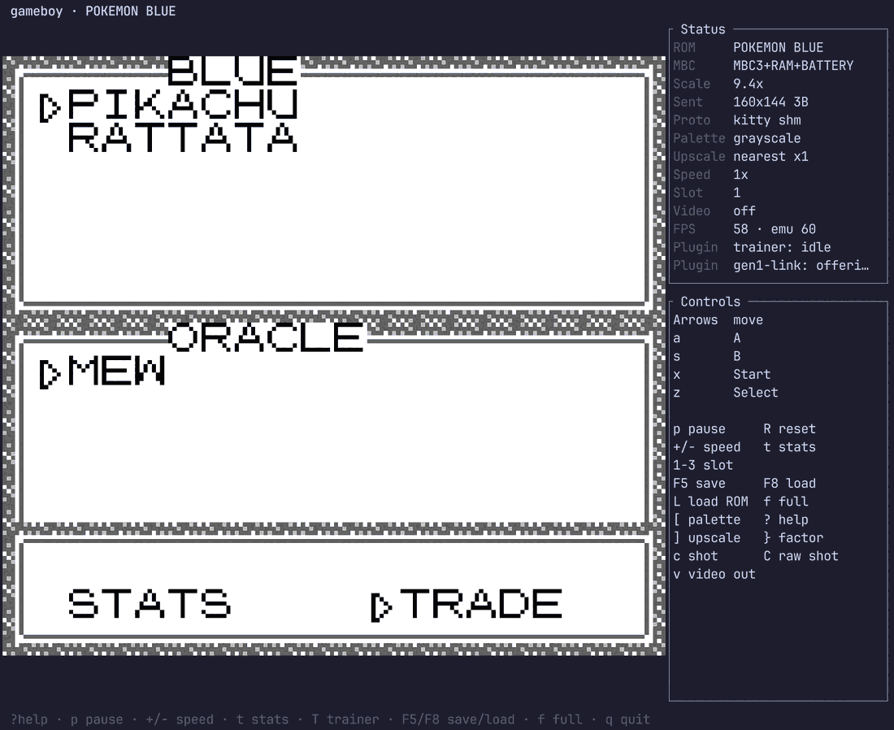
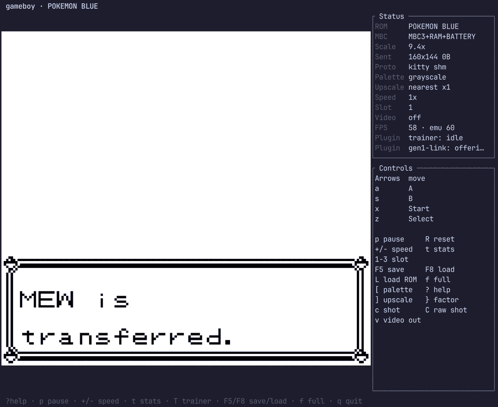
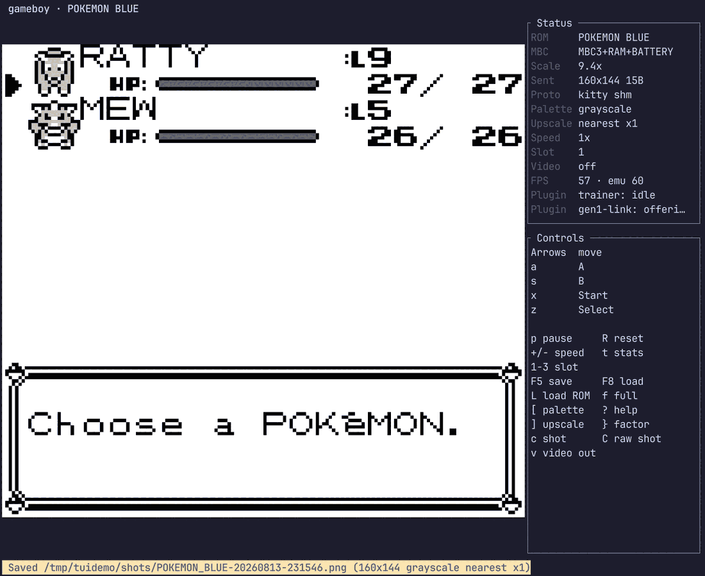
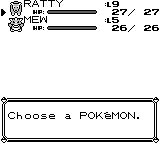

# Trading a Pokémon in over the link cable

> Source: [`src/plugin/gen1/`](../src/plugin/gen1/) · Contract: [plugins](plugins.md) ·
> Serial: [components/serial](components/serial.md) · [🗺️ Code map](codemap.md)

---

The emulator can **be the Game Boy on the other end of the link cable**. Walk into any Cable
Club in Pokémon Red or Blue, use the console, and trade with a partner that does not exist —
and get back a Pokémon you specified in a text file.

This page is the story and the step-by-step. The [plugin contract](plugins.md) is what it is
built on.



*The game has accepted the partner. `BLUE`'s party is on top; `ORACLE` — a trainer that is
really a few hundred lines of Rust — is offering `MEW` below. The Status panel on the right
shows both attached plugins, which is how you know one is active.*

---

## 1. Why this is more interesting than it looks

The easy way to put a Mew in someone's party is to write it into memory. Find `wPartyMons`,
poke 44 bytes, done. That is a cheat, and it is boring: nothing about it tests anything.

This does the hard thing instead. The plugin **answers the serial port**, byte by byte, as the
second console in a link. The game runs its real link code — the handshake, the party-block
exchange, the trade selection, the confirmation — and inserts the Pokémon **itself**, because
as far as it can tell it just traded with a person.

### The proof: a number we never sent

Here is the evidence that settles it.

The partner puts a level 5 Mew on the wire with **125 experience points** — the exact total for
level 5 on Mew's medium-slow growth curve, which we compute ourselves. Read the Pokémon out of
the party afterwards and it has **135**.

We never wrote 135. Nothing in the plugin knows that number.

Generation 1 gives a traded Pokémon **boosted experience**, and the game applied it on the
receiving side, of its own accord, because it believed it had just received a Pokémon from
another trainer. A memory poke would have left 125 sitting there, untouched. So would a clever
fake that skipped to the end of the protocol.

The second piece of evidence is the game's own words:



`MEW is transferred.` and, moments later, `Trade completed!` are printed by
`engine/link/cable_club.asm` at the end of a successful exchange. The game will not print them
unless the whole protocol ran to completion. We do not write text to the screen — we answer
bytes on a wire, and the game says this because it decided to.

And here it is in the party, with the sprite the game decompressed out of the cartridge:



*`MEW :L5 26/26`, sitting in the party next to the Rattata. The yellow bar at the bottom is the
emulator's own toast confirming the `c` key just wrote that frame to a PNG — the small image
below is the file it produced.*



---

## 2. Who drives the clock — the one decision that made this tractable

A Game Boy link is a **clocked** serial exchange: one console supplies the clock and the other
follows it. Get the timing wrong and the game does not error, it **hangs** — which is the
failure mode to expect and the reason this is usually described as fiddly.

The plugin sidesteps the entire problem with one choice. During the Cable Club handshake both
sides repeatedly send a byte saying what they want to be: `$01` for "I will use the internal
clock" and `$02` for "I will use the external clock"
(`constants/serial_constants.asm`). **The partner always answers `$01` with `$02`** — it
volunteers to be the follower, which makes the *game* the clock master.

That is what makes this easy rather than hard. Because the game supplies the clock, the game
also decides *when* each byte moves, and our reply is produced synchronously inside the same
`SC = $81` write that started the transfer. There is no timing budget to miss. A real hardware
bridge or a network peer has to meet the clock in real time; a plugin living inside the
emulator simply does not.

This is also why the in-game step below insists you use the **left** console facing **right**:
that seat is the one the game makes clock master, which is the role we need it to have.

---

## 3. The user journey, step by step

### Step 1 — write down what you want

A `key = value` file, anywhere. The format is the same hand-rolled shape the terminal config
uses: `#` starts a comment, values may be bare or quoted, and **a `species` line starts a new
Pokémon** so you can offer up to a full party of six.

Copy this and edit it:

```text
# ~/mewtwo.trade
trainer  = ORACLE            # the trainer name the game will show you traded with

species  = Mewtwo            # a name, "#150" for a dex number, or a raw internal index
level    = 70
nickname = MEWTWO            # what it is called in your party afterwards
ot_name  = GF                # original trainer — a traded Pokémon keeps its OT
ot_id    = 22796             # 0-65535; with ot_name this is what marks it as traded
moves    = Psychic, Recover, Amnesia, Swift
dvs      = 15, 15, 15, 15    # attack, defense, speed, special (0-15 each)
```

Only `species` is required. Everything else has a sensible default — omit `level` and you get 5,
omit `moves` and it gets the moves that species knows at that level.

Every value is checked against **your own cartridge's tables**: species names, base stats and
move PP are located in the ROM you are running, so `species = Mewtwo` cannot resolve to
something the game does not have, and the stats it arrives with are the ones the game itself
would compute. A misspelled key is an **error at load** — `speceis =` refuses to attach rather
than quietly handing over a default Pokémon and leaving you wondering.

> **A note on levels.** A level 70 Mewtwo is a perfectly legal Pokémon and the game will accept
> it happily, but it will only **obey you** if you have the badges for its level — that is
> Generation 1's obedience rule for traded Pokémon, and it is another sign the game is treating
> this as a genuine trade rather than a gift.

### Step 2 — arm the partner

Nothing loads implicitly, so you have to name it:

```bash
GB_PLUGINS=gen1-link GB_GEN1_TRADE=~/mewtwo.trade \
  cargo run --release --example terminal -- ~/roms/blue.gb
```

or permanently, in `${XDG_CONFIG_HOME:-~/.config}/gameboy/config.toml`:

```toml
plugins    = gen1-link
gen1_trade = ~/mewtwo.trade
```

### Step 3 — check it is active, before you press a button

The Status panel gains a **`Plugin`** row per attached plugin:

```text
Plugin  trainer: idle
Plugin  gen1-link: offeri…
```

`gen1-link: offering MEWTWO (Lv70) — waiting for link` is the full line. If the trade file had
a problem, a toast says what and **no plugin attaches** — there is no state in which a link
partner is quietly present. A plugin that can write your game's memory is additionally marked
`!` ("may write"), or a sticky `!!` ("has written"); the link partner shows neither, because it
holds no write capability at all.

### Step 4 — get to a Cable Club

Every Pokémon Center has one upstairs, and the nearest to the start of the game is **Viridian
City** — the first Pokémon Center you ever walk into. You need to be far enough in to have the
**Pokédex** (so, after delivering Oak's Parcel); before that the receptionist turns you away.

Talk to the receptionist at the **top-right counter**, choose **TRADE CENTER**, and let her
save your game. You will walk into the link room.

### Step 5 — the left console, facing right

This is the step that catches people, and it is the game's rule rather than ours.

`CableClubLeftGameboy` (`engine/link/cable_club.asm`) starts the exchange only for the player
standing on the **left** console tile and **facing right**. The right-hand tile is the *other*
Game Boy's seat. Walk to the left console, face right, press A.

That player is also the one who ends up **clock master**, which — see §2 — is exactly the role
the partner needs the game to have. So this is the supported path, not a workaround.

### Step 6 — what you will see

In order:

1. `Just a moment.` — the two sides are exchanging their party blocks.
2. The **trade selection screen**: your party on top, the partner's below (the first screenshot
   on this page).
3. Pick yours, pick theirs, choose **TRADE**, confirm at `<NAME> will be traded.`
4. The trade animation, then `MEW is transferred.` and `Trade completed!`

Back in your party is a Pokémon with a **foreign OT name and trainer ID**. That is what marks
it as traded: it earns boosted experience, and it obeys only with the right badges. The Status
row changes to `— 1 traded`.

### Step 7 — if it hangs

A link protocol fails by freezing, not by erroring, so here is the triage in the order worth
trying:

| symptom | almost certainly |
|---|---|
| No `Plugin` row in the Status panel at all | The plugin never attached. Check the startup warning — a bad `gen1_trade` path, or an unknown key in the trade file. |
| `Please wait…` forever at the console | You are on the **right-hand** console tile, or not facing right. Only the left seat drives `CableClubLeftGameboy`. |
| The receptionist refuses you | You do not have the Pokédex yet. |
| The link room never appears | The save the receptionist takes failed, or the cartridge is not English Red/Blue — the partner refuses builds it does not recognise (by title *and* header checksum) rather than corrupting them. |
| Trade screen appears, then freezes | A desynced exchange. **Loading a save state mid-trade does this by design**: plugin state is deliberately not in the save file, so the partner is `reset()` while the game is still mid-protocol. Leave the Cable Club and start again. |
| It worked once, now nothing | The partner offers its party once per link session. Walk out of the room and back in. |

None of this can corrupt your save. The plugin declares **no write capability**, so the host
refuses a memory write from it outright — a completely desynced exchange can only leave the
game waiting for a byte that never comes.

---

## 4. How it is verified without a human watching

Screenshots are good evidence for a person and useless in CI. `examples/gen1_trade.rs` drives
the whole thing headlessly — boots the ROM, walks to the Cable Club, talks to the receptionist,
uses the console, completes the trade, and reads the result out of WRAM:

```bash
cargo run --release --example gen1_trade -- --rom <rom> --make-save   # once: build a fixture
cargo run --release --example gen1_trade -- --rom <rom>               # trade
```

```text
party before: SPARK Lv12, RATTY Lv9
party after : RATTY Lv9, MEW Lv5

MEW — species index 0x15, Lv5, HP 26/26, atk/def/spd/spc [16, 16, 16, 16],
      moves [1, 0, 0, 0], pp [35, 0, 0, 0], exp 135, OT GF (id 22796)
```

Two techniques in there are worth stealing for any future test that has to drive a real game.

### Read the game's own screen, as text

Generation 1 draws its menus through the **window layer**, and it writes character codes
straight into the tilemap — the font is laid out so that **a tile id *is* the character code**.
So `wTileMap` (`$C3A0`, 20×18) can be decoded directly into the words a player is looking at, with
no OCR and no rendering.

That turns menu navigation into something robust: the driver presses A when the screen **says**
`TRADE CENTER`, not 147 frames after talking to the receptionist. It cannot drift when
animation lengths or emulation speed change. `testharness/trainer.rs` uses the same trick to
check the trainer panel against the game's own party menu.

### Redirect the room's own warp — never relocate the player

The fixture needs a save with the player standing in a Pokémon Center that has a Cable Club.

The obvious approach is to write the player's map and coordinates directly. It produces a save
that looks perfectly right and then **hangs**, because the current map, the loaded tileset, the
sprite set and the warp table are mutually consistent state that the game maintains together —
setting one of them by hand desynchronises the rest.

What works is to leave the player exactly where the game put them and instead rewrite the
**destination of the warp they are about to walk through** (`wWarpEntries`). The *game* then
performs its own map transition, through its own code, loading everything it needs on the way.

> **The general lesson: move the world's pointers, not the player.**

The fixture is honest about what it edits. `--make-save` boots a **new game**, plays the intro
with real button presses until the game writes its own save file, then changes four things in
that save — current map, player position, the Pokédex event flag, and the party — and fixes the
checksum the way `engine/menus/save.asm` computes it. Everything else is state the game itself
produced, and **from the receptionist onward nothing is edited at all**.

### Reproducing the screenshots on this page

The screenshots are from the real terminal frontend, driven live. The `--state` flag writes a
save state at the console the moment before the trade starts, which is what makes it repeatable
without playing to Viridian by hand:

```bash
# 1. capture a save state standing at the Cable Club console
cargo run --release --example gen1_trade -- --rom <rom> --state ~/atconsole.gbss

# 2. drop it into save slot 1 and start the frontend with the partner armed
cp ~/atconsole.gbss "${XDG_STATE_HOME:-$HOME/.local/state}/gameboy/states/POKEMON_BLUE.slot1.gbss"
GB_PLUGINS=gen1-link GB_GEN1_TRADE=~/mew.trade \
  cargo run --release --example terminal -- <rom>

# 3. F8 loads the state; press A and trade. c writes a PNG of what you are looking at.
```

`--shots <dir>` also captures a PNG at every stage of the headless run, through the same
`image`-crate path the `c` / `C` / `F2` keys use.

---

## 5. On the screenshots and licensing

The images on this page are checked into the repository, which is a deliberate exception worth
stating rather than leaving implicit.

`AGENTS.md` has a standing rule — *"Licence boundary: format knowledge is ours, game assets are
not"* — that forbids vendoring game assets into this repo, including as test fixtures. It is why
`docs/upscale-samples/` contains only the MIT-licensed dmg-acid2 ROM's output, and why nothing
here ships sprite data, tile sheets or text corpora.

**These are a different thing, and the distinction is what the rule is actually protecting.**
That rule exists to stop us redistributing game *data* — bytes that substitute for owning the
cartridge, or that a program could consume as input. A screenshot of our own interface, with a
game visible inside it, is neither. It cannot be decoded back into assets, it is no use to
anything but a human reading documentation, and it substitutes for nothing. Three of the four
images are mostly *our* UI — the Status panel, the Controls panel, the toast — and exist to show
a feature of this emulator that cannot be demonstrated in text. Using screenshots to document
and discuss software is ordinary practice and squarely fair dealing.

The scope is kept deliberately narrow: four images, at modest resolution, in one directory, all
showing the emulator's chrome, none of them a clean asset rip. If you are adding more, that is
the line — **our interface, doing something, with the game incidental**; not a gallery of game
frames, and never anything a program could read back as data.
