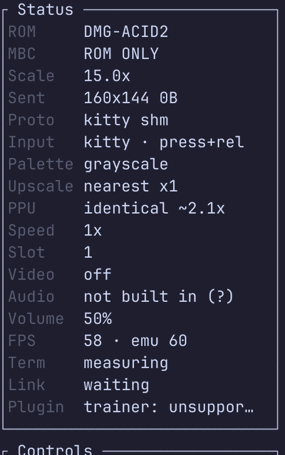

# Picture modes — `standard` and `identical`

> **Key:** `P` switches mode live. [Every control →](controls.md)

TerminalGB carries **two complete picture engines**, and which one runs is a mode you choose.

> **There is a third mode, and it is not a picture engine.** *Speed mode* trades
> sub-instruction timing for throughput and is for driving the machine, never for
> judging it. It lives with the other two on **[docs/modes.md](modes.md)**, which
> is the page to read if you are choosing between all three.


| | **`identical`** | **`standard`** |
|---|---|---|
| The default | **yes, since 2026-08-20** | no — opt in |
| How it draws | the real hardware pixel pipeline, dot by dot: BG fetcher, 8-pixel FIFO, sprite fetches, window restart, `SCX & 7` discard | a whole scanline at once, at the mode 3 → 0 transition, from whatever the registers hold at that instant |
| Mode 3 length | variable, as it falls out of the machine (172–289 on hardware) | fixed at 172 dots |
| A register written mid-scanline | lands exactly where a Game Boy puts it | invisible — only its final value is read |
| Cost per frame (Pokémon Blue, one P-core) | **0.373 ms** (45× real time) — 2.2 % of a frame | **0.094 ms** (178× real time) |
| Cost per frame, headless with no pixels wanted | 0.382 ms (44×) — the skip does not apply | **0.057 ms** (295×), **6.7× cheaper** |
| [Speed flags](modes.md) | refused — nothing may be skipped | the only mode they apply to |
| Almost every game | identical output, proved frame-for-frame | identical output |

They are **not** a quality or appearance choice. Palette, upscaler, transport and every other
visual setting live above the PPU in `src/screen/` and are byte-identical either way. The only axis
is *exactness against speed*.

> **The old names still work everywhere.** `standard` was `fast` and `identical` was `accurate`,
> and both spellings parse in every place a mode is named — `config.toml`, `$GB_PPU`, the `make`
> targets, `RenderMode::parse`. Nothing anybody has written stops working.

---

## 1. How to choose one

**In the terminal frontend, press `P`.** The mode switches live — no pause, no reload, no restart —
because the two engines share every register and the framebuffer, and `identical` rebuilds its
pipeline at the head of the next scanline. The Status panel's `PPU` row says which one is live and,
for `identical`, what it costs:

<p align="center">
  
</p>

Or set it before launch, in `${XDG_CONFIG_HOME:-~/.config}/terminalgb/config.toml`:

```toml
ppu = standard       # or: identical (the default), accurate, fast
```

Or for one run:

```sh
GB_PPU=standard   cargo run --release --example terminal -- game.gb
GB_PPU=identical  cargo run --release --example terminal -- game.gb   # the default
```

`$GB_PPU` wins over the config key, so a one-off override is not silently undone by a config file.
A misspelling **warns and is ignored** rather than quietly switching mode — the same rule
`$GB_MODEL` follows, and for the same reason: a conformance score published from the mode nobody
asked for is worse than no score.

Embedding? [`Gameboy::set_render_mode`](../src/gameboy.rs) takes
[`terminalgb::ppu::RenderMode`](../src/gpu/mod.rs) and is safe to call at any point.

**The mode is not part of a save state.** It is a property of the machine *you* are running, not of
the cartridge — loading somebody else's state must not switch your renderer underneath you. Same
call as the console revision and the CGB APU revision.

---

## 2. When `standard` is worth reaching for

`identical` is the default because it is what a Game Boy does and, for somebody *playing a game*,
it costs 2.2 % of a frame. Reach past it when:

- **the machine is small.** The PSP frontend pins `standard`, and the arithmetic is why: that
  console already spends 9.4–9.9 ms of a 16.743 ms frame, so four times the PPU is not 2 % there,
  it is unplayable. Any frontend with that little headroom should say so in its own source, the
  way [`platform/psp/src/main.rs`](../platform/psp/src/main.rs) does.
- **nothing is looking at the picture.** A collector — an agent corpus, a certification run, a
  swarm — declares `set_render_pixels(false)`, and that skip is a `standard`-only saving:
  under `identical` the fetcher *is* the timing, so the pixels are not optional and the engine
  says so through `Gpu::pixels_effective`. Measured on Pokémon Blue, one P-core: **0.057 against
  0.382 ms/frame, 6.7×.**
- **you want [speed mode](modes.md).** `identical` refuses every speed flag — its whole claim is
  that nothing is skipped — so `GB_SPEED=speed` is a no-op until the machine is on `standard`.
  Read [`Gameboy::speed_flags`](../src/gameboy.rs) for what is actually in effect rather than
  assuming it is what you asked for.
- **you are reproducing a figure or a corpus measured before 2026-08-20.** The two engines are
  *not* the same machine to the cartridge: 6,000 frames of Pokémon Blue from reset give WRAM
  hashes `0x5042287b86903f2a` on `standard` and `0x21c97cf3b52433a7` on `identical`. Every
  recorded agent trajectory, every certified chain corpus and every save-state digest in
  [`docs/agent/`](agent/) was produced on `standard` and replays only there.

For an ordinary game the two produce the *same* picture, and that is not an assumption:
[`testharness/ppuengines.rs`](../testharness/ppuengines.rs) renders 600 frames of dmg-acid2 and of
Blargg's `cpu_instrs` through both engines every `cargo test --release` and requires the
framebuffers to be **byte-identical**.

---

## 3. What each mode scores

Both modes are gated in CI, each against **its own baselines**, so neither can drift unnoticed:
`make test-external-accurate` scores `identical` (the default) and `make test-external` scores
`standard`. **Both targets name their engine on every line**; until the flip the `standard` one
could be silent about it, and a target that named no engine would now re-bless eighteen files
with the other machine's numbers.

| Gated suite | `standard` | `identical` |
|---|---:|---:|
| Mooneye GB `acceptance` | <!--score:mooneye_acceptance-->67 / 75<!--/score--> | **<!--score:mooneye_acceptance_accurate-->75 / 75<!--/score-->** |
| Mealybug Tearoom — pixel-exact rows | <!--score:mealybug:pass-->3<!--/score--> / 79 | **<!--score:mealybug_accurate:pass-->29<!--/score-->** / 79 |
| Gambatte (5,225 scored rows) | <!--score:csp_gambatte:pass-->3176<!--/score--> | **<!--score:csp_gambatte_accurate:pass-->3620<!--/score-->** |
| GBMicrotest | <!--score:csp_gbmicrotest:pass-->252<!--/score--> / 513 | **<!--score:csp_gbmicrotest_accurate:pass-->339<!--/score-->** / 513 |
| GBSelfTest (our own cartridge) † | 90 / 101 | **99 / 101** |
| dmg-acid2 against its author's reference | 0 / 23,040 differ | 0 / 23,040 differ |
| **GB Emulator Shootout, its own 264-row manifest** | 223 | **243** |

† The GBSelfTest figures come from **`tools/gbselftest-gate.py`** (`make gbselftest`), the full
cartridge gate, whose denominator is every check the ROM prints and whose skips count in it —
the same instrument [`docs/gbselftest.md`](gbselftest.md) quotes. That page read `96 / 98` and
`87 / 98` until now: the same measurement taken before the cartridge was re-pinned from 98
checks to 101, i.e. stale by one vintage rather than a different tool, and it is corrected to
match. Not baseline-derived, so not rewritten by `make status`.

Everything else — the in-repo Blargg harness (<!--score:harness-->46/47<!--/score-->), Mooneye
`emulator-only` (<!--score:mooneye_emulator_only-->28/28<!--/score-->) and `misc`
(<!--score:mooneye_cgb-->8/8<!--/score-->), SameSuite (<!--score:samesuite-->73/76<!--/score-->),
CasualPokePlayer (<!--score:cpp-->4/4<!--/score-->) — measures the CPU, the APU, DMA or the cartridge
mappers, which the picture mode does not reach. Those suites have one baseline each; the three
external ones are gated in **both** modes against that one file, which is only safe because every
row of each was measured identical under both.

**The flip happened because `identical` stopped losing rows.** It used to be behind on two
(`ppu/intr_1_2_timing-GS` and Blargg `oam_bug` sub-test 7); both closed, and the last
counter-example — `cgb-acid2`, 158 pixels — closed with the Color gate on the window
pixel-insertion glitch. Through the shootout's own manifest the two engines are **15 gains and
zero losses**.

It is still not *strictly* dominant across every one of the 6,210 gated rows: four small Gambatte
groups are net-negative on `identical` (`sprites` −3, `lyc153int_m2irq` −2, `lycint_lycflag` −2,
`m2int_m0stat` −1) — **eight rows between them, against 891 gains.** Named rather than rounded
away; they are the next thing for a PPU crew to look at.

**Read the Mealybug pixel distance, not just the row count.** It is a *shade-rank* distance, so a
frame with one extra distinct shade reports ~23,040 whatever else is right, and a four-pixel error
can move the total by tens of thousands. The row count is a wall at this range; the distance is the
thing that shows a pipeline change getting closer. Both are in the baselines.

---

## 4. The cost figure, and how it stays honest

`RenderMode::IDENTICAL_COST` is **7.6**, and it is measured rather than chosen. **It has moved
four times, and the fourth is the first time it moved because `identical` got FASTER.** First
2.1 → 6.3, when the PSP work rewrote the whole-scanline renderer to fetch once per tile instead
of once per pixel; then 6.3 → 6.8, when the shipping profile stopped optimising for size; then
6.8 → 8.8, when `Gpu::blit_dmg_tile` started drawing a whole monochrome tile with word
arithmetic. All three were `standard` — a branchy whole-scanline loop is exactly the shape an
optimiser, or a human, can do something with, while the per-dot engine's pixels come out of the
fetcher.

8.8 → 7.6 is the other direction: the per-dot engine gained the idle batch it had never been
able to use and stopped walking mode 2 a dot at a time
([`docs/throughput.md`](throughput.md) §14). Measured in one session, same harness, HEAD against
the change: **8.44× → 7.25/7.31/7.32×** on dmg-acid2 (accurate 0.6759 → 0.5653 ms/frame), and
on a real cartridge — Pokémon Blue from an overworld save state, where the CPU actually halts —
**0.5755 → 0.332 ms/frame**. The constant is the published 8.8 scaled by the ratio HEAD and the
change measured against each other in that session, because both ends are depressed by the same
contention.

[`testharness/ppuengines.rs`](../testharness/ppuengines.rs) times both engines over the same 400
frames of dmg-acid2 on every `cargo test --release` and **fails the build if the constant disagrees
with what it measured**. Twelve interleaved runs on the machine this was last measured on gave
**7.03–10.00×, median 8.5** (fast 0.056–0.078 ms/frame, accurate 0.545–0.666); the *same harness on
the parent commit, in the same session*, gave **5.57–6.38× against its published 6.8**, so both
ends were depressed by the same contention and the new constant is the median scaled onto the old
one. An earlier low-load session gave 6.72–6.78 where a busy box gave 7.75 and a very busy one
5.56, which is why the figure is shown with a `~` and checked against a wide band.

That check exists because this repository has been bitten by a stale performance number before —
"audio costs ~8 ms a frame" outlived the fix by months and kept being quoted. A figure printed on a
status row, in a toast and in the help overlay is the whole basis on which somebody decides to trade
speed for exactness; it has to be a measurement, not folklore.

Reproduce it:

```sh
cargo test --release --test ppuengines
```

---

## 5. Where the modes are named in the product

An option nobody can find is an option nobody has, so the mode appears in five places and they are
kept consistent by tests rather than by care:

- the **`P` key** in the terminal frontend, with a toast naming the new mode and its cost;
- the **`PPU` row** of the Status panel, always visible;
- the **Controls list** (`P picture mode`) and the **`?` help overlay**;
- the **`ppu`** config key, whose warning offers every spelling back;
- the header of **every baseline file**, which records the mode that scored it and the `make`
  target that re-blesses it — a baseline that did not say would be a file nobody could safely
  re-bless.

---

## 6. Further reading

- [`docs/modes.md`](modes.md) — all three modes together, including the speed
  flags and what they must never be used to judge.
- [`docs/mealybug.md`](mealybug.md) — what the per-dot engine still gets wrong, row by row, and what
  closing each would take. Read it before touching `src/gpu/fifo.rs`.
- [`docs/components/ppu.md`](components/ppu.md) — the component page: registers, modes, the
  interrupt line, and the honest approximations of each engine.
- [`docs/measured/ppu.md`](measured/ppu.md) — the measured picture unit: what the references say,
  what we measured, and what a wrong emulator does.
- [`docs/testing.md`](testing.md) — how the suites are fetched, scored and gated.
