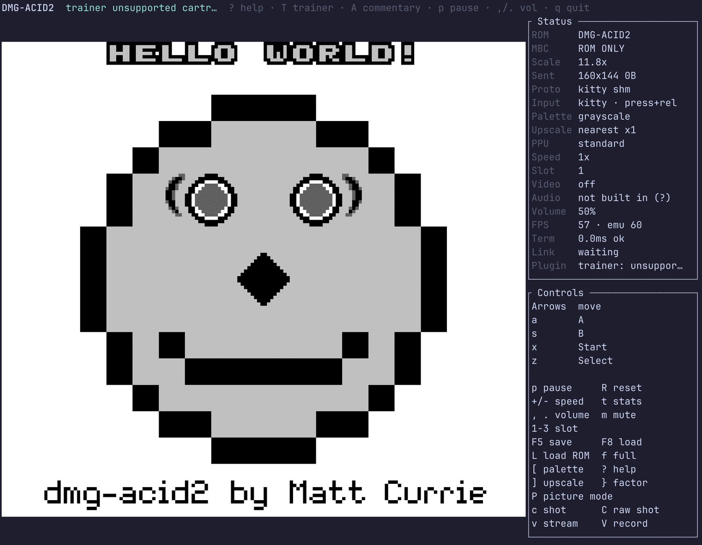
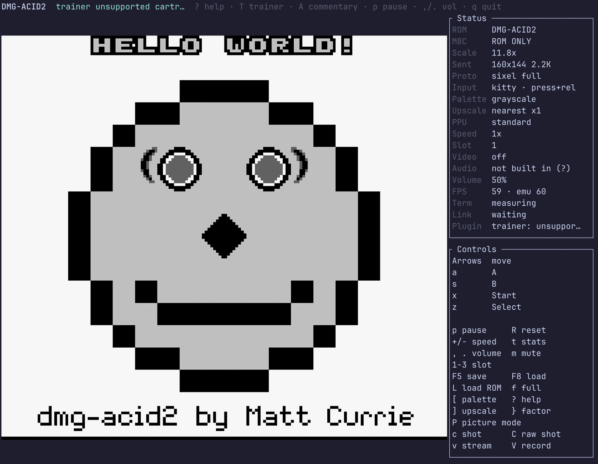
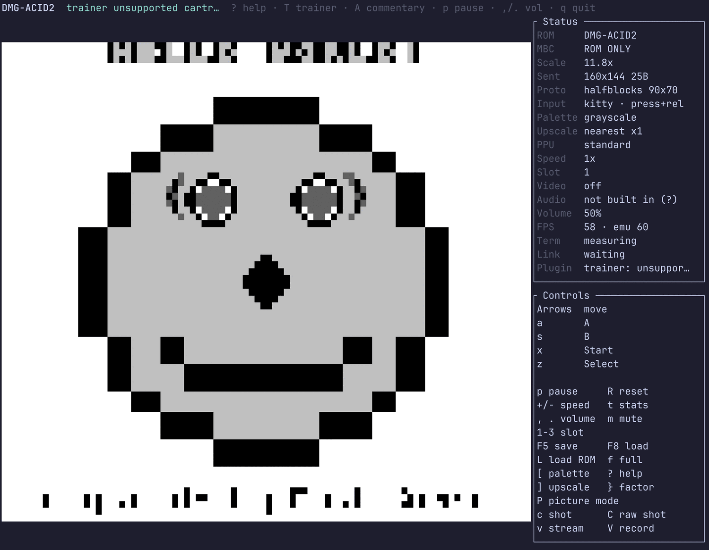
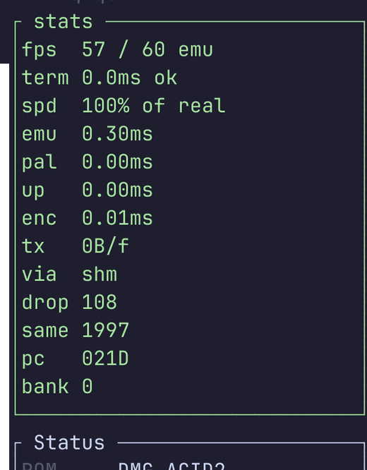
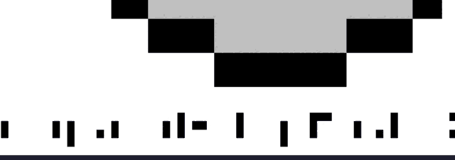
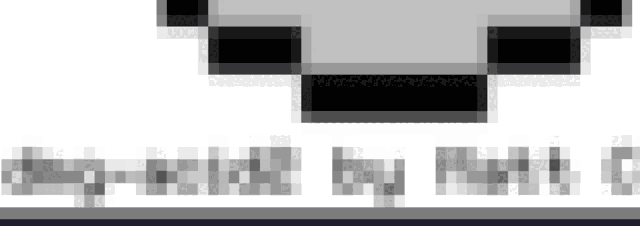
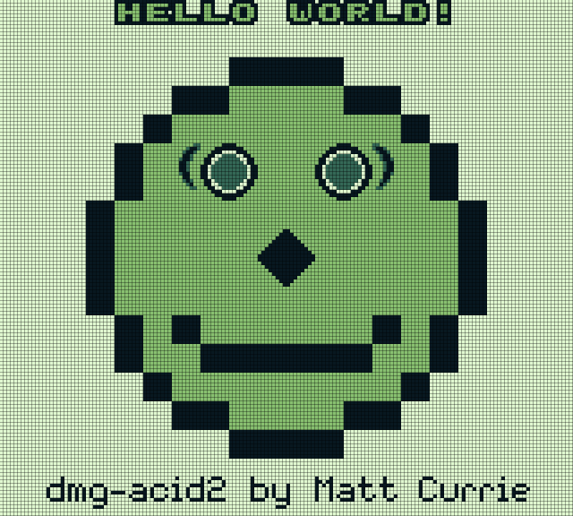
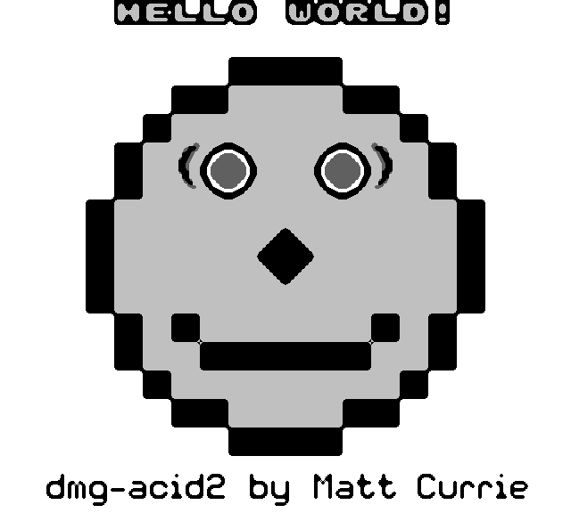
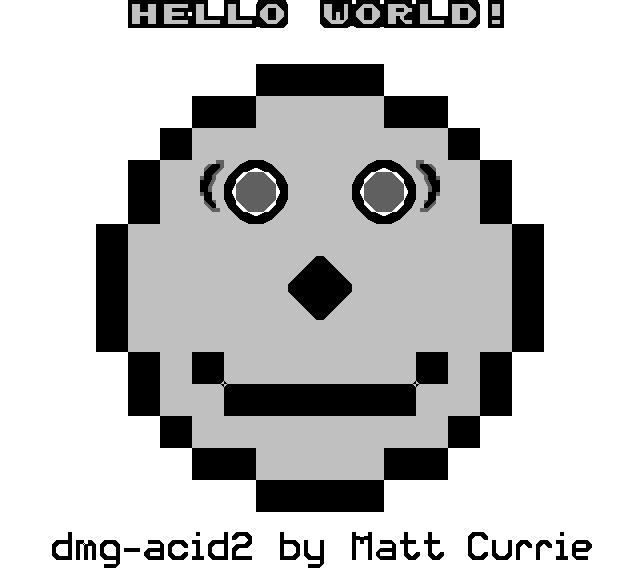
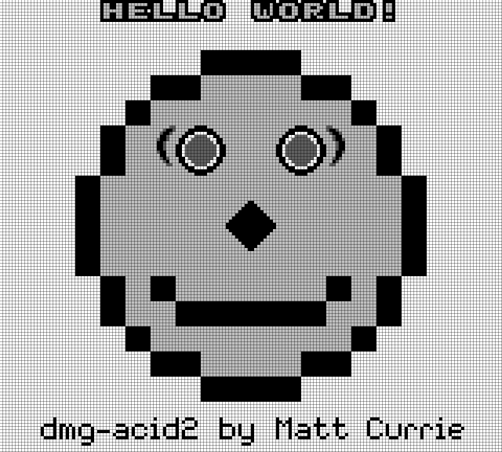

# How the picture reaches you — and how to capture it

> **Keys on this page:** `c` screenshot · `C` raw screenshot · `[` palette · `]` `}` upscaler · `P` picture mode — and [**every control, with a link each**](controls.md).

> Source: [`src/termimage.rs`](../src/termimage.rs) · [`src/shmframe.rs`](../src/shmframe.rs) ·
> [`src/screen/halfblocks.rs`](../src/screen/halfblocks.rs) ·
> [`src/screen/termcaps.rs`](../src/screen/termcaps.rs) · [`src/upscale/`](../src/upscale) ·
> [`src/screen/tui.rs`](../src/screen/tui.rs)
> Related: [what the transport costs](rendering.md) · [why a big window used to cost
> frames](terminal-render.md) · [scaling across all three frontends](display.md) ·
> [the upscalers in detail](upscaling.md) · [the traps](pitfalls/README.md)

---

A Game Boy screen is **<!-- picture:fact:source-px -->160×144<!-- /picture:fact:source-px -->
pixels in four shades**. A terminal is a grid of character cells. This page is about the
distance between those two things: what happens to a frame between the emulated LCD and your
screen, why the result is sharp rather than smeared, and how to take a picture of it that is
worth keeping.

It is written for someone who has never opened the source. If you want the performance
argument, [`rendering.md`](rendering.md) and [`terminal-render.md`](terminal-render.md) own
that; if you want scaling across the desktop and web frontends too, [`display.md`](display.md)
owns that. This page owns **how the picture gets to you, and how to capture it.**

---

## What we built, and what we did not

Someone generously described this work as *"a custom frame transport protocol that bypasses
standard bloated window captures."* That is a nicer story than the true one, so it is worth
being exact:

> **We did not invent a protocol.** We implement
> <!-- picture:fact:transports -->4<!-- /picture:fact:transports --> existing ones that other
> people designed and published — the kitty graphics protocol, sixel, iTerm2 inline images,
> and the half-block glyph — ask the terminal which of them it speaks, and pick the best
> answer. The standards are theirs. All four are credited and linked in §2.

What *is* ours is smaller, and more interesting than the invented version, because each piece
is a decision that could have gone the other way:

1. **We transmit the picture at its own resolution, never at the window's.** Both cell-addressed
   protocols can be told to scale an image to a rectangle measured in *character cells*, so we
   send 160×144 and let the terminal do the stretch. That is why a fullscreen window costs the
   same as a small one — see the table in §1, where the wire cost is flat across a 12× change in
   display area while the alternative goes from 744 KB to 9.3 MB a frame.
2. **The escape sequence is written outside `ratatui`'s cell buffer, deliberately.** Putting a
   90 KB payload in a cell makes the library re-emit the whole screen every frame, and anything
   drawn over that cell silently stops the picture updating. Both were live bugs
   ([the record](terminal-render.md#5-conformance-record)).
3. **An unchanged frame costs nothing at all** — not a smaller payload, *nothing*: the encoder
   hashes the pixels and reports "no change", and the caller writes zero bytes.
4. **We sample the cells ourselves, nearest-neighbour, on the half-block path.** Added
   2026-08-15, after `ratatui-image`'s half-block encoder was found hard-coding a smoothing
   filter. §3 has the before and after, in the same terminal, one config key apart.
5. **Integer-scaled, aspect-correct output**, with the four pixel-art upscalers of §5 doing the
   enlarging when you want computed pixels rather than bigger ones.

And one thing that is *not* a claim: none of this makes the emulator more accurate. The
framebuffer is identical whichever transport carries it. Everything here is presentation — which
is exactly why no test ROM catches a bug in it, and why the checks are the ones described in §6.

---

## 1. The path a frame takes

```
 emulated LCD          your terminal
 ┌──────────┐                                                    ┌──────────┐
 │ 160×144  │  ①      ②        ③         ④          ⑤            │ 944×848  │
 │ 4 shades │ ───► palette ► upscale ► encode ► write to the tty  │  pixels  │
 └──────────┘      map       (opt.)   + place    (or the buffer)  └──────────┘
                                        └── the terminal does the final stretch ──┘
```

① **Emulate.** [`Gameboy::frame`](../src/gameboy.rs) runs the machine until the PPU says a frame
is done, and hands back 160×144 RGBA bytes. Everything after this point is presentation.

② **Palette map.** The four shades become the palette you picked — `grayscale`, `green` or
`amber` (`[` cycles them). [`screen::frame`](../src/screen/frame.rs), into a reused buffer.

③ **Upscale, optionally** — at the *transmission* factor, never the display size. With the
default `transmit_scale = auto`, a `nearest` upscale is skipped entirely and left to the
terminal, because integer duplication is exactly what the terminal's own stretch already does,
for one-sixteenth the bytes. A real filter (`scale2x`, `mmpx`, `lcd`) *is* a visual effect and
has to happen here. See §5.

④ **Encode and place.** [`termimage`](../src/termimage.rs) turns the frame into one
absolutely-positioned escape sequence — and hashes it first, so an unchanged frame produces an
empty sequence. A four-shade picture becomes a **2-bit palette-indexed PNG**, deflated by a
hand-rolled compressor; the palette path is taken for any frame with at most
<!-- picture:fact:max-palette -->64<!-- /picture:fact:max-palette --> colours, which Game Boy
content never exceeds. On kitty the pixels may not go on the wire at all — see `shm` in §2.

⑤ **Write.** After `ratatui` has flushed the rest of the screen, the sequence goes straight to
the terminal and the cells it covers are marked "leave alone". (The half-block path is the
exception and goes *through* the buffer on purpose — §2.)

Measured end to end, on the vendored MIT dmg-acid2 ROM in a 213×55 terminal, every frame
different:

<!-- picture:frame-path -->
| Step | Where | Cost |
|---|---|---:|
| Emulate one frame | [`Gameboy::frame`](../src/gameboy.rs) | 0.079 ms |
| Map 4 shades → RGBA | [`screen::frame`](../src/screen/frame.rs) | 0.070 ms |
| Upscale | [`upscale`](../src/upscale/mod.rs) | 0.000 ms |
| Encode + place | [`termimage`](../src/termimage.rs) | 0.183 ms |
| Write to the terminal | the frontend, after `ratatui` flushes | 0.000 ms |
| **Whole displayed frame** | | **0.333 ms** |
<!-- /picture:frame-path -->

A Game Boy frame is 16.743 ms, so that is about **2 % of the budget**. (`upscale` reads 0.000
because the default is `nearest`, which §5's table shows is free by construction.)

### The picture's size, not the window's

This is the load-bearing decision, and it is easy to check: grow the window and watch the wire.

<!-- picture:window-independence -->
| Terminal window | Display area | **Sized by the picture** | | **Sized by the window** | |
|---|---|---:|---:|---:|---:|
| cells | pixels | on the wire | per frame | on the wire | per frame |
| 80x24 | 392x352 | **1.4 KB** | **0.34 ms** | 743.9 KB | 2.32 ms |
| 120x40 | 672x608 | **1.4 KB** | **0.34 ms** | 2.2 MB | 5.90 ms |
| 160x50 | 856x768 | **1.4 KB** | **0.34 ms** | 3.5 MB | 11.39 ms |
| 213x55 | 944x848 | **1.4 KB** | **0.33 ms** | 4.3 MB | 11.46 ms |
| 297x80 | 1384x1248 | **1.4 KB** | **0.33 ms** | 9.3 MB | 30.84 ms |
<!-- /picture:window-independence -->

The display area grows **12×** across those rows. The bytes we send do not move, and neither
does the cost. (The last row is also the ceiling: kitty addresses a placement's rows and columns
with a fixed table of combining marks, so a placement cannot exceed
<!-- picture:fact:max-cells -->297<!-- /picture:fact:max-cells --> cells on either axis. Past
that the picture stays aspect-correct and centred rather than growing.) The right-hand columns are the same emulator with `render_path = legacy`, which
hands the frame to `ratatui-image` to resize to the display rectangle — the behaviour this
project shipped with, and the reason a fullscreen terminal used to stutter. Note the last row:
30.84 ms is already past a 16.743 ms frame, so the emulator could not have kept up no matter how
fast the emulation was.

### An unchanged frame costs nothing

Not "less" — nothing. Over 300 frames of a still screen:
<!-- picture:fact:still-identical -->299/300<!-- /picture:fact:still-identical --> were
recognised as identical, and the average went to
**<!-- picture:fact:still-bytes -->4<!-- /picture:fact:still-bytes --> bytes a frame** against
<!-- picture:fact:moving-bytes -->1.4 KB<!-- /picture:fact:moving-bytes --> when every frame
differs. A paused game, a menu, a dialogue box: free.

> ⚠️ **Which is also why you must never quote a transport number from a still ROM.** dmg-acid2
> is a static picture; measured without forcing motion it reports ~4 bytes a frame, which
> measures the deduplicator and not the transport. Every figure on this page is measured with
> every frame different.

---

## 2. The four transports — whose they are, and which one you got

The ladder, best first. The order of the variants in
[`termcaps.rs`](../src/screen/termcaps.rs)'s `Graphics` enum **is** the preference order, and
this table is generated from it:

<!-- picture:ladder -->
| # | What it is | How we find out | What it buys | Terminals |
|---|---|---|---|---|
| 1 | [kitty graphics protocol](https://sw.kovidgoyal.net/kitty/graphics-protocol/) | an `a=q` handshake the terminal answers `OK` | cell-addressed, and can take the frame through shared memory | Kitty, Ghostty, WezTerm, Konsole |
| 2 | [sixel](https://en.wikipedia.org/wiki/Sixel) (DEC, 1987) | parameter `4` in the Primary DA reply | real pixels, but the whole picture goes over the wire every frame | foot, xterm (`-ti vt340`), Konsole, WezTerm, mlterm |
| 3 | [iTerm2 inline images](https://iterm2.com/documentation-images.html) | **cannot be asked** — an `$TERM_PROGRAM` guess | cell-addressed, so the picture is still sized by us and not the window | iTerm2, WezTerm, VSCode's terminal |
| 4 | no protocol at all — the `▀` glyph, foreground over background | nothing to ask; it is the floor | two vertical pixels per character cell — sharp, but coarse | everything, including VTE (GNOME Terminal, GNOME Console, Ptyxis) |
<!-- /picture:ladder -->

**Credit where it is due.** The kitty graphics protocol is Kovid Goyal's; sixel is DEC's, from
the VT240 era; iTerm2's inline-image escape is George Nachman's. Nothing about the wire format
of any of them is ours. `ratatui` and `ratatui-image` (Benjamin Große) do the terminal buffer,
the diff and the sixel encoding — the half-block filter in §3 was a *default we should have
checked*, not a fault; the crate's sixel encoder does not smooth, and its `Resize::Scale`
default filter is nearest.

**We ask; we never guess from `$TERM`.** A rule of the form "a terminal called X supports Y" is
wrong in both directions — WezTerm speaks the kitty protocol but not its Unicode placeholders,
and Ptyxis is a modern terminal with no image protocol at all. The probe is one round trip on
`/dev/tty` at startup, ending in a cursor-position report so that *silence* is a conclusive "no"
rather than "we did not wait long enough". `protocol = kitty|sixel|iterm2|halfblocks` in
`config.toml` forces one and **disables detection**, which is how a terminal ends up worse than
it can do.

### How to find out which one you got

The Status panel's **`Proto`** row, always. Three real captures, same machine, same
120×40 window, same font — the only difference is the `protocol` key:

**`Proto  kitty shm`** — negotiated, nothing configured. `shm` means the pixels never went on
the wire at all: they were handed over in a POSIX shared-memory object and only its *name* was
sent, about sixty bytes. `Sent 160x144 0B` because dmg-acid2 is a still screen, so every frame
after the first deduplicated to nothing.



**`Proto  sixel full`** — `full` is the honest word for "no cell-addressed placement exists, so
the whole picture goes over the wire every frame". `Sent 160x144 2.2K` is that cost — and most
of it is not sixel's fault: `ratatui-image` has no way to write out of band, so the payload
lands in a cell symbol and the rest of the UI is re-emitted with it — the same `ratatui` diff
behaviour the second bullet at the top of this page describes, still live for sixel because
sixel has no cell-addressed placement to write out of the buffer instead.



**`Proto  halfblocks 90x70`** — no transport word, because there is no wire transport: the
picture goes through `ratatui`'s own buffer. The row carries **the picture's real resolution**
instead, which is the thing actually worth knowing here. 90×70 against a Game Boy's 160×144 is
exactly why the caption under the face is unreadable — and a bigger window or a smaller font
buys more of it.



Press **`t`** for the stats overlay and the same numbers become live, per frame — this is the
whole of §1's table, on screen, while you play:



`pal`/`up`/`enc` are steps ②③④; `tx` is bytes per displayed frame, averaged over a second;
`via` is the transport; `same` counts frames recognised as unchanged (1997 of them here, which
is the deduplicator doing its job on a still screen).

### The honest failure mode

**A terminal with no image protocol falls to half-blocks, and there is nothing the emulator can
do about it.** The commonest case is the VTE family — GNOME Terminal, GNOME Console, Ptyxis —
and on Fedora it is not a detection bug: VTE is *built without sixel* there. Measured on VTE
0.84.1 (Ptyxis 50.1, Fedora 44), `vte_get_features()` reports `+BIDI +GNUTLS +ICU +SYSTEMD` and
no `+SIXEL`, and its Primary DA reply has no `4` in it. So on one machine WezTerm gets kitty and
Ptyxis gets half-blocks, correctly, and the picture really is coarser in one of them.

The frontend says so rather than leaving you to wonder — the notice appears on stderr before the
alternate screen opens, in the picker footer, as a toast on entering a game, and in the `?`
overlay. It names the terminals that do work.

---

## 3. Why it is sharp

Not an adjective — a **categorical** test. A Game Boy emits exactly four shades and every
palette maps them to four colours, so *any* colour on screen that is not one of the four is
proof of interpolation. There is no threshold to tune and it holds at every window size.

Screenshotting the real frontend on dmg-acid2, in a 120×40 WezTerm window, and counting the
distinct colours in the picture area (the fifth is the panel background at the edge):

| Transport | Distinct colours in the picture |
|---|---|
| kitty | 5 |
| sixel | 5 |
| half-blocks (ours) | 5 |
| **half-blocks via `render_path = legacy`** | **184** |

That last row is the same binary, the same terminal, the same window, one config key apart. It
is what the half-block path did before 2026-08-15, and here it is:

**Ours — `screen::halfblocks`, nearest-neighbour.** Hard edges, four shades, and the caption is
at least *shaped* like letters:



**The same cells through the library's default filter.** Every cell is a weighted average of
what was under it, so the edges smear and the caption dissolves:



**The cause was the sampling, not the drawing.** A half-block cell is two flat colours; there is
nothing in it that *can* be soft. But `ratatui-image`'s half-block encoder resizes the frame onto
the cell grid with `FilterType::Triangle` hard-coded, so every cell became a weighted average of
the Game Boy pixels beneath it. Its sixel encoder does no such thing, and `Resize::Scale`'s own
default filter is nearest — half-blocks is the single path in that crate with a filter baked in,
which is exactly why WezTerm looked right and Ptyxis did not, on the same machine, on the same
day. (Re-check this if the crate is ever upgraded: it is upstream behaviour we route around, not
a bug we fixed there.)

So [`screen::halfblocks`](../src/screen/halfblocks.rs) samples the framebuffer itself,
nearest-neighbour, straight into the `ratatui` buffer. Three rules it keeps:

* **Sampled at pixel centres** — `(2i+1)·s / 2t`, the same rule the video sink uses, because
  edge sampling never reaches the last source column or row and quietly leans the whole picture
  towards the top-left.
* **A uniform cell is written as a space, not `▀`.** Visually identical, but it asks the
  terminal to rasterise no glyph — so a font with a poor `▀`, or a font substitution for it,
  cannot soften the large flat areas a Game Boy picture is mostly made of.
* **It writes into the buffer, never straight to the wire.** `ratatui`'s per-cell diff is what
  suppresses an unchanged picture here; hand-writing escapes would give that up and cost
  hundreds of kilobytes a frame.

It is also *cheaper* than what it replaced (one integer pass instead of two `image`-crate
resizes), and the guard is permanent: a unit test over a one-pixel checkerboard at five window
sizes and an end-to-end test through the real render path both fail if a colour appears that was
not in the framebuffer.

> **Three transports, three different reasons the picture is crisp**, and it is worth being
> precise about which is which. On kitty and iTerm2 the final enlargement is the **terminal's**:
> we hand over 160×144 and ask for a cell rectangle, and the 5-colour measurement above is what
> says those terminals do it with nearest-neighbour. On sixel the enlargement is
> `ratatui-image`'s, whose `Resize::Scale` default filter is nearest — the *absence* of a
> hard-coded filter, which is precisely what the half-block path lacked. Only half-blocks is
> sampled by code of ours. A terminal that chose to smooth would show up in that table, which is
> the point of measuring rather than assuming.
>
> The other two frontends reach the same place by different routes: the desktop window with
> `gl::NEAREST`, the browser canvas with `image-rendering: pixelated`. Both in
> [`display.md`](display.md).

---

## 4. Screenshots — `c` and `C`

Two keys, on the game screen, and they capture **different things on purpose**:

| Key | Captures | Size | Colours | Palette | Upscaler |
|---|---|---|---|---|---|
| **`c`** (or `F2`) | what you are looking at | 160×144 × the selected factor | the palette's | applied | applied |
| **`C`** | the raw internal framebuffer | always 160×144 | always the 4 hardware shades | **not** applied | **not** applied |

Both write a PNG (through the `image` crate, properly compressed — the encoder in
[`termimage`](../src/termimage.rs) is deliberately *uncompressed*, which is right for a 60 Hz
wire and wrong for a file someone keeps). Both toast the full path they wrote, because a
screenshot that lands somewhere unknown is useless.

**Where they land:** the `screenshot_dir` config key if you set one, else
`$XDG_PICTURES_DIR/terminalgb`, else `~/Pictures/terminalgb`, else a temp directory. The
filename is `TITLE-YYYYMMDD-HHMMSS.png` in UTC, with a `-2`, `-3` … suffix if that second
already has one, so repeated presses never overwrite.

Here is the pair, taken one after the other from a running game with the palette on `green` and
the upscaler on `lcd ×4`:

| **`c`** — the display: 640×576, 12 colours | **`C`** — the raw frame: 160×144, 4 colours |
|---|---|
|  |  |

### Why the raw one matters

`c` is a picture of *your* setup — your palette, your upscaler, your taste. It is the right
thing to share, and the right thing for comparing looks.

`C` is a picture of *the machine*. It is un-upscaled, un-palette-mapped, exactly the bytes the
emulated PPU produced, so:

* it is **comparable** — against a hardware photograph, against another emulator, against the
  same frame six months from now, without first having to undo a palette and an upscaler that
  are not recorded anywhere in the file;
* it is **the archival artefact** — a bug report, a reference frame, a conformance check. The
  whole in-repo accuracy harness compares 160×144 frames by shade rank
  ([`testing.md`](testing.md)), and `C` is that same object by hand;
* it is **lossless in the only sense that matters here**: every upscaler and every palette is a
  function of it, so the raw frame can produce any `c` you like, and no `c` can produce it back.

> **A detail worth knowing:** with the defaults — `grayscale` palette, `nearest ×1` — `c` and
> `C` produce byte-identical files. Verified: 0 of 23,040 pixels differ. They diverge the moment
> you touch `[`, `]` or `}`. So if you have never changed a setting, you have already been
> taking raw screenshots.
>
> `c` uses the factor **you selected**, not the transmission factor. With the default
> `transmit_scale = auto` a `nearest ×4` sends 160×144 on the wire and lets the terminal
> stretch — right for the wire, wrong for a file, so the screenshot does the upscale properly.

The keys are the game screen's only; the picker has no frame to capture. `?` lists both.

---

## 5. The upscalers

`]` cycles the algorithm, `}` cycles its scale factor, and the Status panel's `Upscale` row says
which is live. All <!-- picture:fact:upscalers -->4<!-- /picture:fact:upscalers --> are pure
integer arithmetic in
[`src/upscale/`](../src/upscale/mod.rs), with no dependencies, shared by all three frontends.

<!-- picture:upscalers -->
| `upscale` | Factors (`}`) | What it does |
|---|---|---|
| `nearest` | 1/2/3/4/5/6 | plain integer pixel duplication — the crisp baseline, and a true no-op at ×1 |
| `scale2x` | 2/3/4 | EPX/Scale2x/AdvMAME2x exact-match corner rule: staircases get one diagonal step, no new colours |
| `mmpx` | 2/4 | MMPX style-preserving magnification: 2:1 slopes, single-pixel details kept, still no new colours |
| `lcd` | 2/3/4/5/6 | nearest plus a darkened dot-matrix gap between cells — the "looks like a Game Boy" option |
<!-- /picture:upscalers -->

**None of them invents a colour** (except `lcd`, which deliberately darkens, which is the
effect). That is the property that makes them right for this source: a 160×144 picture in four
shades has no gradients to discriminate, so the blending scalers designed for 16-bit sprite art
would only smear it — which is the same failure §3 is about, arriving from a different
direction. The licensing that shaped the set (Scale2x reimplemented from its published rule,
MMPX ported from the authors' MIT reference, xBRZ and hqx deliberately excluded) is in
[`upscaling.md`](upscaling.md).

Rendered from the same dmg-acid2 frame — these are the gallery's own committed samples:

| source ×1 | `nearest` ×4 | `scale2x` ×4 |
|---|---|---|
|  |  |  |

| `mmpx` ×4 | `lcd` ×4 | `lcd` ×4, `green` palette |
|---|---|---|
|  |  |  |

Measured cost per displayed frame, and what each costs on the wire. (The benchmark transmits at
whatever factor it is told, so the `nearest ×4` row is what that option *would* cost if it went
on the wire; in the product, `transmit_scale = auto` sends `nearest` at ×1 — the row below it.)

<!-- picture:upscale-cost -->
| Setting | Transmitted | Upscale | Encode | On the wire |
|---|---:|---:|---:|---:|
| `nearest` ×1 | 160x144 | 0.000 ms | 0.181 ms | 1.4 KB/frame |
| `nearest` ×4 | 640x576 | 0.773 ms | 2.444 ms | 4.6 KB/frame |
| `scale2x` ×2 | 320x288 | 0.241 ms | 0.737 ms | 3.1 KB/frame |
| `scale2x` ×3 | 480x432 | 0.598 ms | 1.502 ms | 5.1 KB/frame |
| `mmpx` ×2 | 320x288 | 0.305 ms | 0.721 ms | 2.8 KB/frame |
| `mmpx` ×4 | 640x576 | 1.238 ms | 2.558 ms | 6.7 KB/frame |
| `lcd` ×4 | 640x576 | 1.547 ms | 2.799 ms | 5.7 KB/frame |
| `lcd` ×6 | 960x864 | 3.481 ms | 5.981 ms | 8.5 KB/frame |
<!-- /picture:upscale-cost -->

The worst case here is about a third of a 16.743 ms frame, so any of them is affordable. But
note what the table also shows: **the upscaler is the only thing on this page that puts more
pixels back into the transport's cost.** A real filter is a visual effect, so it has to be
applied before transmission and the terminal receives the bigger picture. What it is *not* is
the window's size — `lcd ×6` costs the same in a small window as in a fullscreen one, exactly
like §1. And it is why `transmit_scale = auto` skips the upscale entirely for `nearest`: nothing
is lost, because the terminal's own stretch does exactly that, and the frame stays at 1.4 KB
instead of 4.6 KB.

### How they interact with screenshots

* **`c` applies the selected upscaler at the selected factor**, whatever the transmission
  factor is. A `nearest ×4` screenshot really is 640×576, even though the wire carried 160×144.
* **`C` applies none of it, ever.** That is its job.
* The `lcd` grid is applied *after* the palette map, or the palette would quantise the grid
  away — so a `lcd` screenshot in the `green` palette looks like the sample above, not like a
  grey grid tinted green.

---

## 6. Reproducing everything on this page

Nothing here is typed by hand. The tables between `<!-- picture:… -->` markers are generated,
and `make docs-check` — which CI runs — fails if the page has drifted from either the source or
the measurements:

```bash
python3 docs/tools/picture_numbers.py            # rewrite the generated tables
python3 docs/tools/picture_numbers.py --check    # what CI runs, via make docs-check
python3 docs/tools/picture_numbers.py --measure  # re-run every benchmark
```

The **source facts** — the four transports and their ladder order, the four upscalers and their
factors, the fact that `c`/`C`/`[`/`]`/`}` are still bound to what this page says they are — are
re-read from `src/` on *every* run, so renaming a key or adding a fifth upscaler either moves
the page or fails the check.

The **measurements** live in
[`docs/picture/measurements.json`](picture/measurements.json) and are *data*, not something
re-derived on every check — a benchmark re-run would make CI fail on ordinary timing noise.
Refresh them deliberately with `--measure` (which needs only the vendored ROM), in the same
commit as the page. Behind it:

```bash
cargo build --release --features image --example render_bench
cargo run --release --features image --example render_bench -- \
    --rom third_party/dmg-acid2/dmg-acid2.gb --frames 300 \
    --cols 213 --rows 55 --motion --json
```

The **terminal captures** are the one part a machine cannot judge, so the tool checks only that
they exist. They were taken on WezTerm running on XWayland, a 120×40 window at font size 13,
with every XDG directory pointed at a scratch path so nothing of the developer's was touched:

```bash
REPO=$(git rev-parse --show-toplevel)              # absolute paths only — a spawned
mkdir -p "$REPO/target/pic/roms"                   # terminal starts in $HOME
cp third_party/dmg-acid2/dmg-acid2.gb "$REPO/target/pic/roms/"
env -u WAYLAND_DISPLAY DISPLAY=:0 \
  XDG_CONFIG_HOME="$REPO/target/pic/cfg" XDG_STATE_HOME="$REPO/target/pic/state" \
  XDG_PICTURES_DIR="$REPO/target/pic/shots" \
  wezterm-gui --config enable_wayland=false --config initial_cols=120 \
    --config initial_rows=40 --config font_size=13 \
    start --cwd "$REPO" \
    -- "$REPO/target/release/examples/terminal" "$REPO/target/pic/roms/dmg-acid2.gb"

WID=$(DISPLAY=:0 xprop -root _NET_CLIENT_LIST | grep -o '0x[0-9a-f]*' | tail -1)
DISPLAY=:0 import -window "$WID" shot.png
magick shot.png -format '%k unique colours\n' info:      # the §3 measurement
```

Put `protocol = sixel` or `protocol = halfblocks` (and, for the before-picture,
`render_path = legacy`) in `$XDG_CONFIG_HOME/terminalgb/config.toml` to reproduce the other
rows. Two traps that cost real time here, and neither is obvious: every path on a
`wezterm-gui … start --` line must be **absolute**, because a spawned terminal starts in `$HOME`
and a relative ROM path fails *inside the window* where you cannot see it; and
[`pkill -f <pattern>` matches your own shell's command
line](pitfalls/environment.md#pgrep--f-matches-your-own-command-line), so it will cheerfully
kill the pipeline you ran it from — which is exactly what happened while this page was being
written.

The **licence line** on the pictures: everything shown is either our own interface or the
vendored MIT dmg-acid2 ROM, which this repository may redistribute. No commercial game frame is
committed here, and none should be.

---

## Where the rest of the story lives

| | |
|---|---|
| [`rendering.md`](rendering.md) | the transport ladder in depth, the shared-memory handshake, the per-terminal matrix, and what the terminal itself costs per frame |
| [`terminal-render.md`](terminal-render.md) | the performance fight this page's §1 is the outcome of, with the render-bug conformance record |
| [`display.md`](display.md) | scaling across all three frontends — terminal, desktop OpenGL, browser canvas — and the HiDPI `cell_scale` correction |
| [`upscaling.md`](upscaling.md) | the four algorithms in full, the survey that rejected the others, and the licensing that shaped the set |
| [`picture-modes.md`](picture-modes.md) | a different sense of "picture": `standard` vs `identical`, which is about how the **emulated hardware** draws a scanline, not about how it reaches you |
| [`video-out.md`](video-out.md) | the same frames going somewhere other than a terminal — a file, a FIFO, or a webcam device |
| [`pitfalls/README.md`](pitfalls/README.md) | the traps, indexed by the symptom you actually see |
