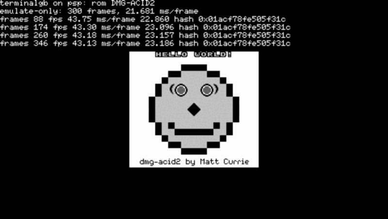
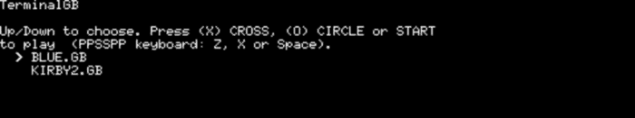

# Portability — what the core actually runs on

The README's "Embedding the core" section makes a claim that used to stop one step short:
`--no-default-features` builds the emulator with **one third-party dependency**, and it
*type-checks* for wasm32, Windows, aarch64 Linux and macOS. A type check cannot tell you
that a 32-bit machine has no 64-bit atomics, that a `usize` leaked into a file format, or
that a shift is architecture-dependent. **Running it can.**

This page records what has been run, on what, and what it cost — and says plainly which
rows are still only a compile.

Everything below was measured on 2026-08-15. Reproduce the Linux rows with
`make test-cross`; the PSP with `tools/psp-build.sh`.

---

## 1. The board

| Target | Status | Evidence |
|---|---|---|
| `x86_64-unknown-linux-gnu` | **runs** — the development platform | everything |
| `aarch64-unknown-linux-musl` | **runs**, frame-identical | `make test-cross`, under `qemu-aarch64` |
| `armv7-unknown-linux-musleabihf` | **runs**, frame-identical | `make test-cross`, under `qemu-arm` |
| `i686-unknown-linux-musl` | **runs**, frame-identical | `make test-cross`, natively |
| `mipsel-sony-psp` (**PlayStation Portable**) | **runs Pokémon Blue**, ~42 fps | §3, under PPSSPP |
| `wasm32-unknown-unknown` | **runs** in a browser, with audio | `docs/web-audio.md` |
| `x86_64-pc-windows-msvc` | **builds and smoke-tests** on a real Windows runner | `.github/workflows/release.yml` |
| `x86_64-apple-darwin`, `aarch64-apple-darwin` | **type-checks only** | `cargo check`; nobody has linked or run it |
| `armv7-sony-vita-newlibeabihf` (**PS Vita**) | not attempted — *the cheapest console left*, §5 | — |
| `armv6k-nintendo-3ds`, `aarch64-nintendo-switch-freestanding` | not attempted, §5 | — |
| any big-endian machine | **never run**, §6 | — |
| bare metal / `no_std` | **not possible without a rework**, §7 | — |

**`std` is required and `no_std` is not a flag away.** `Vec`, `Box<dyn …>`,
`std::sync::Mutex` in the FFI shim and `PathBuf` in the battery layer are all load-bearing.
Embedded *Linux* is fine — that is what the aarch64/armv7 rows above are. Bare metal is a
rework of the MBC and battery layers; see §7.

---

## 2. `make test-cross` — running the core on other architectures

`tools/run-cross.sh` builds `--no-default-features --example headless` for each target,
runs it on a real cartridge, and requires the result to equal this machine's **exactly**:

```
== host x86_64: building the reference
   frame hash 0x01acf78fe505f31c
   state bytes 142090

== aarch64-unknown-linux-musl
   PASS: identical to the host
== armv7-unknown-linux-musleabihf
   PASS: identical to the host
== i686-unknown-linux-musl
   PASS: identical to the host
```

Two lines are compared and both earn their place. **`frame hash`** is every pixel of the
frame after 300 frames of dmg-acid2. **`state bytes`** is the save-state length: it is
142,090 on 32-bit and 64-bit alike, which is the observable form of `savestate`'s
`Writer::usize` storing a `u32` — a save state written on a phone loads on a desktop.

*How it needs nothing installed.* The linker is **`rust-lld`**, which every rustup
toolchain already ships, and the targets are all **musl**, for which rustup ships a
prebuilt `libc.a`. No C cross-toolchain is involved. The only external requirement is
`qemu-<arch>-static` to execute a foreign binary; a missing one **skips that target
loudly** rather than passing it silently. Without root:

```sh
dnf download qemu-user-static-aarch64
rpm2cpio qemu-user-static-*.rpm | cpio -idmu
GB_QEMU_DIR=$PWD/usr/bin make test-cross
```

*Teeth, proven.* Changing `examples/headless.rs`'s FNV constant to
`0x0000_0100_0000_01b3usize as u64` — a bug that is invisible on the host and wrong on any
32-bit machine — turns armv7 and i686 red and the script exits 1. The host build does not
notice.

*Not in the list, deliberately:* `riscv64gc-unknown-linux-musl`. The emulator compiles for
it, but this package declares `crate-type = ["cdylib", "rlib", "staticlib"]` for the FFI
build, and a musl target that *supports* `cdylib` then tries to link one against a shared
libc that rustup's musl sysroot does not ship. The three targets above escape it only
because rustc drops `cdylib` for them with a warning. That is a packaging quirk of this
repository, not a finding about RISC-V.

---

## 3. The PlayStation Portable

**It runs Pokémon Blue.** Aspect-correct and full-height on the 480x272 panel, from the
memory stick, with the game's own battery save beside it — measured at **41.9 fps in the
overworld and 41.2 fps in a battle**, against the DMG's 59.7275 Hz.



*dmg-acid2 rendered by TerminalGB running on a PSP. The frame hash printed on every line
is `0x01acf78fe505f31c` — see §3.2.*

### 3.1 What was measured, and on what

Everything in this section is **PPSSPP 1.20.4 on this desktop, not a PSP**. Nobody here has
a PlayStation Portable, so **no number below has been seen on real hardware** and that is a
gap, not a footnote. Two things say the figures are not merely PPSSPP's frame rate:

* The emulator reads `sceKernelGetSystemTimeWide`, and moving the CPU from 222 MHz to
  333 MHz changed the reported cost by **exactly 1.5000x** (32.537 → 21.681 ms/frame).
  A wall-clock number would not scale with the emulated clock like that, so PPSSPP is
  deriving it from emulated cycles and the host is not the limiter.
* Which also means it is a **cycle count divided by a clock**, and PPSSPP does not model
  the PSP's caches. Our working set (VRAM, WRAM, ROM banks, tables) does not fit in a
  32 KB / 16 KB cache, so **real hardware is more likely to be slower than these numbers
  than faster.**

Configuration: `mipsel-sony-psp`, CPU at 333 MHz, `standard` picture mode (the cheap
scanline renderer — `identical` was never in play), no APU installed, `opt-level = 3` with
fat LTO and one codegen unit.

| Workload | fps | work / frame | of which emulation | worst frame |
|---|---:|---:|---:|---:|
| Pokémon Blue, overworld | 41.9 | 23.9 ms | 22.4 ms | 24.7 ms |
| Pokémon Blue, wild battle | 41.2 | 24.3 ms | 22.8 ms | 24.9 ms |
| dmg-acid2 | — | — | 21.7 ms | — |

The budget is **16.743 ms**. So the PSP build is at about **70 % of full speed** and needs
roughly **1.4x** more. `fps` is under the frontend's own pacer, so it is a floor; `work` is
measured before the pacer sleeps and is the number that decides whether 59.7275 Hz is
reachable.

### 3.2 The determinism is the proof the port is exact

The per-frame hash printed by the PSP build is `0x01acf78fe505f31c`. It is:

* **identical on every frame** of a 1,500-frame run (dmg-acid2 is a static picture), and
* **identical to the x86-64 desktop build**, and to aarch64, armv7 and i686.

That is a stronger claim than "it looks right". A Game Boy emulator has a great many ways
to be *nearly* correct — one dot of PPU phase, one M-cycle of timer, one bit of an APU
register — and every one of them changes the frame. Five machines across three
architectures and two pointer widths producing the same 23,040 pixels means the port
changed the *host*, not the *emulation*.

### 3.3 The one portability bug, and why only building for the target found it

The core did not compile for `mipsel-sony-psp`. One error, in one line:

```
error[E0432]: unresolved import `std::sync::atomic::AtomicU64`
```

`sound::host_status` counted audio-device errors in an `AtomicU64`. **A 32-bit target need
not have 64-bit atomics, and MIPS32 does not** — `std::sync::atomic::AtomicU64` does not
exist there at all. It is `AtomicU32` now, widened to `u64` on read so the published
`Snapshot` type is unchanged; a counter of audio-device errors cannot reach 2^32 in a
session.

This is the kind of defect the rest of this page exists to catch, and note what did *not*
catch it: armv7 and i686 are 32-bit and both build fine, because both have 64-bit atomics
(`ldrexd`, `cmpxchg8b`). Neither `cargo check --target` nor a 32-bit run would have found
it. **Only building for the actual target did.** `host_status` is compiled on every build
including the embedding one, so this made the whole emulator unbuildable for a class of
target while every gate stayed green.

### 3.4 What it took to get `std` on a PSP

`mipsel-sony-psp` is **Tier 3 and `no_std` only** in upstream Rust. That is not a
formality — asking stock nightly for a std build fails *inside std itself*, before it ever
reaches our code:

```
error[E0432]: unresolved imports `crate::sys::thread_local::key::LazyKey`, `…::set`
error[E0425]: cannot find function `fill_bytes` in module `sys`
error: could not compile `std` (lib) due to 14 previous errors
```

So `std` comes from a third-party **sysroot overlay**
([AndrewAltimit/rust-psp](https://github.com/AndrewAltimit/rust-psp), MIT, a fork of
[overdrivenpotato/rust-psp](https://github.com/overdrivenpotato/rust-psp)) which
reimplements std's internal platform layer against PSP syscalls —
`sceKernelCreateThread` for `std::thread`, `sceKernelLwMutex*` for `Mutex`, `sceIo*` for
`std::fs`, `sceKernelGetSystemTimeWide` for `Instant` — and rebuilds std from it with
`-Z build-std`. `std::net` and `std::process` return `ErrorKind::Unsupported`; neither is
in `--no-default-features`.

**Those internals are unstable with no compatibility promise, and the overlay rots.** On
nightly-2026-08-14 it does not compile (`sys::fs`'s `set_permissions_nofollow` signature
moved, among 18 errors); on the nightly its own CI pins, `nightly-2026-04-14`, it builds
first time. `tools/psp-build.sh` pins the nightly *and* the overlay commit for that reason,
and bumping either is real work rather than a version bump. That is the honest cost of the
PSP: **not a target you add, a toolchain you maintain.**

What our code needed on top of all that was nothing at all — the emulator crate compiles
unmodified once `AtomicU64` is gone, and `#![feature(restricted_std)]` is required only in
the *binary* crate (`platform/psp/src/main.rs`), never in the library.

### 3.5 The frontend

`platform/psp/` is ~350 lines and uses only the public embedding API. It is **not a
workspace member and must never become one** — it needs nightly, `-Z build-std` and a
third-party std overlay, and none of that may reach `make embed`, `cargo test` or a
`cargo install`. `make embed` still reports exactly one third-party dependency.

* **Ask for 333 MHz.** A PSP boots at 222 MHz. `scePowerSetClockFrequency(333, 333, 166)`
  is one call and is worth exactly 1.5x — the single largest lever there is.
* **Let the GE scale the picture.** The frame is copied row-wise into a 256x256 staging
  texture in *cached* RAM and drawn as one quad. That costs **1.5 ms**; the emulation
  either side of it costs 22.4. Writing per-pixel into uncached VRAM instead was measured
  at the same 1.5 ms *for an unscaled 1:1 blit*, so the hardware path is the one that
  scales for free.
* **Aspect is corrected inside the texture, not by shrinking the quad.** The picture is
  written at column 47 of the staging texture and 254 texels are sampled across the whole
  panel, so the untouched black texels become the pillarbox. Measured: the picture lands on
  screen columns 89..391, which is 160 x 272/144 = 302 px centred, to the pixel.
* **A ROM picker off the memory stick**, `std::fs::read_dir` over
  `ms0:/PSP/GAME/terminalgb/roms` (then `ms0:/roms`, then `host0:/roms`).
* **Save states**: `<rom>.gbss` beside the cartridge is loaded at boot, L saves, R loads.
  That is also what makes a benchmark reproducible — the overworld and a battle are
  different loads and neither is reachable by mashing buttons.
* **Battery saves work.** `Gameboy::try_new_with_model(rom, Some(path), Auto)` wires the
  battery to `<rom>.sav` on the memory stick. There is no `$HOME` on a PSP and the core
  never looks for one — that is the embedding claim paying off. `fs::rename`, which the
  battery's atomic write depends on, *is* implemented by the overlay; the directory
  `sync_all` beside it is not, and is already `let _ =` in `src/mbc/battery.rs`.

### 3.6 Testing under PPSSPP — the keyboard map that reads as a broken build

**PPSSPP's default keyboard mapping does not spell the buttons the way you would guess**,
and the failure looks exactly like a frontend that ignores input. From its own
`controls.ini` (Android keycodes):

| PSP button | PPSSPP default key |
|---|---|
| **Cross (X)** | **Z** |
| **Circle (O)** | **X** |
| Square | A |
| Triangle | S |
| Start | Space |
| Select | Enter |
| D-pad | arrow keys |

So a prompt that says "press X" sends a tester's press to **Circle**. The picker therefore
names the *button glyph* and the PPSSPP key beside it, and accepts **Cross, Circle or
Start** — a menu has no reason to be strict, and "nothing happened" is the worst thing a
first launch can do.



Two more traps worth writing down:

* **Initialise the pad.** Without `sceCtrlSetSamplingCycle(0)` +
  `sceCtrlSetSamplingMode(Digital)`, `sceCtrlReadBufferPositive` returns whatever the
  buffer held — observed here as a ROM picker scrolling by itself with nobody touching it.
* **XTEST cannot drive PPSSPP here.** Synthetic X11 key events (`python-xlib`,
  `xdotool`-style) are accepted by the X server and never reach the flatpak's SDL window.
  Injecting through the kernel does work: `ydotoold` on a short socket path
  (`/dev/uinput` is group `input`, so no root is needed if you are in it), then focus the
  window first — a kernel-level key goes to whatever has focus, including the developer's
  own terminal.

### 3.7 What would close the 1.4x

Measured, in the order they were tried:

| Change | Emulation, ms/frame |
|---|---:|
| 222 MHz, no LTO, 16 codegen units | 37.2 |
| + fat LTO, one codegen unit | 32.5 |
| + `scePowerSetClockFrequency(333, …)` | **21.7** |
| `opt-level = "s"` instead of `3` | 23.4 — **worse**, so `"s"` is wrong here |
| `panic = "abort"` | 22.2 — inside the noise |

The clock and the build flags are spent. What is left:

1. **The core itself, profiled on MIPS.** 22.4 ms at 333 MHz is ~7.4 M MIPS cycles per
   Game Boy frame, ~420 instructions per emulated M-cycle, against ~114 x86 instructions
   for the same work. Some of that gap is real (in-order single-issue MIPS against a wide
   out-of-order x86) and some is almost certainly ours — nobody has ever profiled this core
   on a 32-bit in-order machine, and it is full of `u8`/`u16` arithmetic that MIPS must mask
   after every operation. **This is the work, and it is a project, not a flag.**
2. **The present path is already cheap** — 1.5 ms of 23.9. Even making it free leaves
   22.4 against 16.7.
3. **Accuracy for speed, if it were ever wanted.** The timer and APU are stepped on every
   CPU memory access (`MemoryManagementUnit::bus_tick`), which `docs/testing.md` measures at
   ~15 % on a pure-CPU benchmark and which is what makes Blargg `mem_timing` pass. A
   handheld build could give that up. **That is a product decision and it is not this
   crew's to take** — it would make the PSP a different emulator from the one every baseline
   in this repository describes.
4. **Real hardware might not agree with any of this.** See §3.1.

Honest summary: **the PSP plays Pokémon at ~42 fps, it is smooth and it is exact, and it is
not full speed.** Closing the last 1.4x is a MIPS profiling campaign on the core.

---

## 4. Building and running it yourself

```sh
./tools/psp-build.sh                 # → target/psp/EBOOT.PBP
```

Copy `EBOOT.PBP` to `ms0:/PSP/GAME/terminalgb/` and cartridges to
`ms0:/PSP/GAME/terminalgb/roms/`. For PPSSPP, that path is under
`~/.var/app/org.ppsspp.PPSSPP/config/ppsspp/PSP/GAME/` for the flatpak.

Per-second statistics are written to `<rom>.stats.txt` **beside the cartridge**, because
once the GE owns the framebuffer the debug console is gone and a number nobody can read is
a number nobody can check.

---

## 5. The consoles that were not attempted, and what each would cost

The Rust target must exist and it must have `std`; that single question separates these
sharply, and it is not the answer people expect.

| Console | Target | Upstream `std` | Cost |
|---|---|---|---|
| **PS Vita** | `armv7-sony-vita-newlibeabihf` | **yes, Tier 3 with full std** | **the cheapest console left** |
| Nintendo 3DS | `armv6k-nintendo-3ds` | work in progress | needs `ctru-rs` + devkitARM |
| Nintendo Switch | `aarch64-nintendo-switch-freestanding` | `no_std` only | as bad as the PSP, plus §7 |
| PSP | `mipsel-sony-psp` | `no_std` only | done — §3, and it needed a std overlay |

**The cheapest console port is the Vita, not the PSP.** `armv7-sony-vita-newlibeabihf`
carries full std *upstream*, so there is no sysroot overlay to maintain and no pinned
nightly that rots — the thing that makes §3.4 expensive simply is not there. It is also a
600 MHz quad-core ARM with a 960x544 screen, i.e. comfortably more machine than the 1.4x
the PSP is short by, and it plays PSP titles, so a Vita owner gets both. It needs VitaSDK
and `cargo-vita` for packaging, and `platform/psp/`'s shape — pick a ROM, blit a texture,
read a pad, save beside the cartridge — ports across almost unchanged.

The **3DS** is next: `ctru-rs` is a maintained ecosystem and the std story is real, but it
is `?` upstream and needs devkitARM. The **Switch** is the same shape of problem as the PSP
was, with a freestanding `no_std` target, and should not be attempted before §7.

None of these were attempted here and none should be quoted as "nearly working".

---

## 6. Big-endian: audited, never run

**No big-endian machine has run this emulator.** That matters for the GameCube, Wii and
Wii U, which are big-endian PowerPC and which mGBA supports.

It could not be tested here: rustup ships no std for a big-endian *musl* target, and the
big-endian *gnu* targets it does ship (`powerpc-unknown-linux-gnu`, `s390x-unknown-linux-gnu`)
cannot be linked without a glibc sysroot this machine does not have.

What an audit of the embedding build found, which is weaker evidence than a run and is
offered as exactly that: the save-state codec is explicitly little-endian byte by byte
(`src/savestate.rs`), there is no `transmute` and no reinterpreting slice cast anywhere in
the core, and the only native-endian code is `src/upscale/`, where `u32::from_ne_bytes` and
`to_ne_bytes` are used as a **symmetric** pack/unpack of one RGBA pixel that never crosses a
boundary — channels are extracted with `to_ne_bytes`, never with shifts. So big-endian is
*expected* to work. Until something runs, that is a prediction.

---

## 7. `no_std` and bare metal

Not a flag away, and here is the list:

* `Vec` and `Box<dyn …>` throughout — `alloc` would cover these.
* `std::sync::Mutex` in the FFI shim (`src/lib.rs` parks a `Gameboy` in a `static`).
* `std::path::PathBuf` and `std::fs` in the battery layer (`src/mbc/battery.rs`) — the
  cartridge-RAM persistence that `docs/testing.md` treats as a correctness feature, not a
  convenience.
* One `std::env::var` (`$GB_MODEL`, and only for `Model::Auto` — `Gameboy::new_with_model`
  bypasses it) and one `SystemTime::now` (only when an MBC3 clock cartridge's battery file
  is read or written).

`alloc`-only would need the battery layer restructured behind a storage trait the host
implements, and the FFI shim's `static Mutex` replaced. That is a real piece of design work
with a clear shape; it has not been done and should not be described as close.

---

## 8. Where this is enforced

* `make test-cross` — builds and **runs** the core on aarch64, armv7 and i686, and fails if
  any of them disagrees with the host by one pixel. In CI's `embed` job, which also keeps
  the existing type-check sweep for the targets that cannot be run there.
* `make embed` — the core alone, one third-party dependency, a cartridge run with no
  `$HOME` and no display.
* `make check-wasm` — the wasm build, which GitHub CI cannot protect on its own because
  merges land locally first.
* `tools/psp-build.sh` — the PSP, pinned. **Not in CI**: it needs a pinned nightly, a
  third-party checkout and `-Z build-std`, and it produces an artefact nothing here can
  execute. Run it by hand when `platform/psp/` or the core's host surface changes.
