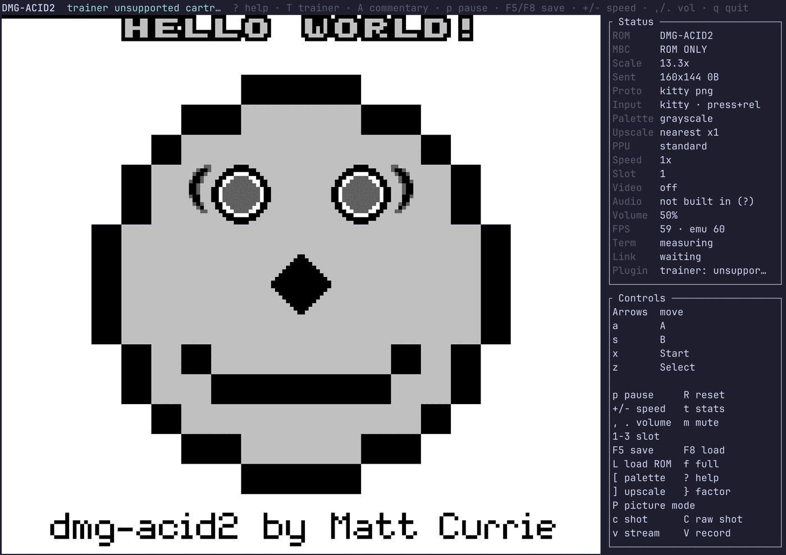
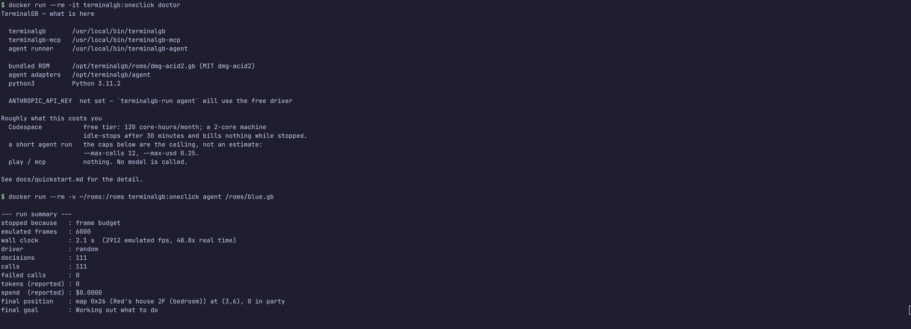

# Quick start — from a GitHub page to a running emulator

**One click, and a few minutes later you have a Game Boy running in a browser tab, with an
AI able to drive it.** You supply an API key if you want the model half, and a cartridge you
own if you want to play a game. Nothing else.

[](https://codespaces.new/Alchemy86/TerminalGB?quickstart=1)

There are three ways in, and they are the same environment:

| | what it is | you need |
|---|---|---|
| **Codespaces** | click the badge; GitHub builds [`.devcontainer/`](../.devcontainer/devcontainer.json) and gives you a terminal in the browser | a GitHub account |
| **Devcontainer, locally** | the same definition, in VS Code or the `devcontainer` CLI | Docker |
| **Plain Docker** | `docker build` the [`Dockerfile`](../Dockerfile) and `docker run` it | Docker |

The devcontainer builds the **`dev` stage of the repository's own `Dockerfile`**. That is
deliberate: a Codespace and a `docker build` are then the same environment rather than two
definitions that drift apart, and the container CI job builds both stages on every change to
either.

---

## 1. The three commands

One entry point, [`tools/oneclick/terminalgb-run`](../tools/oneclick/terminalgb-run), with one
subcommand per way of running this. It works from a clone (it finds the binaries under
`target/release`), inside the container (they are on `PATH`), and inside a Codespace.

```bash
./tools/oneclick/terminalgb-run play      # the emulator, in this terminal
./tools/oneclick/terminalgb-run mcp       # the MCP server on stdio, for an AI client
./tools/oneclick/terminalgb-run agent     # the headless agent, at speed
./tools/oneclick/terminalgb-run doctor    # what is present, what is missing, what it costs
```

Each takes an optional ROM path. With none, they use the bundled
[dmg-acid2](../third_party/dmg-acid2/) test ROM and say so.

In the container the script *is* the entrypoint, so the same commands read:

```bash
docker run --rm -it terminalgb:oneclick play
docker run --rm -i  terminalgb:oneclick mcp < requests.jsonl
docker run --rm     terminalgb:oneclick doctor
```

<p align="center">
  
</p>

<p align="center"><em><code>docker run --rm -it terminalgb:oneclick play</code>, with nothing
configured: the shipped image, the bundled MIT test ROM, real pixels over the kitty graphics
protocol, 59 fps. <code>Audio  not built in</code> is the image telling you what it is rather
than leaving you to suspect your sound card.</em></p>

<p align="center">
  
</p>

<p align="center"><em><code>doctor</code> and a headless <code>agent</code> run against a
mounted cartridge — 6,000 emulated frames at 48.8× real time in that capture, with no key set,
so the free local driver made all 111 decisions and nothing was spent.</em></p>

### `play`

The terminal frontend. A Codespace's terminal is xterm.js, which has neither the kitty
graphics protocol nor sixel, so the picture is drawn with **half-blocks** — a real answer, not
a failure, and the emulator's own status panel says which transport it negotiated. In a
terminal that does have one (kitty, WezTerm, Ghostty) you get real pixels. The ladder and the
measured costs are in [`docs/rendering.md`](rendering.md).

### `mcp`

The [Model Context Protocol server](mcp.md). This is the path that needs **no cartridge and no
API key of its own** — point Claude Desktop, Claude Code or any other MCP client at it and the
model can `observe`, `press_buttons`, `step` and `screenshot` a real running emulator. It works
against the bundled test ROM: the smoke test in
[`.github/workflows/container.yml`](../.github/workflows/container.yml) runs 120 frames and
requires a 160×144 PNG back.

`docs/mcp.md` has the client config blocks, every flag, and what each tool actually does.

### `agent`

The headless autonomous loop — the one that plays on its own, described in
[`docs/claude-plays.md`](claude-plays.md). Two things to know before you run it:

* **it reads Pokémon Red/Blue.** It has a structured view of the party, the map and the battle,
  and it declines a cartridge it cannot read rather than pressing buttons blindly. Against the
  bundled test ROM it will say so and stop — that is the design, not a broken install. For an
  AI driving *any* cartridge, use `mcp`.
* **without `ANTHROPIC_API_KEY` it runs the free local driver instead**, which exercises the
  whole substrate and prints the real emulated frame rate. That number is the point of the
  architecture: the emulator never waits on the agent.

---

## 2. The key

**One environment variable: `ANTHROPIC_API_KEY`.** Read at run time, by the adapter, from the
environment. It is never baked into an image, never written to a file by anything here, and
never passed on a command line — `argv` is world-readable in `ps` on a shared machine, which is
also why the state snapshot goes to the adapter over **stdin**.

**In Codespaces, use a Codespaces secret.** `.devcontainer/devcontainer.json` declares it, so
GitHub prompts you for one when you create the Codespace and stores it encrypted against your
account; it is injected into the running container's environment and is not part of the image,
the repository or any layer. Set or change it at
[github.com/settings/codespaces](https://github.com/settings/codespaces).

Locally, `export ANTHROPIC_API_KEY=…` before the command, or use `docker run --env
ANTHROPIC_API_KEY` (which passes the value through without it appearing in the command line).

Nothing here needs a key to start. `terminalgb-run doctor` reports whether one is **set** and
how many characters it is — never the value, not even a prefix, because that output is exactly
the kind of thing that gets pasted into an issue.

### The key must not survive in a run log — checked, both ways

The agent's NDJSON decision log is a **published artefact** here: people attach it to issues,
and a broadcast run publishes it. The host deliberately copies an adapter's **stderr verbatim**
into that log (`plugins/agent/src/lib.rs`, `log_record`), because a failing model call has to be
diagnosable. The shipped adapters never print the key. A third-party adapter written in an
afternoon might.

That was **reproduced, not assumed**: an adapter of four lines that echoes its environment to
stderr puts the key in `agent.ndjson` twice, on a normal run that exits 0.

So `terminalgb-run agent` greps its own run directory for the key's exact value before anyone is
invited to share it, and:

* **clean run** → `checked <dir> — the API key is not in the run artefacts`, exit code unchanged;
* **leaking run** → it names the directory, says the key is compromised and must be rotated,
  **deletes the files that contain it**, and exits non-zero.

The key is fed to `grep` on **stdin** rather than as an argument, for the `ps` reason above. Both
directions were exercised against a real cartridge and a real agent run: the leaking adapter lost
its `agent.ndjson` and kept its screenshot; the clean adapter kept both.

This is a backstop on the artefact, not a sanitiser on the pipe. If you write an adapter, **do
not print the key**: not in a debug line, not in an environment dump, not in an exception
message.

---

## 3. ROMs — nothing is shipped, nothing is fetched

**TerminalGB ships no game content and downloads none.** The one exception, and it is not an
exception to the principle, is the vendored MIT-licensed
[dmg-acid2](../third_party/dmg-acid2/) PPU test ROM: its licence permits redistribution and it
travels with its `LICENSE` into the image. That is what every command above boots when you name
no cartridge, and it renders a real picture — the one on the front page of the README.

To play a game, point the commands at a `.gb`/`.gbc` you own:

```bash
./tools/oneclick/terminalgb-run play /path/to/game.gb
docker run --rm -it -v "$HOME/roms:/roms:ro" terminalgb:oneclick play /roms/game.gb
```

In a Codespace, drag the file into the file explorer, or `gh` it in from a private repository of
your own. In-game saves are written **beside the ROM** as `<rom>.sav` — mount the directory
read-write if you want them to persist, and be aware that a Codespace's disk goes away when the
Codespace is deleted.

The `tests/` submodule carries Blargg's test ROMs and is **not** in the image: those carry no
explicit licence, so they are a submodule you initialise yourself, never something this project
redistributes. `git submodule update --init --depth 1 tests` inside the Codespace if you want
them.

---

## 4. How long, and what it costs

Measured, not estimated, on a 20-core x86-64 Linux box. A Codespace is **2 cores** by default,
so the build was measured again under a real two-CPU `cpuset` with a cold registry and a cold
`target/` — that column is the one to read for a Codespace, with the caveat that a Codespace's
individual cores may be slower than this machine's.

| | 20 cores | 2 CPUs (`--cpuset-cpus 0,1`) |
|---|---:|---:|
| `docker build --no-cache`, runtime image, end to end | **56 s** | — |
| `cargo build --release`, 136 crates from nothing — this is the Codespace's `onCreateCommand` | **37 s** | **58 s** |
| the same build inside the running devcontainer, over the bind mount | **52 s** | — |
| container start → 120 emulated frames → a 160×144 PNG back over MCP | **0.74 s** | — |
| `docker run … doctor` | **0.52 s** | — |
| 6,000 emulated frames of a real cartridge in the shipped image | **1.6 s** — 3,653 emulated fps, **61× real time** | — |

The two-core figure is only 1.6× the twenty-core one because the critical path is the
`terminalgb` crate itself, which is one large compilation unit however many cores you have;
the dependency crates parallelise, the tail does not.

| the image | |
|---|---:|
| on disk, uncompressed | **193 MB** |
| what you actually pull | **46 MB** |
| of which: Debian bookworm-slim | 85 MB |
| ca-certificates + python3 (the agent adapter is stdlib Python) | 52 MB |
| the three binaries, stripped | 7.9 MB |
| the **dev** image the Codespace builds (Rust toolchain and all) | 2.6 GB |

The dev image is large because it contains a whole Rust toolchain; that is the price of being
able to rebuild inside the Codespace, and it is a layer GitHub caches. The **shipped** image
does not contain a compiler.

**In money:**

* **A Codespace.** GitHub's free tier for personal accounts is 120 core-hours and 15 GB-months
  of storage per month; a 2-core machine therefore gives 60 hours. It **stops itself after 30
  minutes idle** by default and bills nothing while stopped — only storage. Check the current
  figures on [GitHub's billing page](https://docs.github.com/en/billing/managing-billing-for-github-codespaces/about-billing-for-github-codespaces),
  because they are GitHub's to change, not ours.
* **`play` and `mcp` cost nothing.** No model is called by either. An MCP client calls a model,
  but that is your client's usage and your client's bill, not something this repository spends.
* **`agent` is capped by the host, not by the prompt.** The defaults are `--max-calls 12` and
  `--max-usd 0.25`, plus a wall-clock ceiling; they are ceilings, not estimates, and they are
  enforced in the emulator rather than in the adapter so that editing the adapter cannot raise
  them. Raise or lower them with `TERMINALGB_AGENT_MAX_CALLS` / `TERMINALGB_AGENT_MAX_USD`.
  For what a decision actually costs through each adapter, see
  [`docs/claude-plays.md`](claude-plays.md) — the `claude` CLI adapter is several times more
  expensive per call than the API one, because it loads a whole coding-agent system prompt every
  time.

### Why this is cheap here

The properties that make a one-click plausible at all are unusual, and they are not packaging
tricks — they are consequences of how the emulator is built:

* **The headless build needs no window, no audio device, no image codec and no `$HOME`.** That
  is gated, not asserted: `make embed` runs the headless example with `HOME`, `DISPLAY` and
  `WAYLAND_DISPLAY` unset, and CI runs it on a machine with no system libraries installed.
* **The embedding build has exactly one third-party dependency** (`blip_buf`, the APU
  resampler). CI fails if a second appears. The container's feature set is larger than that —
  it wants a terminal and a PNG encoder — but the thing being packaged is small by
  construction, which is why 136 crates compile in under a minute and the binaries are single
  digit megabytes.
* **Audio is off by default**, so the image needs no ALSA, no PulseAudio and no sound card. The
  APU is still fully emulated; there is simply nowhere for it to play. That is also why a fresh
  clone builds with no `apt install` at all.

---

## 5. What is pinned, and why

| pinned | where | why |
|---|---|---|
| **Rust 1.83.0** | `Dockerfile` `ARG RUST_VERSION`, matching [`rust-toolchain`](../rust-toolchain) | the crate declares `rust-version = "1.83"`, and `make lint` runs `clippy -D warnings`, so a newer toolchain can fail the build on lints that did not exist when the code was written |
| **`debian:bookworm`** | `Dockerfile` `ARG DEBIAN_SUITE` | glibc and the Python major version stay put; a floating `:latest` would move both under you |
| **the dependency graph** | `cargo build --locked` against the tracked `Cargo.lock` | the build resolves to the same crates CI measured, and a build that *would* change the lockfile fails instead of silently drifting |
| **the base image tags** | `rust:1.83.0-slim-bookworm`, `debian:bookworm-slim` | tags, not digests, on purpose: a digest pin stops receiving Debian security updates, and this image has no persistent state to protect. Pin digests if you are publishing it |
| **the devcontainer's build** | `.devcontainer/devcontainer.json` `build.target: dev` | it cannot drift from the Dockerfile, because it *is* the Dockerfile |

Deliberately **not** pinned: the `@devcontainers/cli` and VS Code versions (GitHub's, not ours)
and the extension list (a convenience, not a dependency).

---

## 6. Building and running it yourself

```bash
git clone https://github.com/Alchemy86/TerminalGB
cd TerminalGB

# the shipped image
docker build --target runtime -t terminalgb:oneclick .
docker run --rm -it terminalgb:oneclick play

# the same environment the Codespace opens
devcontainer up --workspace-folder .
devcontainer exec --workspace-folder . ./tools/oneclick/terminalgb-run doctor
```

Without Docker at all, the ordinary path still works and needs no system libraries:

```bash
cargo build --release --no-default-features --features tui,mcp,image \
    --bin terminalgb --bin terminalgb-mcp --example claude_plays
./tools/oneclick/terminalgb-run play
```

That feature set is what the image uses, and it is chosen for a container rather than copied
from `default`: `tui` for the one frontend that works over `docker run -it`, `mcp` for the
protocol server, `image` for the PNG encoder the agent's screenshot channel needs. `desktop` is
left out (a container has no window) and so is `audio` (no sound card, and it would pull ALSA
in). [README §"Build modes"](../README.md#-build-modes--what-you-can-compile-and-why-you-would)
covers every other combination.

---

## 7. When it goes wrong

**`terminalgb-run doctor` first.** It prints every binary it can and cannot find, whether the
bundled ROM and the adapters are present, whether `python3` is there, and whether a key is set.

| what you see | what it is |
|---|---|
| the picture is coarse and blocky | a terminal with no graphics protocol — xterm.js in a Codespace is one. Real, not a fault; [`docs/rendering.md`](rendering.md) §4a |
| `play` draws nothing at all | not a TTY. `docker run` needs `-it` |
| `agent` says the cartridge has no map or party | the bundled test ROM is not Pokémon Red/Blue. Give it a cartridge, or use `mcp` |
| `mcp` prints nothing and seems to hang | correct — stdin and stdout are the protocol. It is waiting for a client |
| `NOT BUILT` from `doctor` in a Codespace | `onCreateCommand` has not finished, or failed. Re-run the `cargo build` line from §6 and read the error |
| the Codespace takes minutes to open | the `cargo build` in `onCreateCommand`. A GitHub **prebuild** moves that off your clock entirely |

---

## 8. What was verified, and what was not

Every number and every claim above was produced by running the thing, on this machine, and the
list of what was **not** exercised is part of the answer.

**Done, and observed:**

* the `runtime` image built cold with `--no-cache` and then *emulated*: 120 frames through the
  MCP server on stdio, a 160×144 PNG decoded out of the reply — the whole path, cartridge to
  protocol, not a `--version` string;
* `docker run --rm -it terminalgb:oneclick play` drew the picture in a real terminal, which is
  the first screenshot above;
* `docker run -v … terminalgb:oneclick agent /roms/blue.gb` ran 6,000 frames of a real
  cartridge at 61× real time inside the image;
* the `dev` stage built, and the devcontainer came up with the clone bind-mounted exactly as a
  Codespace mounts it. Its `onCreateCommand` completed in 52 s, after which `doctor`, `mcp`
  (frame decoded again) and `agent` all worked inside it;
* the API-key guard in **both** directions, against a real agent run: a deliberately careless
  adapter leaked the key into `agent.ndjson` twice, and the guard named it, deleted the file and
  exited non-zero; a clean adapter kept every artefact and the check said so.

**Not exercised:**

* **A GitHub-hosted Codespace.** A Codespace is created from a branch on GitHub, and this work
  was developed on a branch that is never pushed. What *was* driven is the same
  `devcontainer.json` and the same Dockerfile stage, brought up by the `@devcontainers/cli` —
  which is the tool Codespaces itself runs — on this machine. Unverified until it lands: the
  badge URL, GitHub's creation flow, and the secret prompt.
* **Codespaces prebuilds**, which would move the 58 s build off the user's clock.
* **arm64.** Everything here was built and run on x86-64. Nothing in the Dockerfile is
  architecture-specific, but that is a reading, not a measurement.

**A trap worth writing down** if you try any of this on Fedora or another SELinux distribution:
a bind-mounted workspace is denied to the container unless it is relabelled
(`chcon -Rt container_file_t <dir>`, or a `:z` mount flag). The failure is silent and
misleading — the container starts, the lifecycle command runs, and every path reads as
missing. Codespaces runs on Ubuntu and does not hit it.

## 9. What this page does not cover

* **What the agent is for**, how it perceives the game and what it can be used to study — the
  agent and MCP documentation owns that narrative:
  [`docs/agent-environment.md`](agent-environment.md) (why this is a good place to run agents),
  [`docs/agent-reference.md`](agent-reference.md) (every hook and field),
  [`docs/mcp.md`](mcp.md) (install), [`docs/claude-plays.md`](claude-plays.md) (design), and
  [`plugins/agent/`](../plugins/agent/). This page is only *how do I get one running*.
* **Publishing an image to a registry.** The container CI job builds and smoke-tests; it pushes
  nowhere. Publishing is a decision with a registry, a retention policy and a name behind it.
* **Anything about accuracy.** [`docs/status.md`](status.md) is the scoreboard.
