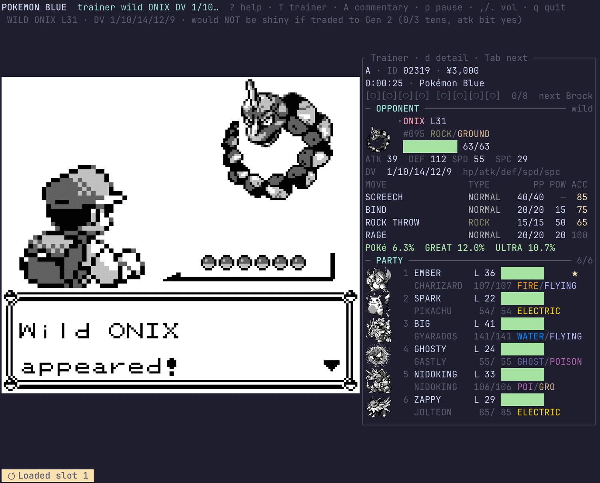
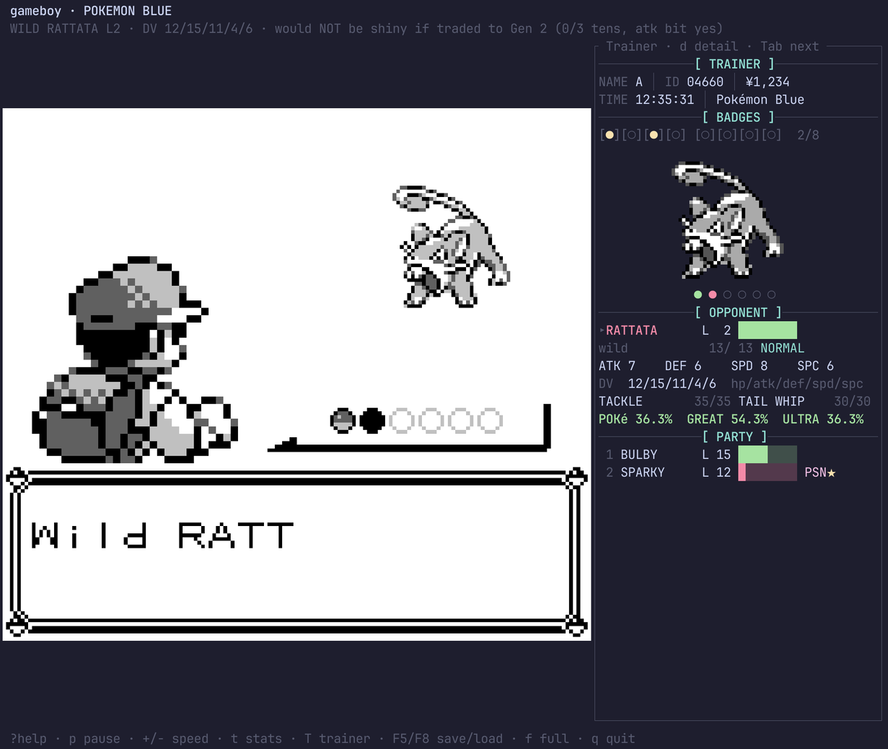
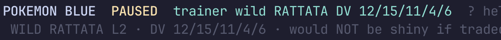
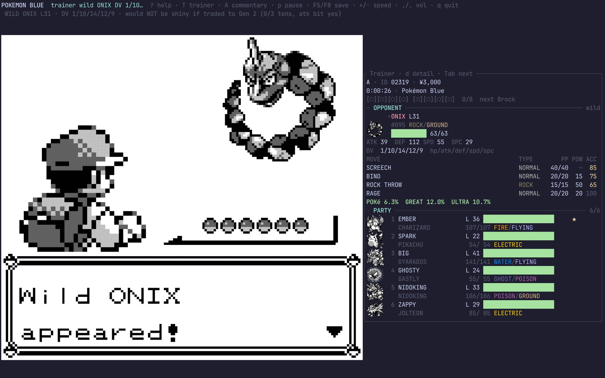
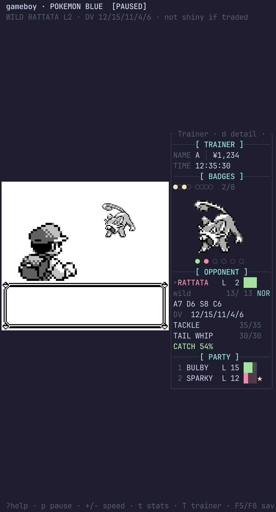
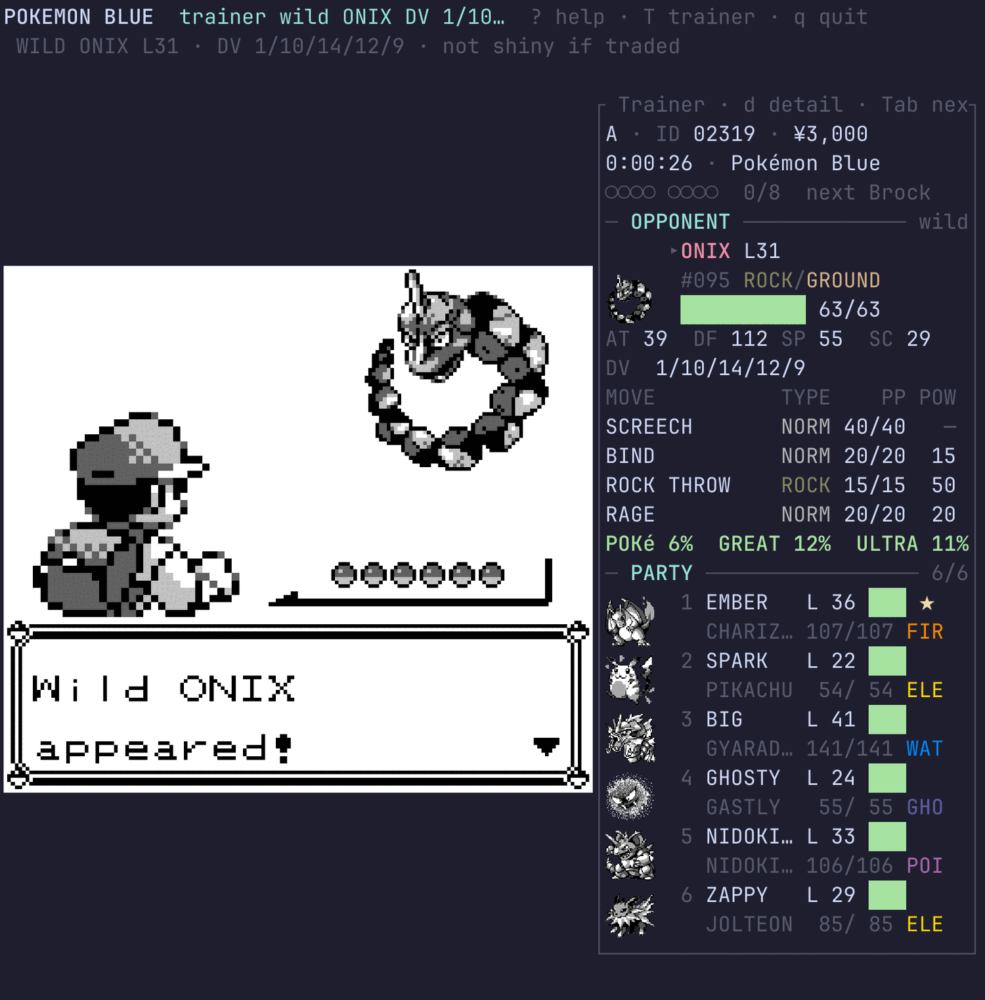
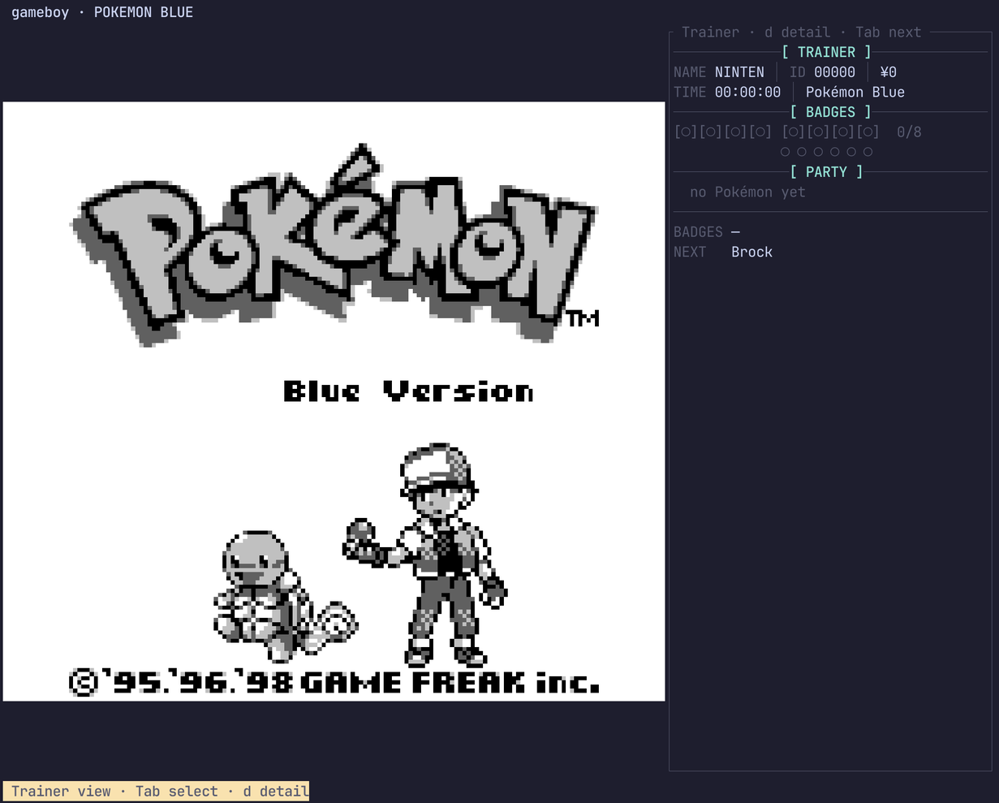

# The live trainer view

A read-only plugin that reads a running Pokémon Red/Blue cartridge and shows the party, the
badges and — during a battle — the opponent's stats, beside the game. It is the emulator's
own answer to the [Ironmon Tracker](https://github.com/besteon/Ironmon-Tracker), and the
second consumer of the plugin surface designed in [`debugging.md`](debugging.md).

Press **`T`** in the terminal frontend.

- Source: [`src/trainer/`](../src/trainer), panel layout in
  [`src/screen/trainer_view.rs`](../src/screen/trainer_view.rs), plugin contract in
  [`src/plugin/mod.rs`](../src/plugin/mod.rs).
- Harness: `cargo test --release --test trainer`
  ([`testharness/trainer.rs`](../testharness/trainer.rs)).

---

## What it shows

The panel is one bordered frame of **bracketed sections** — `[ TRAINER ]`, `[ BADGES ]`,
`[ OPPONENT ]`, `[ PARTY ]` — separated by centred rules. Everything inside a section is
aligned to fixed columns, so a value changing never shifts the one beside it.



**Header.** Name, ID and money on one packed line; play time and the cartridge on the next;
then eight discrete badge markers in two groups of four with the count. Held and missing
differ in **both** glyph and colour (`●` yellow against `○` dark grey) so the count survives a
monochrome or colour-blind read.

**Party slots.** Six markers under the sprite: filled and coloured by remaining HP, hollow and
dim for an empty slot, hollow and red for a fainted one. This is the only place an *empty*
slot is visible at all — the list below only lists what exists. The Pokémon currently in a
fight is underlined.

**Party.** Two lines each out of battle: marker, index, nickname, level, HP bar and status on
the first; species, `cur/max` and types on the second. `★` marks a Pokémon that would be shiny
in Gen 2. A gutter cell carries `▸` for the focus and `▌` for the Pokémon in the fight.

**Opponent (`[ OPPONENT ]`).** In a battle this section comes **first**, right under the
sprite, and the party below it collapses to one line each so all six still fit. Species,
level, HP bar and status; the encounter (`wild` / `safari` / `wild (demo)` / `trainer NAME`);
`cur/max` and types; all four battle stats; any stat stages on either side; the opponent's
DVs (the numbers behind the encounter banner's verdict — a trainer's Pokémon shows the fixed
`$98/$88` pair every time, which is itself worth seeing); the moves with PP; and the opposing
trainer's roster.

**Stat stages (`MOD` / `YOU`).** The stat numbers in a battle are the *modified* ones — a
Growl visibly takes an Attack of 10 down to 6 — so the panel says which stats are staged, in
which direction and by how many, for the opponent (`MOD`) and for your own active Pokémon
(`YOU`). Lowered is red, raised is green. See
[`derived::StatMods`](../src/trainer/derived.rs) for why the *stage* is shown rather than a
reconstructed "before" value, and for the Gen 1 ratios (`-1` is two thirds, not a half; `+1`
is 1.5×, so up and down do not cancel).

**Catch chance (wild encounters only).** Live odds for a Poké, Great and Ultra
Ball, recomputed every sample so they move as HP comes off and status lands, with
`▲` / `▼` for the direction since the last look. **Only for a wild encounter** —
a trainer's Pokémon cannot be caught, so a percentage there would be worse than
nothing. See [Catch chance](#catch-chance) for where the arithmetic came from.



**The opposing trainer's team.** In a trainer battle the roster is read from the enemy party
block and drawn as a row of small sprites in its own band, with a `TEAM ● ○ ?  n left` line in
the opponent section. Standing, fainted and *unreadable* are three different glyphs — "beaten"
and "not yet legible" are opposite facts. The strip is **progressive**: it needs 30 columns
and six spare rows, and where it does not fit the marker line carries the same information.

**Detail (`d`).** One Pokémon at a time, headed `[ OPPONENT ]` or `[ YOUR POKéMON ]` so whose
numbers these are is never left to be inferred from the picture. Four moves with PP (including
PP Ups), the DVs and their total out of 75, the invisible stat experience, Hidden Power's type
and base power, and the shiny-if-traded verdict.

**Sprite.** The focused Pokémon's front picture, decompressed from the cartridge, with its
background made transparent so it sits on the panel instead of in a white box (see
[Sprites](#sprites-from-the-rom-not-from-vram)).

### Focus: one ring drives the picture and the numbers

`Tab` walks a **focus ring**, and in a battle that ring **starts at the opponent**. Whatever
is focused is what the sprite shows and what `d` opens.

This used to be two different things. The sprite switched to the opponent on its own while the
stat block kept showing the player's party, so during a battle the panel put one Pokémon's
face over another's statistics — and there was no way to reach the opponent's own stat block
at all, which is most of what a tracker is for. The ring fixed both: `Tab` from a fresh battle
is the opponent, `Tab` again is your first party member, and the opponent's `[ OPPONENT ]`
section is on screen the whole time regardless.

**Wild-encounter banner.** The moment a catchable wild Pokémon appears, a row across the top
of the terminal names it, prints its DVs, and says whether it **would be shiny if traded to
Gen 2** — see [the section below](#the-wild-encounter-banner). It does not need the panel to
be open, and it is the only part of this feature that shows up uninvited.

| Key | |
|---|---|
| `T` | show / hide the panel |
| `d` | detail view for the focused Pokémon |
| `Tab` / `Shift-Tab` | next / previous in the focus ring |

`d` and `Tab` only bind while the panel is up, so they stay available as game buttons
otherwise. `T` is shifted deliberately: the A/B/Start/Select bindings are configurable
lowercase letters and an unshifted key could collide with somebody's.

### The bar across the top

One row above the game carries what a person looks for first: what is running,
anything abnormal (paused, fast-forwarding, recording), **what the plugins are
doing**, and the keys in constant use.



It replaced two worse places. The controls used to run along the **last** row —
the row a terminal clips when its pixel height is not a whole number of cells,
which is exactly how they were being lost. Plugin state lived **inside this
panel**, competing with the party and the battle for the space that is the
panel's actual job; and nothing on screen advertised that plugins existed at
all, so the link partner had to be found by reading the documentation.

**It costs no rows.** It replaces the title row rather than adding to it, and
the bottom row it freed is now taken only while a toast is up — so the tall
narrow split this was asked for gains a row rather than spending one.

Each part has its own ladder of shorter forms and shrinks through it before
anything is dropped ([`fit_bar`](../src/screen/tui.rs)), so a narrow window gets
`? help` rather than losing the controls, and never a *clipped* hint — which a
reader cannot tell from a complete one. The full key reference stays behind `?`.

**Not a menu.** The captain asked for "controls across the top, menu bits or
whatever". This is the status half. A genuine interactive menu — focus,
navigation, a modal stack, and every action reachable two ways — is a
substantially larger piece of work than a bar, and building half of one
silently would be worse than either. What exists today is a bar you read and a
key you press; a menu would mean a focus model over the existing single-threaded
`App` state machine, and it should be asked for deliberately rather than
arrived at.

### One composition, not two columns

The picture and the panel are laid out as a **single block**: adjacent, sharing
one vertical extent, centred together in the body
([`compose_block`](../src/screen/tui.rs)).

Three separate reports came out of that not holding. `fit_metrics` has always
centred the picture inside its own column while the panel was pinned to the
window's right edge, so in any window wider than the picture needs — which is
every window where the picture is height-limited — **all** the horizontal slack
landed in a band *between* them and the two halves read as unrelated things
pasted side by side. Vertically it was worse: the picture floated in the middle
of its column while the panel started hard at the ceiling and ran out well
before the bottom. Centring only the panel simply inverted that. A composition
has one alignment, so both pieces now get the same rectangle — its height is the
taller of what each needs, so neither is cropped to suit the other — and the
slack goes to the outside edges where it is symmetric and reads as margin.



**The panel scales with the picture rather than beside it.** Terminal text is
bound to the cell grid and cannot be made larger, so "scales" has to mean
something real: the panel takes **two fifths of the width** rather than a fixed
column count, the **sprite band grows with that width**
([`sprite_rows`](../src/screen/trainer_view.rs)) so the one part of the panel
that genuinely is an image scales like one, and the party columns **grow above
the design width** ([`party_cols`](../src/screen/trainer_view.rs)) so a wider
panel spends the space on longer names and more HP-bar resolution instead of
stranding it. Below the design width the same code shrinks them, which is the
degradation that was already there.



### Narrowing

The panel takes what the window leaves it rather than a fixed 40 columns, and every section
**drops its least valuable column first** instead of wrapping. Below `PANEL_MIN_W` (22) there
is no panel worth drawing and the width goes back to the game picture.



At 30 columns: the badge brackets go, the stat line compacts to `A6 D12 S10 C10`, the moves go
one to a row, the team strip stands down to its marker line, and long names truncate with `…`.
Everything still reads. `no_line_overflows_at_any_width` renders every section at every width
from 8 to 60 and asserts nothing exceeds it, so the guarantee is a test rather than arithmetic
in a comment.

Out of battle the panel closes with a plain separator and the badge summary:



---

---

## Where every address came from

**Not a wiki, and not from memory.** [`pret/pokered`](https://github.com/pret/pokered) was
built at its pinned RGBDS version (1.0.3) and the resulting ROMs checked against the
disassembly's own `roms.sha1`:

```
d7037c83e1ae5b39bde3c30787637ba1d4c48ce2  pokeblue.gbc
ea9bcae617fdf159b045185467ae58b2e4a48b9a  pokered.gbc
```

The cartridge this was developed against has **the same SHA-1 as `pokeblue.gbc`**, byte for
byte. Every address is therefore the value that build's own symbol file gives for a named
`pokered` label, not a number someone typed. `pokered.sym` gives the identical address for
every symbol used here, which is why one table serves both games.

Each constant carries its label in
[`src/trainer/gen1.rs`](../src/trainer/gen1.rs) and
[`src/trainer/rom.rs`](../src/trainer/rom.rs); the headline ones:

| What | Symbol | Address |
|---|---|---|
| Party size | `wPartyCount` | `$D163` |
| Party species list | `wPartySpecies` | `$D164` |
| Party structures (6 × 44 bytes) | `wPartyMons` | `$D16B` |
| Nicknames (6 × 11) | `wPartyMonNicks` | `$D2B5` |
| Badges (bitfield) | `wObtainedBadges` | `$D356` |
| Money (3-byte BCD) | `wPlayerMoney` | `$D347` |
| Trainer name / ID | `wPlayerName` / `wPlayerID` | `$D158` / `$D359` |
| Play time | `wPlayTimeHours` … | `$DA41`, `$DA43`, `$DA44` |
| In a battle? | `wIsInBattle` | `$D057` |
| **The opponent** | `wEnemyMon` | `$CFE5` |
| Your active Pokémon | `wBattleMon` | `$D014` |
| Species names | `MonsterNames` | `07:421E` |
| Move names / data | `MoveNames` / `Moves` | `2C:4000` / `0E:4000` |
| Type names | `TypeNames` | `09:7DAE` |
| Base stats + sprite pointers | `BaseStats` | `0E:43DE` |
| Internal index → Pokédex number | `PokedexOrder` | `10:5024` |

Three traps worth naming, because each silently produces plausible-but-wrong data:

1. **Species indices are not Pokédex numbers.** Gen 1's internal index has Rhydon at `$01`
   and Bulbasaur at `$99`. `MonsterNames` is indexed by internal index; `BaseStats` is indexed
   by *Pokédex* number, so the conversion through `PokedexOrder` has to happen in between —
   exactly as `GetMonHeader` (`home/pokemon.asm`) does, Mew's special case included.
2. **Every HP and stat is big-endian**, on a little-endian machine.
3. **The party and battle structures are different.** `party_struct` is 44 bytes with
   experience and an OT ID; `battle_struct` is 28 without them, so level and stats sit at
   different offsets. Reading one with the other's offsets gives numbers that look almost
   right.

### Games other than Red/Blue

The cartridge is identified by **title *and* header global checksum**, so a translation, a ROM
hack or a randomiser with a shifted layout is refused rather than displayed wrongly. The panel
then says which cartridge it saw and what it does support.

- **Yellow** is [`pret/pokeyellow`](https://github.com/pret/pokeyellow) — the same structures
  at different addresses. It needs its own symbol pass and its own `Game` variant: a table
  swap, not new decoding.
- **Gen 2** is [`pret/pokecrystal`](https://github.com/pret/pokecrystal), which changed the
  party structure itself. It needs a second decoder as well as a second table.

Neither is implemented. Saying so is the point — a tracker that guesses is worse than one that
declines.

---

## Sprites: from the ROM, not from VRAM, and on the panel rather than in a box

There were two honest options.

**VRAM** is trivial: the tiles are already decoded and whatever is on screen is by definition
correct. But VRAM only holds what is *on screen*. In the overworld that is the map and the
player — not one party Pokémon. A party panel sourced from VRAM would be blank almost all the
time, which is not the feature that was asked for.

**The cartridge** gives every Pokémon at any moment, in or out of battle, at the cost of
implementing the compression Gen 1 stores its pictures in. That is what
[`src/trainer/sprite.rs`](../src/trainer/sprite.rs) does, reimplemented from the format as
documented by `pokered` (`home/uncompress.asm`, `home/pics.asm`, `tools/pkmncompress.c`):
a square of up to 7×7 tiles, two bitplanes each run-length coded as 2-bit groups with a
biased unary length encoding, then delta-decoded ("a bit means *toggle*"), then combined by
one of three modes the encoder picks by trying all of them.

**It is checked, not asserted.** With `POKERED_GFX=<dir>` pointing at a built `pokered`
checkout, the harness decompresses thirteen species spanning every "Pics" bank and both
special-cased ones and compares them **byte for byte** against the 2bpp tiles the disassembly
itself produces — the exact oracle, since the ROM's compressed data was produced *from* those
bytes. All thirteen match. Without that directory it still decodes all 151 species and checks
each is square, in range, and not a flat colour.

The sprite is a **second terminal image**, with its own image id, its own cell rectangle, and
its cells marked `skip` — all three rules the render work paid for
([`terminal-render.md`](terminal-render.md)). Sharing the game picture's id would have the two
overwrite each other; sharing cells with text would blank the picture and, on Kitty, freeze
it.

---

### Transparent backgrounds — a flood fill, not a colour key

A Gen 1 picture is four palette indices and index 0 is the page the artwork sits on. Mapping
"every lightest pixel → transparent" is the obvious implementation and it is wrong in a way
that looks broken rather than subtly off: Gen 1 art uses the lightest shade **inside** the
figure for eyes, teeth, highlights, Charmander's belly and the core of its flame. A colour key
punches holes straight through the middle of the Pokémon.

`sprite::background_mask` is therefore a four-way flood fill from the border over
lightest-shade pixels only. Anything the fill reaches is page; a light region enclosed by
darker pixels is never reached and stays opaque. Four-connected rather than eight, so the fill
cannot squeeze diagonally between two touching outline pixels and eat the artwork behind them.
Measured on the starters: Charmander has **98** lightest-shade pixels inside its artwork,
Squirtle 100, Pikachu 281 — every one of which a colour key would have erased.

The alpha reaches the terminal two ways. Kitty's shared-memory path is `f=32` RGBA and carries
it already; the PNG paths (Kitty `f=100`, iTerm2) carry it as a `tRNS` chunk, which
`PngEncoder` now emits whenever a frame has a non-opaque palette entry. **A fully opaque frame
writes no `tRNS` at all and is byte-identical to what it was before**, so the game picture's
bytes on the wire did not move. Transparent pixels keep their opaque colour in RGB and only
carry `A = 0`, which is what makes the fallback safe: a transport that drops alpha (the
`GB_TERM_IMAGE=rgb` escape hatch, or the truecolour PNG path) renders exactly the opaque
picture it rendered before rather than a hole full of undefined colour.

**This exposed a latent bug worth remembering.** Cells covered by a terminal image are marked
`skip` so ratatui's diff leaves them alone — which also means they are never *erased*, so when
the layout moved an image the text that used to be underneath was still on the terminal.
An opaque sprite hid that for as long as the sprites had a white box behind them; a
transparent one showed it straight through as half-eaten words. Two fixes:
`skip` is now only set on frames where the picture is **not** being retransmitted (on a frame
where it is, the image is flushed after `terminal.draw` and covers the text anyway), and a
picture that stops being drawn is explicitly deleted (`a=d,d=i`) with a full repaint, because
a Kitty placement lives until it is deleted and redrawing the cells under it does not remove
it.

---

## Catch chance

**Disassembled from the cartridge, not taken from a wiki.** Gen 1's capture code
is unlike every later generation's in ways a modern formula gets confidently
wrong, so `ItemUsePokeBall` was located in the player's own ROM (bank 3, by its
`ld a,200` / `ld a,150` threshold pair, which occurs exactly once) and read
instruction by instruction. [`src/trainer/capture.rs`](../src/trainer/capture.rs)
carries the listing with the addresses it was read from, cross-referenced to
`pret/pokered`'s `engine/items/item_effects.asm`.

Three things the disassembly settles, each of which a plausible-looking formula
gets wrong:

1. **The ball check is a resampling loop, not a rejection.** `jr c, .loop` at
   `03:570E` jumps *backwards to the `call Random`*. A Great Ball does not fail
   when the first random byte exceeds 200 — it draws again. The ball's effect
   there is to make that byte uniform on `0..=200` (Great) or `0..=150` (Ultra
   and Safari), which makes a low byte likelier and is **help**. Read as a
   failure it makes every Great and Ultra number too low.
2. **The status bonus is subtracted, and can win outright.** `sub c` then
   `jp c` at `03:5729`: a random byte *below* the bonus catches the Pokémon with
   nothing else checked. Sleep and freeze are worth 25, every other status 12.
3. **The shake count is cosmetic.** Everything from `03:578D` runs after the
   outcome is already decided. "Aww! It appeared to be caught!" is three shakes,
   not a near miss.

Two consequences worth knowing, both of which fall straight out of the routine
and neither of which is intuitive: a **Great Ball beats an Ultra Ball at full
health** (its HP divisor is 8 rather than 12), and an **Ultra Ball beats a Great
Ball once the target is nearly down** (its tighter resampling bound is all that
is left to matter). At a catch rate of 255 with a Poké Ball, one hit point is a
**guaranteed** catch — the HP term overflows a byte and `03:5780` jumps straight
to `.captured`.

The number quoted is **exact, not sampled**: a closed form over the routine's own
integer arithmetic, assuming the up-to-three bytes from `Random` are independent
and uniform (which is the only assumption under which a single number can be
quoted at all, and it is stated in the module). The closed form is checked
against a literal transcription of the routine by enumerating **every reachable
random pair** across nine states and five ball types, and the worked cases in
the tests are derived from the disassembly rather than from the implementation.

**Verified against the running game**, not only in unit tests: harness check [5]
walks a real cartridge into real wild encounters on Route 1 and asserts that
`wEnemyMonActualCatchRate` (`$D007`, the byte the routine compares) equals the
species' catch rate in the cartridge's own `BaseStats` table — the one address
claim the feature rests on — and that the odds are a real probability that only
improves as HP falls and status lands. `GB_TRAINER_STATE=<path>` on that harness
writes a save state at the first encounter, which is how the screenshot above
was taken.

Below a quarter of maximum HP the HP term saturates and further chip damage does
nothing at all; the panel says so, because a player who does not know that keeps
whittling for no gain.

---

## The opposing trainer's roster

In a **trainer** battle (never a wild encounter) the panel reads the whole enemy party. The
addresses mirror the player's block byte for byte — count, a species list with an `$FF`
terminator, then the `party_struct`s, at the same `+1` / `+8` offsets — and
`the_enemy_block_mirrors_the_player_block` holds that relationship so the two cannot drift.

**An address is only a claim until something checks it**, so nothing is displayed unless the
block is self-consistent: the count is in range, every listed species is non-zero, and the
species list agrees with the species field of the `party_struct` beside it — two independent
copies of the same fact, written by the game at different times. A slot that fails is `known:
false` and draws as `?`; a block that fails wholesale sets `enemy_team_unknown` and the panel
says `TEAM ?`. That also covers the real transient: the first frames of a trainer battle,
before `LoadEnemyMonData` has run, where the block still holds the previous battle's contents.

Verified against the captain's own cartridge by playing a new game headlessly into the rival
battle in Oak's Lab (`cargo run --release --example trainer_layout -- --rom <rom>
--to-battle`): `wIsInBattle = 2`, `wEnemyPartyCount = 1`, and the species list, the
`party_struct` copy and `wEnemyMonSpecies` all read `$B1` — SQUIRTLE, which is what the rival
takes when you pick BULBASAUR.

The roster is drawn as **one** wide strip image, `n × 56` by `56` pixels, each Pokémon
bottom-centred in its own cell with transparent gutters and fainted members ghosted to
`A = 80`. One image rather than six is the whole design: six would mean six terminal image
ids, six placements and six PNG encodes every time the strip changed, in a panel 38 cells
wide where each would land under six cells anyway.

**What is not here: the trainer's own portrait.** The captain asked for the opposing trainer's
picture beside their team. `wTrainerClass` is available, but the pic pointers
(`TrainerPicAndMoneyPointers`) and the bank the trainer pictures live in are not among the
symbols derived in [Where every address came from](#where-every-address-came-from), and this
project's standing rule is that addresses are derived from a verified build rather than
guessed. Locating the table by signature is a plausible follow-up — the cross-check is strong
(every entry must decompress to a square picture) — but it is a separate piece of work and
inventing an address to ship a picture sooner is exactly what the refusal machinery exists to
prevent. The trainer's **name** is shown instead, on the encounter line.

## Derived values — what the game hides

The layer that makes this a tracker rather than a prettier party menu. Everything here is
already in memory; the game simply never shows it.
[`src/trainer/derived.rs`](../src/trainer/derived.rs).

**Would it be shiny in Gen 2?** Gen 1 has no shininess, but a Pokémon's DVs travel forward
through the Time Capsule unchanged and Gen 2 derives shininess *entirely* from them. So this
can be answered today, for a save that has never left Gen 1. The rule is `CheckShininess`
(`pokecrystal/engine/gfx/color.asm`): defense, speed and special DVs all exactly 10, and the
attack DV with bit 1 set — one of 2, 3, 6, 7, 10, 11, 14, 15. That is 8 of 16 attack values
with three fixed nybbles: **1 in 8192**. Worth knowing that perfect 15/15/15/15 DVs are *not*
shiny.

**Hidden Power.** Also a Gen 2 rule on Gen 1 data (`pokecrystal/engine/battle/hidden_power.asm`):
the type from the low two bits of the attack and defense DVs, the base power from the top bit
of all four plus the low two bits of special. Never Normal; 31 to 70 power.

**Stat experience.** Gen 1's ancestor of EVs, stored in the party structure and completely
invisible in game. Shown raw, with the conversion `CalcStat` (`pokered/home/move_mon.asm`)
applies.

**DV total** out of 75, including the HP DV — which is not stored but assembled from bit 0 of
the other four, again per `CalcStat`.

### Deliberately not derived

- **The Poké Ball.** There is **no ball field anywhere in the Gen 1 party structure** — the
  concept arrives in Gen 2, which stores it in the caught-data word. It cannot be shown for
  Red/Blue at any price, and inferring one would be fabrication. A future Gen 2 mode gains it.
- **Gender.** Gen 2 derives it from the attack DV against the *species' gender ratio*, and
  that ratio is Gen 2 data present nowhere in a Gen 1 cartridge. Deriving it means embedding a
  151-entry table from `pokecrystal` — a bigger and more debatable step than the rules above,
  so it is named rather than half-built.
- **Type effectiveness, catch odds, route encounters, move power/accuracy.** All computable
  from tables already in the ROM, all additive on this data, none implemented.

---

## Cost

The render path was rescued from 18 fps not long ago ([`terminal-render.md`](terminal-render.md))
and does not get the cost handed back.

- **Nothing is read per frame.** The plugin samples every `SAMPLE_EVERY` (6) emulated frames,
  about 10 Hz — a tenth of a second behind the game, which nobody can see.
- **A hidden panel reads one byte.** `TrainerPlugin::set_active(false)` stops the party read
  entirely; what survives is `watch_encounter`, which peeks `wIsInBattle` at the same 10 Hz and
  returns. In the overworld that is **one byte, six times a second** — the price of the banner
  working when nobody has the panel up, which is the whole point of it.
- **The encounter verdict is latched, not sampled.** Once a wild battle's DVs are read, the
  plugin holds the answer until the battle ends: no further reads, and the banner cannot
  flicker.
- **Sprites are decompressed once per species and cached**, so an unchanged party costs
  nothing, and the encoded image is only rebuilt when the focused species or the palette
  changes.
- With no plugin attached, `PluginHost::frame` is one `is_empty` test per frame.

## Read-only, structurally

The plugin is handed a `DebugView`, which borrows `&Gameboy`. It is not a convention that it
cannot write to the machine — it is the borrow checker. `MemoryManagementUnit::peek` is
likewise `&self`, so it cannot tick the bus, catch the APU up, or trip a register's read
side-effects. (The consequence: the I/O range `$FF00-$FF7F` reads back `0xFF` through `peek`.
Plain memory is exact, which is all a tracker needs.)

---

## The wild-encounter banner

> *"if a wild Pokémon is on screen, can we also confirm if it will be SHINY right there and
> THEN so we don't miss out."*

The party `★` answers the question for Pokémon you already own. This answers it **while a Ball
is still unspent**, which is the only moment the answer changes a decision.

### Why the answer exists that early

Three facts, each from the disassembly, are what make it work
([`src/trainer/encounter.rs`](../src/trainer/encounter.rs)):

1. **A wild Pokémon's DVs are rolled when the battle starts.** `LoadEnemyMonData`
   (`pokered/engine/battle/core.asm`) branches on `wIsInBattle`: a wild Pokémon gets two
   `BattleRandom` bytes into `wEnemyMonDVs`, before the battle is even drawn.
2. **Capture copies those exact bytes.** `_AddPartyMon`
   (`pokered/engine/pokemon/add_mon.asm`) takes its `.copyEnemyMonData` branch for a Pokémon
   caught in battle and copies `wEnemyMonDVs` verbatim into the new party entry. Nothing is
   re-rolled, so the verdict shown at the encounter is still true of the Pokémon in the Ball.
3. **The Gen 2 rule reads only DVs.** `CheckShininess` (`pokecrystal/engine/gfx/color.asm`):
   defense, speed and special all exactly 10 and bit 1 of the attack DV set.

### The wording is the feature

**Gen 1 has no shiny Pokémon at all.** Nothing in Red or Blue is shiny, and no string in this
feature says otherwise — every one of them, at every terminal width, reads *would be shiny if
traded to Gen 2*. A unit test asserts exactly that: it renders the banner at every width from
8 to 200 cells and fails if the word "shiny" ever appears without its qualifier. Getting this
wrong would be worse than not shipping it, because the captain would act on it.

### What gets a verdict, and what does not

| Situation | Verdict? | Why |
|---|---|---|
| Wild encounter (grass, water, fishing, cave) | **yes** | `InitWildBattle` sets `wIsInBattle` = 1 |
| Static / scripted (Snorlax, the birds, Mewtwo, Voltorbs, tower ghosts) | **yes** | `InitOpponent` falls through to `InitWildBattle` — an ordinary wild battle with rolled DVs |
| Safari Zone | **yes**, labelled `SAFARI` | catchable; the Ball being weighed is a Safari Ball |
| Trainer battle | **no** | Balls cannot catch a trainer's Pokémon, and its DVs are the *fixed* pair `ATKDEFDV_TRAINER`/`SPDSPCDV_TRAINER` = `$98`/`$88` — the same for every trainer Pokémon in the game, and never shiny. A verdict there is pure noise. |
| The old man's catching demonstration | **no** | `wBattleType` = `BATTLE_TYPE_OLD_MAN`: real rolled DVs, but the Weedle is never added to the player's party |
| Gift, starter, fossil, in-game trade | **no encounter to warn about** | see below |

**Gift, starter and traded Pokémon are the honest gap.** They never enter a battle, so there
is no moment before the decision — `_AddPartyMon` rolls their DVs with `Random` at the instant
they are handed over (its `; Not wild.` branch), by which time they are already yours. Their
verdict *is* shown, by the party panel's `★` reading the same DVs out of `wPartyMon*DVs`; it is
just retrospective rather than a prompt. There is nothing to fix here — the information does
not exist any earlier.

**Two wild Pokémon you are shown but cannot catch:** an unidentified ghost in Pokémon Tower
(no Silph Scope) and the ghost Marowak on 6F are both refused by `ItemUseBall` even though they
are wild battles. They still get a banner. That is a known, small overclaim of *catchability* —
never of shininess.

### How it is surfaced

The banner takes **a row of its own** across the top of the terminal, above the game picture
and never on it (a terminal graphics image owns whole cells — see
[`terminal-render.md`](terminal-render.md); a test asserts the two rectangles never intersect
at any window size, in both the windowed and fullscreen layouts).

- **A shiny verdict** fills the row: black on bright yellow, `★ WILD NIDORAN L7 WOULD BE SHINY
  IF TRADED TO GEN 2 ★ DV 8/14/10/10/10 …`, padded edge to edge so it reads as a bar rather
  than a sentence. It also raises a toast and rings the terminal bell — **once**, on the frame
  the Pokémon appears, which is when the captain is looking at the game and not at a panel.
- **An ordinary encounter** gets the same row, quietly: the species, the DVs, and *why* it is
  not shiny (`0/3 tens, atk bit yes`). A near miss is interesting, and a banner that only ever
  appears for a shiny gives no way to tell "working, and this one is ordinary" from "not
  working".
- The row **persists for the whole encounter**: the verdict is latched when the battle starts
  and held until it ends, so it cannot flash past.
- `shiny_alert` in `config.toml` — `on` (default: banner + toast + bell), `quiet` (no bell),
  `off` (no row; the verdict still appears in the panel's battle block).

**Terminal frontend only.** The trainer plugin is attached by `tui::load_session` and nowhere
else, so the desktop (`glutin`) and web frontends have neither the panel nor the banner. That
is the existing scope of the plugin, not a decision taken here.

### It does not depend on the boot model

The `Model` axis has landed, and for Pokémon Red/Blue it changes the **default**: the header's
CGB flag is clear, so `Model::Auto` now resolves to `GbMode::Classic` — a real DMG boot — where
this feature was originally developed under CGB compatibility mode. **Nothing here reads the
model, and nothing here is laid out differently under one.**

- `wEnemyMon` is at `$CFE5`, inside `$C000-$CFFF` — the *fixed* WRAM bank. There is no banking
  question at all for the DVs.
- `wIsInBattle` `$D057`, `wBattleType` `$D05A` and the party structures are in `$D000-$DFFF`,
  which goes through `wrambank` — initialised to **1 in both MMU constructors**
  (`MemoryManagementUnit::new` and `new_cgb`) and only ever changed by a write to `SVBK`
  (`$FF70`), which a DMG game never makes. Same physical bytes either way.
- The cartridge is identified from the ROM header's title and global checksum, not from the
  running model, so `Game::detect` is unaffected.
- Red/Blue has no CGB code path — it is a DMG game — so its WRAM layout is one layout.

**Checked on both, not assumed.** `cargo test --release --test trainer` was run under
`GB_MODEL=dmg` and `GB_MODEL=cgb`: three encounters each, every verdict agreeing with
`wEnemyMonDVs` read independently.

The one real difference is that `BattleRandom` is seeded from different startup state, so the
*particular* Pokémon and DVs a given button sequence produces are not the same:

| | `GB_MODEL=dmg` | `GB_MODEL=cgb` |
|---|---|---|
| 1st | PIDGEY L3 `$C4CA` @ step 3 | RATTATA L3 `$9F0B` @ step 13 |
| 2nd | RATTATA L3 `$D42D` @ step 5 | RATTATA L3 `$41CA` @ step 17 |
| 3rd | PIDGEY L3 `$4CCE` @ step 11 | PIDGEY L3 `$3870` @ step 34 |

The harness never asserts specific DVs, only that the verdict matches the memory, so it holds
under either model — but **do not pin a DV value in a test**, and do not expect the printed
species and DVs to reproduce. They also move with *emulation timing*: the Mooneye core-timing
work (real timer, 5-cycle interrupt dispatch, timed OAM DMA) changed every one of these numbers
again, because `BattleRandom` is driven from `DIV` and the frame counter. That the values move
while the verdicts keep agreeing is the point — the check is on the agreement, not the values.

The trainer panel's battle block also gained the opponent's DVs on every battle, trainer
battles included — `$98/$88` showing up every single time is itself worth being able to see.

---

## How this was verified

Five checks, in increasing order of what they prove
([`testharness/trainer.rs`](../testharness/trainer.rs)):

1. **All 151 front sprites decode** to a square of 1..=7 tiles, in range, not a flat colour.
2. **Thirteen of them are byte-identical** to `pokered`'s own 2bpp output.
3. **The cartridge's own battery save is read** through the real boot path.
4. **The panel is compared against the game's own screen.** `wTileMap` (`$C3A0`, 20×18) holds
   Gen 1 charmap codes directly, so decoding it reads back exactly what a player sees. The
   harness plays a new game to the overworld, drives the START menu to **SAVE** so the *game*
   writes an internally consistent save, edits a known party into the party block, fixes
   `sMainDataCheckSum`, boots into it, and then opens the game's own POKéMON menu and compares.
   (A hand-built save **hangs** the game — its map, tileset and sprite state are not
   consistent — which is why the game has to write the base save itself. The battery file is
   `<rom>.sav`, raw cartridge RAM with no header, so SRAM bank 1 begins at file offset
   `0x2000`; see [`src/mbc/battery.rs`](../src/mbc/battery.rs).)

**A fifth, for everything a battle adds.** The four above cannot reach a battle, so
`examples/trainer_layout.rs --to-battle` plays a **new game** on the real cartridge into the
rival battle in Oak's Lab — mashing A plays Gen 1's intro on its own, and a per-map-biased
random walk finds the doorways — then dumps the raw enemy block beside what the plugin made of
it, and the panel beside both. That run is what verified the enemy-roster addresses, the
opponent's stats being the opponent's, and the stat-stage line: one GROWL lands, the enemy's
stat-mod byte reads `6`, and the panel prints `ATK 6` with `MOD ATK-1` under it.

It also caught a bug nothing else would have: the stat-mod block is **zeroed WRAM** until
`InitBattleVariables` writes the neutral 7s, so for the first frames of a battle every byte
reads `0` — which taken at face value is `-6` on every stat. `StatMods::is_valid` refuses
anything outside `MIN_STAT_MOD..=MAX_STAT_MOD` for exactly that reason.

The same example renders the panel from a fixture at any width
(`cargo run --release --example trainer_layout -- 40 34 28 24`), which is how a layout change
is *looked at* rather than reasoned about, and writes the sprites with their alpha to PNGs
(`--sprites <dir>`) plus an ASCII map of the flood-fill mask, which is how the
"does the belly survive" question is answered by eye on the two species that matter.

That fourth one is the real proof of the *addresses*, because it checks them against the game
rather than against another copy of our own assumptions:

```
    the game's own party menu:
      |   BULBY      15    |
      |    '         22/ 41|
      |   SPARKY     12 PSN|
      |    '         18/ 34|
```

and the panel, from the same moment:

```
      ┌ Trainer ─────────────────────────────┐
      │A       ID 04660  ¥1,234              │
      │12:34:56  Pokémon Blue                │
      │Badges 2/8  ●○●○○○○○                  │
      └──────────────────────────────────────┘
      ┌ Party (d: detail) ───────────────────┐
      │▸1 BULBY         L15 ████░░░░         │
      │    BULBASAUR   22/41  GRASS/POISON   │
      │ 2 SPARKY    PSN L12 ████░░░░★        │
      │    PIKACHU     18/34  ELECTRIC       │
      │badges: Boulder, Thunder              │
      │next: Misty                           │
      └──────────────────────────────────────┘
```

SPARKY is given the canonical shiny DV pair `$EA`/`$AA` on purpose, so the `★` and the
derived layer are covered by the same run. The game's own CONTINUE screen independently
confirms the badge and play-time addresses (`BADGES 2`, `TIME 12:34`).

5. **A real wild encounter is driven, from a brand-new game.** This is the one the shiny
   verdict stands or falls on. The harness plays a new game, has the *game* write a save,
   edits in a party and one event flag, then **walks**: bedroom → stairs → front door → east
   along Pallet Town → north through the fence gap → Route 1, and paces the grass at the
   southern end until `wIsInBattle` reads 1. It then compares the latched verdict against
   `wEnemyMonDVs` read independently, with the Gen 2 rule **re-implemented in the harness**
   from the pokecrystal constants rather than by calling the code under test — and checks the
   verdict clears when the battle ends. Three encounters per run, in about two dozen steps:

   ```
   [5] a real wild encounter
       walked a new game to ROUTE_1, arriving at (34, 10)
         step   3: PIDGEY L3 wEnemyMonDVs $C4CA -> DV 0/12/4/12/10 -> would not be shiny if traded to Gen 2
                  banner:  WILD PIDGEY L3 · DV 0/12/4/12/10 · would NOT be shiny if traded to Gen 2 (1/3 tens, atk bit no)
         step   5: RATTATA L3 wEnemyMonDVs $D42D -> DV 9/13/4/2/13 -> would not be shiny if traded to Gen 2
         step  11: PIDGEY L3 wEnemyMonDVs $4CCE -> DV 0/4/12/12/14 -> would not be shiny if traded to Gen 2
       3 wild encounter(s) in 11 steps, every verdict agrees
       the same encounter with the canonical shiny DVs $EA/$AA:
          ★ WILD PIDGEY L3 WOULD BE SHINY IF TRADED TO GEN 2 ★ DV 0/14/10/10/10 · nothing is shiny in Gen 1
   ```

   **It fails when it under-delivers.** Asking for three encounters and reporting success on one
   is the same defect class the suite was just cleaned of — a check quietly doing less than it
   claims — so a short run is a FAIL, not a pass with a smaller number. That rule earned its
   keep immediately: under CGB the walk wedged after the second battle and spent its whole
   budget pressing a direction key into a menu. Cause: the post-battle "Got away safely!"
   clean-up pressed **A**, and an A one frame after the text closes opens the START menu, which
   eats every direction key thereafter. It presses **B** now — B advances a text box just as A
   does, closes a menu, and can never open one — and the pacing loop detects a position that
   has not moved for eight steps, presses B and re-anchors, reporting how many times it had to.

   **Two traps this ran into, both worth not rediscovering.** (a) *You cannot teleport the
   player by editing `wCurMap`.* `LoadSAV` (`pokered/engine/menus/save.asm`) sets
   `BIT_NO_PREVIOUS_MAP` on `wCurMapTileset` right after restoring the main data, and
   `LoadMapHeader` (`home/overworld.asm`) sees that bit, clears it and **returns without
   loading the header** — the whole `wCurMapHeader` block lives in the save, so on a continue
   the game trusts it. Change the map without the header and the game reads the new map's
   blocks through the old map's `wCurMapDataPtr`; the observed result is a jump into `rst $38`
   or an illegal opcode within a second. Hence walking. (b) *Oak stops a new game at the north
   exit of Pallet Town* — `PalletTownDefaultScript` opens with
   `CheckEvent EVENT_FOLLOWED_OAK_INTO_LAB / ret nz`, so setting that one bit (`wEventFlags`
   `$D747`, bit 0) skips the entire introduction, the starter choice and the rival battle.
   A shiny wild Pokémon is 1 in 8192, so no run will meet one; what the harness can and does
   check is that the same real encounter struct with the canonical `$EA`/`$AA` pair flips the
   verdict and renders the loud banner.

**The save is never the user's.** The ROM and its battery file are copied into `target/`
before anything runs, because the harness presses buttons at menus and the MBC writes saves
next to the ROM path.

### What could not be verified

The cartridge this was developed against **has an empty battery save** — both `.gbsave` files
next to it are entirely zero — so there was no existing game to read a real party out of.
Check 3 reports that honestly rather than showing the title-screen demo's leftovers, and check
4 exists precisely because of it. A human with a save in progress should press `T` and confirm
the panel matches their party; that is the one thing a harness cannot do.

**Nobody has yet seen a shiny-if-traded banner on a real encounter**, because the odds are 1
in 8192 — the harness proves the reads and the rule against the machine, and proves the loud
rendering with substituted DVs, but the two halves have never met in one live encounter. The
wording and the layout of that banner are worth a human's eyes; `shiny_alert = quiet` is there
for anyone who does not want the bell.

---

## What the Ironmon Tracker contributed, and what was done differently

The tracker is MIT-licensed Lua for BizHawk/mGBA and targets Gen 3, so **its addresses do not
apply and its code was not used** — there is nothing to lift even in principle. What transfers
is what it learned from people staring at it for hours:

**Taken.**
- A **compact default with detail on demand**, rather than one dense screen. The tracker shows
  one Pokémon's essentials and hides everything else behind screens; the split here is
  compact party list versus per-Pokémon detail.
- **HP coloured by fraction** — three bands, red under a fifth, amber under a half. It is the
  fastest thing on the panel to read.
- **One consistent "unknown" glyph** (`Constants.HIDDEN_INFO = "?"`). A blank reads as zero
  and a zero is a lie; stat experience is marked `?` during a battle, where the structure
  genuinely does not carry it, and an empty move slot gets a dash because it really is empty.
- **Surfacing derived and hidden values** as a first-class feature rather than a curiosity.

**Done differently, because Gen 1 is not Gen 3.** There are no abilities, natures or held
items to show; "special" is one stat, not two; DVs run to 15 rather than IVs to 31. That space
goes to DVs, stat experience and the derived layer instead.

**Not taken, and named as a follow-up: the tracking itself.** The Ironmon Tracker does not
just read current memory — it *remembers across a run* which moves an enemy species has used,
what levels were seen, what each route produced. That accumulated knowledge is what makes it a
tracker rather than a live readout, and it is a genuinely strong idea. It is not in this
change: it needs a per-run store with a lifecycle (when does a run start? what resets it?
where is it persisted?) and that is a design conversation, not an increment. The plugin
already samples at a fixed cadence with a snapshot in hand, which is the right place to
accumulate from when it happens.

---

## Follow-ups

In rough order of value:

1. **Per-run memory** — enemy moves seen, levels encountered, route data. The thing above.
2. **Type effectiveness against the current opponent** — the type chart is in the ROM.
3. **Catch odds** — the catch rate is already read; the formula is in `pokered`. It belongs
   *next to the shiny banner*: "would be shiny, and a Great Ball has an N% chance" is the
   complete answer to the question the banner half-answers.
4. **The ghost exception.** Two wild Pokémon get a banner and cannot be caught — an
   unidentified Pokémon Tower ghost and the ghost Marowak on 6F (`ItemUseBall`,
   `pokered/engine/items/item_effects.asm`). Suppressing them needs `wCurMap`, the Silph Scope
   flag and `RESTLESS_SOUL`; small, and not done.
5. **Gender-if-traded** — needs the Gen 2 gender-ratio table.
6. **Yellow, then Gen 2** — see above.
7. **A `peek_bank(bank, addr)` on `DebugView`** so a plugin can read cartridge tables without
   the frontend handing it the ROM; see below.

## Feedback on the plugin contract

This was built as the second consumer of the surface in [`debugging.md`](debugging.md), which
is the point of building it — a contract is only general if something other than its author
can use it. Two gaps found:

1. **`DebugSink::on_events(&mut self, batch: &[Event])` has no view parameter.** A plugin that
   reacts to an event by *reading state* — which is what a tracker does, and probably what most
   plugins do — cannot. `Plugin::on_events` here passes the `DebugView` alongside the events.
2. **There is no banked-ROM read.** `peek` sees only the currently-mapped bank, and mapping
   another would be a write, so a plugin that wants cartridge data (graphics, name tables,
   base stats — all of which live in banks the game is not currently using) has no route to it.
   Until the contract grows a `peek_bank`, the frontend hands the plugin the cartridge image
   at construction. That works, but it means every plugin needing ROM data must be built by a
   frontend that has the bytes, which the contract should not require.

Both are small additions, and both were only visible from the outside.
