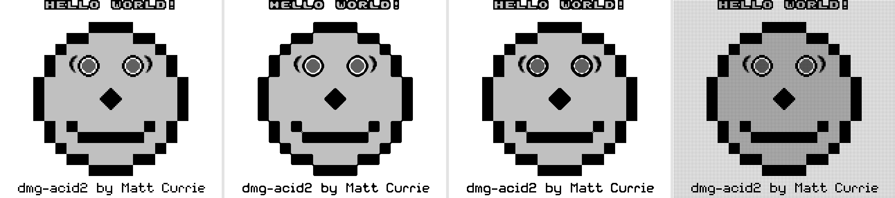

# Pixel-art upscaling

The DMG framebuffer is 160×144 with four shades. On any modern display that is
a postage stamp, and plain stretching only makes the blocks bigger. This
document records the survey of upscaling techniques, why this repo ships the
set it ships, the licensing constraints that shaped that choice, the measured
per-frame cost, and how to look at the evidence and pick with your own eyes.

The implementation is **`src/upscale/`** — a dependency-free core module
(framebuffer in, larger framebuffer out) shared by all three frontends. See
[Integration](#integration) for the config keys and hotkeys.

## Survey: what exists

### Interpolation / exact-match family

* **EPX / Scale2x / AdvMAME2x** — Eric Johnston (LucasArts, 1992), reinvented
  independently by Andrea Mazzoleni (2001) for AdvanceMAME; the two are
  confirmed identical ([scale2x.it](https://www.scale2x.it/scale2xandepx)).
  Each pixel becomes a 2×2 block; a corner copies a neighbour only when the
  two adjacent orthogonal neighbours match *exactly*. Scale3x generalises to
  3×3. No blending — output colours ⊆ input colours.
* **Eagle** (Dirk Stevens, late 90s) — checks diagonal triples instead;
  notorious for erasing lone single-pixel dots. Superseded by everything
  below; not shipped.
* **2xSaI / Super2xSaI / SuperEagle** (Derek "Kreed" Liauw Kie Fa) — 4×4
  neighbourhood with *interpolation blending*. On a 4-shade source the blend
  step invents off-palette intermediate greys. GPL source. Not shipped.

### Edge-directed

* **hqx (hq2x/3x/4x)** (Maxim Stepin, 2003) — classifies the 8 neighbours as
  close/distant using **YUV thresholds tuned for 16-bit colour**, then drives
  a large precomputed lookup table. LGPL-2.1, and the lookup tables are the
  load-bearing licensed artifact. On 2-bit greyscale the thresholds are
  trivially all-or-nothing, so hqx's extra machinery buys little over
  exact-match rules here. Not shipped.
* **xBR** (Hyllian, 2011) / **xBRZ** (Zenju) — colour-distance edge detection
  with interpolation. xBR's licensing is fragmented per port (LGPL lib, MIT
  Super-xBR ports); **xBRZ is GPLv3** and its rule set (not just code) is the
  author's copyrighted expression. Same "solves a colour problem we don't
  have" argument as hqx. Not shipped.
* **Omniscale** (Lior Halphon, SameBoy) — the one algorithm purpose-built and
  tuned on real Game Boy 4-shade output; arbitrary non-integer factors;
  Expat/MIT ([sameboy.github.io/scaling](https://sameboy.github.io/scaling/)).
  The best candidate for a future *vendored* addition, but it is coupled to
  SameBoy's codebase; extracting it was judged out of scope for round one.
* **MMPX** (Morgan McGuire & Mara Gagiu, JCGT 2021,
  [paper](https://jcgt.org/published/0010/02/04/),
  [project page](https://casual-effects.com/research/McGuire2021PixelArt/index.html))
  — *style-preserving* magnification designed explicitly for small,
  hard-edged, **limited-palette** pixel art: fills 1:1 and 2:1 slopes into
  smooth steps, refuses to erase single-pixel details, never outputs a colour
  absent from the source. Reference implementation is **MIT**. **Shipped.**

### Shaders / NN / research

* RetroArch's shader library: `crt-royale` (GPLv2+), `lcd-grid-v2` /
  `lcd3x` (per-file licences, lcd3x public domain), **ScaleFX** (Sp00kyFox,
  MIT) — the LCD-grid family, not the CRT family, is the right fit for a
  handheld LCD.
* NN super-resolution (ESRGAN/waifu2x): tuned for gradients, hallucinate on
  flat 4-shade art; not real-time-appropriate here. Kopf & Lischinski's
  "Depixelizing Pixel Art" (SIGGRAPH 2011) vectorises sprites — beautiful but
  far beyond a per-frame budget.

### Hardware precedent

* **Super Game Boy** does *no* upscaling: 1:1 pixels, palette substitution,
  and a border.
* **GameCube Game Boy Player** firmware ships selectable filters that
  literally include **scale2x** and **eagle2x** plus temporal deflicker — the
  family shipped here has real Nintendo-hardware precedent.
* **Analogue Pocket** chose its 1600×1440 panel as an exact 10× of 160×144
  and renders the DMG's **LCD subpixel grid + green tint** at native density —
  the hardware version of this repo's `lcd` algorithm + `green` palette.

## What ships, and the licensing line

| Algorithm | Factors | Origin | Licence status here |
|---|---|---|---|
| `nearest` | 1–6 | trivial | ours |
| `scale2x` | 2, 3, 4 (4 = 2×2) | EPX/Scale2x rule | **reimplemented from the published rule**; reference impl is GPL-2.0 and was not used |
| `mmpx` | 2, 4 (4 = 2×2) | McGuire & Gagiu, JCGT 2021 | ported from the **MIT** reference (attribution kept in `src/upscale/mod.rs`) |
| `lcd` | 2–6 | our own dot-matrix filter | ours; same visual family as lcd-grid shaders / Analogue Pocket |

Avoided on licence and/or fit: xBRZ (GPLv3), hqx (LGPL tables + 16-bit YUV
tuning), 2xSaI (GPL + off-palette blends), crt-royale (GPLv2+, and a CRT is
the wrong screen to imitate for a handheld).

Why these three beyond nearest: on a **four-shade** source, exact-match logic
(scale2x) and style-preserving rules (MMPX) are the algorithms that neither
degrade nor invent colours; MMPX is the "smooth curves from blocky sprites"
option, scale2x the cheaper classic with hardware precedent, and `lcd` covers
the other definition of gorgeous — looking like an actual Game Boy. The MMPX
port is verified **byte-identical** against the authors' reference
implementation on seeded 4-shade noise images (and the diagonal-line unit test
pins that behaviour).

## Integration

* **Core:** `gameboy::upscale::{Algorithm, Upscaler}`. `Upscaler::apply(&rgba,
  160, 144)` returns the upscaled RGBA slice; factor 1 is a true no-op.
  Runtime-switchable, allocation-free after the first frame, pure `std` —
  builds unchanged on `wasm32` and under `ffi`.
* **Terminal:** config keys in `~/.config/gameboy/config.toml` —
  `upscale = nearest|scale2x|mmpx|lcd` and `upscale_factor = N` (clamped to
  what the algorithm supports; `upscale = scale2x` alone picks ×2). Live keys
  in game: **`]`** cycles the algorithm, **`}`** cycles the factor (paired
  with `[` for palette). The upscale runs *after* palette mapping so the LCD
  grid survives the 4-shade bucketing; the upscaled image is what the terminal
  image protocol transmits.
* **Desktop:** reads the same config file; **`U`** cycles the algorithm,
  **`I`** the factor (window title shows the current choice). The upscaled
  frame is uploaded as the GL texture; the existing integer-scale +
  letterbox viewport then fits it to the window.
* **Browser:** starts at 1×; **`]`** cycles the algorithm, **`\`** the
  factor; the canvas resizes to match.
* **GPU vs CPU:** the desktop GL pipeline could do this in a fragment shader
  for near-zero CPU cost, but a CPU pre-pass was chosen deliberately: one
  implementation serves all three frontends identically, and the measured
  worst case (~1.6 ms, MMPX ×4) is under 10 % of the 16.7 ms frame budget. A
  shader port (or Omniscale) is a sensible follow-up if a cheaper desktop path
  is ever wanted.

## Measured cost

One real 160×144 frame, release build, Linux x86-64 (Fedora, this repo's
`examples/upscale_gallery.rs`; re-run it to measure your own machine — numbers
below are avg µs over 200 runs):

| Algorithm | ×2 | ×3 | ×4 | ×5 | ×6 |
|---|---|---|---|---|---|
| nearest | 214 | 459 | 810 | 1251 | 1800 |
| scale2x | 244 | 620 | 1015 | — | — |
| mmpx | 301 | — | 1259 | — | — |
| lcd | 423 | 904 | 1593 | 2462 | 3560 |

Everything is real-time with an order of magnitude of headroom (frame budget
16 743 µs); nothing had to be marked screenshot-only. Much of the cost is
plain memory traffic (the nearest row shows the floor per output size).

## Look at it and choose

**The author of this feature cannot judge how these look — the numbers above
prove speed, not beauty. A human has to pick the default.** The evidence:

  

<em>The choice, side by side: <strong>nearest | scale2x | mmpx | lcd</strong>,
one real emulated dmg-acid2 frame at ×4
(<a href="upscale-samples/compare-x4.png"><code>docs/upscale-samples/compare-x4.png</code></a>).
Look at the face outline and the eye circles — do curves smooth, or stay blocky? — at the
<code>HELLO WORLD!</code> text, which is where scale2x and mmpx disagree most, and at whether
the LCD grid reads as texture or as noise at your viewing size. dmg-acid2 is MIT-licensed,
which is why these samples can be committed at all.</em>

* **`docs/upscale-samples/`** (committed) — one real emulated dmg-acid2 frame
  through each algorithm. That is `compare-x4.png` above. Then `compare-x4-green.png` for the same with
  the DMG green palette, and `lcd-x4-green.png` for the full "it's a Game Boy"
  look. Things to look for: the face outline and eye circles (do curves smooth
  or stay blocky?), the "HELLO WORLD!" text (does it stay crisp or grow
  artifacts?), and whether the LCD grid reads as texture or as noise at your
  viewing size.
* **Any of your own ROMs:**
  `cargo run --release --example upscale_gallery -- path/to/game.gb
  --frames 700` writes the full set (plus `bench.txt`) to
  `target/upscale-gallery/<rom>/` — sprite-heavy scenes differentiate the
  algorithms far more than test patterns.
* Or just play: launch the terminal frontend and tap `]` / `}` in game.

The shipped default is `nearest` ×1 (no behaviour change until a human picks).
