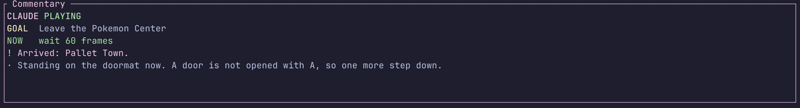

# `agent` — an AI that plays the game, under a budget

**An AI agent can watch this emulator and play it, and say what it is thinking while it does** —
built to be streamed, with a commentary panel a viewer can follow.

```bash
cargo build --release --features plugin-agent
GB_PLUGINS=agent \
GB_AGENT_CMD=tools/claude_plays/claude_api_adapter.py \
GB_AGENT_OBJECTIVE="Get out of the house and choose a starter Pokemon" \
  cargo run --release --example terminal -- ~/roms/blue.gb
```

`A` shows the commentary panel, `G` hands the controller back to a human.



*The panel, from a real run. A cold viewer gets the goal first, then what is happening now, then
a little history — never a scrolling log, which has moved on by the time a newcomer has read
enough of it to orient. Everything in it has been through the sanitiser.*

## The problem it exists to solve

**The model is slow and the game is not.** A round trip takes seconds; the Game Boy runs at
59.7 frames a second. Two obvious designs both fail: consulting the agent every frame costs a
fortune and achieves nothing, and letting the emulator *wait* on the agent turns a stream into
a slideshow.

The shape that works is **plan, then execute locally**:

```text
  snapshot ──▶ driver ──▶ plan (≤12 actions) ──▶ executor ──▶ hundreds of
     ▲          (slow)                            (local,      frames
     │                                             per-frame)     │
     └──────────── outcomes + what changed ◀──────────────────────┘
```

The agent is asked again only when the plan **finishes**, **fails**, or the world does
something it did not plan for (a battle starts, the map changes). One `advance_text` action
holds a whole conversation down. Measured on Pokémon Blue's opening: **about one model call
per 1,100 emulated frames.**

## The three non-negotiables, and where each lives

| rule | where |
|---|---|
| the emulator never blocks on the agent | `driver::Driver` is **polled, never awaited**; `subprocess::CommandDriver` runs the child on its own thread |
| a hard budget cap and a circuit breaker | `governor::Governor` — four independent ceilings (calls, tokens, spend, wall clock) and a breaker, **in the host**, where no driver can reach them |
| stuck detection with escalation | `governor::Stuck`, escalating nudge → insist → local intervention |

With a driver that never answers at all, emulation costs **0.24 ms/frame** against a 16.74 ms
budget — asserted in CI, not hoped for.

## It presses buttons; it cannot write memory

It declares `OBSERVE | READ_MEMORY | CONTROL_INPUT` and **not** `WRITE_MEMORY`. The status bar
marks it `>>` the moment it presses anything. A plugin that is playing your game must be
visible while it does.

## The agent is swappable

Nothing here knows what Claude is. A driver is *"here is the state, give me actions and
commentary"* and nothing more — it never receives a `Machine`, so it cannot press a button,
read memory or write a save. The host parses the reply, **clamps every number**, and performs
the plan itself.

That is what makes `driver::ScriptedDriver` a complete substitute for a model in tests: it goes
through the identical code path, which is how all of this is tested for free. Claude through
either shipped adapter, a scripted policy, a random walker, or you.

## Everything the panel shows is public and permanent

A driver error reaches a viewer as *"The agent hit a problem — trying again"* and **never** as
a path, a key or a stack trace. That is a deliberate rule of the commentary layer, not an
accident of formatting.

## The four seams, and where each is documented

Everything an integrator touches is one of these. Full field tables, clamps and real generated
payloads for all of them: **[`docs/agent-reference.md`](../../docs/agent-reference.md)**.

| seam | you implement | you receive | reference |
|---|---|---|---|
| **`Driver`** | `name` · `submit` · `poll` (· `cancel` · `take_stderr` · `costs_money`) | the snapshot as text; you return reply text | [§5](../../docs/agent-reference.md#5-the-agent-plugin-hooks-and-extension-points) |
| **a subprocess adapter** | a program: snapshot on stdin, JSON on stdout, exit 0 | the same snapshot | [§5a](../../docs/agent-reference.md#5a-the-subprocess-adapter-contract) |
| **`Plugin`** | `name` · `capabilities` · `status` · `on_event` | `Event::Frame` / `Event::SerialTransfer`, each with a `&mut Machine` | [`docs/plugins.md`](../../docs/plugins.md) |
| **`Config`** | nothing — you set fields | budget, limits, objective, log path, history depth | [§5d](../../docs/agent-reference.md#5d-configuration) |

The snapshot is schema `gbagent/1`; the reply is `{goal, say, plan, usage}`. Three real
snapshots and the replies to them, captured from a running cartridge, are in
[`docs/agent/examples/agent-snapshots.md`](../../docs/agent/examples/agent-snapshots.md).

The smallest adapter that works is fifteen lines
([`tools/agent-docs/hello_adapter.sh`](../../tools/agent-docs/hello_adapter.sh)); a working
skeleton that actually reads the snapshot is seventy
([`tools/agent-docs/canned_adapter.py`](../../tools/agent-docs/canned_adapter.py)).

## Layout

| file | what it holds |
|---|---|
| [`lib.rs`](src/lib.rs) | the `Plugin` impl and the plan/execute loop |
| [`observe.rs`](src/observe.rs) | the snapshot a driver is given |
| [`action.rs`](src/action.rs) | the action vocabulary and the local executor |
| [`governor.rs`](src/governor.rs) | the four ceilings, the circuit breaker, stuck detection |
| [`driver.rs`](src/driver.rs) | the driver trait and the scripted driver |
| [`subprocess.rs`](src/subprocess.rs) | running a driver program without blocking the frame |
| [`commentary.rs`](src/commentary.rs) | what a viewer sees, and what they must never see |
| [`json.rs`](src/json.rs) | a hand-rolled parser — no dependency enters the emulator for this |

## Tests

```bash
cargo test -p terminalgb-plugin-agent         # 50 unit tests
cargo test --release --test agent          # observation, executor, budget cap, breaker, stuck
```

The harness runs against a **hand-assembled Gen-1-shaped cartridge**, deterministically, with
no commercial ROM — so the budget cap and the circuit breaker are proved in CI rather than
described.

## Where to read next

| | |
|---|---|
| 📖 [**the agent reference**](../../docs/agent-reference.md) | **every hook, field and payload**, with real generated examples — start here if you are integrating |
| 🧪 [as an AI environment](../../docs/agent-environment.md) | determinism, headless throughput, save states as episode resets, recording a dataset, honest scoring |
| [full design + the OBS/Twitch recipe](../../docs/claude-plays.md) | why it is shaped this way, and the recorded runs |
| [agent play in Gen 1 terms](../../docs/gen1/agent-play.md) | the cartridge facts behind each primitive |
| [the MCP server](../../docs/mcp.md) | the same perception and executor, for any MCP client |
